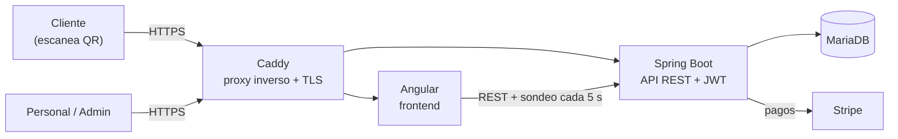
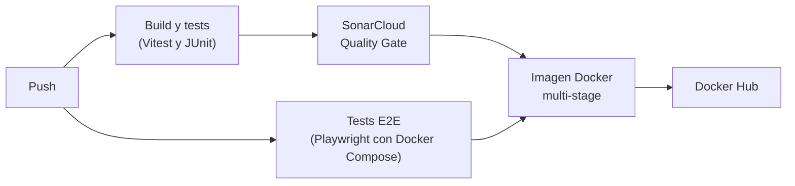

<div align="center">


# BarHub 2.0

### Carta digital por QR y gestión operativa para bares y restaurantes

Pedidos desde el móvil, comandas con actualización automática, control de caja y un ciclo de desarrollo pensado con la seguridad en mente.

<br>


[Funcionalidades](#funcionalidades) ·
[Arquitectura](#arquitectura) ·
[Seguridad y calidad](#seguridad-y-calidad) ·
[Estado](#estado-del-proyecto) ·
[Arranque](#arranque-en-local) ·
[Estructura](#estructura-del-repositorio) ·
[Documentación](#documentación)

</div>

---

## Sobre el proyecto

BarHub 2.0 es una aplicación full-stack para establecimientos de hostelería. El cliente escanea un QR, mira la carta y pide desde su móvil sin instalar nada. El personal gestiona mesas, comandas y cobros en efectivo con actualización automática, y la gerencia lleva el control de la caja y consulta estadísticas del negocio.

Es la segunda versión de mi TFC. Esta vez me he centrado en tres cosas: rediseñar la interfaz, añadir los módulos de caja y analítica, y trabajar el ciclo de vida seguro del software, con auditorías de dependencias, calidad de código y contenedores, integración continua y bastionado del servidor.

> [!NOTE]
> **Estado actual:** la aplicación funciona y está auditada en local. El despliegue en VPS y el SOC automático siguen en curso. Más abajo está el [estado detallado](#estado-del-proyecto).

---

## Funcionalidades

<table>
<tr>
<td width="33%" valign="top">

#### Cliente

- Carta digital interactiva por QR
- Pedido en mesa, a recoger o a domicilio
- Seguimiento del pedido con actualización automática cada 5 s
- Pago en efectivo y con tarjeta (Stripe en modo demostración, sin cargos reales)
- Registro de usuarios y perfil con foto
- Historial de pedidos

</td>
<td width="33%" valign="top">

#### Personal y sala

- Comandas y estado de mesas con actualización automática
- Confirmación de pagos en efectivo en barra y en mesa
- Apertura y cierre de caja con arqueo
- Control de descuadres por turno

</td>
<td width="33%" valign="top">

#### Administración

- Gestión de productos, precios y disponibilidad
- Gestión de mesas, pedidos y usuarios
- Roles: `admin`, `empleado` y `cliente`
- Métricas: ingresos, productos más vendidos y horas pico

</td>
</tr>
</table>

---

## Arquitectura



### Stack

| Capa | Tecnologías |
| :--- | :--- |
| **Backend** | Java 21, Spring Boot 4.2, Spring Security 7, JWT (jjwt 0.13), Gradle |
| **Frontend** | Angular 22 (build con esbuild), TypeScript 6, Bootstrap 5.3, Bootstrap Icons |
| **Base de datos** | MariaDB |
| **Infraestructura** | Docker (multi-stage), Docker Compose, Caddy, DuckDNS, Uptime Kuma, Mailpit (correo en local) |
| **Calidad y seguridad** | SonarQube / SonarCloud, Snyk, Trivy, GitHub Actions, Dependabot |

---

## Seguridad y calidad

He intentado tratar la seguridad como parte del desarrollo y no como algo que se pega al final. Estos son los resultados de las auditorías (el detalle y las capturas están en [`docs/`](./docs)):

| Herramienta | Alcance | Antes | Después |
| :--- | :--- | :---: | :---: |
| **SonarQube** (local) | Backend | 48 incidencias | 0 abiertas, Quality Gate superado |
| **SonarQube** (local) | Frontend | 1 de seguridad, 145 de fiabilidad, 173 de mantenibilidad | 0 abiertas, Quality Gate superado |
| **SonarCloud** (CI, 15-nov-2026) | Repositorio completo | 10 de seguridad (C), 49 de fiabilidad (C), 363 de mantenibilidad (A) | 0 de seguridad (A), 45 de fiabilidad (A), 363 de mantenibilidad (A) |
| **Snyk** | Dependencias del backend | 136 incidencias | 2 (reanálisis del 21-nov-2026, con Spring Boot 4.2): ninguna crítica y ninguna explotable, sin parche publicado ([detalle](docs/auditorias.md)) |
| **Snyk** | Dependencias del frontend | 29 incidencias | 0 (reanálisis del 21-nov-2026, con Angular 22) |
| **Trivy** | Dockerfiles | 1 HIGH y 2 LOW | 0 (usuario no root y `HEALTHCHECK`) |

> El Quality Gate de SonarCloud se evalúa sobre el código nuevo de cada versión (`sonar.projectVersion`) y está superado desde la 2.0.3: la cobertura se mide en el backend con JaCoCo y los avisos que quedan están revisados. Desde la 2.1 el frontend también tiene tests (Vitest) y su cobertura se envía a SonarCloud, de modo que el código nuevo del frontend tiene que cumplir el mismo 80 % que el backend.

> [!IMPORTANT]
> Los avisos de Spring Framework 6.2, Spring Security 6.5 y Angular 14 solo tenían corrección migrando de versión mayor. En la 2.1 el backend ya está en Spring Boot 4.2 (Spring Framework 7 y Spring Security 7) y el frontend en Angular 22: Dependabot ha pasado de 53 alertas abiertas a 1, y Snyk de 54 incidencias (29 + 25) a 2 en el backend, que no son explotables en BarHub y no tienen parche ([detalle](docs/auditorias.md)).

<!-- autenticacion -->
### Autenticación y sesiones

- Contraseñas con hash en la base de datos. Sesión con token de acceso JWT de 15 minutos y token de renovación rotatorio en una cookie `HttpOnly` y `SameSite=Strict`, con detección de reutilización. La sesión vive en el servidor: cerrar sesión la revoca al momento, y cada rol tiene su límite de inactividad y de duración (administrador 15 min / 8 h, empleado 30 min / 10 h, cliente 1 h / 12 h).
- Bloqueo temporal del inicio de sesión, por usuario y por IP: 5 intentos fallidos seguidos de un mismo usuario bloquean esa cuenta 15 minutos, y 20 fallos desde una misma IP (aunque sean contra cuentas distintas) bloquean esa IP 15 minutos. Responde 429 con `Retry-After`. También cuentan los usuarios que no existen, para no revelar cuáles existen.
- Verificación en dos pasos con una app de autenticación (TOTP, RFC 6238), obligatoria para el administrador y los empleados: la configuran en su primer inicio de sesión escaneando un código QR y no reciben ningún token hasta escribir el código del móvil. Un código no se acepta dos veces, los códigos incorrectos cuentan para el bloqueo del login y hay 10 códigos de recuperación de un solo uso para entrar sin el móvil. El secreto se guarda cifrado con AES-256-GCM y de los códigos de recuperación solo su HMAC.
- Para cambiar la propia contraseña hay que indicar la actual.

**Limitaciones conocidas** (decisiones asumidas en esta versión):

- El contador de intentos vive en la memoria del backend: se reinicia al reiniciar el servicio y no se comparte entre varias instancias. Con una sola instancia es suficiente; para escalar habría que moverlo a Redis o a la base de datos.
- El bloqueo por usuario permite que alguien bloquee a propósito la cuenta de otra persona durante 15 minutos (desde cualquier IP). Es el precio de frenar a quien prueba claves contra una cuenta desde muchas IP; el bloqueo por IP cubre el caso contrario.
- La primera configuración de la verificación en dos pasos la hace quien conoce la contraseña: el administrador y cada empleado tienen que activarla en cuanto tengan su cuenta. Una vez activa, cambiarla exige quitarla antes (ver *Arranque en local*).
- Los login a medias (contraseña correcta, falta el código) se guardan en memoria durante 5 minutos: si el backend se reinicia, hay que volver a escribir la contraseña.

### Pruebas de seguridad dinámicas

Además de las auditorías estáticas, he probado el backend en ejecución (instancia local con Docker Compose). Los resultados están en [`docs/evidencias/`](./docs/evidencias).

| Área | Qué se comprueba | Resultado |
| :--- | :--- | :---: |
| Registro | No se puede obtener el rol de admin o de empleado al registrarse | Verificado |
| Control de acceso | 25 rutas protegidas frente a anónimos y clientes (401 / 403) | 0 fallos |
| Propiedad de los datos | Un cliente no lee ni modifica el perfil de otro ni se asigna roles | Verificado |
| Pedidos | El servidor ignora los precios, el estado y el usuario enviados por el cliente | Verificado |
| JWT | Firma alterada y `alg=none` rechazados | Verificado |
| Subidas | Extensión, tipo, firma del fichero, tamaño y ruta | Verificado |
| Errores | Respuestas genéricas y `404` en recursos inexistentes | Verificado |
| Fuerza bruta en el login | Bloqueo tras 5 intentos fallidos (429 con `Retry-After`), cubierto por tests | Verificado ([prueba dinámica](docs/evidencias/seguridad-2026-11-22.md)) |

### Pipeline CI/CD



El pipeline compila el frontend, ejecuta sus tests (Vitest) y los del backend (JUnit), con cobertura de los dos, y lo analiza todo en SonarCloud. En paralelo levanta la aplicación completa con Docker Compose y la recorre con Playwright: registro, pedido con ticket en PDF, comandas, caja y panel de administración ([`e2e/`](./e2e)). La imagen solo se publica en Docker Hub si pasa todo.

<details>
<summary><b>Prácticas de seguridad aplicadas</b></summary>

<br>

- **Secretos fuera del repositorio:** las credenciales van en un `.env` ignorado por git, el `docker-compose.yml` solo las referencia y el repo incluye un [`.env.example`](./infra/docker/.env.example) sin valores reales.
- **Autenticación y autorización:** JWT, control de acceso por roles en el backend con regla por defecto de denegar, comprobación de propiedad en los datos de usuario (mismo `404` exista o no el recurso) y guardas de ruta en el frontend.
- **Datos del cliente no fiables:** el precio, el estado y el usuario de un pedido los calcula el servidor; el cliente no puede fijarlos.
- **Subidas de archivos:** extensión, Content-Type y firma del fichero comprobados, tamaño limitado, nombre generado en el servidor y borrado restringido a la carpeta de subidas.
- **Errores:** respuestas genéricas al cliente y detalle solo en el log del servidor.
- **Contenedores:** imágenes multi-stage, usuario no root, `HEALTHCHECK` y `.dockerignore` para no meter secretos en las imágenes.
- **Red:** solo Caddy publica puertos hacia fuera; base de datos, backend y frontend viven en una red interna de Docker.
- **Base de datos:** el backend se conecta a MariaDB con TLS 1.3 y certificado verificado, y el usuario de la aplicación tiene el TLS obligatorio (`REQUIRE SSL`): una conexión sin cifrar se rechaza ([evidencia](docs/evidencias/tls-mariadb-2026-11-20.md)).
- **Dependencias:** auditoría con Snyk, versiones de seguridad alineadas donde hace falta (restricciones de Gradle) y Dependabot para las actualizaciones.
- **Servidor:** script de bastionado del sistema Linux en [`seguridad/`](./seguridad).
- **Accesibilidad:** contrastes revisados para cumplir los mínimos de WCAG.
- **Divulgación responsable:** política de reporte de vulnerabilidades en [`SECURITY.md`](./SECURITY.md).

</details>

---

<!-- hoja-de-ruta -->
## Estado del proyecto

Versión publicada: **2.0.3** (20 de noviembre de 2026). Las tareas están ordenadas por prioridad dentro de cada versión.

### Hecho en 2.0.0

| Bloque | Estado |
| :--- | :--- |
| Base legal y estructura del repositorio | Hecho |
| Backend, base de datos y API REST | Hecho |
| Rediseño de la interfaz (cliente, personal y administración) | Hecho |
| Auditorías locales (Snyk, SonarQube, Trivy) | Hecho |
| Endurecimiento del backend y pruebas de seguridad dinámicas | Hecho |
| Pipeline CI/CD del frontend y análisis en SonarCloud (Quality Gate superado) | Hecho |
| Dependabot, acciones de GitHub fijadas por SHA y revisión de secretos con gitleaks | Hecho |

### Hecho en 2.0.1

| Bloque | Estado |
| :--- | :--- |
| Tests del backend (servicios, JWT, autenticación y permisos por rol) y cobertura con JaCoCo en SonarCloud | Hecho |
| Modo oscuro con contraste revisado (WCAG AA) en las pantallas públicas y de administración | Hecho |
| Bloqueo de intentos repetidos en el login, caducidad del token a 4 horas y contraseña actual para cambiarla | Hecho |
| Accesibilidad: avisos a lectores de pantalla, errores de formulario asociados a su campo y movimiento reducido | Hecho |
| Limpieza de configuración: conector de MariaDB, healthcheck, `DB_USERNAME` unificado, actuator y Caddyfile | Hecho |
| Prueba de escalada de privilegios con evidencia en `docs/evidencias` | Hecho |
| Despliegue verificado desde un clon limpio con Docker Compose | Hecho |

### Hecho en 2.0.2

| Bloque | Estado |
| :--- | :--- |
| Dominio del Caddyfile y orígenes CORS como variables de entorno (`SITE_ADDRESS` y `CORS_ALLOWED_ORIGINS`) | Hecho |
| Alertas de dependencias analizadas: limitaciones de Angular 14 documentadas en `SECURITY.md` y Dependabot ajustado a esa versión | Hecho |
| Actualizaciones seguras aplicadas (Gradle 8.14, acciones de GitHub y dependencias menores del frontend) y bloqueo de dependencias del backend regenerado | Hecho |
| Los `.jar` compilados ya no se versionan y la documentación de Caddy refleja la configuración real | Hecho |

### Hecho en 2.0.3

| Bloque | Estado |
| :--- | :--- |
| Tema oscuro sobre el modo de color nativo de Bootstrap 5.3, sin pisar a Bootstrap con `!important` (tema claro verificado idéntico con capturas automáticas) | Hecho |
| Estilos: `transition: all` sustituido por las propiedades que se animan y clases de Bootstrap adaptables al tema | Hecho |
| SonarCloud: quality gate superado; cobertura medida en el backend | Hecho |
| Dependencias del build parcheadas sin migrar (overrides en la misma rama) | Hecho |

### Hoja de ruta

**v2.1: migración de versiones y funcionalidades nuevas (no requieren servidor)**

La migración va primero, para que las funcionalidades nuevas se construyan ya sobre versiones con soporte.

| Prioridad | Tarea | Objetivo |
| :-: | :--- | :--- |
| 7 | Migración a Spring Boot 4.2 (Spring Framework 7, Spring Security 7 y Jackson 3), Java 21 y conexión con MariaDB cifrada | Hecho |
| 8 | Migración de Angular 14 a 22, versión a versión, con Node 24 y build con esbuild | Hecho |
| 9 | Tests del frontend con cobertura en SonarCloud | Medir el frontend igual que el backend |
| 10 | Información de alérgenos (los 14 del reglamento europeo) | Cumplimiento y confianza del cliente |
| 11 | Código QR por mesa | Pedir desde la mesa sin elegirla a mano |
| 12 | Varios idiomas (español, portugués e inglés) | Carta traducida, tras los alérgenos |
| 13 | Impresión de comandas | Flujo cocina y barra; pendiente decidir si hay pantalla en cocina |
| 14 | SOC en local | Monitorización y alertas probadas sin depender de un VPS |
| 15 | Stripe en modo de pruebas | Probar el flujo de pago completo sin cobros reales |

**Cuando haya servidor**

| Prioridad | Tarea | Objetivo |
| :-: | :--- | :--- |
| 16 | Despliegue en VPS con HTTPS y copias de seguridad | Aplicación accesible en producción |
| 17 | SOC en producción | Monitorización real |
| 18 | Stripe real | Último paso, tras validar todo en pruebas |

**Más adelante**

| Versión o momento | Tarea |
| :--- | :--- |
| Tras la migración | Revisión de los `!important` que quedan en el CSS |
| Con demo en producción | RGPD, cliente piloto y precio |
| Aparcado | Control de stock y analítica adicional |

---

## Arranque en local

Requisitos: Docker y Docker Compose.

```bash
git clone https://github.com/juanparejog/BarHub2.0.git
cd BarHub2.0/infra/docker
cp .env.example .env
docker compose up -d --build
```

Los secretos nunca se versionan: el `docker-compose.yml` los lee del `.env`. Todas las variables necesarias están descritas en [`.env.example`](./infra/docker/.env.example) y el despliegue se explica con más detalle en [`infra/README.md`](./infra/README.md).

En local la aplicación se sirve en `http://localhost`. Para cargar datos de demostración (productos, mesas y un administrador), pon `APP_SEED_DEMO=true` y una contraseña en `APP_SEED_ADMIN_PASSWORD` dentro del `.env`. Un cliente se obtiene registrándose en la propia aplicación y abriendo el enlace del correo de confirmación, que en local llega a **Mailpit** (`http://localhost:8025`, solo desde el propio equipo): captura todos los correos y no entrega ninguno. Un empleado se crea desde Administración, Gestionar Usuarios.

El administrador y los empleados configuran la verificación en dos pasos en su primer inicio de sesión, con una app de autenticación en el móvil (Google Authenticator, Microsoft Authenticator, Aegis...). Si alguien pierde el móvil y también los códigos de recuperación, se le quita desde la base de datos y la vuelve a configurar en su siguiente login (cambia `admin` por su usuario):

```sql
DELETE FROM codigos_recuperacion WHERE id_user = (SELECT id FROM users WHERE username = 'admin');
DELETE FROM segundo_factor WHERE id_user = (SELECT id FROM users WHERE username = 'admin');
```

El secreto de cada usuario se cifra con `APP_TOTP_CLAVE` (o, si no se define, con una clave derivada de `JWT_SECRET`). Si esa clave cambia, los códigos dejan de valer y hay que quitarla igual a quien la tuviera activada.

---

## Estructura del repositorio

```text
BarHub2.0/
├── .github/
│   ├── workflows/       Pipeline CI/CD
│   ├── dependabot.yml   Actualización automática de dependencias
│   └── CODEOWNERS       Revisión de pipeline, infra y bastionado
├── backend/             API REST (Spring Boot)
├── frontend/            Aplicación web (Angular)
├── e2e/                 Tests de extremo a extremo (Playwright)
├── infra/
│   ├── caddy/           Caddyfile (proxy inverso y HTTPS)
│   ├── docker/          docker-compose.yml y .env.example
│   └── mysql/           Configuración de la base de datos
├── seguridad/           Script de bastionado del sistema Linux
├── docs/                Documentación técnica, auditorías y evidencias de pruebas
├── CHANGELOG.md
├── LICENSE.md
├── NOTICE.md
├── SECURITY.md
└── README.md
```

---

## Documentación

| Documento | Contenido |
| :--- | :--- |
| [`docs/`](./docs) | Arquitectura, endpoints, modelo entidad-relación, frontend y auditorías |
| [`infra/`](./infra) | Despliegue con Docker Compose y configuración de Caddy |
| [`.env.example`](./infra/docker/.env.example) | Variables de entorno necesarias, sin secretos |
| [`SECURITY.md`](./SECURITY.md) | Cómo reportar una vulnerabilidad |
| [`CHANGELOG.md`](./CHANGELOG.md) | Historial de cambios por versión |
| [`LICENSE`](./LICENSE.md) | Términos de la licencia propietaria |
| [`NOTICE`](./NOTICE.md) | Aviso legal y reserva de derechos |

---

<div align="center">

**Juan Parejo García**
Desarrollo web full-stack y ciberseguridad

[](https://github.com/juanparejog)

<sub>© Juan Parejo García. Todos los derechos reservados.</sub>

</div>
