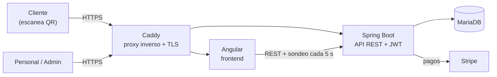
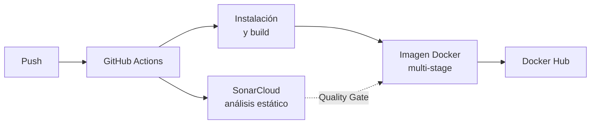

<div align="center">


# BarHub 2.0

### Carta digital por QR y gestión operativa para bares y restaurantes

Pedidos desde el móvil, comandas con actualización automática, control de caja y un ciclo de desarrollo pensado con la seguridad en mente.

<br>


[Funcionalidades](#funcionalidades) ·
[Arquitectura](#arquitectura) ·
[Seguridad y calidad](#seguridad-y-calidad) ·
[Estado](#estado-del-proyecto) ·
[Arranque](#arranque-en-local) ·
[Estructura](#estructura-del-repositorio) ·
[Documentación](#documentación)

</div>

---

## Sobre el proyecto

BarHub 2.0 es una aplicación full-stack para establecimientos de hostelería. El cliente escanea un QR, mira la carta y pide desde su móvil sin instalar nada. El personal gestiona mesas, comandas y cobros en efectivo con actualización automática, y la gerencia lleva el control de la caja y consulta estadísticas del negocio.

Es la segunda versión de mi TFC. Esta vez me he centrado en tres cosas: rediseñar la interfaz, añadir los módulos de caja y analítica, y trabajar el ciclo de vida seguro del software, con auditorías de dependencias, calidad de código y contenedores, integración continua y bastionado del servidor.

> [!NOTE]
> **Estado actual:** la aplicación funciona y está auditada en local. El despliegue en VPS y el SOC automático siguen en curso. Más abajo está el [estado detallado](#estado-del-proyecto).

---

## Funcionalidades

<table>
<tr>
<td width="33%" valign="top">

#### Cliente

- Carta digital interactiva por QR
- Pedido en mesa, a recoger o a domicilio
- Seguimiento del pedido con actualización automática cada 5 s
- Pago en efectivo y con tarjeta (Stripe en modo demostración, sin cargos reales)
- Registro de usuarios y perfil con foto
- Historial de pedidos

</td>
<td width="33%" valign="top">

#### Personal y sala

- Comandas y estado de mesas con actualización automática
- Confirmación de pagos en efectivo en barra y en mesa
- Apertura y cierre de caja con arqueo
- Control de descuadres por turno

</td>
<td width="33%" valign="top">

#### Administración

- Gestión de productos, precios y disponibilidad
- Gestión de mesas, pedidos y usuarios
- Roles: `admin`, `empleado` y `cliente`
- Métricas: ingresos, productos más vendidos y horas pico

</td>
</tr>
</table>

---

## Arquitectura



### Stack

| Capa | Tecnologías |
| :--- | :--- |
| **Backend** | Java 17, Spring Boot 3.5.16, Spring Security, JWT (jjwt 0.12.5), Gradle |
| **Frontend** | Angular 14, TypeScript, Tailwind CSS, PrimeNG |
| **Base de datos** | MariaDB |
| **Infraestructura** | Docker (multi-stage), Docker Compose, Caddy, DuckDNS, Uptime Kuma |
| **Calidad y seguridad** | SonarQube / SonarCloud, Snyk, Trivy, GitHub Actions, Dependabot |

---

## Seguridad y calidad

He intentado tratar la seguridad como parte del desarrollo y no como algo que se pega al final. Estos son los resultados de las auditorías (el detalle y las capturas están en [`docs/`](./docs)):

| Herramienta | Alcance | Antes | Después |
| :--- | :--- | :---: | :---: |
| **SonarQube** (local) | Backend | 48 incidencias | 0 abiertas, Quality Gate superado |
| **SonarQube** (local) | Frontend | 1 de seguridad, 145 de fiabilidad, 173 de mantenibilidad | 0 abiertas, Quality Gate superado |
| **SonarCloud** (CI, 15-nov-2026) | Repositorio completo | 10 de seguridad (C), 49 de fiabilidad (C), 363 de mantenibilidad (A) | 0 de seguridad (A), 45 de fiabilidad (A), 363 de mantenibilidad (A) |
| **Snyk** | Dependencias del backend | 136 incidencias | 29 (reanálisis del 15-nov-2026), de Spring Framework 6.2 y Spring Security 6.5 |
| **Snyk** | Dependencias del frontend | 29 incidencias | 25 (reanálisis del 15-nov-2026), 24 de Angular 14 sin soporte |
| **Trivy** | Dockerfiles | 1 HIGH y 2 LOW | 0 (usuario no root y `HEALTHCHECK`) |

> El Quality Gate de SonarCloud se evalúa sobre el código posterior a la versión 2.0.0 (`sonar.projectVersion`). La cobertura global es del 0 % porque todavía no se envían informes de tests, y la duplicación global es del 1,7 %. Los 45 avisos de fiabilidad restantes son de gravedad baja, casi todos imágenes sin texto alternativo, y están en la hoja de ruta.

> [!IMPORTANT]
> Lo que queda en Snyk son avisos de Spring Framework 6.2 y Spring Security 6.5 (sus correcciones solo existen en la serie 7, Spring Boot 4) y de Angular 14, sin soporte. Ambas migraciones están documentadas como deuda técnica y en la [hoja de ruta](#estado-del-proyecto).

<!-- autenticacion -->
### Autenticación y sesiones

- Contraseñas con hash en la base de datos y sesión mediante token JWT sin estado, que caduca a las 4 horas.
- Bloqueo temporal del inicio de sesión: 5 intentos fallidos seguidos de un mismo usuario bloquean el acceso 15 minutos (respuesta 429 con `Retry-After`). También cuentan los usuarios que no existen, para no revelar cuáles existen.
- Para cambiar la propia contraseña hay que indicar la actual.

**Limitaciones conocidas** (decisiones asumidas en esta versión):

- El contador de intentos vive en la memoria del backend: se reinicia al reiniciar el servicio y no se comparte entre varias instancias. Con una sola instancia es suficiente; para escalar habría que moverlo a Redis o a la base de datos.
- El bloqueo es por usuario, no por dirección IP. Alguien podría bloquear a propósito la cuenta de otra persona durante 15 minutos. La mejora sería combinar usuario e IP.
- Los tokens no se pueden revocar antes de caducar (por ejemplo, al cambiar la contraseña): siguen siendo válidos hasta las 4 horas.

### Pruebas de seguridad dinámicas

Además de las auditorías estáticas, he probado el backend en ejecución (instancia local con Docker Compose). Los resultados están en [`docs/evidencias/`](./docs/evidencias).

| Área | Qué se comprueba | Resultado |
| :--- | :--- | :---: |
| Registro | No se puede obtener el rol de admin o de empleado al registrarse | Verificado |
| Control de acceso | 25 rutas protegidas frente a anónimos y clientes (401 / 403) | 0 fallos |
| Propiedad de los datos | Un cliente no lee ni modifica el perfil de otro ni se asigna roles | Verificado |
| Pedidos | El servidor ignora los precios, el estado y el usuario enviados por el cliente | Verificado |
| JWT | Firma alterada y `alg=none` rechazados | Verificado |
| Subidas | Extensión, tipo, firma del fichero, tamaño y ruta | Verificado |
| Errores | Respuestas genéricas y `404` en recursos inexistentes | Verificado |
| Fuerza bruta en el login | Todavía sin bloqueo | Pendiente |

### Pipeline CI/CD



Ahora mismo el pipeline compila el frontend, lo analiza en SonarCloud y publica la imagen en Docker Hub. El pipeline del backend (compilación, tests y cobertura) está pendiente.

<details>
<summary><b>Prácticas de seguridad aplicadas</b></summary>

<br>

- **Secretos fuera del repositorio:** las credenciales van en un `.env` ignorado por git, el `docker-compose.yml` solo las referencia y el repo incluye un [`.env.example`](./infra/docker/.env.example) sin valores reales.
- **Autenticación y autorización:** JWT, control de acceso por roles en el backend con regla por defecto de denegar, comprobación de propiedad en los datos de usuario (mismo `404` exista o no el recurso) y guardas de ruta en el frontend.
- **Datos del cliente no fiables:** el precio, el estado y el usuario de un pedido los calcula el servidor; el cliente no puede fijarlos.
- **Subidas de archivos:** extensión, Content-Type y firma del fichero comprobados, tamaño limitado, nombre generado en el servidor y borrado restringido a la carpeta de subidas.
- **Errores:** respuestas genéricas al cliente y detalle solo en el log del servidor.
- **Contenedores:** imágenes multi-stage, usuario no root, `HEALTHCHECK` y `.dockerignore` para no meter secretos en las imágenes.
- **Red:** solo Caddy publica puertos hacia fuera; base de datos, backend y frontend viven en una red interna de Docker.
- **Dependencias:** auditoría con Snyk, versiones de seguridad forzadas donde hace falta (`overrides`) y Dependabot para las actualizaciones.
- **Servidor:** script de bastionado del sistema Linux en [`seguridad/`](./seguridad).
- **Accesibilidad:** contrastes revisados para cumplir los mínimos de WCAG.
- **Divulgación responsable:** política de reporte de vulnerabilidades en [`SECURITY.md`](./SECURITY.md).

</details>

---

<!-- hoja-de-ruta -->
## Estado del proyecto

Versión publicada: **2.0.2** (19 de noviembre de 2026). Las tareas están ordenadas por prioridad dentro de cada versión.

### Hecho en 2.0.0

| Bloque | Estado |
| :--- | :--- |
| Base legal y estructura del repositorio | Hecho |
| Backend, base de datos y API REST | Hecho |
| Rediseño de la interfaz (cliente, personal y administración) | Hecho |
| Auditorías locales (Snyk, SonarQube, Trivy) | Hecho |
| Endurecimiento del backend y pruebas de seguridad dinámicas | Hecho |
| Pipeline CI/CD del frontend y análisis en SonarCloud (Quality Gate superado) | Hecho |
| Dependabot, acciones de GitHub fijadas por SHA y revisión de secretos con gitleaks | Hecho |

### Hecho en 2.0.1

| Bloque | Estado |
| :--- | :--- |
| Tests del backend (servicios, JWT, autenticación y permisos por rol) y cobertura con JaCoCo en SonarCloud | Hecho |
| Modo oscuro con contraste revisado (WCAG AA) en las pantallas públicas y de administración | Hecho |
| Bloqueo de intentos repetidos en el login, caducidad del token a 4 horas y contraseña actual para cambiarla | Hecho |
| Accesibilidad: avisos a lectores de pantalla, errores de formulario asociados a su campo y movimiento reducido | Hecho |
| Limpieza de configuración: conector de MariaDB, healthcheck, `DB_USERNAME` unificado, actuator y Caddyfile | Hecho |
| Prueba de escalada de privilegios con evidencia en `docs/evidencias` | Hecho |
| Despliegue verificado desde un clon limpio con Docker Compose | Hecho |

### Hecho en 2.0.2

| Bloque | Estado |
| :--- | :--- |
| Dominio del Caddyfile y orígenes CORS como variables de entorno (`SITE_ADDRESS` y `CORS_ALLOWED_ORIGINS`) | Hecho |
| Alertas de dependencias analizadas: limitaciones de Angular 14 documentadas en `SECURITY.md` y Dependabot ajustado a esa versión | Hecho |
| Actualizaciones seguras aplicadas (Gradle 8.14, acciones de GitHub y dependencias menores del frontend) y bloqueo de dependencias del backend regenerado | Hecho |
| Los `.jar` compilados ya no se versionan y la documentación de Caddy refleja la configuración real | Hecho |

### Hoja de ruta

**v2.0.3: pendiente de la 2.0.2**

| Tarea | Objetivo |
| :--- | :--- |
| Lote de avisos CSS de SonarCloud (`!important`, `transition: all`) | Hojas de estilo más mantenibles |

**v2.1: funcionalidades nuevas (no requieren servidor)**

| Prioridad | Tarea | Objetivo |
| :-: | :--- | :--- |
| 7 | Información de alérgenos (los 14 del reglamento europeo) | Cumplimiento y confianza del cliente |
| 8 | Código QR por mesa | Pedir desde la mesa sin elegirla a mano |
| 9 | Varios idiomas (español, portugués e inglés) | Carta traducida, tras los alérgenos |
| 10 | Impresión de comandas | Flujo cocina y barra; pendiente decidir si hay pantalla en cocina |
| 11 | SOC en local | Monitorización y alertas probadas sin depender de un VPS |
| 12 | Stripe en modo de pruebas | Probar el flujo de pago completo sin cobros reales |

**Cuando haya servidor**

| Prioridad | Tarea | Objetivo |
| :-: | :--- | :--- |
| 13 | Despliegue en VPS con HTTPS y copias de seguridad | Aplicación accesible en producción |
| 14 | SOC en producción | Monitorización real |
| 15 | Stripe real | Último paso, tras validar todo en pruebas |

**Más adelante**

| Versión o momento | Tarea |
| :--- | :--- |
| v2.2 | Migración a Spring Boot 4 y a una versión de Angular con soporte |
| Con demo en producción | RGPD, cliente piloto y precio |
| Aparcado | Control de stock y analítica adicional |

---

## Arranque en local

Requisitos: Docker y Docker Compose.

```bash
git clone https://github.com/juanparejog/BarHub2.0.git
cd BarHub2.0/infra/docker
cp .env.example .env
docker compose up -d --build
```

Los secretos nunca se versionan: el `docker-compose.yml` los lee del `.env`. Todas las variables necesarias están descritas en [`.env.example`](./infra/docker/.env.example) y el despliegue se explica con más detalle en [`infra/README.md`](./infra/README.md).

En local la aplicación se sirve en `http://localhost`. Para cargar datos de demostración (productos, mesas y un administrador), pon `APP_SEED_DEMO=true` y una contraseña en `APP_SEED_ADMIN_PASSWORD` dentro del `.env`. Un cliente se obtiene registrándose en la propia aplicación, y un empleado asignando el rol desde Administración, Gestionar Usuarios.

---

## Estructura del repositorio

```text
BarHub2.0/
├── .github/
│   ├── workflows/       Pipeline CI/CD
│   ├── dependabot.yml   Actualización automática de dependencias
│   └── CODEOWNERS       Revisión de pipeline, infra y bastionado
├── backend/             API REST (Spring Boot)
├── frontend/            Aplicación web (Angular)
├── infra/
│   ├── caddy/           Caddyfile (proxy inverso y HTTPS)
│   ├── docker/          docker-compose.yml y .env.example
│   └── mysql/           Configuración de la base de datos
├── seguridad/           Script de bastionado del sistema Linux
├── docs/                Documentación técnica, auditorías y evidencias de pruebas
├── CHANGELOG.md
├── LICENSE.md
├── NOTICE.md
├── SECURITY.md
└── README.md
```

---

## Documentación

| Documento | Contenido |
| :--- | :--- |
| [`docs/`](./docs) | Arquitectura, endpoints, modelo entidad-relación, frontend y auditorías |
| [`infra/`](./infra) | Despliegue con Docker Compose y configuración de Caddy |
| [`.env.example`](./infra/docker/.env.example) | Variables de entorno necesarias, sin secretos |
| [`SECURITY.md`](./SECURITY.md) | Cómo reportar una vulnerabilidad |
| [`CHANGELOG.md`](./CHANGELOG.md) | Historial de cambios por versión |
| [`LICENSE`](./LICENSE.md) | Términos de la licencia propietaria |
| [`NOTICE`](./NOTICE.md) | Aviso legal y reserva de derechos |

---

<div align="center">

**Juan Parejo García**
Desarrollo web full-stack y ciberseguridad

[](https://github.com/juanparejog)

<sub>© Juan Parejo García. Todos los derechos reservados.</sub>

</div>
