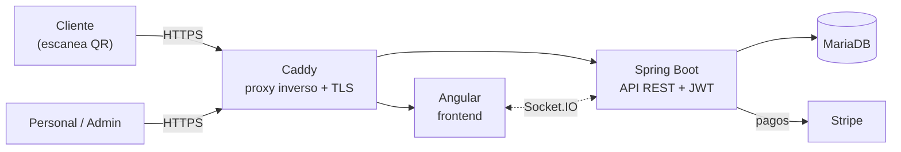
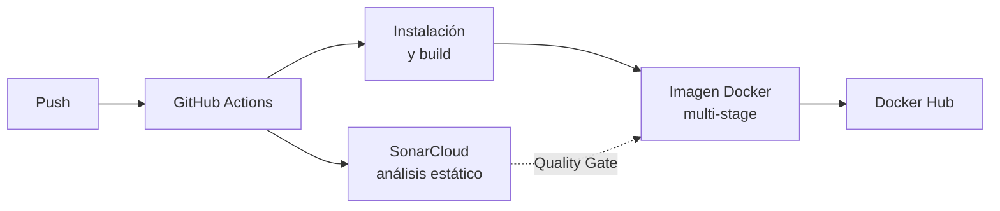

<div align="center">


# BarHub 2.0

### Carta digital por QR y gestión operativa para bares y restaurantes

Pedidos desde el móvil, comandas en tiempo real, control de caja y un ciclo de desarrollo pensado con la seguridad en mente.

<br>


[Funcionalidades](#funcionalidades) ·
[Arquitectura](#arquitectura) ·
[Seguridad y calidad](#seguridad-y-calidad) ·
[Estado](#estado-del-proyecto) ·
[Arranque](#arranque-en-local) ·
[Estructura](#estructura-del-repositorio) ·
[Documentación](#documentación)

</div>

---

## Sobre el proyecto

BarHub 2.0 es una aplicación full-stack para establecimientos de hostelería. El cliente escanea un QR, mira la carta y pide desde su móvil sin instalar nada. El personal gestiona mesas, comandas y cobros en efectivo en tiempo real, y la gerencia lleva el control de la caja y consulta estadísticas del negocio.

Es la segunda versión de mi TFC. Esta vez me he centrado en tres cosas: rediseñar la interfaz, añadir los módulos de caja y analítica, y trabajar el ciclo de vida seguro del software, con auditorías de dependencias, calidad de código y contenedores, integración continua y bastionado del servidor.

> [!NOTE]
> **Estado actual:** la aplicación funciona y está auditada en local. El despliegue en VPS y el SOC automático siguen en curso. Más abajo está el [estado detallado](#estado-del-proyecto).

---

## Funcionalidades

<table>
<tr>
<td width="33%" valign="top">

#### Cliente

- Carta digital interactiva por QR
- Pedido en mesa, a recoger o a domicilio
- Seguimiento del pedido en tiempo real
- Pago con Stripe o en efectivo
- Registro con verificación por correo
- Perfil, historial y puntos de fidelización

</td>
<td width="33%" valign="top">

#### Personal y sala

- Comandas y estado de mesas en tiempo real
- Confirmación de pagos en efectivo en barra y en mesa
- Apertura y cierre de caja con arqueo
- Control de descuadres por turno

</td>
<td width="33%" valign="top">

#### Administración

- Gestión de productos, precios y disponibilidad
- Gestión de mesas, pedidos y usuarios
- Roles: `admin`, `empleado` y `cliente`
- Métricas: ingresos, productos más vendidos y horas pico

</td>
</tr>
</table>

---

## Arquitectura



### Stack

| Capa | Tecnologías |
| :--- | :--- |
| **Backend** | Java 17, Spring Boot 3.4.3, Spring Security, JWT (jjwt 0.12.5), Gradle |
| **Frontend** | Angular, TypeScript, Tailwind CSS, PrimeNG, Socket.IO |
| **Base de datos** | MariaDB |
| **Infraestructura** | Docker (multi-stage), Docker Compose, Caddy, DuckDNS, Uptime Kuma |
| **Calidad y seguridad** | SonarQube / SonarCloud, Snyk, Trivy, GitHub Actions, Dependabot |

---

## Seguridad y calidad

He intentado tratar la seguridad como parte del desarrollo y no como algo que se pega al final. Estos son los resultados de las auditorías (el detalle y las capturas están en [`docs/`](./docs)):

| Herramienta | Alcance | Antes | Después |
| :--- | :--- | :---: | :---: |
| **SonarQube** (local) | Backend | 48 incidencias | 0 abiertas, Quality Gate superado |
| **SonarQube** (local) | Frontend | 1 de seguridad, 145 de fiabilidad, 173 de mantenibilidad | 0 abiertas, Quality Gate superado |
| **Snyk** | Dependencias del backend | 136 incidencias | 129, transitivas del framework |
| **Snyk** | Dependencias del frontend | 29 incidencias | 22, ligadas a la versión de Angular |
| **Trivy** | Dockerfiles | 1 HIGH y 2 LOW | 0 (usuario no root y `HEALTHCHECK`) |

> [!IMPORTANT]
> Lo que queda en Snyk son dependencias transitivas del framework y la migración mayor de Angular. Lo tengo documentado como deuda técnica y está en la [hoja de ruta](#estado-del-proyecto).

### Pipeline CI/CD



Ahora mismo el pipeline cubre el frontend. El primer análisis en SonarCloud y el pipeline del backend están pendientes.

<details>
<summary><b>Prácticas de seguridad aplicadas</b></summary>

<br>

- **Secretos fuera del repositorio:** las credenciales van en un `.env` ignorado por git, el `docker-compose.yml` solo las referencia y el repo incluye un [`.env.example`](./infra/docker/.env.example) sin valores reales.
- **Autenticación y autorización:** JWT con control de acceso por roles en el backend y guardas de ruta en el frontend.
- **Contenedores:** imágenes multi-stage, usuario no root, `HEALTHCHECK` y `.dockerignore` para no meter secretos en las imágenes.
- **Red:** solo Caddy publica puertos hacia fuera; base de datos, backend y frontend viven en una red interna de Docker.
- **Dependencias:** auditoría con Snyk, versiones de seguridad forzadas donde hace falta (`overrides`) y Dependabot para las actualizaciones.
- **Servidor:** script de bastionado del sistema Linux en [`seguridad/`](./seguridad).
- **Accesibilidad:** contrastes revisados para cumplir los mínimos de WCAG.
- **Divulgación responsable:** política de reporte de vulnerabilidades en [`SECURITY.md`](./SECURITY.md).

</details>

---

## Estado del proyecto

| Bloque | Estado |
| :--- | :--- |
| Base legal y estructura del repositorio | Hecho |
| Backend, base de datos y API REST | Hecho |
| Rediseño de la interfaz (cliente, personal y administración) | Hecho |
| Auditorías locales (Snyk, SonarQube, Trivy) | Hecho |
| Pipeline CI/CD del frontend | Hecho |
| Primer análisis en SonarCloud | En curso |
| Despliegue en VPS con HTTPS | En curso |
| Dependabot y escaneo de secretos en GitHub | En curso |
| Pipeline CI/CD del backend | Pendiente |
| SOC automático (monitorización y alertas) | Pendiente |
| Migración de Angular a una versión con soporte | Pendiente |
| Más cobertura de tests | Pendiente |

---

## Arranque en local

Requisitos: Docker y Docker Compose.

```bash
git clone https://github.com/juanparejog/BarHub2.0.git
cd BarHub2.0/infra/docker
cp .env.example .env
docker compose up -d --build
```

Los secretos nunca se versionan: el `docker-compose.yml` los lee del `.env`. Todas las variables necesarias están descritas en [`.env.example`](./infra/docker/.env.example) y el despliegue se explica con más detalle en [`infra/README.md`](./infra/README.md).

---

## Estructura del repositorio

```text
BarHub2.0/
├── .github/
│   ├── workflows/       Pipeline CI/CD
│   ├── dependabot.yml   Actualización automática de dependencias
│   └── CODEOWNERS       Revisión de pipeline, infra y bastionado
├── backend/             API REST (Spring Boot)
├── frontend/            Aplicación web (Angular)
├── infra/
│   ├── caddy/           Caddyfile (proxy inverso y HTTPS)
│   ├── docker/          docker-compose.yml y .env.example
│   └── mysql/           Configuración de la base de datos
├── seguridad/           Script de bastionado del sistema Linux
├── docs/                Documentación técnica y auditorías
├── CHANGELOG.md
├── LICENSE.md
├── NOTICE.md
├── SECURITY.md
└── README.md
```

---

## Documentación

| Documento | Contenido |
| :--- | :--- |
| [`docs/`](./docs) | Arquitectura, endpoints, modelo entidad-relación, frontend y auditorías |
| [`infra/`](./infra) | Despliegue con Docker Compose y configuración de Caddy |
| [`.env.example`](./infra/docker/.env.example) | Variables de entorno necesarias, sin secretos |
| [`SECURITY.md`](./SECURITY.md) | Cómo reportar una vulnerabilidad |
| [`CHANGELOG.md`](./CHANGELOG.md) | Historial de cambios por versión |
| [`LICENSE`](./LICENSE.md) | Términos de la licencia propietaria |
| [`NOTICE`](./NOTICE.md) | Aviso legal y reserva de derechos |

---

<div align="center">

**Juan Parejo García**
Desarrollo web full-stack y ciberseguridad

[](https://github.com/juanparejog)

<sub>© Juan Parejo García. Todos los derechos reservados.</sub>

</div>