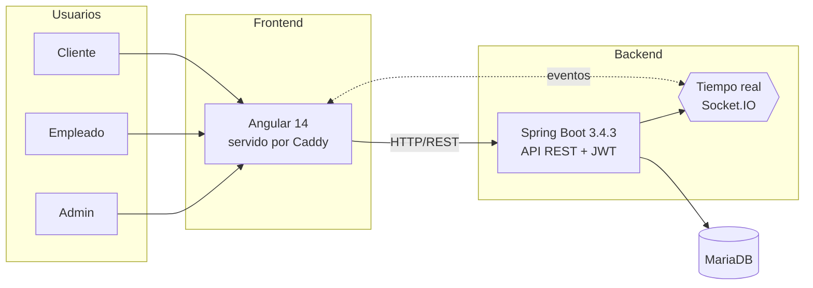

<p align="center">
  
</p>

<h1 align="center">BarHub 2.0 · Documentación</h1>

<p align="center">
  Plataforma digital para la gestión integral de bares y restaurantes:<br>
  carta digital, pedidos en mesa / a recoger / a domicilio, comandas en tiempo real y control de caja.
</p>

> Los puntos marcados con `⚠️ Verificar` son datos que no constan en la documentación original y deben contrastarse con el código antes de la entrega.

---

## Mapa de la documentación

| Documento | Para quién | Qué encontrarás |
| :--- | :--- | :--- |
| [producto/cliente.md](producto/cliente.md) | Clientes y evaluadores | Escanear QR, hacer pedido, seguimiento y perfil |
| [producto/empleado.md](producto/empleado.md) | Personal de sala y cocina | Comandas, mesas, pagos en efectivo y caja |
| [producto/admin.md](producto/admin.md) | Gerencia | Productos, usuarios y métricas |
| [backend.md](backend.md) | Desarrollo | Arquitectura, endpoints, roles y tiempo real |
| [frontend.md](frontend.md) | Desarrollo | Módulos, rutas, guardas y estilos |
| [base-de-datos.md](base-de-datos.md) | Desarrollo / BBDD | Modelo ER, tablas y relaciones |
| [seguridad.md](seguridad.md) | Seguridad | Prácticas aplicadas y modelo de amenazas |
| [auditorias.md](auditorias.md) | Calidad / seguridad | Snyk, SonarQube y Trivy con capturas |
| [infraestructura.md](infraestructura.md) | DevOps | Docker, Caddy, CI/CD, despliegue y SOC |

## Visión general



## Roles y qué puede hacer cada uno

| Capacidad | Cliente | Empleado | Admin |
| :--- | :---: | :---: | :---: |
| Ver carta y hacer pedidos | ✅ | ✅ | ✅ |
| Seguimiento de sus pedidos | ✅ | — | — |
| Gestionar comandas y mesas | — | ✅ | ✅ |
| Registrar pagos en efectivo | — | ✅ | ✅ |
| Abrir y cerrar caja | — | ✅ | ✅ |
| CRUD de productos, usuarios, pedidos y mesas | — | — | ✅ |
| Métricas del negocio | — | — | ✅ |

## Stack en una línea

| Capa | Tecnología |
| :--- | :--- |
| Frontend | Angular 14 · `ngx-socket-io` · Karma/Jasmine |
| Backend | Java · Spring Boot 3.4.3 · Gradle · JWT (`jjwt 0.12.5`) |
| Base de datos | MariaDB |
| Tiempo real | Socket.IO |
| Contenedores | Docker multi-etapa (Node.js + Caddy) |
| CI/CD | GitHub Actions · SonarCloud · Docker Hub |
| Auditoría | Snyk · SonarQube · Trivy |

## Estructura de este directorio

```
docs/
├── README.md
├── producto/          cliente · empleado · admin
├── backend.md
├── frontend.md
├── base-de-datos.md
├── seguridad.md
├── auditorias.md
├── infraestructura.md
└── img/               logo, modelo ER y capturas de auditoría
```