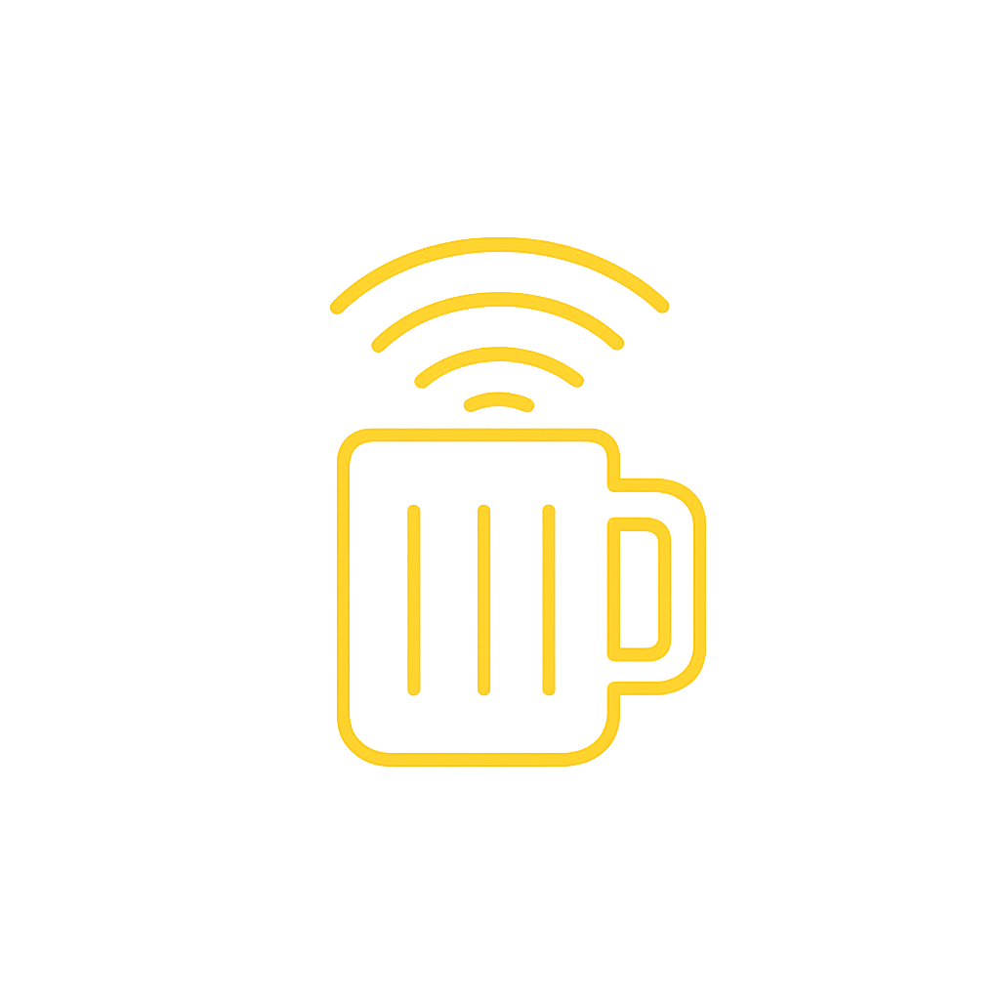
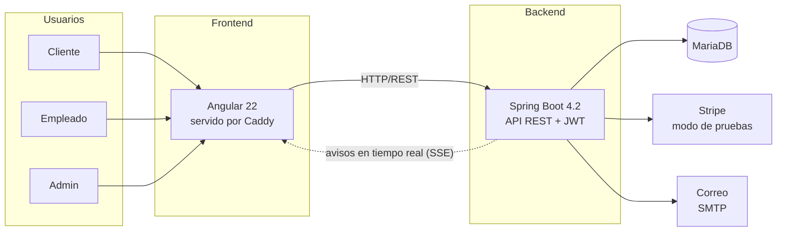

<p align="center">
  
</p>

<h1 align="center">BarHub 2.0 · Documentación</h1>

<p align="center">
  Plataforma digital para la gestión integral de bares y restaurantes:<br>
  carta digital en tres idiomas, pedidos en mesa / a recoger / a domicilio con pago en efectivo o con tarjeta,<br>
  comandas en tiempo real, control de caja, registro de jornada y auditoría.
</p>

---

## Mapa de la documentación

| Documento | Para quién | Qué encontrarás |
| :--- | :--- | :--- |
| [producto/cliente.md](producto/cliente.md) | Clientes y evaluadores | Escanear el QR, hacer un pedido, pagar, seguirlo y gestionar la cuenta |
| [producto/empleado.md](producto/empleado.md) | Personal de sala y cocina | Comandas, mesas, pagos en efectivo y caja |
| [producto/admin.md](producto/admin.md) | Gerencia | Productos, usuarios, mesas, pedidos, métricas, registro de jornada y auditoría |
| [backend.md](backend.md) | Desarrollo | Arquitectura, endpoints, roles y actualización de datos |
| [frontend.md](frontend.md) | Desarrollo | Módulos, rutas, guardas, tiempo real, estilos e idiomas |
| [base-de-datos.md](base-de-datos.md) | Desarrollo / BBDD | Tablas del negocio y de seguridad, relaciones y enumerados |
| [seguridad.md](seguridad.md) | Seguridad | Prácticas aplicadas, autenticación, modelo de amenazas, pruebas dinámicas y limitaciones |
| [auditorias.md](auditorias.md) | Calidad / seguridad | Snyk, SonarQube y SonarCloud, Trivy, Dependabot y pruebas dinámicas |
| [evidencias/](evidencias/cierre-2.1-2026-11-28.md) | Calidad / seguridad | Resultados de las pruebas: pasada final de la 2.1, pruebas de seguridad y TLS con MariaDB |
| [infraestructura.md](infraestructura.md) | DevOps | Docker, Caddy, CI/CD, despliegue y monitorización del servidor |
| [../seguridad/soc/README.md](../seguridad/soc/README.md) | Seguridad / DevOps | SOC: arquitectura, reglas de alerta, avisos, panel, puesta en marcha y qué hacer con cada alerta |
| [../seguridad/hardening/README.md](../seguridad/hardening/README.md) | DevOps | Bastionado del servidor Linux |
| [../e2e/README.md](../e2e/README.md) | Desarrollo | Tests de extremo a extremo con Playwright: qué recorren y cómo ejecutarlos |

## Visión general



## Roles y qué puede hacer cada uno

| Capacidad | Cliente | Empleado | Admin |
| :--- | :---: | :---: | :---: |
| Ver la carta y hacer pedidos (también sin cuenta) | Sí | Sí | Sí |
| Pagar con tarjeta (Stripe, modo de pruebas) | Sí | Sí | Sí |
| Seguimiento de sus pedidos | Sí | — | — |
| Perfil: datos, dirección, correo, contraseña, sesiones, verificación en dos pasos, descargar sus datos | Sí | Sí | Sí |
| Eliminar su cuenta | Sí | — | — |
| Gestionar comandas y mesas | — | Sí | Sí |
| Registrar pagos en efectivo | — | Sí | Sí |
| Abrir y cerrar caja | — | Sí | Sí |
| Terminar su turno | — | Sí | Sí |
| CRUD de productos, usuarios, pedidos y mesas | — | — | Sí |
| Métricas, registro de jornada y auditoría | — | — | Sí |

El personal (empleados y administrador) entra siempre con verificación en dos pasos.

## Stack en una línea

| Capa | Tecnología |
| :--- | :--- |
| Frontend | Angular 22 · TypeScript 6 · build con esbuild · tests con Vitest · español, portugués e inglés |
| Backend | Java 21 · Spring Boot 4.2 · Gradle · JWT (`jjwt 0.13.0`) · Stripe (`stripe-java`) |
| Base de datos | MariaDB 13, con TLS |
| Actualización de datos | Avisos en tiempo real (Server-Sent Events); sin conexión, sondeo REST cada 5 s |
| Contenedores | Docker multi-etapa (Gradle + Temurin, Node.js + Caddy) · Caddy como proxy con HTTPS y CSP |
| Tests | JUnit (backend) · Vitest (frontend) · Playwright (E2E) |
| CI/CD | GitHub Actions · SonarCloud · Docker Hub |
| Auditoría | Snyk · SonarQube y SonarCloud · Trivy · Dependabot |
| Monitorización | Uptime Kuma · SOC con Loki, Alloy, Alertmanager y Grafana |

## Estructura de este directorio

```
docs/
├── README.md
├── producto/          cliente · empleado · admin
├── backend.md
├── frontend.md
├── base-de-datos.md
├── seguridad.md
├── auditorias.md
├── infraestructura.md
├── evidencias/        resultados de las pruebas: pasada final, seguridad dinámica y TLS
└── img/               logo, modelo ER y capturas de auditoría
```