# Documentación Técnica y Funcional de BarHub 2.0

## 1.- Introducción y Propósito del Proyecto

**BarHub 2.0** representa la evolución integral de una plataforma digital diseñada específicamente para optimizar la gestión integral de establecimientos de hostelería, bares y restaurantes. El sistema cubre tanto las necesidades de cara al cliente final (carta digital interactiva, pedidos en mesa, a reoger y a domicilio) como las operaciones internas del personal de sala, cocina y gerencia (control de mesas, comandas,saldos pendientes en efectivo en tiempo real y apertura y cierre de caja).

Este documento detalla la arquitectura técnica, el diseño de la base de datos (modelo entidad-relación), las funcionalidades de las capas de frontend y backend, así como las directrices estéticas y de diseño gráfico aplicadas en esta versión.

---

## 2.- Arquitectura del Backend y Mejoras Añadidas

El backend de BarHub 2.0 ha sido estructurado bajo estándares modernos de desarrollo para garantizar escalabilidad, alto rendimiento y mantenimiento a largo plazo.

### 2.1.- Stack Tecnológico del Backend

El backend de BarHub 2.0 se ha desarrollado empleando tecnologías robustas y de alto rendimiento:

- Entorno de ejecución / Framework principal: Node.js con Express (o Spring Boot / Laravel, según la arquitectura específica del sistema relacional con MariaDB).

- Base de Datos: MariaDB, estructurada mediante un Modelo Entidad-Relación optimizado para la gestión concurrente de usuarios, roles, mesas, catálogo de productos, pedidos y control de caja por turnos.

- Autenticación y Seguridad: JSON Web Tokens (JWT) para la gestión de sesiones seguras y control de accesos basado en roles (`role_admin`, `role_cliente`, `role_empleado`).

- Control de Tiempo Real: WebSockets (o SSE) para la sincronización en tiempo real de comandas, estados de mesas y saldos de efectivo en caja.

### 2.2.- Funcionalidades y Endpoints REST más importantes del Backend

La API RESTful se encuentra organizada en los siguientes módulos principales:
- Autenticación (`/api/auth`)
    - `POST /api/auth/signup`: Registro de nuevos usuarios (clientes o personal).
    - `POST /api/auth/login`: Inicio de sesión y generación de token JWT.

- Gestión de Mesas (`/mesas`)
    - `GET /mesas`: Listado de todas las mesas del establecimiento y su estado actual (disponible, ocupada, reservada).
    - `PUT /mesas/{id}`: Actualización del estado de una mesa y vinculación.
    
- Catálogo de Productos (`/productos`)
    - `GET /productos`: Consulta del menú completo (filtrado por categorías: bebida, entrante, postre, tapa).
    - `POST /productos`: Creación o actualización de productos en el catálogo (restringido a administradores).

- Gestión de Pedidos y Comandas (`/pedidos`)
    - `GET /pedidos`: Consulta de pedidos en curso para el personal de sala y cocina.
    - `POST /pedidos`: Creación de un nuevo pedido (indicando modalidad: domicilio, mesa, a recoger).   
    - `PUT /pedidos/{id}`: Actualización del flujo del pedido (pendiente, preparado, servido).   
    - `GET /pedidos/pendientes-efectivo`: Consulta de pedidos por pago en efectivo que están pendientes.   
    - `GET /pedidos/mis-pedidos`: Consulta de seguimiento del estado del pedido para clientes.  
- Control de Caja y Turnos (`/caja`)
    - `GET /caja/actual`: Consulta del estado de la caja.
    - `GET /caja/historial`: Consulta del historial de la caja.
    - `POST /caja/abrir`: Apertura de turno de caja registrando el monto inicial.   
    - `POST /caja/cerrar`: Cierre de caja calculando ventas en efectivo, tarjeta, efectivo real y posibles diferencias o descuadres.   

---

## 3.- Modelo Entidad-Relación (Modelo ER)

Para soportar las nuevas capacidades del sistema, la base de datos relacional (MariaDB) ha sido diseñada de forma robusta. A continuación se detalla la estructura lógica de las tablas principales, sus campos, tipos de datos y relaciones:

  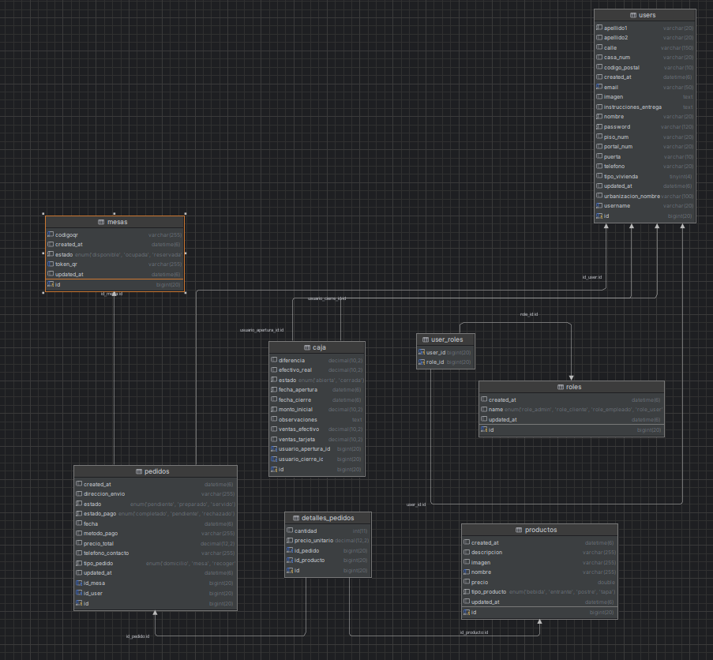

### 3.1.- Detalle de las Tablas y Estructura de Datos

#### 1. Tabla: `users` (Usuarios)
Almacena la información de los usuarios registrados en el sistema (clientes, empleados, administradores).
* **Campos principales:**
  * `id` (`bigint`, PK): Identificador único del usuario.
  * `username` (`varchar(20)`): Nombre de usuario.
  * `email` (`varchar(50)`): Correo electrónico del usuario.
  * `password` (`varchar(120)`): Contraseña cifrada del usuario.
  * `nombre` (`varchar(20)`): Nombre de pila.
  * `apellido1`, `apellido2` (`varchar(20)`): Apellidos del usuario.
  * `telefono` (`varchar(20)`): Teléfono de contacto.
  * `imagen` (`text`): URL o ruta de la imagen de perfil.
* **Dirección y entrega:**
  * `calle` (`varchar(150)`), `casa_num` (`varchar(20)`), `piso_num` (`varchar(20)`), `portal_num` (`varchar(20)`), `puerta` (`varchar(10)`): Datos detallados de la dirección física.
  * `codigo_postal` (`varchar(10)`), `urbanizacion_nombre` (`varchar(100)`), `tipo_vivienda` (`tinyint(4)`): Información adicional de ubicación.
  * `instrucciones_entrega` (`text`): Notas para repartidores.
* **Auditoría:**
  * `created_at`, `updated_at` (`datetime(6)`): Marcas de tiempo de creación y última actualización.

#### 2. Tabla: `roles` (Roles del Sistema)
Define los distintos roles de usuario que existen en la aplicación para el control de accesos y permisos.
* **Campos:**
  * `id` (`bigint`, PK): Identificador único del rol.
  * `name` (`enum`): Define los permisos o tipos de rol permitidos: `'role_admin'`, `'role_cliente'`, `'role_empleado'`, `'role_user'`.
  * `created_at`, `updated_at` (`datetime(6)`): Marcas de tiempo de auditoría.

#### 3. Tabla: `user_roles` (Roles de Usuario - Tabla Pivote)
Tabla intermedia para implementar una relación de **muchos a muchos (N:M)** entre `users` y `roles`.
* **Campos:**
  * `user_id` (`bigint`, FK -> `users.id`): Referencia al usuario.
  * `role_id` (`bigint`, FK -> `roles.id`): Referencia al rol asignado.

#### 4. Tabla: `mesas` (Mesas del Establecimiento)
Gestiona las mesas físicas del local y su disponibilidad en tiempo real.
* **Campos:**
  * `id` (`bigint`, PK): Identificador único de la mesa.
  * `estado` (`enum`): Estado actual de la mesa: `'disponible'`, `'ocupada'`, `'reservada'`.
  * `codigoqr` (`varchar(255)`): Código QR asociado a la mesa.
  * `token_qr` (`varchar(255)`): Token de seguridad vinculado al QR.
  * `created_at`, `updated_at` (`datetime(6)`): Marcas de tiempo de auditoría.

#### 5. Tabla: `productos` (Catálogo de Productos)
Almacena el menú de alimentos, bebidas y productos disponibles para la venta.
* **Campos:**
  * `id` (`bigint`, PK): Identificador único del producto.
  * `nombre` (`varchar(255)`): Nombre del producto.
  * `descripcion` (`varchar(255)`): Descripción detallada.
  * `precio` (`double`): Precio unitario del producto.
  * `tipo_producto` (`enum`): Categoría del producto: `'bebida'`, `'entrante'`, `'postre'`, `'tapa'`.
  * `imagen` (`varchar(255)`): Imagen ilustrativa del producto.
  * `created_at`, `updated_at` (`datetime(6)`): Marcas de tiempo de auditoría.

#### 6. Tabla: `pedidos` (Pedidos)
Registra las comandas o encargos realizados por los clientes (domicilio, mesa, recogida).
* **Campos:**
  * `id` (`bigint`, PK): Identificador único del pedido.
  * `id_user` (`bigint`, FK -> `users.id`): Usuario que realiza o solicita el pedido.
  * `id_mesa` (`bigint`, FK -> `mesas.id`, *nullable*): Mesa asignada en caso de consumo local.
  * `tipo_pedido` (`enum`): Modalidad de entrega: `'domicilio'`, `'mesa'`, `'recoger'`.
  * `estado` (`enum`): Estado del flujo: `'pendiente'`, `'preparado'`, `'servido'`.
  * `estado_pago` (`enum`): Estado financiero: `'completado'`, `'pendiente'`, `'rechazado'`.
  * `metodo_pago` (`varchar(255)`): Forma de pago utilizada.
  * `precio_total` (`decimal(12,2)`): Coste total acumulado del pedido.
  * `fecha` (`datetime(6)`): Fecha y hora en la que se efectúa el pedido.
  * `telefono_contacto` (`varchar(255)`): Teléfono de contacto.
  * `direccion_envio` (`varchar(255)`): Dirección específica de destino.
  * `created_at`, `updated_at` (`datetime(6)`): Marcas de tiempo de auditoría.

#### 7. Tabla: `detalles_pedidos` (Líneas de Detalle del Pedido)
Relaciona los pedidos con los productos individuales que los componen.
* **Campos:**
  * `id` (`bigint`, PK): Identificador único de la línea de detalle.
  * `id_pedido` (`bigint`, FK -> `pedidos.id`): Pedido al que pertenece este detalle.
  * `id_producto` (`bigint`, FK -> `productos.id`): Producto seleccionado.
  * `cantidad` (`int(11)`): Unidades solicitadas del producto.
  * `precio_unitario` (`decimal(12,2)`): Precio del producto en el momento de la compra.

#### 8. Tabla: `caja` (Control de Caja / Turnos de Caja)
Lleva la contabilidad y control financiero de apertura y cierre de caja por turnos.
* **Campos:**
  * `id` (`bigint`, PK): Identificador único de la sesión de caja.
  * `estado` (`enum`): Estado de la caja: `'abierta'`, `'cerrada'`.
  * `fecha_apertura` / `fecha_cierre` (`datetime(6)`): Marcas temporales.
  * `monto_inicial` (`decimal(10,2)`): Dinero base al abrir la caja.
  * `efectivo_real` (`decimal(10,2)`): Efectivo contabilizado físicamente al cierre.
  * `ventas_efectivo` / `ventas_tarjeta` (`decimal(10,2)`): Totales recaudados por cada método.
  * `diferencia` (`decimal(10,2)`): Cuadre o descuadre resultante.
  * `usuario_apertura_id` / `usuario_cierre_id` (`bigint`, FK -> `users.id`): Empleados responsables.
  * `observaciones` (`text`): Notas o incidencias ocurridas durante el turno.

### 3.2.- Relaciones Principales y Cardinalidad
1. **`users` ↔ `roles`**: Relación **Muchos a Muchos (N:M)** resuelta mediante la tabla pivote `user_roles`.
2. **`users` → `pedidos`**: Relación **Uno a Muchos (1:N)**. Un usuario puede realizar múltiples pedidos.
3. **`mesas` → `pedidos`**: Relación **Uno a Muchos (1:N)**. Una mesa puede albergar múltiples pedidos secuenciales a lo largo del tiempo.
4. **`pedidos` ↔ `productos`** (a través de `detalles_pedidos`): Relación **Muchos a Muchos (N:M)**.
5. **`users` → `caja`**: Relación **Uno a Muchos (1:N)** para la auditoría de apertura y cierre de caja por parte de los empleados.

---

## 4.- Arquitectura del Frontend y Páginas Añadidas

### 4.1.- Configuración y Entorno de Desarrollo (`frontend/`)
El directorio raíz del frontend contiene los archivos de configuración esenciales para la compilación, despliegue y calidad del código:

* **`angular.json`**: Archivo de configuración principal de Angular CLI que define las rutas de construcción, optimizaciones, configuraciones de entorno y esquemas para los diferentes proyectos y librerías del workspace.
* **`package.json` y `package-lock.json`**: Gestionan las dependencias del proyecto, scripts de ejecución (`npm start`, `npm build`, `npm test`) y librerías externas necesarias para la interfaz y la lógica de negocio.
* **`Dockerfile`**: Configuración optimizada multi-etapa (Node.js + Caddy) para la contenerización de la aplicación frontend en entornos de producción.
* **`karma.conf.js`**: Configuración del entorno de pruebas unitarias utilizando Karma, Jasmine y el prefijo de protocolo moderno `node:path`.
* **`.browserslistrc`**: Define los navegadores objetivo soportados por la aplicación para garantizar la compatibilidad de estilos y características de JavaScript.
* **`.editorconfig`**: Mantiene un estilo de código consistente entre diferentes editores y entornos de desarrollo.

### 4.2.- Módulos y Estructura de Rutas (`src/app/`)

#### 4.2.1.- Enrutamiento Raíz (`app-routing.module.ts` y `app.module.ts`)

La aplicación utiliza un sistema de enrutamiento modular (`AppRoutingModule`) que divide la navegación principal en tres secciones lógicas:
* **Área Pública**: Rutas accesibles para clientes y visitantes generales (carta, gestión de mesas, pedidos, contacto y políticas).
* **Área de Autenticación**: Rutas para el inicio de sesión, registro y verificación de correo electrónico.
* **Área de Administración**: Rutas protegidas mediante guardianes (`guards`) orientadas a la gestión interna del sistema.

#### 4.2.2.- Módulo de Autenticación (`auth/`)

Gestiona el acceso de los usuarios al sistema y la seguridad de las peticiones HTTP:
* **Componentes**:
  * `login`: Interfaz y lógica para la autenticación de usuarios.
  * `register`: Formulario de registro de nuevos usuarios.
  * `verificacion`: Componente de verificación por correo electrónico (`email-verification`).
* **Servicios y Guardianes**:
  * `auth.service.ts`: Gestiona la lógica de autenticación, almacenamiento de tokens y estado de sesión.
  * `auth.guard.ts` y `role.guard.ts`: Guardianes de ruta que protegen el acceso según la autenticación y los roles del usuario.
  * `auth.interceptor.ts`: Interceptor HTTP encargado de adjuntar automáticamente los tokens de autorización a las cabeceras de las solicitudes salientes.

#### 4.2.3.- Área de Administración (`admin/`)

Diseñada para la gestión integral del negocio. Contiene páginas específicas para el control administrativo con estilos personalizados definidos en `crud-styles.css`:

* **Páginas y Componentes**:
  * `bienvenida`: Panel de inicio o dashboard principal del administrador.
  * `detalles_pedidos`: Gestión, edición y visualización detallada de los pedidos (`gestionar-detalles`, `editar-detalles`, `ver-detalle`).
  * `mesas`: Administración de la distribución y estado de las mesas del establecimiento (`gestionar-mesas`, `editar-mesas`, `ver-mesa`).
  * `metricas`: Visualización de estadísticas y métricas de rendimiento del negocio.
  * `pedidos`: Control general de los pedidos del sistema (`gestionar-pedidos`, `editar-pedidos`, `ver-pedido`).
  * `productos`: Administración del catálogo de productos o elementos de la carta (`gestionar-productos`, `editar-productos`, `ver-producto`).
  * `usuarios`: Gestión de cuentas de usuario, roles y permisos (`gestionar-usuarios`, `editar-usuarios`, `ver-usuario`).

#### 4.2.4.- Área Pública (`public/`)

Orientada a la experiencia del cliente final y la interacción operativa diaria:

* **Componentes Principales**:
  * `carta`: Visualización del menú de productos disponibles.
  * `confirmar-pedido`: Interfaz para la revisión y confirmación final de un pedido.
  * `contacto`: Formulario e información de contacto.
  * `gestionar-caja`: Interfaz para el control de caja y transacciones.
  * `gestionar-comandas`: Visualización y control de comandas en tiempo real.
  * `gestionar-mesas-empleado`: Vista específica para empleados sobre el estado de las mesas.
  * `gestionar-pagos-efectivo`: Control y registro de pagos en efectivo.
  * `home`: Página de bienvenida o inicio del sitio público.
  * `perfil`: Gestión de los datos del perfil del usuario cliente.
  * `seguimiento-pedidos`: Pantalla para que el cliente consulte el estado actual de su pedido.
  * `politica-privacidad` y `terminos-condiciones`: Páginas informativas legales.

### 4.3.- Componentes Compartidos y UI Components (`shared/` y `uicomponents/`)

* **`shared/`**: Contiene elementos reutilizables en toda la aplicación:
  * `custom-toast`: Sistema de notificaciones flotantes (`toasts`) para feedback visual.
  * `footer`: Pie de página común.
  * `modals`: Cuadros de diálogo reutilizables, como el modal de confirmación de eliminación (`modal-confirmar-eliminar`).
* **`uicomponents/`**: Componentes visuales de diseño estructural, destacando el componente `menu` de navegación principal.

## 5. Estilos, Diseño y Activos (`styles` y `assets/`)

* **Estilos Globales y Accesibilidad**: El proyecto cuenta con hojas de estilo específicas para la administración (`crud-styles.css`), estilos por componente y un servicio dedicado al manejo de temas (`theme.service.ts`) para soportar la adaptabilidad visual. Todas las interfaces de usuario han sido refactorizadas y validadas para cumplir estrictamente con los ratios de contraste mínimo exigidos por las normativas de accesibilidad **WCAG** (colores sólidos optimizados, eliminación de opacidades conflictivas en textos y contraste certificado en botones y elementos interactivos).

* **Activos (`assets/`)**: Contiene recursos estáticos como imágenes corporativas y de fondo.

## 6.- Auditorias

En este apartado se definen las diferentes auditorías que he realizado con diferentes herramientas:

### 6.1.- Snyk

- Backend:

Se realizaron escáneres iterativos sobre las 117 dependencias del proyecto utilizando Snyk CLI en el entorno de Kali Linux. 

1. **Estado Inicial:** Se detectaron inicialmente **136 incidencias** y **406 rutas vulnerables**, asociadas principalmente a versiones anteriores del framework y desactualizaciones en librerías de terceros.
2. **Mitigación y Actualización de Dependencias:** 
   - Se actualizaron los componentes críticos de seguridad, migrando la librería de autenticación JWT (`jjwt`) a la versión `0.12.5` y adaptando por completo la implementación al API moderno (`JwtUtils.java`).
   - Se elevó la versión base del ecosistema a **Spring Boot 3.4.3**, saneando de forma directa las vulnerabilidades transitivas de Tomcat, Spring Security y componentes de registro (`Logback`).
   - Se actualizaron los conectores de bases de datos (`mariadb-java-client` y `mysql-connector-j`) a sus iteraciones más estables y seguras.
3. **Estado Final:** Tras las optimizaciones y recompilación limpia (`./gradlew clean build -x test`), el número de incidencias se redujo a **129 problemas** y **397 rutas vulnerables**. Las advertencias restantes quedan limitadas estrictamente a avisos de menor relevancia y dependencias transitivas internas del núcleo del framework que no afectan a la lógica de negocio personalizada de la aplicación.

- Frontend:

Se realizaron análisis de seguridad sobre las 102 dependencias del proyecto frontend utilizando Snyk CLI en el entorno de Kali Linux.

1. **Estado Inicial:** Se detectaron inicialmente **29 incidencias** y **33 rutas vulnerables**, compuestas por vulnerabilidades directas en paquetes obsoletos de Angular (versión 14) y vulnerabilidades de alto riesgo en dependencias transitivas de red (tales como `engine.io`, `socket.io-parser` y `ws`, introducidas a través de `ngx-socket-io`).
2. **Mitigación y Actualización de Dependencias:** 
   - Se aislaron y solucionaron de forma directa las vulnerabilidades críticas de red e infraestructura mediante la implementación de directivas de anulación (`overrides`) en el archivo `package.json` para forzar versiones parcheadas de los protocolos de comunicación (`engine.io`, `socket.io-parser` y `ws`).
   - Se depuró el árbol de dependencias ejecutando una limpieza completa de módulos y una reinstalación de los paquetes (`npm install --legacy-peer-deps`) para garantizar la estabilidad de la compilación frente a restricciones de versiones.
3. **Estado Final:** Tras aplicar las directivas de control y la reconstrucción del entorno, el número de incidencias se redujo a **22 problemas** y **22 rutas vulnerables** (una reducción drástica que eliminó el 100% de las vulnerabilidades transitivas de terceros). Las incidencias restantes quedan limitadas exclusivamente a avisos estructurales nativos del núcleo de Angular 14, cuya actualización completa a versiones modernas requeriría una migración mayor del framework.

### 6.2.- SonarQube (Auditoría de Calidad y Mantenibilidad)

Se ha llevado a cabo una auditoría exhaustiva de la calidad del código fuente tanto en el Backend (Java/Spring Boot) como en el Frontend (Angular/TypeScript), empleando SonarQube para garantizar los más altos estándares de mantenibilidad, seguridad y robustez.

---

### Backend: Auditoría y Refactorización

El análisis del backend se estructuró en dos fases: un diagnóstico inicial (que identificó áreas de mejora) y un estado final tras aplicar un plan de refactorización integral.

#### 1. Estado Inicial y Detección de Incidencias
En el primer escaneo se detectaron **48 incidencias** globales distribuidas en seguridad, fiabilidad y mantenibilidad:

  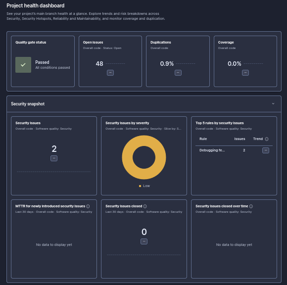

  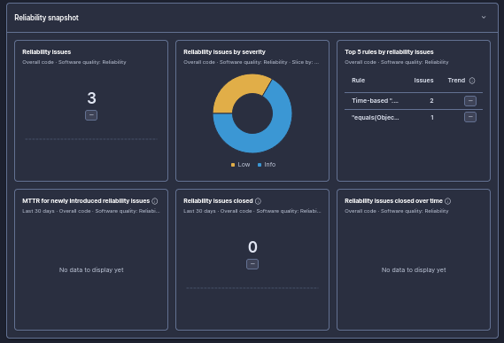

  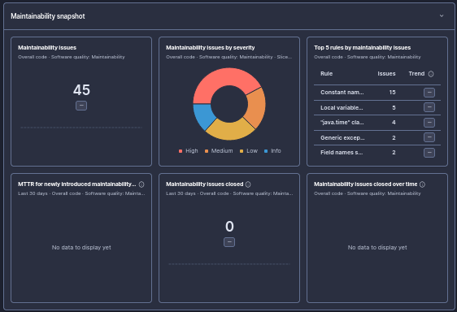

  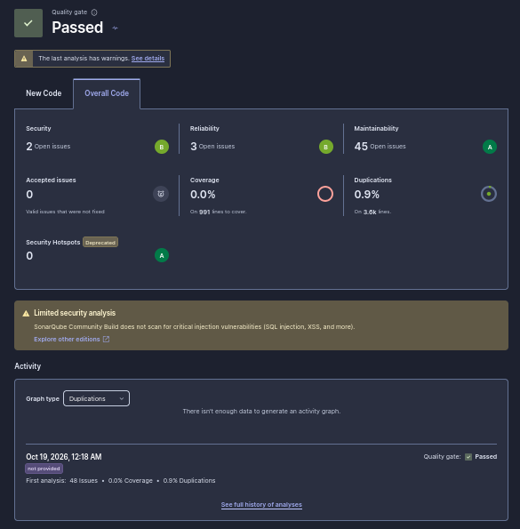

* **Seguridad (2 incidencias):** Uso de funciones de depuración activas en producción (`e.printStackTrace()` en controladores).
* **Fiabilidad (3 incidencias):** Omisión del contrato `hashCode()` al sobrescribir `equals()` y llamadas a métodos de fecha sin zona horaria explícita.
* **Mantenibilidad (45 incidencias):** Complejidad cognitiva elevada en métodos extensos (como `crearPedidoSeguro`), además de convenciones de nombres no alineadas con los estándares de Java.

---

#### 2. Plan de Optimización y Refactorización
Para erradicar la deuda técnica detectada, se implementaron las siguientes mejoras técnicas:

1. **Seguridad y Trazabilidad:** Supresión de impresiones por consola (`e.printStackTrace()`) y centralización del manejo de excepciones mediante respuestas HTTP estandarizadas.
2. **Contrato de Objetos:** Implementación correcta y simultánea de `equals()` y `hashCode()` en `UserDetailsImpl`.
3. **Reducción de Complejidad:** Refactorización de servicios complejos (`PedidoServiceImpl`) desglosando bloques extensos en métodos auxiliares privados y cohesivos.
4. **Estandarización de Estilo:** Corrección de la estructura de paquetes de enumerados (`model/enums`) para prevenir conflictos con palabras reservadas y estandarización de constantes de seguridad.
5. **Modernización de APIs:** Migración de la clase obsoleta `new Date()` hacia la API moderna de Java 8 (`java.time` / `Instant`).

---

#### 3. Resultados y Estado Final (`Quality Gate: PASSED`)
Tras el despliegue de las correcciones, la re-auditoría confirmó un código limpio y completamente optimizado:

  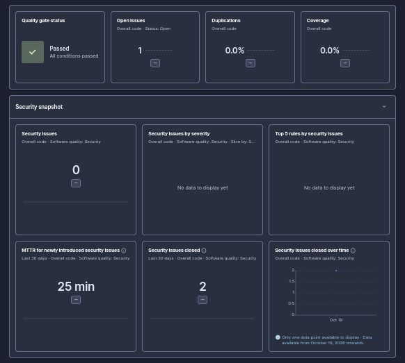

  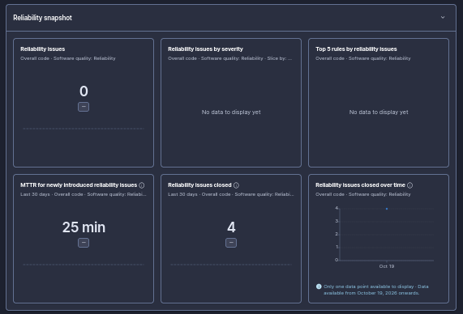

  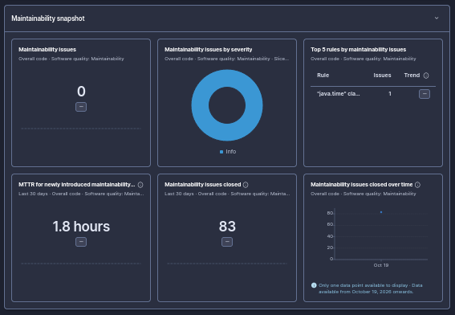

  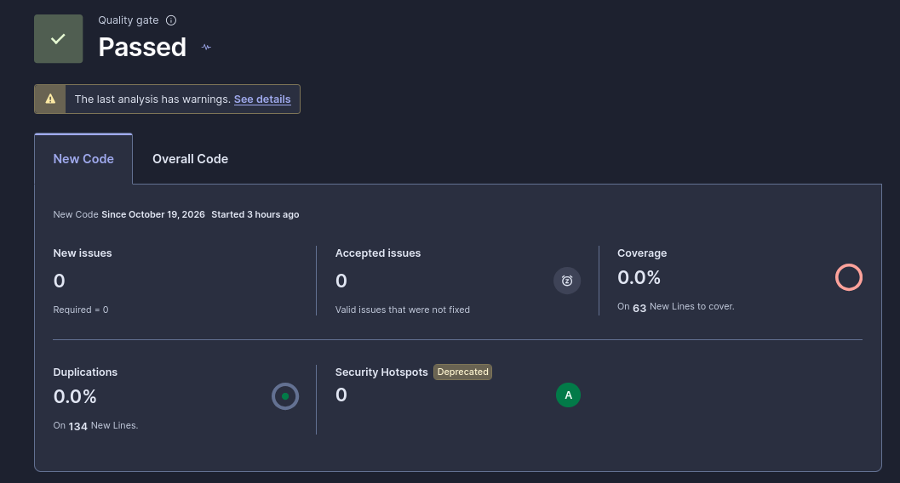

| Métrica | Estado Inicial | Estado Final |
| :--- | :---: | :---: |
| **Quality Gate** | Fallido | PASSED |
| **Seguridad** | 2 incidencias | 0 incidencias |
| **Fiabilidad** | 3 incidencias | 0 incidencias |
| **Mantenibilidad** | 45 incidencias | 0 críticas / Deuda minimizada |

---

### Frontend: Auditoría de Calidad y Accesibilidad

El análisis del frontend se estructuró en dos fases: un diagnóstico inicial (que identificó áreas de mejora en accesibilidad, fiabilidad y mantenibilidad) y un estado final tras aplicar un plan de refactorización integral en el código TypeScript, HTML y hojas de estilo.

#### 1. Estado Inicial y Detección de Incidencias
En el primer escaneo se detectaron numerosas incidencias globales distribuidas en seguridad, fiabilidad y mantenibilidad:

<!-- IMAGEN 1: Dashboard Inicial Frontend -->

  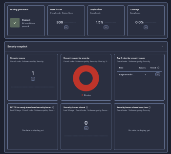

<!-- IMAGEN 2: Snapshot de Fiabilidad y Mantenibilidad Inicial Frontend -->

  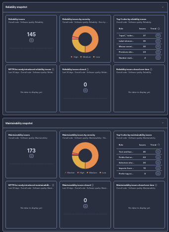

<!-- IMAGEN 3: Resumen General de Issues Iniciales Frontend -->

  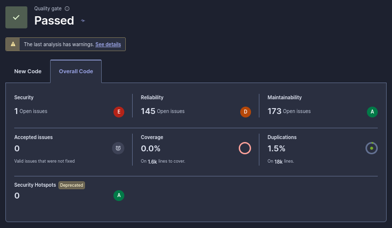

* **Seguridad (1 incidencia):** Puntos críticos detectados en configuraciones o manejo de elementos de la interfaz.
* **Fiabilidad (145 incidencias):** Defectos vinculados a elementos interactivos sin etiquetas asociadas, inputs sin atributos de control y manejo inadecuado de estados en componentes de Angular.
* **Mantenibilidad (173 incidencias):** Presencia de código duplicado, variables no utilizadas, importaciones huérfanas y componentes con exceso de acoplamiento.

---

#### 2. Plan de Optimización y Refactorización
Para erradicar la deuda técnica y los problemas de accesibilidad detectados, se implementaron las siguientes mejoras:

1. **Accesibilidad (WCAG) y Formularios:** Asociación correcta de etiquetas (`<label>`) con sus respectivos campos de entrada (`<input>`, `<select>`), asegurando que todos los elementos interactivos dispongan de nombres accesibles.
2. **Limpieza de Código y Tipado:** Eliminación de importaciones no utilizadas, resolución de redundancias de tipos en TypeScript y estandarización del estilo de código.
3. **Optimización de Componentes:** Reducción de la complejidad en los componentes de las vistas de administración y cliente, separando lógicas extensas en servicios y directivas reutilizables.
4. **Control de Duplicaciones:** Refactorización de bloques de código repetidos en plantillas HTML y hojas de estilo para mantener las duplicaciones por debajo de los límites recomendados.

---

#### 3. Resultados y Estado Final (`Quality Gate: PASSED`)
Tras el despliegue de las correcciones, la re-auditoría confirmó un entorno de cliente completamente limpio y optimizado:

<!-- IMAGEN 4: Dashboard Final Frontend Passed -->

  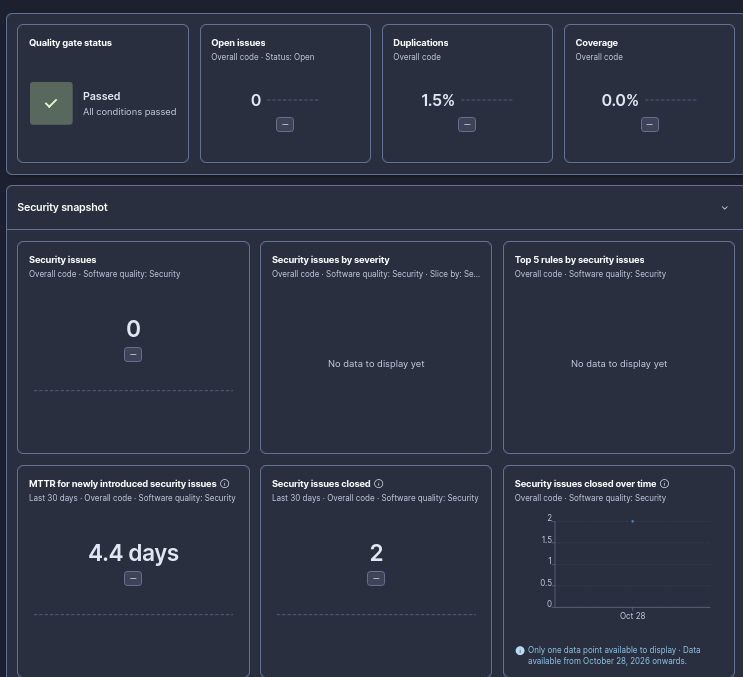

<!-- IMAGEN 5: Snapshot de Seguridad, Fiabilidad y Mantenibilidad Final Frontend -->

  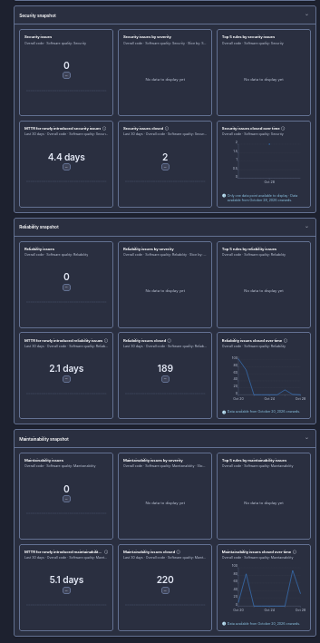

<!-- IMAGEN 6: Resumen de Nuevo Código y Quality Gate Frontend -->

  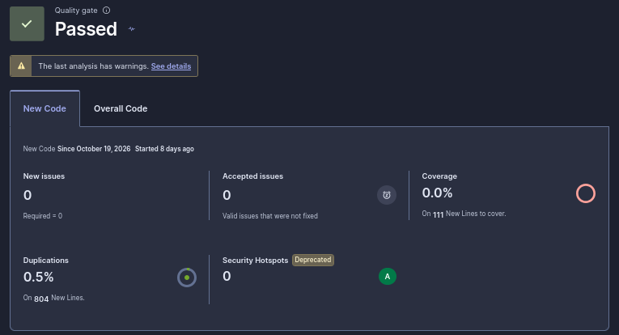

| Métrica | Estado Inicial | Estado Final |
| :--- | :---: | :---: |
| **Quality Gate** | Pasado con advertencias | PASSED |
| **Seguridad** | 1 incidencia | 0 incidencias |
| **Fiabilidad** | 145 incidencias | 0 incidencias (189 resueltas) |
| **Mantenibilidad** | 173 incidencias | 0 incidencias (220 resueltas) |

## 7.- Automatización de CI/CD

Para garantizar la calidad continua, la integración y el despliegue automatizado de la aplicación frontend de BarHub 2.0, se ha configurado un pipeline completo utilizando GitHub Actions. El proceso técnico y de configuración implementado comprende los siguientes apartados:

### 7.1.- Análisis Estático Continuo (SonarCloud)
* **Migración a la nube**: Se completó la transición desde una instancia local de SonarQube hacia **SonarCloud** para centralizar la calidad del código y la seguridad en la nube de forma automatizada en cada ciclo.
* **Integración del proyecto**: Se registró oficialmente el repositorio web en SonarCloud vinculándolo con la organización correspondiente para generar la clave de proyecto (*Project Key*) única.
* **Resolución de conflictos de análisis**: Se desactivó la opción de **Análisis Automático** (*Automatic Analysis*) directamente en el panel de SonarCloud para evitar colisiones y bloqueos concurrentes con el escáner lanzado desde el flujo de integración continua (*CI/CD*).

### 7.2.- Gestión de Dependencias y Compilación (Angular & npm)
* **Sincronización de dependencias**: Se configuró la ejecución de la instalación de paquetes (`npm install`) dentro del entorno del servidor de integración para procesar de forma limpia las librerías del proyecto frontend.
* **Optimización de compilación**: Se ajustaron las validaciones y restricciones de tamaño en los procesos de compilación de producción para garantizar que la generación de paquetes estáticos finalice de manera óptima.

### 7.3.- Automatización de Contenedores y Registro (Docker Hub)
* **Estructuración y contenerización**: Se configuró un proceso de empaquetado multi-etapa utilizando Node.js y un servidor web Caddy para servir la aplicación de manera eficiente en producción.
* **Seguridad y credenciales de despliegue**: Se estableció una autenticación segura mediante secretos de repositorio en GitHub utilizando un **Personal Access Token (PAT)** de Docker Hub dotado de permisos explícitos de escritura (*Read & Write*), permitiendo la subida automatizada de la imagen compilada tras superar con éxito los controles de calidad.