# Auditorías

Resultados de las auditorías de seguridad y calidad realizadas sobre BarHub 2.0, con su estado inicial, las acciones aplicadas y el estado final.

## Resumen ejecutivo

| Herramienta | Objetivo | Backend | Frontend |
| :--- | :--- | :---: | :---: |
| **Snyk** | Vulnerabilidades en dependencias | 136 → 129 incidencias | 29 → 22 incidencias |
| **SonarQube** | Calidad, fiabilidad y mantenibilidad | PASSED |  PASSED |
| **Trivy** | Configuración de Dockerfiles | 1 LOW → 0 | 1 HIGH + 1 LOW → 0 |
| **Pruebas dinámicas** | Control de acceso, subidas y errores | 0 fallos (fuerza bruta pendiente) | Comprobado en navegador |

## Índice

1. [Snyk](#1-snyk)
2. [SonarQube](#2-sonarqube)
3. [Trivy](#3-trivy)
4. [Pruebas dinámicas](#4-pruebas-dinámicas)

---

## 1. Snyk

Ejecutado con Snyk CLI en **Kali Linux**.

> Las cifras corresponden al análisis original. Desde entonces se han retirado dependencias sin uso (por ejemplo `spring-boot-starter-mail` en el backend y el cliente de Socket.IO en el frontend), así que los números actuales serán distintos. El análisis se repetirá antes de la release.

### Backend · 117 dependencias

| Métrica | Inicial | Final |
| :--- | :---: | :---: |
| Incidencias | **136** | **129** |
| Rutas vulnerables | **406** | **397** |

**Acciones:**

- `jjwt` migrado a **0.12.5**, adaptando `JwtUtils.java` al API moderno.
- Base elevada a **Spring Boot 3.4.3**, resolviendo vulnerabilidades transitivas de Tomcat, Spring Security y Logback.
- `mariadb-java-client` y `mysql-connector-j` actualizados.
- Verificado con recompilación limpia: `./gradlew clean build -x test`.

**Estado final:** las incidencias restantes son avisos de menor relevancia y dependencias transitivas internas del núcleo del framework, que no afectan a la lógica de negocio propia.

### Frontend · 102 dependencias

| Métrica | Inicial | Final |
| :--- | :---: | :---: |
| Incidencias | **29** | **22** |
| Rutas vulnerables | **33** | **22** |

**Origen inicial:** paquetes obsoletos de **Angular 14** y vulnerabilidades de alto riesgo en dependencias de red transitivas (`engine.io`, `socket.io-parser`, `ws`) introducidas por `ngx-socket-io`.

**Acciones:**

- `overrides` en `package.json` para forzar versiones parcheadas de `engine.io`, `socket.io-parser` y `ws`.
- Limpieza de módulos y reinstalación con `npm install --legacy-peer-deps`.

**Estado final:** eliminadas las vulnerabilidades transitivas de red. Las 22 restantes son avisos estructurales de **Angular 14**, cuya resolución exige una migración mayor del framework.

---

## 2. SonarQube

Auditoría de calidad y mantenibilidad del código Java/Spring Boot y Angular/TypeScript. Cada capa pasó por **diagnóstico inicial → plan de refactorización → re-auditoría**.

### 2.1. Backend

#### Estado inicial: 48 incidencias

<p align="center">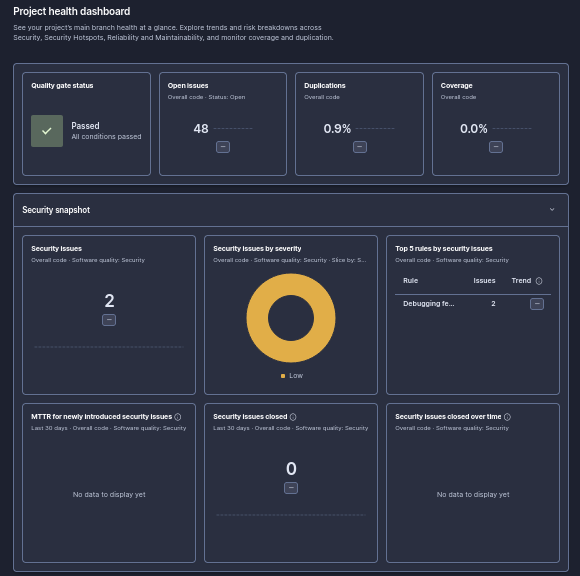</p>
<p align="center">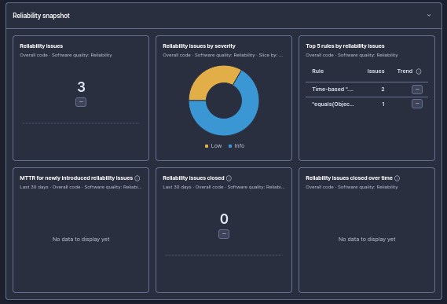</p>
<p align="center">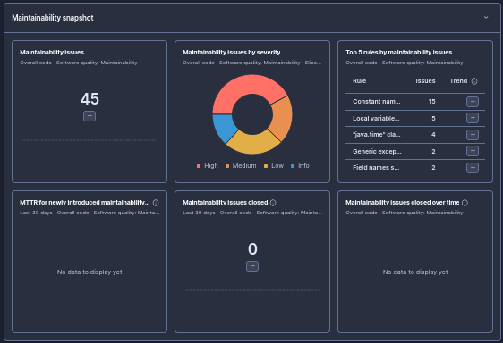</p>
<p align="center">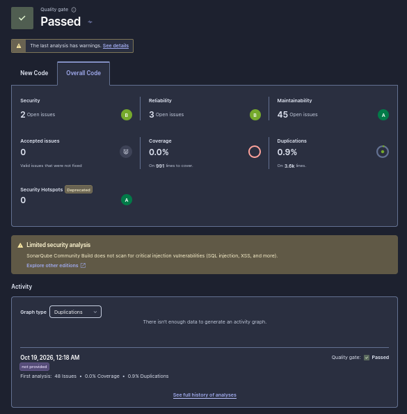</p>

| Categoría | Nº | Problema |
| :--- | :---: | :--- |
| Seguridad | 2 | `e.printStackTrace()` en controladores |
| Fiabilidad | 3 | `equals()` sin `hashCode()` y fechas sin zona horaria explícita |
| Mantenibilidad | 45 | Complejidad cognitiva alta (p. ej. `crearPedidoSeguro`) y convenciones de nombres |

#### Plan de refactorización

1. Supresión de `printStackTrace()` y centralización de excepciones con respuestas HTTP estandarizadas.
2. `equals()` y `hashCode()` implementados juntos en `UserDetailsImpl`.
3. `PedidoServiceImpl` desglosado en métodos auxiliares privados y cohesivos.
4. Enumerados reubicados en `model/enums` y constantes de seguridad estandarizadas.
5. `new Date()` migrado a `java.time` / `Instant`.

#### Estado final: Quality Gate **PASSED**

<p align="center">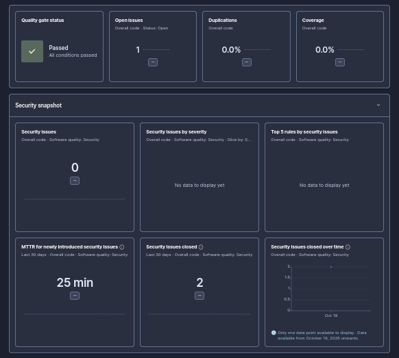</p>
<p align="center">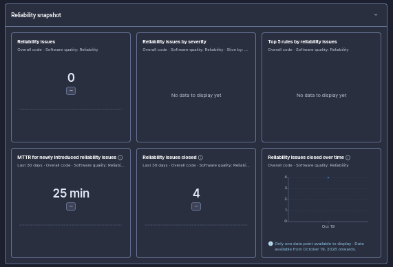</p>
<p align="center">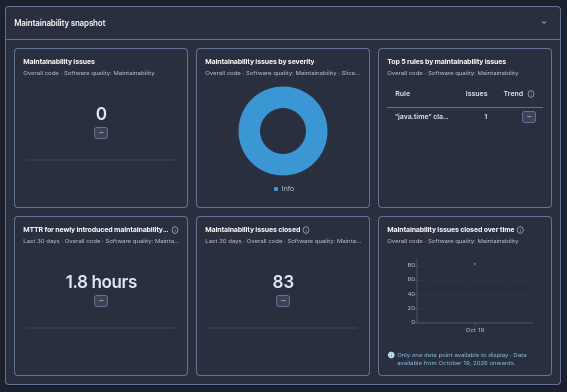</p>
<p align="center">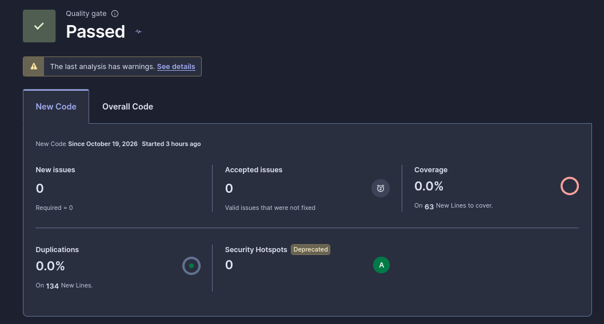</p>

| Métrica | Inicial | Final |
| :--- | :---: | :---: |
| **Quality Gate** | Fallido | PASSED |
| **Seguridad** | 2 | 0 |
| **Fiabilidad** | 3 | 0 |
| **Mantenibilidad** | 45 | 0 críticas / deuda minimizada |

### 2.2. Frontend

#### Estado inicial

<p align="center">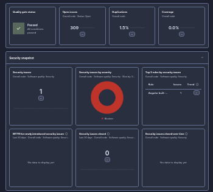</p>
<p align="center">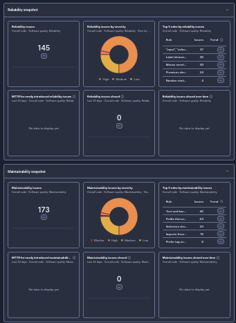</p>
<p align="center">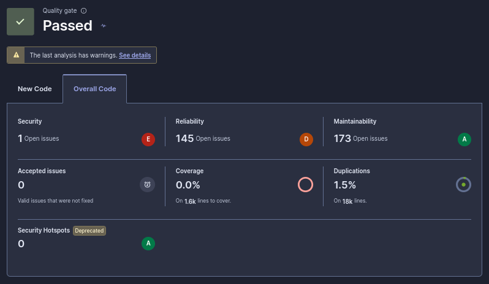</p>

| Categoría | Nº | Problema |
| :--- | :---: | :--- |
| Seguridad | 1 | Punto crítico en configuración o manejo de elementos de la interfaz |
| Fiabilidad | 145 | Elementos interactivos sin etiqueta, inputs sin atributos de control y mal manejo de estados |
| Mantenibilidad | 173 | Código duplicado, variables e imports sin usar, componentes muy acoplados |

#### Plan de refactorización

1. **Accesibilidad (WCAG) y formularios:** `<label>` asociado a cada `<input>` y `<select>`.
2. **Limpieza y tipado:** eliminación de imports sin usar y redundancias de tipos en TypeScript.
3. **Componentes:** lógica extensa de vistas admin y cliente separada en servicios y directivas reutilizables.
4. **Duplicaciones:** plantillas HTML y hojas de estilo refactorizadas por debajo del límite recomendado.

#### Estado final: Quality Gate **PASSED**

<p align="center">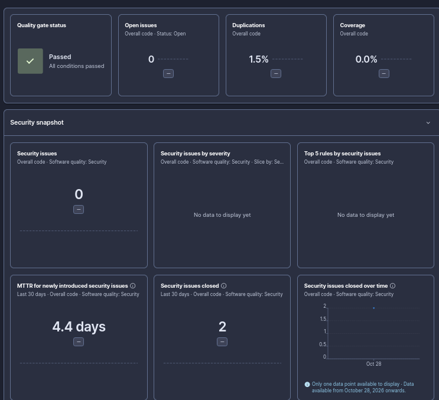</p>
<p align="center">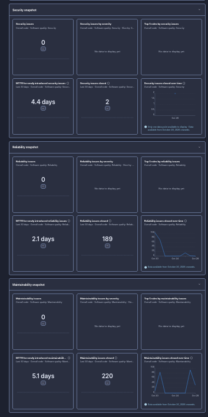</p>
<p align="center">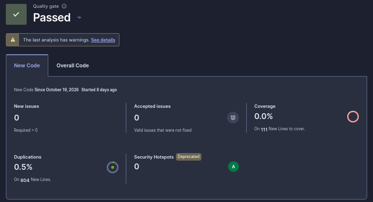</p>

| Métrica | Inicial | Final |
| :--- | :---: | :---: |
| **Quality Gate** | Pasado con advertencias | PASSED |
| **Seguridad** | 1 | 0 |
| **Fiabilidad** | 145 | 0 (189 resueltas) |
| **Mantenibilidad** | 173 | 0 (220 resueltas) |

---

## 3. Trivy

Escaneo de *misconfigurations* en los `Dockerfile` de backend y frontend.

### Backend · estado inicial

<p align="center">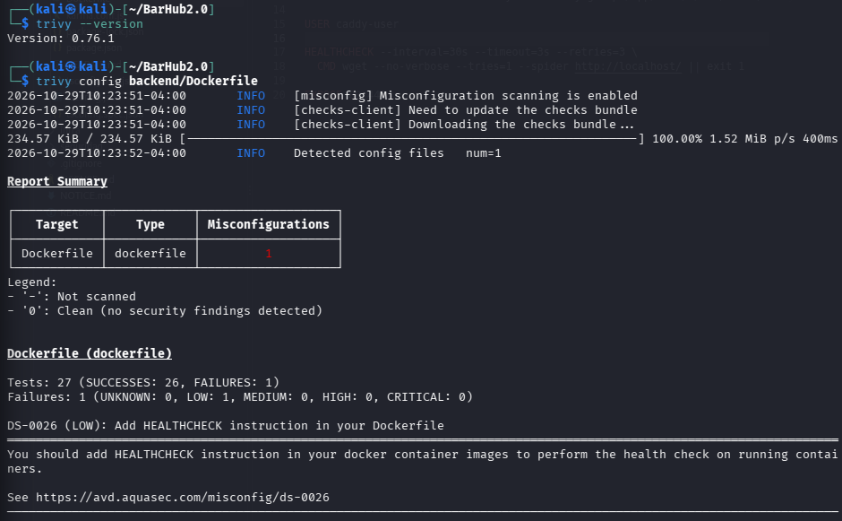</p>

| ID | Severidad | Descripción |
| :--- | :---: | :--- |
| DS-0026 | LOW | Falta la instrucción `HEALTHCHECK` |

### Frontend · estado inicial

<p align="center">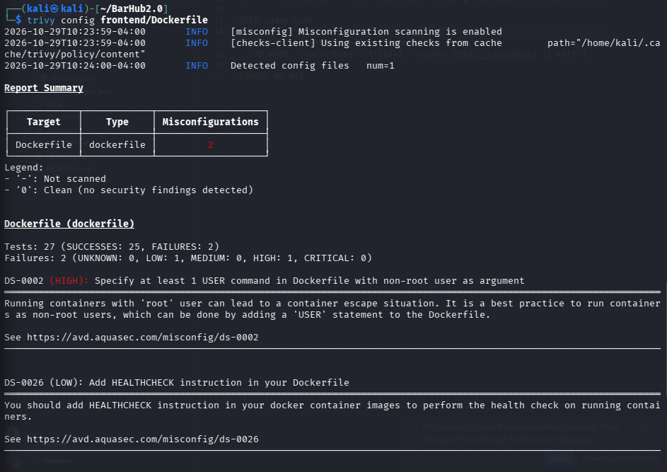</p>

| ID | Severidad | Descripción |
| :--- | :---: | :--- |
| DS-0002 | **HIGH** | Se ejecuta como root. Falta una instrucción `USER` no root (riesgo de escalada / *container escape*) |
| DS-0026 | LOW | Falta la instrucción `HEALTHCHECK` |

### Estado final: **0 incidencias**

Tras añadir usuarios sin privilegios en las imágenes multi-etapa y directivas `HEALTHCHECK`:

<p align="center">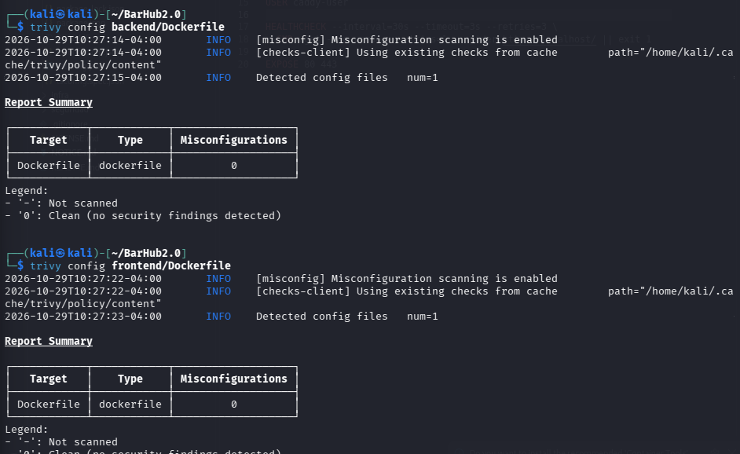</p>

---

## 4. Pruebas dinámicas

Además de las herramientas estáticas, se probó la API en ejecución con un script propio contra una instancia local, repetido tras cada cambio del backend. El script no se versiona; los resultados sí, en [`evidencias/`](evidencias/seguridad-2026-11-14.md).

| Ámbito | Qué se comprueba |
| :--- | :--- |
| Control de acceso | Sin token y con rol insuficiente; las rutas no declaradas se deniegan por defecto |
| Acceso a datos ajenos (IDOR) | Un usuario no puede leer ni modificar pedidos o perfiles de otro; respuesta `404` uniforme |
| Mass assignment | Los campos que el cliente no debe controlar no se aplican |
| Manipulación de precios | El total se recalcula en el servidor |
| Subida de archivos | Extensión, tipo declarado, firma real, tamaño máximo y nombre aleatorio |
| Errores | Respuestas genéricas; el detalle queda en el log |
| Fuerza bruta en el login | Pendiente: 30 intentos fallidos seguidos no provocan bloqueo |

Resultado de la última ejecución: **0 fallos**. Informes: [seguridad-2026-11-14](evidencias/seguridad-2026-11-14.md) y [subidas-y-errores](evidencias/subidas-y-errores.md).

---

## Cómo reproducir las auditorías

```bash
# Snyk
snyk test                                   # en backend/ y frontend/

# SonarQube / SonarCloud: ver infraestructura.md (CI/CD)

# Trivy (misconfiguration de Dockerfile)
trivy config backend/Dockerfile
trivy config frontend/Dockerfile
```