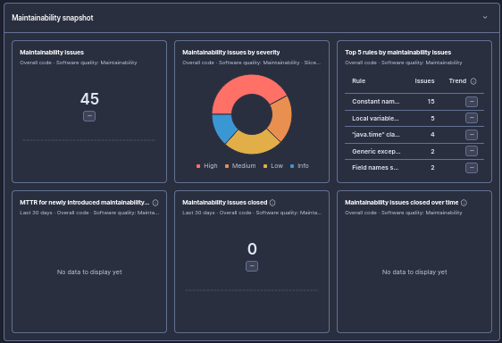
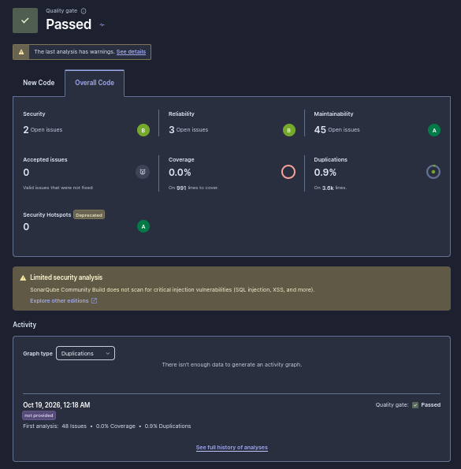
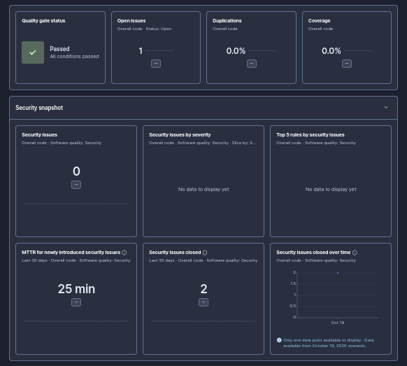
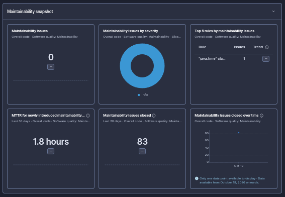
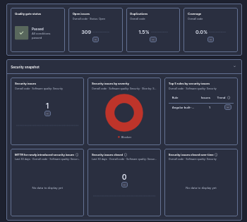
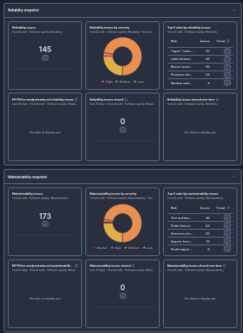
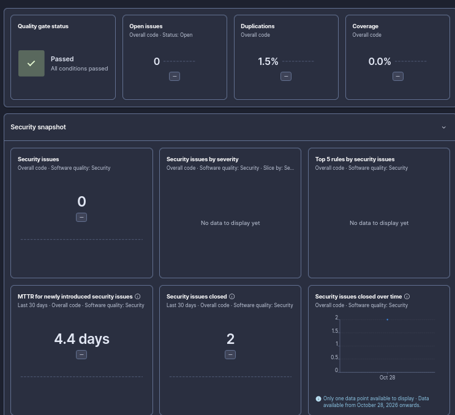
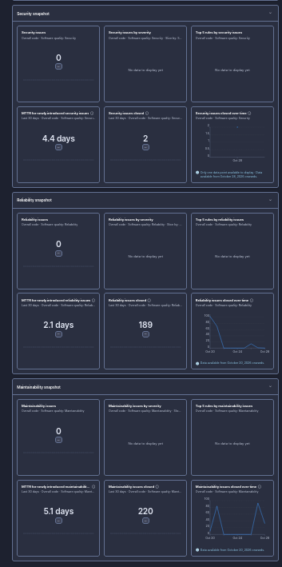
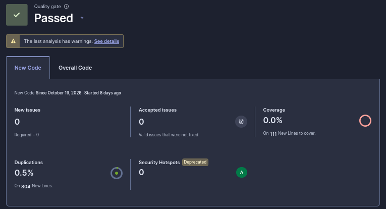

# Auditorías

Resultados de las auditorías de seguridad y calidad realizadas sobre BarHub 2.0, con su estado inicial, las acciones aplicadas y el estado final.

## Resumen ejecutivo

Estado al cerrar la versión 2.1 (28 de noviembre de 2026):

| Herramienta | Objetivo | Resultado |
| :--- | :--- | :--- |
| **Snyk** | Vulnerabilidades en dependencias | Backend: 2 avisos aceptados, ninguno explotable (153 dependencias). Frontend y E2E: 0 |
| **Dependabot** | Alertas de dependencias en GitHub | 0 abiertas (53 antes de migrar a Angular 22) |
| **SonarQube** (análisis local de la 2.0) | Calidad, fiabilidad y mantenibilidad | Backend y frontend: PASSED |
| **SonarCloud** (en el CI) | Calidad y seguridad de todo el repositorio | Quality Gate superado. Código nuevo: 0 incidencias abiertas (131 al empezar la revisión), fiabilidad, seguridad y mantenibilidad A, cobertura 81,6 %, duplicación 0 % |
| **Trivy** | Dependencias del repositorio y configuración de los Dockerfile | 0 vulnerabilidades altas o críticas; 0 errores de configuración |
| **Pruebas dinámicas** | Control de acceso, IDOR, precios, tokens, fuerza bruta, CSP, correo, dos pasos, perfil, tiempo real y pagos | 138 OK, 0 fallos |
| **Pasada final** | Todas las pruebas automáticas | Backend 373, Vitest 208, E2E 53 y SOC 29, sin fallos ([evidencia](evidencias/cierre-2.1-2026-11-28.md)) |

## Índice

1. [Snyk](#1-snyk)
2. [SonarQube](#2-sonarqube)
3. [Trivy](#3-trivy)
4. [Pruebas dinámicas](#4-pruebas-dinámicas)
5. [Dependabot y análisis de código de GitHub](#5-dependabot-y-análisis-de-código-de-github)

---

## 1. Snyk

Ejecutado con Snyk CLI en **Kali Linux**.

> Cada apartado muestra primero el análisis original y después el reanálisis del 15 de noviembre de 2026. Entre ambos se retiraron dependencias sin uso (`spring-boot-starter-mail` en el backend y el cliente de Socket.IO en el frontend) y se publicaron avisos nuevos, por lo que las cifras no son directamente comparables.

### Backend · 117 dependencias

| Métrica | Inicial | Final |
| :--- | :---: | :---: |
| Incidencias | **136** | **129** |
| Rutas vulnerables | **406** | **397** |

**Acciones:**

- `jjwt` migrado a **0.12.5**, adaptando `JwtUtils.java` al API moderno.
- Base elevada a **Spring Boot 3.4.3**, resolviendo vulnerabilidades transitivas de Tomcat, Spring Security y Logback.
- `mariadb-java-client` y `mysql-connector-j` actualizados.
- Verificado con recompilación limpia: `./gradlew clean build -x test`.

**Estado final:** las incidencias restantes son avisos de menor relevancia y dependencias transitivas internas del núcleo del framework, que no afectan a la lógica de negocio propia.

#### Reanálisis del 15 de noviembre de 2026

Spring Boot 3.4 había salido de soporte y, con el tiempo, se habían publicado avisos nuevos sobre Tomcat, Jackson y el propio Spring. Acciones:

- Spring Boot de 3.4.3 a **3.5.16**.
- Versiones fijadas por encima del BOM en `build.gradle`: Tomcat 10.1.61, Jackson 2.22.4, Logback 1.5.36 y Hibernate Validator 8.0.6.Final, además del conector de MariaDB 3.5.11.
- Verificación: tras los cambios, las pruebas dinámicas de seguridad siguen con 0 fallos ([informe](evidencias/seguridad-2026-11-15.md)).

| Gravedad | Con Spring Boot 3.5.16, sin fijar versiones | Tras fijar versiones |
| :--- | :---: | :---: |
| Crítica | 7 | 1 |
| Alta | 30 | 11 |
| Media | 37 | 14 |
| Baja | 4 | 3 |
| **Total** | **78** | **29** |

**Lo que queda (29), por origen:**

| Origen | Gravedad máxima | Por qué no se corrige |
| :--- | :---: | :--- |
| Spring Framework 6.2.19 (`spring-web`, `spring-webmvc`, `spring-beans`, `spring-expression`) | Crítica | Las correcciones solo existen en la serie 7 (7.0.9) |
| Spring Security 6.5.11 | Alta | Solo en 7.0.7 y 7.1.1 |
| Spring Data JPA 3.5.13 | Media | Solo en 4.0.7 y 4.1.1 |
| `micrometer-core` 1.15.12 | Alta | Solo en 1.16 y 1.17, fuera de lo probado con Spring Boot 3.5 |
| `jaxb-core`, `log4j-api` | Alta y media | Sin parche publicado |
| `logback-classic`, `json-smart`, `asm`, `objenesis`, `jakarta.validation-api` | Media y baja | La corrección está en otra rama o es una versión preliminar |

Estos avisos no se han analizado uno a uno para decidir si son explotables en esta aplicación. La solución de fondo es migrar a Spring Boot 4 (Spring Framework 7), que está en la hoja de ruta (v2.1).

#### Migración a Spring Boot 4 (20 de noviembre de 2026, versión 2.1)

- Spring Boot de 3.5.16 a **4.2.0**: Spring Framework 7, Spring Security 7, Spring Data JPA 4, Hibernate 7, Tomcat 11 y Jackson 3. Java de 17 a **21**.
- Se quitan las versiones fijadas por encima del BOM (Tomcat, Jackson, Logback e Hibernate Validator): Spring Boot 4 ya trae versiones corregidas.
- `jjwt` 0.13.0 con Gson en lugar de Jackson 2, que deja de estar en el classpath.
- `mariadb-java-client` 4.0.0: conexión con TLS y certificado verificado por defecto, y TLS obligatorio para el usuario de la aplicación ([evidencia](evidencias/tls-mariadb-2026-11-20.md)).
- Verificación: los 176 tests del backend pasan, y las capturas automáticas de las 36 pantallas en los dos temas salen idénticas antes y después, de modo que la API devuelve los mismos datos.
- Pruebas dinámicas con la versión nueva: 53 OK y 0 fallos ([informe](evidencias/seguridad-2026-11-22.md)).

#### Reanálisis del 21 de noviembre de 2026 (versión 2.1)

Con Spring Boot 4.2 quedaron 8 incidencias en 149 dependencias. Se comprobó en `gradle.lockfile` dónde está cada una:

| Paquete | Avisos | Dónde está | Acción |
| :--- | :---: | :--- | :--- |
| `org.ow2.asm:asm` 9.8 | 5 medios | Solo en la herramienta de cobertura (JaCoCo), no en la aplicación | Alineado con la 9.11.1 que ya usaban los tests (`resolutionStrategy` en `build.gradle`) |
| `org.objenesis:objenesis` 3.3 | 1 bajo | Solo en los tests (lo trae Mockito) | Subido a la 3.6 (`constraints` en `build.gradle`) |
| `org.glassfish.jaxb:jaxb-core` 4.0.9 | 1 alto (XXE) | En producción, lo trae Hibernate | Aceptado: no explotable y sin parche publicado |
| `jakarta.validation:jakarta.validation-api` 3.1.1 | 1 bajo | En producción | Aceptado: la corrección solo existe en una versión preliminar (4.0.0-M1) |

| Gravedad | 15-nov (Spring Boot 3.5) | 21-nov, tras migrar | 21-nov, final |
| :--- | :---: | :---: | :---: |
| Crítica | 1 | 0 | 0 |
| Alta | 11 | 1 | 1 |
| Media | 14 | 5 | 0 |
| Baja | 3 | 2 | 1 |
| **Total** | **29** | **8** | **2** |

El aviso de `jaxb-core` (XXE) exige que la aplicación lea un XML enviado desde fuera, y BarHub no lo hace: ningún código usa JAXB (`@XmlRootElement`, `Unmarshaller` ni `application/xml`), no hay archivos `orm.xml` (Hibernate lee el mapeo de las anotaciones) y el conversor JAXB que registra Spring solo actúa sobre clases con `@XmlRootElement`, que la API no tiene; además, Spring desactiva por defecto las entidades externas. Verificación: los tests del backend pasan y el informe de cobertura se sigue generando con la ASM nueva.

#### Reanálisis del 28 de noviembre de 2026 (cierre de la 2.1)

153 dependencias y los mismos 2 avisos aceptados el 21 de noviembre (`jaxb-core` 4.0.9, alto, y `jakarta.validation-api` 3.1.1, bajo), por los mismos motivos: siguen sin parche estable y no son explotables en BarHub. Ningún aviso nuevo.

### Frontend · 102 dependencias

| Métrica | Inicial | Final |
| :--- | :---: | :---: |
| Incidencias | **29** | **22** |
| Rutas vulnerables | **33** | **22** |

**Origen inicial:** paquetes obsoletos de **Angular 14** y vulnerabilidades de alto riesgo en dependencias de red transitivas (`engine.io`, `socket.io-parser`, `ws`) introducidas por `ngx-socket-io`.

**Acciones:**

- `overrides` en `package.json` para forzar versiones parcheadas de `engine.io`, `socket.io-parser` y `ws`.
- Limpieza de módulos y reinstalación con `npm install --legacy-peer-deps`.

**Estado final:** eliminadas las vulnerabilidades transitivas de red. Las 22 restantes son avisos estructurales de **Angular 14**, cuya resolución exige una migración mayor del framework.

#### Reanálisis del 15 de noviembre de 2026

| Gravedad | Incidencias |
| :--- | :---: |
| Crítica | 1 |
| Alta | 9 |
| Media | 9 |
| Baja | 6 |
| **Total** | **25** |

- **24 son de Angular 14.3.0** (`@angular/core`, `common`, `compiler` y `router`), una versión sin soporte. La corrección es migrar a una versión vigente. No se han analizado una a una para decidir si son explotables en esta aplicación.
- **1 es de `pdfmake` 0.2.20** (media). Subir a 0.3.14 la corrige, pero introduce `fflate` con un aviso alto sin parche publicado, así que se mantiene la 0.2.20 hasta que exista corrección.
- Los `overrides` de `engine.io`, `socket.io-parser` y `ws` ya solo afectan a herramientas de desarrollo (Karma y `webpack-dev-server`). La dependencia `ngx-socket-io` se retiró al sustituir el canal en tiempo real por sondeo.

#### Migración a Angular 22 (21 de noviembre de 2026, versión 2.1)

- Angular de 14 a **22**, versión a versión con `ng update` y sus migraciones oficiales; TypeScript 6.0, zone.js 0.16 y Node 24. Build con el builder `application` (esbuild).
- Antes de migrar se retiraron las dependencias sin uso o duplicadas (`@angular/material`, `@angular/cdk`, `@angular/animations`, `@zxing/ngx-scanner`, jQuery y el Popper suelto) y se quitaron los `overrides`, que solo parcheaban las herramientas de Angular 14.
- Verificación: build de producción en cada salto y capturas automáticas de las 36 pantallas en los dos temas, sin diferencias más allá de datos y ruido conocido (fecha del día, mapa incrustado). Prueba manual del flujo de pedido completo con descarga del ticket en PDF.
- Resultado en Dependabot: de 53 alertas abiertas a 1, pendiente de revisar. El 28 de noviembre ya no queda ninguna ([sección 5](#5-dependabot-y-análisis-de-código-de-github)).
- Reanálisis de Snyk (21 de noviembre de 2026): **0 incidencias** en las 40 dependencias de producción, frente a las 25 de antes de migrar. Snyk analiza por defecto las dependencias que llegan a la web publicada; las de desarrollo (Angular CLI, Vitest) se revisan con `npm audit`, que también queda sin vulnerabilidades.

#### Reanálisis del 28 de noviembre de 2026 (cierre de la 2.1)

**0 incidencias** en el frontend y **0** en el proyecto de los E2E (`e2e/`), tras añadir en la 2.1 Stripe.js, `qrcode` y las fuentes servidas desde la propia web.

---

## 2. SonarQube

Auditoría de calidad y mantenibilidad del código Java/Spring Boot y Angular/TypeScript. Cada capa pasó por **diagnóstico inicial → plan de refactorización → re-auditoría**.

### 2.1. Backend

#### Estado inicial: 48 incidencias

<p align="center"></p>
<p align="center"></p>
<p align="center"></p>
<p align="center"></p>

| Categoría | Nº | Problema |
| :--- | :---: | :--- |
| Seguridad | 2 | `e.printStackTrace()` en controladores |
| Fiabilidad | 3 | `equals()` sin `hashCode()` y fechas sin zona horaria explícita |
| Mantenibilidad | 45 | Complejidad cognitiva alta (p. ej. `crearPedidoSeguro`) y convenciones de nombres |

#### Plan de refactorización

1. Supresión de `printStackTrace()` y centralización de excepciones con respuestas HTTP estandarizadas.
2. `equals()` y `hashCode()` implementados juntos en `UserDetailsImpl`.
3. `PedidoServiceImpl` desglosado en métodos auxiliares privados y cohesivos.
4. Enumerados reubicados en `model/enums` y constantes de seguridad estandarizadas.
5. `new Date()` migrado a `java.time` / `Instant`.

#### Estado final: Quality Gate **PASSED**

<p align="center"></p>
<p align="center"></p>
<p align="center"></p>
<p align="center"></p>

| Métrica | Inicial | Final |
| :--- | :---: | :---: |
| **Quality Gate** | Fallido | PASSED |
| **Seguridad** | 2 | 0 |
| **Fiabilidad** | 3 | 0 |
| **Mantenibilidad** | 45 | 0 críticas / deuda minimizada |

### 2.2. Frontend

#### Estado inicial

<p align="center"></p>
<p align="center"></p>
<p align="center"></p>

| Categoría | Nº | Problema |
| :--- | :---: | :--- |
| Seguridad | 1 | Punto crítico en configuración o manejo de elementos de la interfaz |
| Fiabilidad | 145 | Elementos interactivos sin etiqueta, inputs sin atributos de control y mal manejo de estados |
| Mantenibilidad | 173 | Código duplicado, variables e imports sin usar, componentes muy acoplados |

#### Plan de refactorización

1. **Accesibilidad (WCAG) y formularios:** `<label>` asociado a cada `<input>` y `<select>`.
2. **Limpieza y tipado:** eliminación de imports sin usar y redundancias de tipos en TypeScript.
3. **Componentes:** lógica extensa de vistas admin y cliente separada en servicios y directivas reutilizables.
4. **Duplicaciones:** plantillas HTML y hojas de estilo refactorizadas por debajo del límite recomendado.

#### Estado final: Quality Gate **PASSED**

<p align="center"></p>
<p align="center"></p>
<p align="center"></p>

| Métrica | Inicial | Final |
| :--- | :---: | :---: |
| **Quality Gate** | Pasado con advertencias | PASSED |
| **Seguridad** | 1 | 0 |
| **Fiabilidad** | 145 | 0 (189 resueltas) |
| **Mantenibilidad** | 173 | 0 (220 resueltas) |

---

### SonarCloud (análisis en el pipeline)

El 15 de noviembre de 2026 se ejecutó el primer análisis completo del repositorio en SonarCloud desde GitHub Actions.

| Área | Primer análisis | Tras las correcciones |
| :--- | :---: | :---: |
| Seguridad | 10 incidencias (C) | **0 (A)** |
| Fiabilidad | 49 incidencias (C) | **45 (A)** |
| Mantenibilidad | 363 incidencias (A) | 363 (A) |
| Cobertura | 0 % | 0 % |
| Duplicación | 1,7 % | 1,7 % |

**Correcciones aplicadas**

- Acciones del workflow fijadas por SHA de commit (4 avisos).
- `npm ci --ignore-scripts` en el workflow y en el `Dockerfile` del frontend, que además bloquea las versiones con el `package-lock.json` (4 avisos).
- `gradle.lockfile` para bloquear las versiones del backend.
- Dos expresiones regulares de validación (nombre de imagen y correo) reescritas sin retrocesos excesivos.
- Tres navegaciones del editor de mesas marcadas como no esperadas (`void`).
- Contenedor del frontend ejecutado con un usuario sin privilegios.

**Lo que queda**

- 45 avisos de fiabilidad de gravedad baja, casi todos imágenes sin texto alternativo en las plantillas del frontend.
- 363 avisos de mantenibilidad (nota A), sin plan de limpieza completa.
- Cobertura global del 0 %: todavía no se envían informes de tests a SonarCloud. Es la deuda principal de esta auditoría.

**Quality Gate.** En el primer análisis el gate falló sobre el código nuevo (seguridad B, cobertura 0 % y duplicación del 10,9 %), porque todo el código reciente contaba como nuevo. Tras las correcciones se declaró `sonar.projectVersion=2.0.0` y se usa «Previous version» como definición de código nuevo, así que el gate evalúa el código posterior a la versión 2.0.0. Esta decisión no oculta nada: los valores globales de la tabla anterior siguen visibles en Overall Code.

#### Revisión del 22 de noviembre de 2026 (versión 2.1)

Tras las migraciones a Spring Boot 4, Java 21 y Angular 22, y con la cobertura del frontend ya enviada, el código nuevo se mide desde `sonar.projectVersion=2.1.0`. El Quality Gate falló por una sola condición: seguridad C en el código nuevo.

| Área | Antes de la revisión | Después |
| :--- | :---: | :---: |
| Vulnerabilidades | 2 (C) | **0 (A)** |
| Bugs | 0 (A) | 0 (A) |
| Incidencias de mantenibilidad | 65 (A) | 0 abiertas, 2 aceptadas (A) |
| Security hotspots sin revisar | 0 | 0 |
| Cobertura del código nuevo | 100 % | 100 % |
| Cobertura global | 24,6 % | 24,6 % |
| Duplicación | 1,7 % | 1,7 % |

| Regla | Avisos | Decisión |
| :--- | :---: | :--- |
| `githubactions:S6505` y `S8543` | 2 | **Corregido.** El paso de tests del CI usaba `npx ng test`, que puede descargar e instalar un paquete sin versión fijada si no lo encuentra. Pasa a `npm test`, que solo ejecuta el Angular CLI instalado por `npm ci` con la versión del `package-lock.json`. |
| `typescript:S1874` | 2 | **Corregido.** `platformBrowserDynamic` está obsoleto en Angular 22. El build es AOT, así que basta con `platformBrowser`, y sobra la dependencia `@angular/platform-browser-dynamic`. |
| `typescript:S7781` | 1 | **Corregido.** `replace(/_/g, ' ')` pasa a `replaceAll('_', ' ')`. |
| `css:S9440` | 60 | **Cubierto por la regla global y excluido del análisis.** La regla exige un `@media (prefers-reduced-motion: reduce)` en el mismo archivo que la animación. `frontend/src/styles.css` ya lo tiene para `*`, `*::before` y `*::after`, y los estilos globales no se encapsulan, así que se aplica a todos los componentes. La prueba de que la regla solo mira el archivo: `login.component.css` tiene la misma animación que `register.component.css` y no tiene aviso, porque repite ese bloque. Se usa `0.01ms` y no `none` porque dos pantallas parten de `opacity: 0` y quedarían invisibles. La exclusión está en el workflow (`sonar.issue.ignore.multicriteria`), limitada a esta regla y a los CSS de `frontend/src/app`. |
| `java:S2143` | 1 | **Aceptado.** `JwtUtils` calcula las fechas con `java.time.Instant`, pero JJWT 0.13 solo acepta `java.util.Date` en `issuedAt` y `expiration`, así que la conversión con `Date.from` es inevitable. |
| `java:S9438` | 1 | **Falso positivo.** Pide hacer `final` el campo `detalles` de `PedidoDto`, pero Lombok (`@Data`) genera su setter y se usa al convertir pedidos a DTO y al leer el JSON. Con `final` no compilaría. |

#### Revisión del 28 de noviembre de 2026 (cierre de la 2.1)

Tras el trabajo de la 2.1 (paginación, avisos propios, idiomas, pagos, SOC y estilos), el Quality Gate falló sobre el código nuevo por fiabilidad D (3 bugs) y seguridad D (2 vulnerabilidades), con 131 incidencias abiertas en ese código.

| Área (código nuevo) | Antes de la revisión | Después |
| :--- | :---: | :---: |
| Bugs | 3 (D) | **0 (A)** |
| Vulnerabilidades | 2 (D) | **0 (A)** |
| Incidencias abiertas | 131 | **0** |
| Mantenibilidad | A | A |
| Security hotspots revisados | 100 % | 100 % |
| Cobertura | 81,7 % | 81,6 % |
| Duplicación | 0 % | 0 % |

En todo el repositorio, la cobertura es del 57,6 % y la duplicación del 0,7 %.

| Regla | Qué señala | Decisión |
| :--- | :--- | :--- |
| `Web:MouseEventWithoutKeyboardEquivalentCheck` (bug) | Elementos que reaccionan al clic sin equivalente de teclado | **Corregido.** El aviso se cierra con Escape desde su fondo, y el fondo del cobro en el móvil pasa a ser un `<button>` |
| `typescript:S2871` (bug) | `sort()` sin comparador | **Corregido.** Las categorías se ordenan con `localeCompare` |
| `pythonsecurity:S8703` (vulnerabilidad) | `soc.py probar` hacía peticiones a una dirección leída del `.env` (SSRF) | **Corregido.** Solo acepta `http` o `https` hacia `localhost`, `127.0.0.1`, `::1` o el dominio de `SITE_ADDRESS`, sin usuario, ruta ni parámetros, y monta la URL con esas piezas. Tests nuevos en `test_soc.py` |
| `java:S4790` (vulnerabilidad) | HMAC-SHA1 en `Totp.java` | **Descartado.** La RFC 6238 y las apps de autenticación (Google Authenticator, Microsoft Authenticator, Aegis) exigen HMAC-SHA1. Se usa como HMAC, no para guardar contraseñas, y HMAC-SHA1 no se ve afectado por las colisiones de SHA1 |
| `css:S4666` | Selectores repetidos en la misma hoja | **Corregido.** Reglas fusionadas en el panel, el inicio de sesión, el registro, los pagos, la portada y el perfil |
| `Web:S6819` | Roles ARIA donde existe un elemento nativo | **Corregido.** `role="status"` pasa a `<output>`, `role="dialog"` a `<dialog open>` (con un estilo base que respeta el diseño propio), `role="group"` a `<fieldset>` y `role="list"` a `<ul>` |
| `css:S7924` | Contraste insuficiente entre texto y fondo | **Corregido.** Fondos sólidos donde el contraste se calculaba sobre transparencias, y colores más oscuros en los iconos de ver, editar y borrar (5:1 o más) |
| `typescript:S3358`, `S3776`; `java:S3358`, `S3776`; `python:S3776` | Ternarios anidados y métodos demasiado complejos | **Corregido.** Tablas de búsqueda y métodos auxiliares (`formato.ts`, perfil, `UsuarioController`, `soc.py`) |
| `java:S1192` | Textos repetidos | **Corregido.** Constantes en `StripePasarela`, `MesaController`, `AuditoriaService`, `AuthController` y `UsuarioController` |
| `python:S6326`, `S5713`; `typescript:S5906`, `S2925`, `S2699` y otras menores | Expresiones regulares, `except` redundante, aserciones de los tests, esperas fijas en un E2E, comentarios TODO | **Corregido.** Entre otras, `toHaveLength` en los tests y una espera por condición (`expect.poll`) en lugar de `waitForTimeout` |
| `java:S2143` | `java.util.Date` en `JwtUtils` | **Descartado**, por el motivo de la revisión del 22 de noviembre |
| `Web:S6840` | `autocomplete="tel-national"` en el teléfono del perfil | **Descartado.** Es un valor válido del estándar HTML. Con `tel`, el navegador rellenaría el prefijo +34 y no cabría en el máximo de 9 cifras |

**Avisos que introdujo la propia revisión.** Al fusionar selectores quedaron dos reglas con `background-color` seguido de `background` (`css:S4657`) y seis con el contraste mal calculado (`css:S7924`), y al extraer un método quedaron dos javadoc seguidos (`java:S8491`). Se corrigieron el mismo día, en dos commits.

**Por qué se descartan en el workflow y no en la interfaz.** El aviso de `JwtUtils`, aceptado en la interfaz el 22 de noviembre, volvió a aparecer abierto en un análisis posterior. Por eso los tres descartes se declaran en el workflow (`sonar.issue.ignore.multicriteria`), como el de `css:S9440`: cada uno limitado a una regla y a un archivo, con su motivo en un comentario. Así la decisión queda versionada y se revisa con el resto del código, y cualquier otra incidencia en esos archivos se sigue marcando.

## 3. Trivy

Escaneo de *misconfigurations* en los `Dockerfile` de backend y frontend.

### Backend · estado inicial

<p align="center"></p>

| ID | Severidad | Descripción |
| :--- | :---: | :--- |
| DS-0026 | LOW | Falta la instrucción `HEALTHCHECK` |

### Frontend · estado inicial

<p align="center"></p>

| ID | Severidad | Descripción |
| :--- | :---: | :--- |
| DS-0002 | **HIGH** | Se ejecuta como root. Falta una instrucción `USER` no root (riesgo de escalada / *container escape*) |
| DS-0026 | LOW | Falta la instrucción `HEALTHCHECK` |

### Estado final: **0 incidencias**

Tras añadir usuarios sin privilegios en las imágenes multi-etapa y directivas `HEALTHCHECK`:

<p align="center"></p>

### Reanálisis del 28 de noviembre de 2026 (cierre de la 2.1)

| Análisis | Comando | Resultado |
| :--- | :--- | :--- |
| Dependencias de todo el repositorio (`package-lock.json` y `gradle.lockfile`) | `trivy fs --severity HIGH,CRITICAL .` | **0** |
| Configuración de los Dockerfile | `trivy config backend/Dockerfile` y `trivy config frontend/Dockerfile` | **0** |

---

## 4. Pruebas dinámicas

Además de las herramientas estáticas, se probó la API en ejecución con un script propio contra una instancia local, repetido tras cada cambio del backend. Desde la 2.1 el script ataca a través de Caddy (`/api`), como en producción, y crea sus propios usuarios de prueba. El script no se versiona; los resultados sí, en [`evidencias/`](evidencias/seguridad-2026-11-22.md).

| Ámbito | Qué se comprueba |
| :--- | :--- |
| Control de acceso | Sin token y con rol insuficiente; las rutas no declaradas se deniegan por defecto |
| Acceso a datos ajenos (IDOR) | Un usuario no puede leer ni modificar pedidos o perfiles de otro; respuesta `404` uniforme |
| Mass assignment | Los campos que el cliente no debe controlar no se aplican |
| Manipulación de precios | El total se recalcula en el servidor |
| Subida de archivos | Extensión, tipo declarado, firma real, tamaño máximo y nombre aleatorio |
| Errores | Respuestas genéricas; el detalle queda en el log |
| Fuerza bruta en el login | 401 en los 5 primeros fallos y 429 con `Retry-After` después; la contraseña correcta no entra durante el bloqueo |
| Tokens | Firma alterada y `alg=none` rechazados; token de acceso de 15 minutos con renovación |
| Exposición | El actuator no responde desde fuera y las cabeceras de seguridad de Caddy están presentes |
| CSP | Directivas estrictas y endpoint de avisos que acepta informes sin sesión y rechaza la lectura |
| Correo | Enlaces de confirmación, recuperación y cambio de correo de un solo uso, con el token en el fragmento de la URL |
| Verificación en dos pasos y perfil | Desafíos inventados, reautenticación, sesiones ajenas y cambios de contraseña sin la actual |
| Privacidad | Descarga de datos sin secretos y eliminación de la cuenta (el token y la contraseña dejan de valer) |
| Tiempo real | Canales cerrados sin sesión, el del personal cerrado a clientes y cada cliente solo con sus pedidos |
| Pago con tarjeta | Pedidos con tarjeta sin un pago real cobrado en Stripe rechazados, y precio recalculado en el servidor |

Resultado de la última ejecución (28 de noviembre de 2026, cierre de la 2.1): **138 OK, 0 fallos**, en 13 secciones. Informes: [seguridad-2026-11-28](evidencias/seguridad-2026-11-28.md), [seguridad-2026-11-22](evidencias/seguridad-2026-11-22.md), [seguridad-2026-11-15](evidencias/seguridad-2026-11-15.md), [seguridad-2026-11-14](evidencias/seguridad-2026-11-14.md) y [subidas-y-errores](evidencias/subidas-y-errores.md).

La pasada final del cierre de la 2.1, con todas las pruebas automáticas (backend, Vitest, build, E2E, script y SOC), está en [cierre-2.1-2026-11-28](evidencias/cierre-2.1-2026-11-28.md).

---

## 5. Dependabot y análisis de código de GitHub

Revisado el 28 de noviembre de 2026 en *Security and quality* del repositorio:

| Función | Estado |
| :--- | :--- |
| Política de seguridad (`SECURITY.md`) y avisos de seguridad | Activados |
| Informe privado de vulnerabilidades | Activado |
| Alertas de Dependabot | Activadas; **0 alertas abiertas** |
| Secret scanning | Activado |
| Code scanning (CodeQL) | Sin configurar. El análisis estático lo hace SonarCloud en cada push, con su Quality Gate; activar CodeQL duplicaría ese trabajo |

---

## Cómo reproducir las auditorías

```bash
# Snyk
snyk test                                   # en backend/, frontend/ y e2e/

# SonarQube / SonarCloud: ver infraestructura.md (CI/CD)

# Trivy (misconfiguration de Dockerfile)
trivy config backend/Dockerfile
trivy config frontend/Dockerfile

# Trivy (vulnerabilidades altas y críticas en las dependencias de todo el repositorio)
trivy fs --severity HIGH,CRITICAL .
```