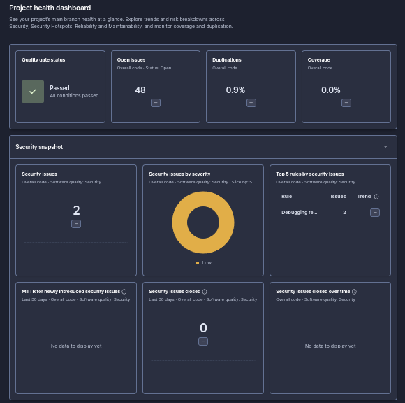
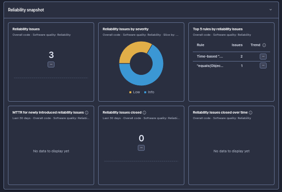
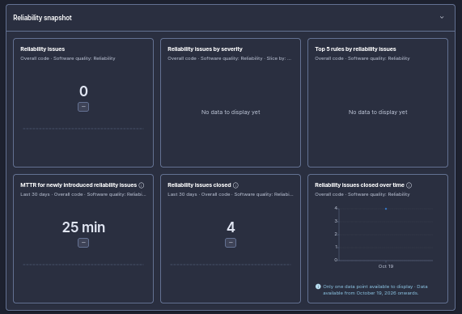
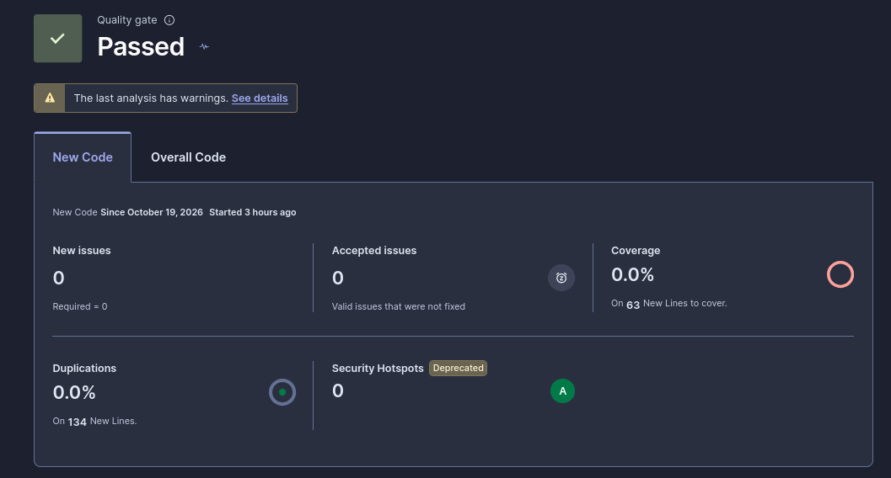
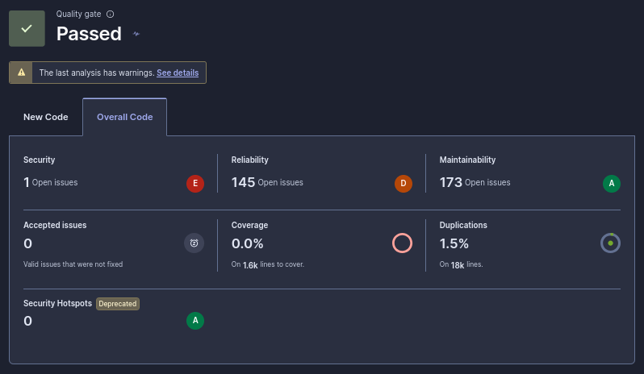
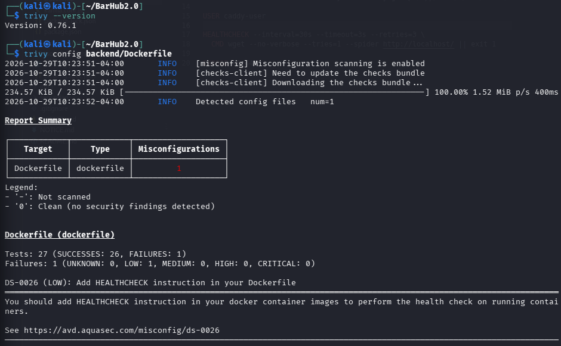
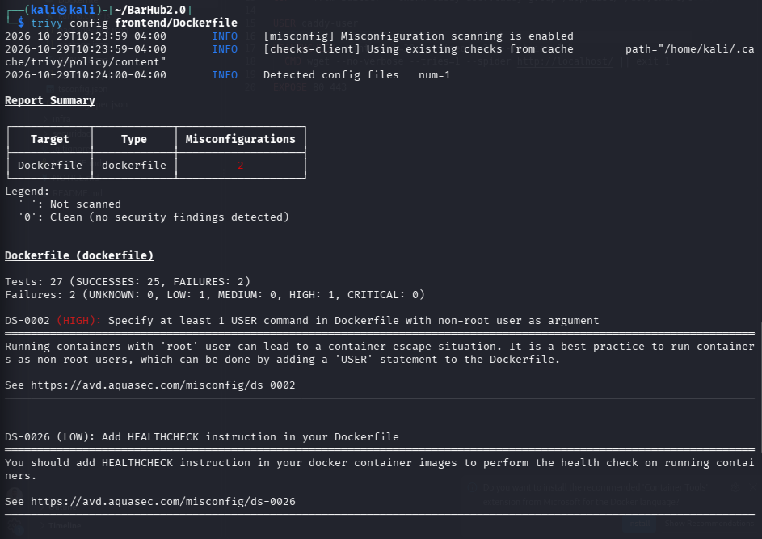
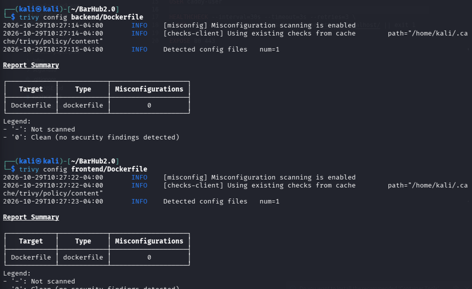

# Auditorías

Resultados de las auditorías de seguridad y calidad realizadas sobre BarHub 2.0, con su estado inicial, las acciones aplicadas y el estado final.

## Resumen ejecutivo

| Herramienta | Objetivo | Backend | Frontend |
| :--- | :--- | :---: | :---: |
| **Snyk** (reanálisis 15-nov-2026) | Vulnerabilidades en dependencias | 136 → 29 incidencias | 29 → 25 incidencias |
| **SonarQube** | Calidad, fiabilidad y mantenibilidad | PASSED |  PASSED |
| **SonarCloud** (CI, 15-nov-2026) | Calidad en el repositorio completo | Seguridad C, fiabilidad C | Seguridad A, fiabilidad A, mantenibilidad A; Quality Gate superado sobre el código nuevo |
| **Trivy** | Configuración de Dockerfiles | 1 LOW → 0 | 1 HIGH + 1 LOW → 0 |
| **Pruebas dinámicas** | Control de acceso, subidas y errores | 0 fallos (fuerza bruta pendiente) | Comprobado en navegador |

## Índice

1. [Snyk](#1-snyk)
2. [SonarQube](#2-sonarqube)
3. [Trivy](#3-trivy)
4. [Pruebas dinámicas](#4-pruebas-dinámicas)

---

## 1. Snyk

Ejecutado con Snyk CLI en **Kali Linux**.

> Cada apartado muestra primero el análisis original y después el reanálisis del 15 de noviembre de 2026. Entre ambos se retiraron dependencias sin uso (`spring-boot-starter-mail` en el backend y el cliente de Socket.IO en el frontend) y se publicaron avisos nuevos, por lo que las cifras no son directamente comparables.

### Backend · 117 dependencias

| Métrica | Inicial | Final |
| :--- | :---: | :---: |
| Incidencias | **136** | **129** |
| Rutas vulnerables | **406** | **397** |

**Acciones:**

- `jjwt` migrado a **0.12.5**, adaptando `JwtUtils.java` al API moderno.
- Base elevada a **Spring Boot 3.4.3**, resolviendo vulnerabilidades transitivas de Tomcat, Spring Security y Logback.
- `mariadb-java-client` y `mysql-connector-j` actualizados.
- Verificado con recompilación limpia: `./gradlew clean build -x test`.

**Estado final:** las incidencias restantes son avisos de menor relevancia y dependencias transitivas internas del núcleo del framework, que no afectan a la lógica de negocio propia.

#### Reanálisis del 15 de noviembre de 2026

Spring Boot 3.4 había salido de soporte y, con el tiempo, se habían publicado avisos nuevos sobre Tomcat, Jackson y el propio Spring. Acciones:

- Spring Boot de 3.4.3 a **3.5.16**.
- Versiones fijadas por encima del BOM en `build.gradle`: Tomcat 10.1.61, Jackson 2.22.4, Logback 1.5.36 y Hibernate Validator 8.0.6.Final, además del conector de MariaDB 3.5.11.
- Verificación: tras los cambios, las pruebas dinámicas de seguridad siguen con 0 fallos ([informe](evidencias/seguridad-2026-11-15.md)).

| Gravedad | Con Spring Boot 3.5.16, sin fijar versiones | Tras fijar versiones |
| :--- | :---: | :---: |
| Crítica | 7 | 1 |
| Alta | 30 | 11 |
| Media | 37 | 14 |
| Baja | 4 | 3 |
| **Total** | **78** | **29** |

**Lo que queda (29), por origen:**

| Origen | Gravedad máxima | Por qué no se corrige |
| :--- | :---: | :--- |
| Spring Framework 6.2.19 (`spring-web`, `spring-webmvc`, `spring-beans`, `spring-expression`) | Crítica | Las correcciones solo existen en la serie 7 (7.0.9) |
| Spring Security 6.5.11 | Alta | Solo en 7.0.7 y 7.1.1 |
| Spring Data JPA 3.5.13 | Media | Solo en 4.0.7 y 4.1.1 |
| `micrometer-core` 1.15.12 | Alta | Solo en 1.16 y 1.17, fuera de lo probado con Spring Boot 3.5 |
| `jaxb-core`, `log4j-api` | Alta y media | Sin parche publicado |
| `logback-classic`, `json-smart`, `asm`, `objenesis`, `jakarta.validation-api` | Media y baja | La corrección está en otra rama o es una versión preliminar |

Estos avisos no se han analizado uno a uno para decidir si son explotables en esta aplicación. La solución de fondo es migrar a Spring Boot 4 (Spring Framework 7), que está en la hoja de ruta (v2.1).

#### Migración a Spring Boot 4 (20 de noviembre de 2026, versión 2.1)

- Spring Boot de 3.5.16 a **4.2.0**: Spring Framework 7, Spring Security 7, Spring Data JPA 4, Hibernate 7, Tomcat 11 y Jackson 3. Java de 17 a **21**.
- Se quitan las versiones fijadas por encima del BOM (Tomcat, Jackson, Logback e Hibernate Validator): Spring Boot 4 ya trae versiones corregidas.
- `jjwt` 0.13.0 con Gson en lugar de Jackson 2, que deja de estar en el classpath.
- `mariadb-java-client` 4.0.0: conexión con TLS y certificado verificado por defecto, y TLS obligatorio para el usuario de la aplicación ([evidencia](evidencias/tls-mariadb-2026-11-20.md)).
- Verificación: los 176 tests del backend pasan, y las capturas automáticas de las 36 pantallas en los dos temas salen idénticas antes y después, de modo que la API devuelve los mismos datos.
- Pendiente: repetir el análisis de Snyk y las pruebas dinámicas con la versión nueva para actualizar las tablas de esta sección.

### Frontend · 102 dependencias

| Métrica | Inicial | Final |
| :--- | :---: | :---: |
| Incidencias | **29** | **22** |
| Rutas vulnerables | **33** | **22** |

**Origen inicial:** paquetes obsoletos de **Angular 14** y vulnerabilidades de alto riesgo en dependencias de red transitivas (`engine.io`, `socket.io-parser`, `ws`) introducidas por `ngx-socket-io`.

**Acciones:**

- `overrides` en `package.json` para forzar versiones parcheadas de `engine.io`, `socket.io-parser` y `ws`.
- Limpieza de módulos y reinstalación con `npm install --legacy-peer-deps`.

**Estado final:** eliminadas las vulnerabilidades transitivas de red. Las 22 restantes son avisos estructurales de **Angular 14**, cuya resolución exige una migración mayor del framework.

#### Reanálisis del 15 de noviembre de 2026

| Gravedad | Incidencias |
| :--- | :---: |
| Crítica | 1 |
| Alta | 9 |
| Media | 9 |
| Baja | 6 |
| **Total** | **25** |

- **24 son de Angular 14.3.0** (`@angular/core`, `common`, `compiler` y `router`), una versión sin soporte. La corrección es migrar a una versión vigente. No se han analizado una a una para decidir si son explotables en esta aplicación.
- **1 es de `pdfmake` 0.2.20** (media). Subir a 0.3.14 la corrige, pero introduce `fflate` con un aviso alto sin parche publicado, así que se mantiene la 0.2.20 hasta que exista corrección.
- Los `overrides` de `engine.io`, `socket.io-parser` y `ws` ya solo afectan a herramientas de desarrollo (Karma y `webpack-dev-server`). La dependencia `ngx-socket-io` se retiró al sustituir el canal en tiempo real por sondeo.

#### Migración a Angular 22 (21 de noviembre de 2026, versión 2.1)

- Angular de 14 a **22**, versión a versión con `ng update` y sus migraciones oficiales; TypeScript 6.0, zone.js 0.16 y Node 24. Build con el builder `application` (esbuild).
- Antes de migrar se retiraron las dependencias sin uso o duplicadas (`@angular/material`, `@angular/cdk`, `@angular/animations`, `@zxing/ngx-scanner`, jQuery y el Popper suelto) y se quitaron los `overrides`, que solo parcheaban las herramientas de Angular 14.
- Verificación: build de producción en cada salto y capturas automáticas de las 36 pantallas en los dos temas, sin diferencias más allá de datos y ruido conocido (fecha del día, mapa incrustado). Prueba manual del flujo de pedido completo con descarga del ticket en PDF.
- Resultado en Dependabot: de 53 alertas abiertas a 1, pendiente de revisar.
- Pendiente: repetir el análisis de Snyk con las versiones nuevas, en la siguiente auditoría.

---

## 2. SonarQube

Auditoría de calidad y mantenibilidad del código Java/Spring Boot y Angular/TypeScript. Cada capa pasó por **diagnóstico inicial → plan de refactorización → re-auditoría**.

### 2.1. Backend

#### Estado inicial: 48 incidencias

<p align="center"></p>
<p align="center"></p>
<p align="center"></p>
<p align="center"></p>

| Categoría | Nº | Problema |
| :--- | :---: | :--- |
| Seguridad | 2 | `e.printStackTrace()` en controladores |
| Fiabilidad | 3 | `equals()` sin `hashCode()` y fechas sin zona horaria explícita |
| Mantenibilidad | 45 | Complejidad cognitiva alta (p. ej. `crearPedidoSeguro`) y convenciones de nombres |

#### Plan de refactorización

1. Supresión de `printStackTrace()` y centralización de excepciones con respuestas HTTP estandarizadas.
2. `equals()` y `hashCode()` implementados juntos en `UserDetailsImpl`.
3. `PedidoServiceImpl` desglosado en métodos auxiliares privados y cohesivos.
4. Enumerados reubicados en `model/enums` y constantes de seguridad estandarizadas.
5. `new Date()` migrado a `java.time` / `Instant`.

#### Estado final: Quality Gate **PASSED**

<p align="center"></p>
<p align="center"></p>
<p align="center"></p>
<p align="center"></p>

| Métrica | Inicial | Final |
| :--- | :---: | :---: |
| **Quality Gate** | Fallido | PASSED |
| **Seguridad** | 2 | 0 |
| **Fiabilidad** | 3 | 0 |
| **Mantenibilidad** | 45 | 0 críticas / deuda minimizada |

### 2.2. Frontend

#### Estado inicial

<p align="center"></p>
<p align="center"></p>
<p align="center"></p>

| Categoría | Nº | Problema |
| :--- | :---: | :--- |
| Seguridad | 1 | Punto crítico en configuración o manejo de elementos de la interfaz |
| Fiabilidad | 145 | Elementos interactivos sin etiqueta, inputs sin atributos de control y mal manejo de estados |
| Mantenibilidad | 173 | Código duplicado, variables e imports sin usar, componentes muy acoplados |

#### Plan de refactorización

1. **Accesibilidad (WCAG) y formularios:** `<label>` asociado a cada `<input>` y `<select>`.
2. **Limpieza y tipado:** eliminación de imports sin usar y redundancias de tipos en TypeScript.
3. **Componentes:** lógica extensa de vistas admin y cliente separada en servicios y directivas reutilizables.
4. **Duplicaciones:** plantillas HTML y hojas de estilo refactorizadas por debajo del límite recomendado.

#### Estado final: Quality Gate **PASSED**

<p align="center"></p>
<p align="center"></p>
<p align="center"></p>

| Métrica | Inicial | Final |
| :--- | :---: | :---: |
| **Quality Gate** | Pasado con advertencias | PASSED |
| **Seguridad** | 1 | 0 |
| **Fiabilidad** | 145 | 0 (189 resueltas) |
| **Mantenibilidad** | 173 | 0 (220 resueltas) |

---

### SonarCloud (análisis en el pipeline)

El 15 de noviembre de 2026 se ejecutó el primer análisis completo del repositorio en SonarCloud desde GitHub Actions.

| Área | Primer análisis | Tras las correcciones |
| :--- | :---: | :---: |
| Seguridad | 10 incidencias (C) | **0 (A)** |
| Fiabilidad | 49 incidencias (C) | **45 (A)** |
| Mantenibilidad | 363 incidencias (A) | 363 (A) |
| Cobertura | 0 % | 0 % |
| Duplicación | 1,7 % | 1,7 % |

**Correcciones aplicadas**

- Acciones del workflow fijadas por SHA de commit (4 avisos).
- `npm ci --ignore-scripts` en el workflow y en el `Dockerfile` del frontend, que además bloquea las versiones con el `package-lock.json` (4 avisos).
- `gradle.lockfile` para bloquear las versiones del backend.
- Dos expresiones regulares de validación (nombre de imagen y correo) reescritas sin retrocesos excesivos.
- Tres navegaciones del editor de mesas marcadas como no esperadas (`void`).
- Contenedor del frontend ejecutado con un usuario sin privilegios.

**Lo que queda**

- 45 avisos de fiabilidad de gravedad baja, casi todos imágenes sin texto alternativo en las plantillas del frontend.
- 363 avisos de mantenibilidad (nota A), sin plan de limpieza completa.
- Cobertura global del 0 %: todavía no se envían informes de tests a SonarCloud. Es la deuda principal de esta auditoría.

**Quality Gate.** En el primer análisis el gate falló sobre el código nuevo (seguridad B, cobertura 0 % y duplicación del 10,9 %), porque todo el código reciente contaba como nuevo. Tras las correcciones se declaró `sonar.projectVersion=2.0.0` y se usa «Previous version» como definición de código nuevo, así que el gate evalúa el código posterior a la versión 2.0.0. Esta decisión no oculta nada: los valores globales de la tabla anterior siguen visibles en Overall Code.

## 3. Trivy

Escaneo de *misconfigurations* en los `Dockerfile` de backend y frontend.

### Backend · estado inicial

<p align="center"></p>

| ID | Severidad | Descripción |
| :--- | :---: | :--- |
| DS-0026 | LOW | Falta la instrucción `HEALTHCHECK` |

### Frontend · estado inicial

<p align="center"></p>

| ID | Severidad | Descripción |
| :--- | :---: | :--- |
| DS-0002 | **HIGH** | Se ejecuta como root. Falta una instrucción `USER` no root (riesgo de escalada / *container escape*) |
| DS-0026 | LOW | Falta la instrucción `HEALTHCHECK` |

### Estado final: **0 incidencias**

Tras añadir usuarios sin privilegios en las imágenes multi-etapa y directivas `HEALTHCHECK`:

<p align="center"></p>

---

## 4. Pruebas dinámicas

Además de las herramientas estáticas, se probó la API en ejecución con un script propio contra una instancia local, repetido tras cada cambio del backend. El script no se versiona; los resultados sí, en [`evidencias/`](evidencias/seguridad-2026-11-15.md).

| Ámbito | Qué se comprueba |
| :--- | :--- |
| Control de acceso | Sin token y con rol insuficiente; las rutas no declaradas se deniegan por defecto |
| Acceso a datos ajenos (IDOR) | Un usuario no puede leer ni modificar pedidos o perfiles de otro; respuesta `404` uniforme |
| Mass assignment | Los campos que el cliente no debe controlar no se aplican |
| Manipulación de precios | El total se recalcula en el servidor |
| Subida de archivos | Extensión, tipo declarado, firma real, tamaño máximo y nombre aleatorio |
| Errores | Respuestas genéricas; el detalle queda en el log |
| Fuerza bruta en el login | Pendiente: 30 intentos fallidos seguidos no provocan bloqueo |

Resultado de la última ejecución (15 de noviembre de 2026, con Spring Boot 3.5.16): **0 fallos**. Informes: [seguridad-2026-11-15](evidencias/seguridad-2026-11-15.md), [seguridad-2026-11-14](evidencias/seguridad-2026-11-14.md) y [subidas-y-errores](evidencias/subidas-y-errores.md).

---

## Cómo reproducir las auditorías

```bash
# Snyk
snyk test                                   # en backend/ y frontend/

# SonarQube / SonarCloud: ver infraestructura.md (CI/CD)

# Trivy (misconfiguration de Dockerfile)
trivy config backend/Dockerfile
trivy config frontend/Dockerfile
```