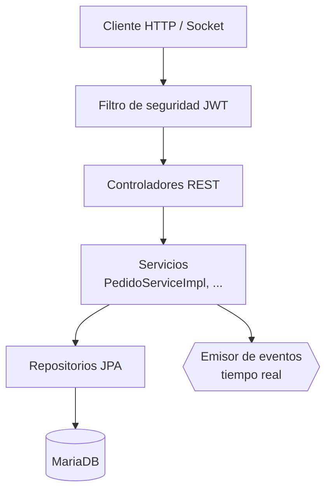
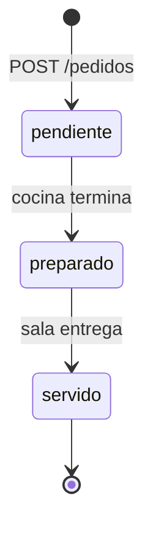
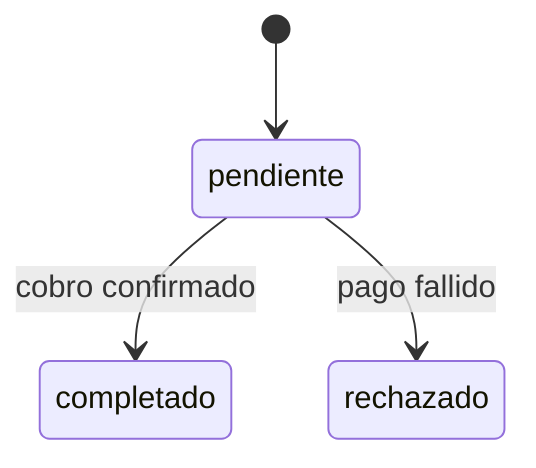
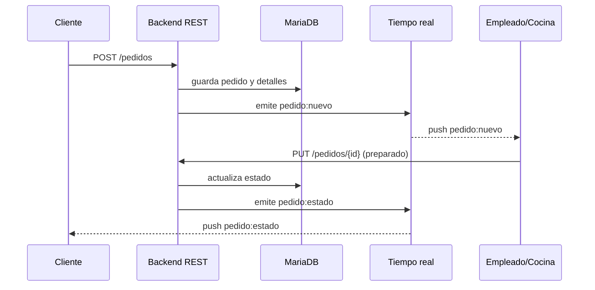

# Backend

El backend de BarHub 2.0 expone una **API REST** securizada con JWT y un canal de **tiempo real** para sincronizar comandas, mesas y caja. Está pensado para escalar, rendir bien y mantenerse a largo plazo.

## Índice

1. [Stack tecnológico](#1-stack-tecnológico)
2. [Arquitectura en capas](#2-arquitectura-en-capas)
3. [API REST](#3-api-rest)
4. [Roles y control de acceso](#4-roles-y-control-de-acceso)
5. [Ciclo de vida de un pedido](#5-ciclo-de-vida-de-un-pedido)
6. [Tiempo real](#6-tiempo-real)
7. [Calidad del código](#7-calidad-del-código)

---

## 1. Stack tecnológico

| Componente | Tecnología | Notas |
| :--- | :--- | :--- |
| Lenguaje / framework | Java + **Spring Boot 3.4.3** | Elevado desde versiones anteriores tras la auditoría Snyk |
| Build | Gradle | `./gradlew clean build -x test` |
| Base de datos | **MariaDB** | Modelo ER en [base-de-datos.md](base-de-datos.md) |
| Autenticación | **JWT** (`jjwt 0.12.5`) | Implementado en `JwtUtils.java` con el API moderno |
| Conectores BBDD | `mariadb-java-client`, `mysql-connector-j` | Versiones estables y seguras |
| Tiempo real | Socket.IO | Ver [sección 6](#6-tiempo-real) |
| Fechas | `java.time` / `Instant` | Sustituye al obsoleto `new Date()` |

## 2. Arquitectura en capas

| Capa | Responsabilidad |
| :--- | :--- |
| **Seguridad** | Valida el JWT y carga `UserDetailsImpl` con sus roles |
| **Controladores** | Reciben peticiones, validan entrada y devuelven respuestas HTTP estandarizadas |
| **Servicios** | Lógica de negocio. Métodos extensos desglosados en auxiliares privados cohesivos |
| **Repositorios** | Acceso a datos |
| **Modelo / `model/enums`** | Entidades y enumerados (estados, tipos de pedido, categorías) |

## 3. API REST

### 3.1. Autenticación · `/api/auth`

| Método | Endpoint | Descripción |
| :--- | :--- | :--- |
| `POST` | `/api/auth/signup` | Registro de nuevos usuarios (clientes o personal) |
| `POST` | `/api/auth/login` | Inicio de sesión y generación del token JWT |

### 3.2. Mesas · `/mesas`

| Método | Endpoint | Descripción |
| :--- | :--- | :--- |
| `GET` | `/mesas` | Listado de mesas y estado actual (`disponible`, `ocupada`, `reservada`) |
| `PUT` | `/mesas/{id}` | Actualiza el estado de una mesa y su vinculación |

### 3.3. Productos · `/productos`

| Método | Endpoint | Descripción |
| :--- | :--- | :--- |
| `GET` | `/productos` | Menú completo, filtrable por categoría (`bebida`, `entrante`, `postre`, `tapa`) |
| `POST` | `/productos` | Crea o actualiza productos. **Solo administradores** |

### 3.4. Pedidos y comandas · `/pedidos`

| Método | Endpoint | Descripción |
| :--- | :--- | :--- |
| `GET` | `/pedidos` | Pedidos en curso para sala y cocina |
| `POST` | `/pedidos` | Crea un pedido indicando modalidad: `domicilio`, `mesa` o `recoger` |
| `PUT` | `/pedidos/{id}` | Avanza el flujo: `pendiente` → `preparado` → `servido` |
| `GET` | `/pedidos/pendientes-efectivo` | Pedidos con pago en efectivo aún pendiente |
| `GET` | `/pedidos/mis-pedidos` | Seguimiento de los pedidos del cliente autenticado |

### 3.5. Caja y turnos · `/caja`

| Método | Endpoint | Descripción |
| :--- | :--- | :--- |
| `GET` | `/caja/actual` | Estado de la caja abierta |
| `GET` | `/caja/historial` | Histórico de turnos |
| `POST` | `/caja/abrir` | Abre turno registrando el monto inicial |
| `POST` | `/caja/cerrar` | Cierra turno calculando ventas en efectivo y tarjeta, efectivo real y descuadre |

## 4. Roles y control de acceso

Se definen en la tabla `roles` (relación N:M con `users` mediante `user_roles`):

| Rol | Descripción |
| :--- | :--- |
| `role_cliente` | Usuario final: carta, pedidos y seguimiento |
| `role_empleado` | Personal: comandas, mesas, efectivo y caja |
| `role_admin` | Gerencia: gestión completa y métricas |

El acceso se aplica a dos niveles: **backend** (Spring Security con el JWT y los roles de `UserDetailsImpl`) y **frontend** (`auth.guard.ts` / `role.guard.ts`). El backend es la barrera real; los guardas del frontend solo mejoran la experiencia.

## 5. Ciclo de vida de un pedido

El **pago** sigue un flujo independiente (`estado_pago`):

Los pagos en efectivo quedan `pendiente` hasta que un empleado los registra (`/pedidos/pendientes-efectivo`) y alimentan el cuadre de `/caja/cerrar`.

## 6. Tiempo real

Las escrituras se hacen siempre por REST; el canal de tiempo real **solo notifica** de que algo cambió. La base de datos es la fuente de la verdad.

### Compatibilidad de protocolo

El frontend usa `ngx-socket-io`, que habla **Socket.IO**, no WebSocket puro. El servidor debe ser compatible:

| Opción en Spring Boot | ¿Compatible? |
| :--- | :---: |
| `netty-socketio` | ✅ |
| Spring WebSocket + STOMP | ❌ |
| Spring WebSocket nativo | ❌ |
| Server-Sent Events | ❌ |

### Buenas prácticas aplicadas / recomendadas

- Emitir **después del commit** de la transacción (`@TransactionalEventListener(phase = AFTER_COMMIT)`) para no notificar cambios que hacen rollback.
- Enviar **DTOs mínimos**, nunca entidades JPA ni datos personales.
- Segmentar por **salas** (`staff`, `caja`, `cliente:{id}`, `mesa:{id}`) para que un cliente no reciba pedidos ajenos.
- Con **una sola instancia** el broadcast funciona directamente. Para escalar a varias réplicas haría falta un broker compartido (p. ej. Redis) y *sticky sessions*.

## 7. Calidad del código

Tras la auditoría de SonarQube se aplicó este plan (detalle en [auditorias.md](auditorias.md)):

- Eliminado `e.printStackTrace()`; excepciones centralizadas con respuestas HTTP estandarizadas.
- `equals()` y `hashCode()` implementados juntos en `UserDetailsImpl`.
- `PedidoServiceImpl` refactorizado para reducir la complejidad cognitiva.
- Enumerados reubicados en `model/enums`.
- Migración de `new Date()` a `java.time` / `Instant`.
