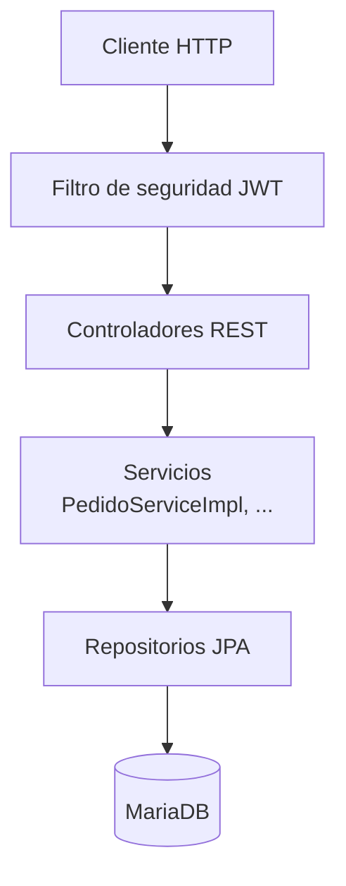
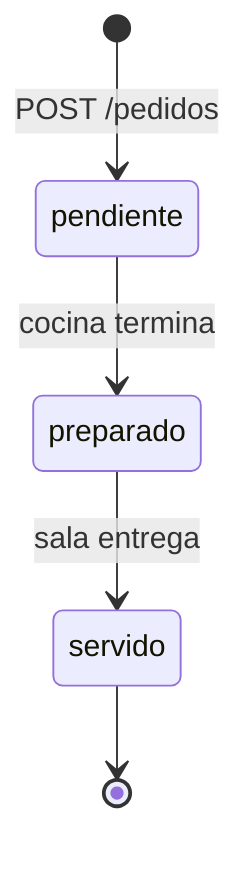
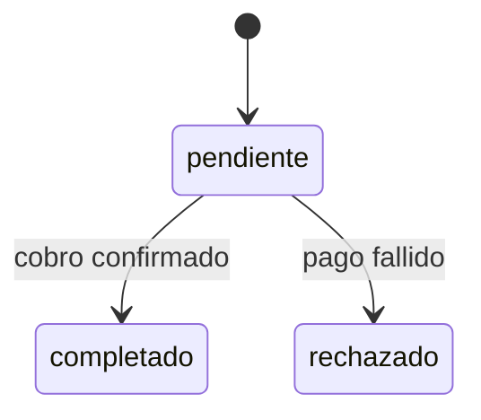
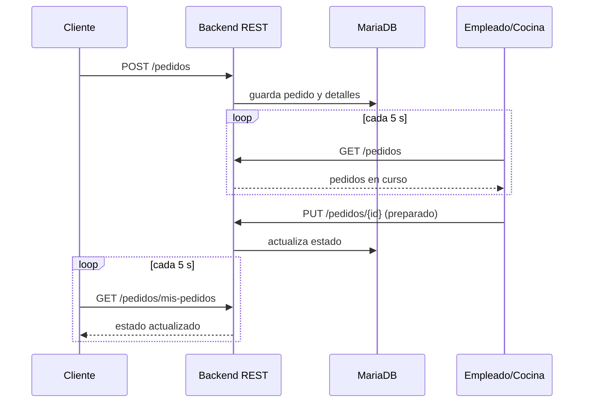

# Backend

El backend de BarHub 2.0 expone una **API REST** securizada con JWT. El frontend consulta los cambios de comandas, mesas y caja mediante sondeo periódico (cada 5 s); no hay canal de tiempo real.

## Índice

1. [Stack tecnológico](#1-stack-tecnológico)
2. [Arquitectura en capas](#2-arquitectura-en-capas)
3. [API REST](#3-api-rest)
4. [Roles y control de acceso](#4-roles-y-control-de-acceso)
5. [Ciclo de vida de un pedido](#5-ciclo-de-vida-de-un-pedido)
6. [Actualización de datos](#6-actualización-de-datos)
7. [Calidad del código](#7-calidad-del-código)

---

## 1. Stack tecnológico

| Componente | Tecnología | Notas |
| :--- | :--- | :--- |
| Lenguaje / framework | Java + **Spring Boot 3.4.3** | Elevado desde versiones anteriores tras la auditoría Snyk |
| Build | Gradle | `./gradlew clean build -x test` |
| Base de datos | **MariaDB** | Modelo ER en [base-de-datos.md](base-de-datos.md) |
| Autenticación | **JWT** (`jjwt 0.12.5`) | Implementado en `JwtUtils.java` con el API moderno |
| Conectores BBDD | `mariadb-java-client`, `mysql-connector-j` | Versiones estables y seguras |
| Actualización de datos | Sondeo REST desde el frontend | Ver [sección 6](#6-actualización-de-datos) |
| Fechas | `java.time` / `Instant` | Sustituye al obsoleto `new Date()` |

## 2. Arquitectura en capas

| Capa | Responsabilidad |
| :--- | :--- |
| **Seguridad** | Valida el JWT y carga `UserDetailsImpl` con sus roles |
| **Controladores** | Reciben peticiones, validan entrada y devuelven respuestas HTTP estandarizadas |
| **Servicios** | Lógica de negocio. Métodos extensos desglosados en auxiliares privados cohesivos |
| **Repositorios** | Acceso a datos |
| **Modelo / `model/enums`** | Entidades y enumerados (estados, tipos de pedido, categorías) |

## 3. API REST

### 3.1. Autenticación · `/auth`

Las rutas se muestran como las ve el backend. Desde fuera, Caddy las publica bajo el prefijo `/api` (por ejemplo, `/api/auth/login`).

| Método | Endpoint | Descripción |
| :--- | :--- | :--- |
| `POST` | `/auth/signup` | Registro de nuevos usuarios (clientes o personal) |
| `POST` | `/auth/login` | Inicio de sesión y generación del token JWT |

### 3.2. Mesas · `/mesas`

| Método | Endpoint | Descripción |
| :--- | :--- | :--- |
| `GET` | `/mesas` | Listado de mesas y estado actual (`disponible`, `ocupada`, `reservada`) |
| `PUT` | `/mesas/{id}` | Actualiza el estado de una mesa y su vinculación |

### 3.3. Productos · `/productos`

| Método | Endpoint | Descripción |
| :--- | :--- | :--- |
| `GET` | `/productos` | Menú completo, filtrable por categoría (`bebida`, `entrante`, `postre`, `tapa`) |
| `POST` | `/productos` | Crea un producto (datos y, opcionalmente, imagen). **Solo administradores** |
| `PUT` | `/productos/{id}` | Actualiza un producto y, si se envía, su imagen. **Solo administradores** |
| `DELETE` | `/productos/{id}` | Elimina un producto y su imagen. **Solo administradores** |

### 3.4. Pedidos y comandas · `/pedidos`

| Método | Endpoint | Descripción |
| :--- | :--- | :--- |
| `GET` | `/pedidos` | Pedidos en curso para sala y cocina |
| `POST` | `/pedidos` | Crea un pedido indicando modalidad: `domicilio`, `mesa` o `recoger` |
| `PUT` | `/pedidos/{id}` | Avanza el flujo: `pendiente` → `preparado` → `servido` |
| `GET` | `/pedidos/pendientes-efectivo` | Pedidos con pago en efectivo aún pendiente |
| `GET` | `/pedidos/mis-pedidos` | Seguimiento de los pedidos del cliente autenticado |

### 3.5. Caja y turnos · `/caja`

| Método | Endpoint | Descripción |
| :--- | :--- | :--- |
| `GET` | `/caja/actual` | Estado de la caja abierta |
| `GET` | `/caja/historial` | Histórico de turnos |
| `POST` | `/caja/abrir` | Abre turno registrando el monto inicial |
| `POST` | `/caja/cerrar` | Cierra turno calculando ventas en efectivo y tarjeta, efectivo real y descuadre |

### 3.6. Subida de imágenes (productos y perfiles)

| Control | Detalle |
| :--- | :--- |
| Extensión | Lista blanca: `jpg`, `jpeg`, `png`, `webp` |
| Tipo declarado | `Content-Type` de tipo `image/*` |
| Contenido real | Comprobación de la firma del archivo (magic bytes) |
| Tamaño | 5 MB por archivo y 6 MB por petición |
| Nombre | Generado por el servidor con sufijo aleatorio; nunca el del cliente |
| Ruta | Normalizada y comprobada dentro de la carpeta de destino |
| Sustitución y borrado | La imagen anterior se elimina solo tras guardar la nueva; también al borrar el registro |

## 4. Roles y control de acceso

Se definen en la tabla `roles` (relación N:M con `users` mediante `user_roles`):

| Rol | Descripción |
| :--- | :--- |
| `role_cliente` | Usuario final: carta, pedidos y seguimiento |
| `role_empleado` | Personal: comandas, mesas, efectivo y caja |
| `role_admin` | Gerencia: gestión completa y métricas |

El acceso se aplica a dos niveles: **backend** (Spring Security con el JWT y los roles de `UserDetailsImpl`) y **frontend** (`auth.guard.ts` / `role.guard.ts`). El backend es la barrera real; los guardas del frontend solo mejoran la experiencia.

**Denegación por defecto.** `SecurityConfig` solo permite de forma explícita `/auth/**` y las lecturas públicas necesarias; cualquier otra ruta no declarada se rechaza (`anyRequest().denyAll()`). Las operaciones de escritura llevan además `@PreAuthorize` por rol. Los intentos de acceder a pedidos o perfiles ajenos reciben un `404` uniforme.

## 5. Ciclo de vida de un pedido

El **pago** sigue un flujo independiente (`estado_pago`):

Los pagos en efectivo quedan `pendiente` hasta que un empleado los registra (`/pedidos/pendientes-efectivo`) y alimentan el cuadre de `/caja/cerrar`.

## 6. Actualización de datos

El backend no emite eventos: expone endpoints REST y el frontend los consulta cada 5 segundos en las pantallas con estado cambiante (seguimiento del pedido y vistas del personal). La base de datos es la única fuente de la verdad.

El retraso máximo para ver un cambio es de unos 5 segundos. A cambio, el diseño es simple, no necesita conexiones persistentes y funciona sin configuración adicional detrás de Caddy.

### Mejora futura

Para evitar el sondeo se podría usar Server-Sent Events o WebSocket (Spring WebSocket con STOMP). Si se aborda, conviene:

- Emitir después del commit de la transacción (`@TransactionalEventListener(phase = AFTER_COMMIT)`) para no notificar cambios que hacen rollback.
- Enviar DTOs mínimos, nunca entidades JPA ni datos personales.
- Segmentar por salas (personal, caja, cliente, mesa) para que un cliente no reciba pedidos ajenos.
- Con varias réplicas haría falta un broker compartido (por ejemplo, Redis).

## 7. Calidad del código

Tras la auditoría de SonarQube se aplicó este plan (detalle en [auditorias.md](auditorias.md)):

- Eliminado `e.printStackTrace()`; excepciones centralizadas con respuestas HTTP estandarizadas.
- `equals()` y `hashCode()` implementados juntos en `UserDetailsImpl`.
- `PedidoServiceImpl` refactorizado para reducir la complejidad cognitiva.
- Enumerados reubicados en `model/enums`.
- Migración de `new Date()` a `java.time` / `Instant`.
- Respuestas de error genéricas: el cliente no recibe detalles internos y la causa queda solo en el log del servidor.
- Validación de entrada con Bean Validation (`@Valid`) en los DTO, para rechazar datos incorrectos con un `400` en lugar de fallar al guardar.
- Denegación por defecto y `@PreAuthorize` en las operaciones de escritura (ver sección 4).
- Pruebas dinámicas de la API en ejecución, con sus resultados en [evidencias/](evidencias/seguridad-2026-11-14.md).
