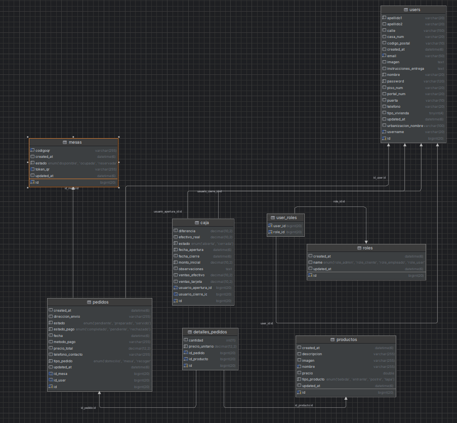
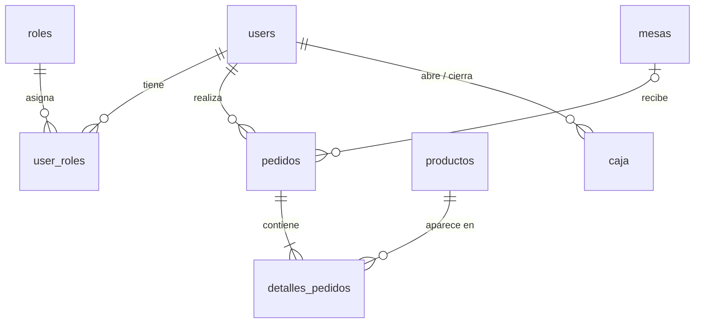

# Base de datos

Base de datos relacional **MariaDB** con un modelo entidad-relación diseñado para la gestión concurrente de usuarios, roles, mesas, catálogo, pedidos y control de caja por turnos.

  

## Índice

1. [Diagrama de relaciones](#1-diagrama-de-relaciones)
2. [Tablas](#2-tablas)
3. [Relaciones y cardinalidad](#3-relaciones-y-cardinalidad)
4. [Enumerados](#4-enumerados)
5. [Decisiones de diseño y puntos a revisar](#5-decisiones-de-diseño-y-puntos-a-revisar)

---

## 1. Diagrama de relaciones

## 2. Tablas

### `users` · Usuarios
Clientes, empleados y administradores.

| Campo | Tipo | Descripción |
| :--- | :--- | :--- |
| `id` | `bigint` PK | Identificador |
| `username` | `varchar(20)` | Nombre de usuario |
| `email` | `varchar(50)` | Correo electrónico |
| `password` | `varchar(120)` | Contraseña cifrada |
| `nombre`, `apellido1`, `apellido2` | `varchar(20)` | Datos personales |
| `telefono` | `varchar(20)` | Contacto |
| `imagen` | `text` | URL o ruta de la imagen de perfil |
| `calle` | `varchar(150)` | Dirección |
| `casa_num`, `piso_num`, `portal_num` | `varchar(20)` | Dirección |
| `puerta` | `varchar(10)` | Dirección |
| `codigo_postal` | `varchar(10)` | Dirección |
| `urbanizacion_nombre` | `varchar(100)` | Dirección |
| `tipo_vivienda` | `tinyint(4)` | Tipo de vivienda |
| `instrucciones_entrega` | `text` | Notas para el repartidor |
| `created_at`, `updated_at` | `datetime(6)` | Auditoría |

### `roles` · Roles del sistema

| Campo | Tipo | Descripción |
| :--- | :--- | :--- |
| `id` | `bigint` PK | Identificador |
| `name` | `enum` | `role_admin`, `role_cliente`, `role_empleado`, `role_user` |
| `created_at`, `updated_at` | `datetime(6)` | Auditoría |

### `user_roles` · Tabla pivote
Relación **N:M** entre `users` y `roles`.

| Campo | Tipo | Descripción |
| :--- | :--- | :--- |
| `user_id` | `bigint` FK → `users.id` | Usuario |
| `role_id` | `bigint` FK → `roles.id` | Rol asignado |

### `mesas` · Mesas del establecimiento

| Campo | Tipo | Descripción |
| :--- | :--- | :--- |
| `id` | `bigint` PK | Identificador |
| `estado` | `enum` | `disponible`, `ocupada`, `reservada` |
| `codigoqr` | `varchar(255)` | Código QR asociado |
| `token_qr` | `varchar(255)` | Token de seguridad vinculado al QR |
| `created_at`, `updated_at` | `datetime(6)` | Auditoría |

### `productos` · Catálogo

| Campo | Tipo | Descripción |
| :--- | :--- | :--- |
| `id` | `bigint` PK | Identificador |
| `nombre` | `varchar(255)` | Nombre |
| `descripcion` | `varchar(255)` | Descripción |
| `precio` | `double` | Precio unitario |
| `tipo_producto` | `enum` | `bebida`, `entrante`, `postre`, `tapa` |
| `imagen` | `varchar(255)` | Imagen del producto |
| `created_at`, `updated_at` | `datetime(6)` | Auditoría |

### `pedidos` · Pedidos y comandas

| Campo | Tipo | Descripción |
| :--- | :--- | :--- |
| `id` | `bigint` PK | Identificador |
| `id_user` | `bigint` FK → `users.id` | Quien realiza el pedido |
| `id_mesa` | `bigint` FK → `mesas.id`, *nullable* | Mesa (solo consumo local) |
| `tipo_pedido` | `enum` | `domicilio`, `mesa`, `recoger` |
| `estado` | `enum` | `pendiente`, `preparado`, `servido` |
| `estado_pago` | `enum` | `completado`, `pendiente`, `rechazado` |
| `metodo_pago` | `varchar(255)` | Forma de pago |
| `precio_total` | `decimal(12,2)` | Coste total |
| `fecha` | `datetime(6)` | Fecha y hora del pedido |
| `telefono_contacto` | `varchar(255)` | Teléfono de contacto |
| `direccion_envio` | `varchar(255)` | Destino (domicilio) |
| `created_at`, `updated_at` | `datetime(6)` | Auditoría |

### `detalles_pedidos` · Líneas del pedido

| Campo | Tipo | Descripción |
| :--- | :--- | :--- |
| `id` | `bigint` PK | Identificador |
| `id_pedido` | `bigint` FK → `pedidos.id` | Pedido |
| `id_producto` | `bigint` FK → `productos.id` | Producto |
| `cantidad` | `int(11)` | Unidades |
| `precio_unitario` | `decimal(12,2)` | Precio en el momento de la compra |

### `caja` · Turnos de caja

| Campo | Tipo | Descripción |
| :--- | :--- | :--- |
| `id` | `bigint` PK | Identificador |
| `estado` | `enum` | `abierta`, `cerrada` |
| `fecha_apertura`, `fecha_cierre` | `datetime(6)` | Marcas temporales |
| `monto_inicial` | `decimal(10,2)` | Dinero base al abrir |
| `efectivo_real` | `decimal(10,2)` | Efectivo contado al cierre |
| `ventas_efectivo`, `ventas_tarjeta` | `decimal(10,2)` | Totales por método |
| `diferencia` | `decimal(10,2)` | Cuadre o descuadre |
| `usuario_apertura_id`, `usuario_cierre_id` | `bigint` FK → `users.id` | Responsables |
| `observaciones` | `text` | Incidencias del turno |

## 3. Relaciones y cardinalidad

| Relación | Tipo | Detalle |
| :--- | :--- | :--- |
| `users` ↔ `roles` | N:M | Resuelta con `user_roles` |
| `users` → `pedidos` | 1:N | Un usuario realiza muchos pedidos |
| `mesas` → `pedidos` | 1:N | Una mesa acumula pedidos a lo largo del tiempo |
| `pedidos` ↔ `productos` | N:M | Resuelta con `detalles_pedidos` |
| `users` → `caja` | 1:N | Auditoría de apertura y cierre por empleado |

## 4. Enumerados

| Campo | Valores |
| :--- | :--- |
| `roles.name` | `role_admin`, `role_cliente`, `role_empleado`, `role_user` |
| `mesas.estado` | `disponible`, `ocupada`, `reservada` |
| `productos.tipo_producto` | `bebida`, `entrante`, `postre`, `tapa` |
| `pedidos.tipo_pedido` | `domicilio`, `mesa`, `recoger` |
| `pedidos.estado` | `pendiente`, `preparado`, `servido` |
| `pedidos.estado_pago` | `completado`, `pendiente`, `rechazado` |
| `caja.estado` | `abierta`, `cerrada` |