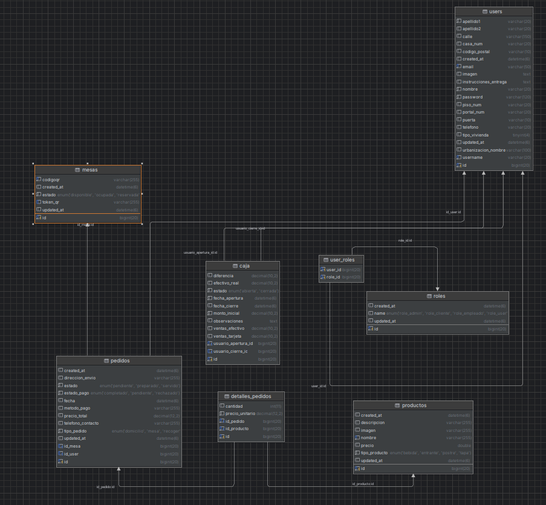
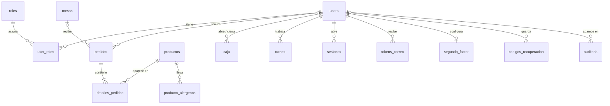

# Base de datos

Base de datos relacional **MariaDB** con el negocio del bar (usuarios y roles, mesas, carta, pedidos y caja) y, desde la versión 2.1, la seguridad de las cuentas (sesiones, enlaces del correo, verificación en dos pasos), el registro de jornada y el registro de auditoría.

  

La imagen es el modelo original de la 2.0. El diagrama de la sección 1 ya incluye las tablas de la 2.1.

## Índice

1. [Diagrama de relaciones](#1-diagrama-de-relaciones)
2. [Tablas del negocio](#2-tablas-del-negocio)
3. [Tablas de cuentas y seguridad](#3-tablas-de-cuentas-y-seguridad)
4. [Relaciones y cardinalidad](#4-relaciones-y-cardinalidad)
5. [Enumerados](#5-enumerados)
6. [Decisiones de diseño y puntos a revisar](#6-decisiones-de-diseño-y-puntos-a-revisar)

---

## 1. Diagrama de relaciones

`turnos`, `sesiones`, `tokens_correo`, `segundo_factor`, `codigos_recuperacion` y `auditoria` guardan el id del usuario (`id_user`) sin clave foránea: así una cuenta se anonimiza sin perder el historial, y el registro de auditoría conserva las entradas de cuentas que ya no existen.

## 2. Tablas del negocio

### `users` · Usuarios
Clientes, empleados y administradores.

| Campo | Tipo | Descripción |
| :--- | :--- | :--- |
| `id` | `bigint` PK | Identificador |
| `username` | `varchar(50)`, único | Nombre de usuario |
| `email` | `varchar(150)`, único | Correo electrónico |
| `email_verificado` | `bit` | Si ha abierto el enlace de confirmación |
| `password` | `varchar(60)` | Hash BCrypt de la contraseña |
| `nombre`, `apellido1`, `apellido2` | `varchar(50)` | Datos personales |
| `telefono` | `varchar(20)` | Contacto |
| `imagen` | `text` | Nombre del archivo de la foto de perfil (`usuario-{id}-{sufijo}.ext`) |
| `calle` | `varchar(150)` | Dirección |
| `casa_num`, `piso_num`, `portal_num` | `varchar(20)` | Dirección |
| `puerta` | `varchar(10)` | Dirección |
| `codigo_postal` | `varchar(10)` | Dirección |
| `urbanizacion_nombre` | `varchar(100)` | Dirección |
| `tipo_vivienda` | `tinyint` | Piso, urbanización o casa (por posición) |
| `instrucciones_entrega` | `text` | Notas para el repartidor |
| `eliminado_en` | `datetime(6)` | Cuándo se eliminó (anonimizó) la cuenta; `null` si está activa |
| `created_at`, `updated_at` | `datetime(6)` | Alta y última modificación |

### `roles` y `user_roles` · Roles

| Tabla | Campo | Tipo | Descripción |
| :--- | :--- | :--- | :--- |
| `roles` | `id` | `bigint` PK | Identificador |
| `roles` | `name` | `enum` | `ROLE_ADMIN`, `ROLE_EMPLEADO`, `ROLE_CLIENTE`, `ROLE_USER` |
| `roles` | `created_at`, `updated_at` | `datetime(6)` | Alta y última modificación |
| `user_roles` | `user_id`, `role_id` | `bigint` FK | Relación **N:M** entre `users` y `roles` |

`ROLE_USER` existe en el enumerado pero no se asigna: el registro siempre da `ROLE_CLIENTE`, y el personal lo da de alta el administrador.

### `mesas` · Mesas del local

| Campo | Tipo | Descripción |
| :--- | :--- | :--- |
| `id` | `bigint` PK | Identificador; es lo que lleva el QR de la mesa |
| `codigoqr` | `varchar(255)`, único | Código de la mesa |
| `token_qr` | `varchar(255)`, único | Sin uso: el QR de la mesa lleva su id, no este token ([seguridad.md](seguridad.md#3-modelo-de-amenazas-básico), amenaza 8) |
| `estado` | `enum` | `DISPONIBLE`, `OCUPADA`, `RESERVADA` |
| `created_at`, `updated_at` | `datetime(6)` | Alta y última modificación |

### `productos` y `producto_alergenos` · Carta

| Campo | Tipo | Descripción |
| :--- | :--- | :--- |
| `id` | `bigint` PK | Identificador |
| `nombre` | `varchar(255)`, único | Nombre en español |
| `descripcion` | `varchar(255)` | Descripción en español |
| `nombre_pt`, `nombre_en` | `varchar(100)` | Nombre en portugués e inglés; `null` si no se ha traducido (la carta usa el español) |
| `descripcion_pt`, `descripcion_en` | `varchar(500)` | Descripción en portugués e inglés |
| `precio` | `double` | Precio unitario |
| `tipo_producto` | `enum` | `BEBIDA`, `ENTRANTE`, `TAPA`, `POSTRE` |
| `imagen` | `varchar(255)` | Nombre del archivo de la imagen |
| `alergenos_declarados` | `bit` | Si el bar ya ha indicado sus alérgenos. Sin indicar, la carta dice que se pregunte al personal |
| `created_at`, `updated_at` | `datetime(6)` | Alta y última modificación |

`producto_alergenos` (`producto_id`, `alergeno` `varchar(30)`) guarda los alérgenos de cada producto, de los 14 de declaración obligatoria del Reglamento (UE) 1169/2011. Una lista vacía con `alergenos_declarados = 1` significa que no lleva ninguno.

### `pedidos` · Pedidos y comandas

| Campo | Tipo | Descripción |
| :--- | :--- | :--- |
| `id` | `bigint` PK | Identificador |
| `id_user` | `bigint` FK → `users.id`, *nullable* | Quién hizo el pedido; `null` si se hizo sin sesión |
| `id_mesa` | `bigint` FK → `mesas.id`, *nullable* | Mesa (solo pedidos en el local) |
| `tipo_pedido` | `enum` | `MESA`, `RECOGER`, `DOMICILIO` |
| `estado` | `enum` | `PENDIENTE`, `PREPARADO`, `DE_CAMINO`, `LISTO_PARA_RECOGER`, `SERVIDO` |
| `estado_pago` | `enum` | `PENDIENTE`, `COMPLETADO`, `RECHAZADO` |
| `metodo_pago` | `varchar(255)` | `EFECTIVO` o `TARJETA` |
| `pago_id` | `varchar(100)`, único | Id del pago en Stripe (`pi_...`) de los pedidos con tarjeta. Al ser único, un pago no sirve para dos pedidos |
| `precio_total` | `decimal(10,2)` | Total, calculado en el servidor con los precios de la carta |
| `fecha` | `datetime(6)` | Fecha y hora del pedido |
| `telefono_contacto` | `varchar(255)` | Teléfono de contacto |
| `direccion_envio` | `varchar(255)` | Destino (domicilio) |
| `created_at`, `updated_at` | `datetime(6)` | Alta y última modificación |

### `detalles_pedidos` · Líneas del pedido

| Campo | Tipo | Descripción |
| :--- | :--- | :--- |
| `id` | `bigint` PK | Identificador |
| `id_pedido` | `bigint` FK → `pedidos.id` | Pedido |
| `id_producto` | `bigint` FK → `productos.id` | Producto |
| `cantidad` | `int` | Unidades |
| `precio_unitario` | `decimal(10,2)` | Precio en el momento del pedido |

### `caja` · Turnos de caja

| Campo | Tipo | Descripción |
| :--- | :--- | :--- |
| `id` | `bigint` PK | Identificador |
| `estado` | `enum` | `ABIERTA`, `CERRADA` |
| `fecha_apertura`, `fecha_cierre` | `datetime(6)` | Apertura y cierre |
| `monto_inicial` | `decimal(10,2)` | Dinero en el cajón al abrir |
| `ventas_efectivo`, `ventas_tarjeta` | `decimal(10,2)` | Ventas del turno por método |
| `efectivo_real` | `decimal(10,2)` | Efectivo contado al cerrar |
| `diferencia` | `decimal(10,2)` | Descuadre (positivo si sobra) |
| `usuario_apertura_id`, `usuario_cierre_id` | `bigint` FK → `users.id` | Quién abrió y quién cerró |
| `observaciones` | `text` | Incidencias del turno |

### `turnos` · Registro de jornada

| Campo | Tipo | Descripción |
| :--- | :--- | :--- |
| `id` | `bigint` PK | Identificador |
| `id_user` | `bigint` | Empleado o administrador |
| `username` | `varchar(50)` | Su nombre de usuario en ese momento |
| `entrada`, `salida` | `datetime(6)` | Inicio (al iniciar sesión) y fin del turno; `salida` es `null` mientras sigue abierto |
| `cierre` | `enum` | `TERMINADO` (pulsó «Terminar turno») o `AUTOMATICO` (cerrado con su última actividad, al no quedarle sesiones abiertas) |

## 3. Tablas de cuentas y seguridad

Ninguna guarda un secreto en claro: de los tokens y los códigos solo se guarda su huella, y el secreto de la verificación en dos pasos va cifrado.

### `sesiones` · Sesiones abiertas

| Campo | Tipo | Descripción |
| :--- | :--- | :--- |
| `id` | `varchar(36)` PK | Identificador (UUID); va en el token de acceso como `sid` |
| `id_user` | `bigint` | Usuario |
| `token_hash`, `token_anterior_hash` | `varchar(64)` | SHA-256 del token de renovación actual y del anterior (para la rotación) |
| `rotado_en` | `datetime(6)` | Última rotación del token de renovación |
| `creada`, `ultima_actividad`, `caduca_en` | `datetime(6)` | Inicio, última actividad y caducidad absoluta |
| `inactividad_segundos` | `bigint` | Inactividad permitida, según el rol |
| `revocada_en`, `motivo_revocacion` | `datetime(6)`, `varchar(20)` | Cierre de la sesión y por qué (cierre de sesión, cambio de contraseña, cuenta eliminada...) |
| `reautenticada_en` | `datetime(6)` | Última vez que confirmó su identidad para una acción crítica |
| `ip`, `agente` | `varchar(45)`, `varchar(255)` | Desde dónde se abrió, para la lista de sesiones del perfil |

### `tokens_correo` · Enlaces enviados por correo

| Campo | Tipo | Descripción |
| :--- | :--- | :--- |
| `id` | `bigint` PK | Identificador |
| `id_user` | `bigint` | Usuario |
| `tipo` | `varchar(20)` | `VERIFICACION`, `RECUPERACION` o `CAMBIO_CORREO` |
| `token_hash` | `varchar(64)` | SHA-256 del token del enlace |
| `creado`, `caduca_en`, `usado_en` | `datetime(6)` | Envío, caducidad (24 h la confirmación y el cambio de correo, 30 min la recuperación) y uso; un enlace solo vale una vez |
| `nuevo_email` | `varchar(150)` | El correo nuevo, en los cambios de correo |

### `segundo_factor` y `codigos_recuperacion` · Verificación en dos pasos

| Tabla | Campo | Tipo | Descripción |
| :--- | :--- | :--- | :--- |
| `segundo_factor` | `id_user` | `bigint` | Usuario |
| `segundo_factor` | `secreto_cifrado` | `varchar(200)` | Secreto TOTP cifrado con AES-256-GCM, con el id del usuario como dato autenticado: copiado a la fila de otro usuario no se descifra |
| `segundo_factor` | `activo`, `creado_en`, `activado_en` | `bit`, `datetime(6)` | Si está activa y desde cuándo |
| `segundo_factor` | `ultimo_paso` | `bigint` | Último paso de 30 s aceptado: un código no se puede usar dos veces |
| `codigos_recuperacion` | `id_user`, `huella` | `bigint`, `varchar(64)` | HMAC-SHA256 de cada código de recuperación, con la clave del servidor |
| `codigos_recuperacion` | `creado_en`, `usado_en` | `datetime(6)` | Generación y uso (cada código vale una vez) |

### `auditoria` · Registro de auditoría

| Campo | Tipo | Descripción |
| :--- | :--- | :--- |
| `id` | `bigint` PK | Identificador |
| `fecha` | `datetime(6)` | Cuándo |
| `id_user`, `usuario` | `bigint`, `varchar(50)` | Quién (o el nombre escrito en un login fallido) |
| `accion` | `varchar(40)` | Una de las 23 acciones de `AccionAuditoria` (inicio de sesión, cambio de contraseña, caja abierta, acceso denegado...) |
| `resultado` | `varchar(12)` | `CORRECTO`, `RECHAZADO`, `BLOQUEADO` o `ERROR` |
| `ip` | `varchar(45)` | IP del cliente |
| `objetivo` | `varchar(100)` | Sobre quién se actuó |
| `detalle` | `varchar(200)` | Qué cambió (nunca contraseñas, códigos ni tokens) |
| `peticion` | `varchar(160)` | Método y ruta |

Índices: `sesiones` por `token_hash` (único), `token_anterior_hash` e `id_user`; `tokens_correo` por `token_hash` (único) e `id_user`; `segundo_factor` por `id_user` (único: una configuración por usuario); `codigos_recuperacion` por `id_user` y `huella`; `turnos` por `id_user` y `entrada`; `auditoria` por `fecha`, `id_user` y `accion`.

## 4. Relaciones y cardinalidad

| Relación | Tipo | Detalle |
| :--- | :--- | :--- |
| `users` ↔ `roles` | N:M | Resuelta con `user_roles` |
| `users` → `pedidos` | 1:N | Un usuario hace muchos pedidos; un pedido sin sesión no tiene usuario |
| `mesas` → `pedidos` | 1:N | Una mesa acumula pedidos a lo largo del tiempo |
| `pedidos` ↔ `productos` | N:M | Resuelta con `detalles_pedidos` |
| `productos` → `producto_alergenos` | 1:N | Alérgenos de cada producto |
| `users` → `caja` | 1:N | Quién abre y quién cierra cada caja |
| `users` → `turnos`, `sesiones`, `tokens_correo`, `codigos_recuperacion` | 1:N | Por `id_user`, sin clave foránea |
| `users` → `segundo_factor` | 1:1 | Por `id_user`, sin clave foránea |

## 5. Enumerados

Se guardan con su nombre (`@Enumerated(EnumType.STRING)`), salvo `users.tipo_vivienda`, que se guarda por posición.

| Campo | Valores |
| :--- | :--- |
| `roles.name` | `ROLE_ADMIN`, `ROLE_EMPLEADO`, `ROLE_CLIENTE`, `ROLE_USER` |
| `mesas.estado` | `DISPONIBLE`, `OCUPADA`, `RESERVADA` |
| `productos.tipo_producto` | `BEBIDA`, `ENTRANTE`, `TAPA`, `POSTRE` |
| `producto_alergenos.alergeno` | `GLUTEN`, `CRUSTACEOS`, `HUEVOS`, `PESCADO`, `CACAHUETES`, `SOJA`, `LACTEOS`, `FRUTOS_DE_CASCARA`, `APIO`, `MOSTAZA`, `SESAMO`, `SULFITOS`, `ALTRAMUCES`, `MOLUSCOS` |
| `pedidos.tipo_pedido` | `MESA`, `RECOGER`, `DOMICILIO` |
| `pedidos.estado` | `PENDIENTE`, `PREPARADO`, `DE_CAMINO`, `LISTO_PARA_RECOGER`, `SERVIDO` |
| `pedidos.estado_pago` | `PENDIENTE`, `COMPLETADO`, `RECHAZADO` |
| `pedidos.metodo_pago` | `EFECTIVO`, `TARJETA` (texto) |
| `caja.estado` | `ABIERTA`, `CERRADA` |
| `turnos.cierre` | `TERMINADO`, `AUTOMATICO` |
| `tokens_correo.tipo` | `VERIFICACION`, `RECUPERACION`, `CAMBIO_CORREO` |
| `auditoria.resultado` | `CORRECTO`, `RECHAZADO`, `BLOQUEADO`, `ERROR` |
| `users.tipo_vivienda` | `PISO` (0), `URBANIZACION` (1), `CASA` (2) |

## 6. Decisiones de diseño y puntos a revisar

| Tema | Situación | Posible mejora |
| :--- | :--- | :--- |
| Esquema | Lo crea y lo amplía Hibernate al arrancar (`ddl-auto: update`); los cambios que `update` no hace (como pasar `tokens_correo.tipo` de `ENUM` a `VARCHAR(20)` en bases antiguas) los aplica el backend al arrancar | Migraciones versionadas con Flyway o Liquibase |
| Importes | `productos.precio` es `double`, mientras que `pedidos` y `detalles_pedidos` usan `decimal(10,2)` | Pasar `precio` a `decimal(10,2)` para evitar errores de redondeo |
| Borrado de cuentas | Eliminar una cuenta la anonimiza: borra los datos personales, la foto, la verificación en dos pasos y los enlaces pendientes, cierra las sesiones y conserva los pedidos sin dirección ni teléfono; sus entradas de auditoría se quedan sin nombre ni IP | Sin cambios |
| Borrado del resto | Productos, mesas y pedidos se borran de forma definitiva | Borrado lógico de pedidos, por trazabilidad contable |
| Limpieza | Tres tareas programadas, de madrugada, borran las sesiones y los enlaces del correo que ya no sirven y las entradas de auditoría de más de un año (`app.auditoria.dias`) | Sin cambios |
| Imágenes | Se guardan en disco (volumen `uploads`); la tabla solo guarda el nombre | Almacenamiento de objetos si se escala a varias instancias |
| Datos iniciales | Con `APP_SEED_DEMO=true`, si no hay productos ni mesas, se cargan 19 productos y 10 mesas desde `backend/src/main/resources/demo/demo-data.sql`, y `demo-traducciones.sql` traduce los que aún no tienen ninguna traducción. El administrador solo se crea si no existe ninguno, con la contraseña de `APP_SEED_ADMIN_PASSWORD` | Sin cambios |
| Conexión | Conector de MariaDB (`mariadb-java-client` 4.0.0) con TLS y el certificado del servidor verificado; el usuario de la aplicación tiene el TLS obligatorio ([evidencia](evidencias/tls-mariadb-2026-11-20.md)) | Sin cambios |
