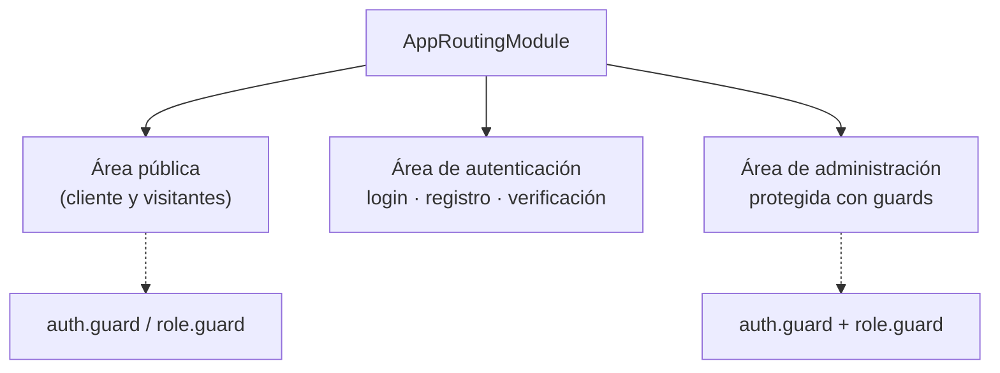
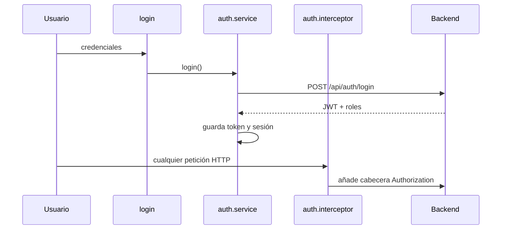

# Frontend

Aplicación **Angular 14** organizada en módulos por área funcional, con rutas protegidas por guardas, interceptor de autenticación y cliente de tiempo real.

## Índice

1. [Configuración del proyecto](#1-configuración-del-proyecto)
2. [Mapa de rutas y áreas](#2-mapa-de-rutas-y-áreas)
3. [Módulo de autenticación](#3-módulo-de-autenticación)
4. [Área pública](#4-área-pública)
5. [Área de administración](#5-área-de-administración)
6. [Componentes compartidos](#6-componentes-compartidos)
7. [Tiempo real en el cliente](#7-tiempo-real-en-el-cliente)
8. [Estilos, temas y accesibilidad](#8-estilos-temas-y-accesibilidad)

---

## 1. Configuración del proyecto

Archivos de la raíz `frontend/`:

| Archivo | Función |
| :--- | :--- |
| `angular.json` | Configuración de Angular CLI: build, optimizaciones, entornos |
| `package.json` / `package-lock.json` | Dependencias y scripts (`npm start`, `npm build`, `npm test`) |
| `Dockerfile` | Multi-etapa (Node.js + Caddy) para producción, usuario no root y `HEALTHCHECK` |
| `karma.conf.js` | Pruebas unitarias con Karma + Jasmine (usa el prefijo `node:path`) |
| `.browserslistrc` | Navegadores objetivo |
| `.editorconfig` | Estilo de código consistente entre editores |

```bash
npm install --legacy-peer-deps   # necesario por restricciones de peer deps de Angular 14
npm start
npm test
```

## 2. Mapa de rutas y áreas

`AppRoutingModule` divide la navegación en tres áreas:



| Área | Acceso | Contenido |
| :--- | :--- | :--- |
| Pública | Visitantes y clientes; vistas de personal con guarda | Carta, pedidos, mesas, contacto, políticas |
| Autenticación | Abierta | Login, registro, verificación de email |
| Administración | Rol admin | CRUD del negocio y métricas |

## 3. Módulo de autenticación

`auth/`

| Pieza | Función |
| :--- | :--- |
| `login` | Formulario de inicio de sesión |
| `register` | Registro de usuarios nuevos |
| `verificacion` | Verificación por correo (`email-verification`) |
| `auth.service.ts` | Lógica de autenticación, almacenamiento del token y estado de sesión |
| `auth.guard.ts` | Exige sesión iniciada |
| `role.guard.ts` | Exige el rol adecuado para la ruta |
| `auth.interceptor.ts` | Adjunta el token JWT a las peticiones HTTP salientes |



## 4. Área pública

`public/` · experiencia del cliente y operativa diaria del personal.

| Componente | Función | Usuario |
| :--- | :--- | :--- |
| `home` | Página de inicio | Todos |
| `carta` | Menú de productos | Cliente |
| `confirmar-pedido` | Revisión y confirmación del pedido | Cliente |
| `seguimiento-pedidos` | Estado actual del pedido | Cliente |
| `perfil` | Datos del perfil | Cliente |
| `contacto` | Formulario e información de contacto | Todos |
| `politica-privacidad`, `terminos-condiciones` | Páginas legales | Todos |
| `gestionar-comandas` | Comandas en tiempo real | Empleado |
| `gestionar-mesas-empleado` | Estado de las mesas | Empleado |
| `gestionar-pagos-efectivo` | Registro de pagos en efectivo | Empleado |
| `gestionar-caja` | Apertura, cierre y transacciones | Empleado |

## 5. Área de administración

`admin/` · estilos compartidos en `crud-styles.css`. Cada entidad sigue el patrón **gestionar / editar / ver**.

| Módulo | Componentes | Función |
| :--- | :--- | :--- |
| `bienvenida` | — | Dashboard inicial |
| `productos` | `gestionar-productos`, `editar-productos`, `ver-producto` | Catálogo de la carta |
| `pedidos` | `gestionar-pedidos`, `editar-pedidos`, `ver-pedido` | Control general de pedidos |
| `detalles_pedidos` | `gestionar-detalles`, `editar-detalles`, `ver-detalle` | Líneas de cada pedido |
| `mesas` | `gestionar-mesas`, `editar-mesas`, `ver-mesa` | Distribución y estado de mesas |
| `usuarios` | `gestionar-usuarios`, `editar-usuarios`, `ver-usuario` | Cuentas, roles y permisos |
| `metricas` | — | Estadísticas y rendimiento del negocio |

## 6. Componentes compartidos

| Carpeta | Contenido |
| :--- | :--- |
| `shared/custom-toast` | Notificaciones flotantes (feedback visual) |
| `shared/footer` | Pie de página común |
| `shared/modals` | Diálogos reutilizables, p. ej. `modal-confirmar-eliminar` |
| `uicomponents/menu` | Navegación principal |

## 7. Tiempo real en el cliente

Se usa `ngx-socket-io` (protocolo **Socket.IO**). Las dependencias transitivas `engine.io`, `socket.io-parser` y `ws` están parcheadas con `overrides` en `package.json` (ver [auditorias.md](auditorias.md)).

```ts
const config: SocketIoConfig = {
  url: environment.socketUrl,
  options: {
    transports: ['websocket'],
    autoConnect: false,                       // se conecta tras el login
    auth: (cb) => cb({ token: localStorage.getItem('token') })
  }
};
```

```ts
// core/realtime.service.ts: un único servicio que encapsula el socket
@Injectable({ providedIn: 'root' })
export class RealtimeService {
  constructor(private socket: Socket) {}
  conectar()    { if (!this.socket.ioSocket.connected) this.socket.connect(); }
  desconectar() { this.socket.disconnect(); }
  pedidoNuevo$():  Observable<any> { return this.socket.fromEvent('pedido:nuevo'); }
  pedidoEstado$(): Observable<any> { return this.socket.fromEvent('pedido:estado'); }
  mesaEstado$():   Observable<any> { return this.socket.fromEvent('mesa:estado'); }
  cajaActualizada$(): Observable<any> { return this.socket.fromEvent('caja:actualizada'); }
}
```

**Patrón recomendado:** carga inicial por REST + actualizaciones por socket, con `takeUntil(destroy$)` en `ngOnDestroy` para evitar fugas y eventos duplicados.

| Pantalla | Eventos |
| :--- | :--- |
| `gestionar-comandas` | `pedido:nuevo`, `pedido:estado` |
| `gestionar-mesas-empleado` | `mesa:estado` |
| `gestionar-pagos-efectivo` | `pedido:pago`, `caja:actualizada` |
| `gestionar-caja` | `caja:actualizada` |
| `seguimiento-pedidos` | `pedido:estado` |

**Ciclo de vida:** login → `conectar()` → suscripciones → logout → `desconectar()`. Si se pierde la red, `ngx-socket-io` reconecta solo; al reconectar conviene recargar el estado por REST.

Catálogo completo de eventos en [backend.md](backend.md#6-tiempo-real).

## 8. Estilos, temas y accesibilidad

| Elemento | Detalle |
| :--- | :--- |
| `crud-styles.css` | Estilos compartidos del área de administración |
| Estilos por componente | Hojas específicas de cada vista |
| `theme.service.ts` | Gestión de temas para adaptabilidad visual |
| `assets/` | Imágenes corporativas y de fondo |

**Accesibilidad (WCAG):** todas las interfaces se refactorizaron para cumplir los ratios mínimos de contraste: colores sólidos optimizados, eliminación de opacidades conflictivas en textos y contraste verificado en botones y elementos interactivos. Además, tras la auditoría de SonarQube, cada `<input>` y `<select>` tiene su `<label>` asociado para ofrecer nombres accesibles.