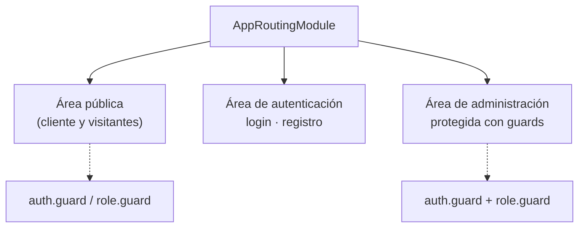
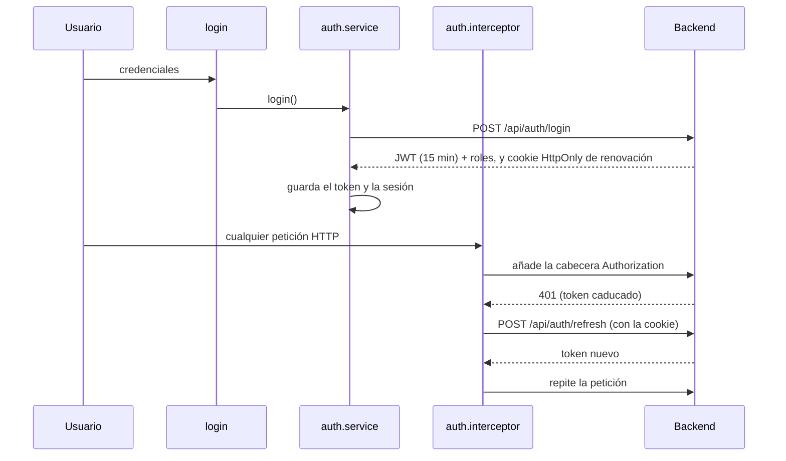

# Frontend

Aplicación **Angular 22** organizada en módulos por área funcional, con rutas protegidas por guardas, un interceptor que añade el token y renueva la sesión, avisos en tiempo real del servidor y la interfaz del cliente en tres idiomas.

## Índice

1. [Configuración del proyecto](#1-configuración-del-proyecto)
2. [Mapa de rutas y áreas](#2-mapa-de-rutas-y-áreas)
3. [Módulo de autenticación](#3-módulo-de-autenticación)
4. [Área pública](#4-área-pública)
5. [Área de administración](#5-área-de-administración)
6. [Componentes compartidos](#6-componentes-compartidos)
7. [Actualización de datos en el cliente](#7-actualización-de-datos-en-el-cliente)
8. [Estilos, temas y accesibilidad](#8-estilos-temas-y-accesibilidad)
9. [Idiomas](#9-idiomas)

---

## 1. Configuración del proyecto

Archivos de la raíz `frontend/`:

| Archivo | Función |
| :--- | :--- |
| `angular.json` | Configuración de Angular CLI: build, optimizaciones, entornos |
| `package.json` / `package-lock.json` | Dependencias y scripts (`npm start`, `npm build`, `npm test`) |
| `Caddyfile` | Servidor estático del contenedor: caché (`immutable` para los bundles con hash, `no-cache` para el resto) y reescritura de rutas de la SPA |
| `Dockerfile` | Multi-etapa (Node.js + Caddy) para producción, usuario no root y `HEALTHCHECK` |
| `.editorconfig` | Estilo de código consistente entre editores |

```bash
npm ci --legacy-peer-deps   # igual que en el CI y en Docker; alguna dependencia aún declara versiones antiguas de Angular
npm start
npm test                              # tests unitarios con Vitest
npm test -- --watch=false --coverage  # con cobertura (coverage/BarHub/lcov.info, el que lee SonarCloud)
```

Versiones y decisiones de la migración a Angular 22 (versión 2.1):

| Pieza | Situación |
| :--- | :--- |
| Angular | 22, migrado desde la 14 versión a versión con `ng update` |
| Build | Builder `application` (esbuild); la web compilada queda en `dist/barhub/browser`, que es lo que copia el Dockerfile |
| TypeScript | 6.0; `tsconfig.json` usa `paths` para los imports `src/...` en lugar de `baseUrl`, que TypeScript 6 declara obsoleto |
| Node.js | 24, en Docker y en el CI |
| Detección de cambios | `ChangeDetectionStrategy.Eager` en los componentes que venían de antes (la migración de la 22 conserva así su comportamiento) y `OnPush` con señales en los nuevos de la 2.1 (paginador, avisos, perfil, idiomas...) |
| Plantillas | Todas usan el control flow nuevo (`@if`, `@for`, `@switch`); no queda ningún `*ngIf` ni `*ngFor` |
| Ticket en PDF | `pdfmake` se carga con `import()` dinámico solo al generar el ticket: el bundle inicial bajó de 2,80 MB a 1,13 MB. Con todo lo de la 2.1 (idiomas, avisos, pagos, fuentes propias) es de 1,49 MB, 268 kB comprimido |
| CSP | La build de producción desactiva `inlineCritical`: Angular cargaría la hoja de estilos con un `onload` en línea, que la CSP de Caddy bloquea. No hay scripts en línea ni `eval`; los estilos de los componentes sí van en línea (`style-src 'unsafe-inline'`) |
| Tests | Vitest con jsdom (sin navegador), desde el builder `@angular/build:unit-test`; se ejecutan en el CI y su cobertura va a SonarCloud. Los recorridos completos en navegador están en [`e2e/`](../e2e/README.md) (Playwright) |

Tests unitarios: **208 en 38 archivos** (Vitest). Por áreas:

| Área | Archivos `*.spec.ts` | Qué comprueban |
| :--- | :--- | :--- |
| Autenticación y sesión | `auth.service`, `auth.interceptor`, `role.guard`, `sesion-aviso.service`, `reautenticacion.service`, `dos-factores.component`, `correo/cuenta-correo`, `shared/aviso-sesion`, `shared/reautenticacion` | Token y cabecera `Bearer`, renovación con una sola petición para varias caducadas, acceso por rol, aviso de inactividad, verificación en dos pasos, enlaces del correo y confirmar que eres tú |
| Perfil | `perfil`, `perfil/seguridad/formato` | Las cinco pestañas, cambio de correo, privacidad y sesiones con su navegador y sistema |
| Carta y pedidos | `carta-alergenos`, `carta-busqueda`, `confirmar-pedido`, `pago.service`, `alergenos`, `alergeno-icono`, `imagen-por-defecto` | Filtro de alérgenos, buscador sin tildes, pago con tarjeta (cobro, rechazo, reintento sin cobrar dos veces) e iconos |
| Personal | `gestionar-comandas`, `gestionar-mesas-empleado`, `aviso-sonoro.service`, `tiempo-real.service`, `turno.service`, `caja.service`, `gestionar-caja/periodo` | Tiempo real (lectura del flujo, agrupación, reconexión, respaldo), aviso sonoro, impresión, turnos y periodos de caja |
| Administración | `auditoria.component`, `registro-jornada.component`, `editar-productos` | Rangos rápidos y filtros, horas por empleado, alérgenos y traducciones del producto |
| Compartidos | `avisos`, `paginador`, `dialog.service`, `idioma.service`, `textos`, `producto-idioma`, `theme.service`, `app.component`, `home.component`, `footer.component` | Diálogos y avisos flotantes, paginación, idiomas (mismas claves y datos en los tres), modo claro de inicio y estructura de la página |


## 2. Mapa de rutas y áreas

`AppRoutingModule` divide la navegación en tres áreas:



| Área | Acceso | Contenido |
| :--- | :--- | :--- |
| Pública | Visitantes y clientes; vistas de personal con guarda | Carta, pedidos, mesas, contacto, políticas |
| Autenticación | Abierta | Login, registro, verificación en dos pasos y enlaces del correo |
| Administración | Rol admin | CRUD del negocio y métricas |

## 3. Módulo de autenticación

`auth/`

| Pieza | Función |
| :--- | :--- |
| `login` | Formulario de inicio de sesión (`/auth/login`) |
| `register` | Registro de clientes (`/auth/register`) |
| `dos-factores` | Segundo paso y configuración de la app de autenticación con su QR (`/auth/2fa`) |
| `correo/` | Confirmar el correo, recuperar y restablecer la contraseña y confirmar el cambio de correo (`/auth/verificar`, `/auth/recuperar`, `/auth/restablecer`, `/auth/confirmar-cambio-correo`); el token se lee del fragmento de la URL |
| `auth.service.ts` | Inicio y cierre de sesión, token de acceso y estado de la sesión |
| `auth.guard.ts` | Exige sesión iniciada |
| `role.guard.ts` | Exige el rol adecuado para la ruta |
| `auth.interceptor.ts` | Añade el token a las peticiones; ante un `401`, renueva la sesión con la cookie y repite la petición |
| `sesion-aviso.service.ts` | Avisa antes de cerrar la sesión por inactividad |
| `reautenticacion.service.ts` | Pide confirmar la identidad antes de las acciones críticas |



## 4. Área pública

`public/` · experiencia del cliente y operativa diaria del personal.

| Componente | Función | Usuario |
| :--- | :--- | :--- |
| `home` | Página de inicio con carrusel | Todos |
| `carta` | Carta con buscador, filtro de alérgenos, paginación y carrito; la mesa sale del QR (`?mesa=`) | Cliente |
| `confirmar-pedido` | Revisión y confirmación del pedido y pago. Con tarjeta (`PagoService`): pide al servidor si hay pago con tarjeta y su clave publicable, carga Stripe.js solo al elegirla, crea el intento de pago en el servidor, lo confirma con `confirmCardPayment` y crea el pedido con el id del pago. Un pago cobrado cuyo pedido no llega a crearse se guarda en `barhub.pagoPendiente` y se reutiliza al reintentar (si el carrito es el mismo), para no cobrar dos veces | Cliente |
| `seguimiento-pedidos` | Estado actual del pedido | Cliente |
| `perfil` | Mi perfil: cabecera con foto y estado de la cuenta, y pestañas como rutas hijas (`datos`, `direccion`, `cuenta`, `seguridad`, `privacidad`). `PerfilService` (proveído en el componente) comparte el perfil entre la cabecera y las pestañas | Todos con sesión |
| `contacto` | Formulario e información de contacto | Todos |
| `politica-privacidad`, `terminos-condiciones` | Páginas legales | Todos |
| `gestionar-comandas` | Comandas con actualización automática | Empleado |
| `gestionar-mesas-empleado` | Estado de las mesas | Empleado |
| `gestionar-pagos-efectivo` | Registro de pagos en efectivo | Empleado |
| `gestionar-caja` | Apertura, arqueo y cierre, e historial por semana, mes o año con sus totales | Empleado |

## 5. Área de administración

`admin/` · estilos compartidos en `crud-styles.css`. Cada entidad sigue el patrón **gestionar / editar / ver**.

| Módulo | Componentes | Función |
| :--- | :--- | :--- |
| `bienvenida` | — | Dashboard inicial |
| `productos` | `gestionar-productos`, `editar-productos`, `ver-producto` | Catálogo de la carta |
| `pedidos` | `gestionar-pedidos`, `editar-pedidos`, `ver-pedido` | Control general de pedidos |
| `detalles_pedidos` | `gestionar-detalles`, `editar-detalles`, `ver-detalle` | Líneas de cada pedido |
| `mesas` | `gestionar-mesas`, `editar-mesas`, `ver-mesa` | Distribución y estado de mesas |
| `usuarios` | `gestionar-usuarios`, `editar-usuarios`, `ver-usuario` | Cuentas, roles y permisos |
| `metricas` | — | Estadísticas y rendimiento del negocio |
| `registro-jornada` | — | Entradas, salidas y horas del personal, con rangos rápidos y una tarjeta por empleado |
| `auditoria` | — | Registro de auditoría con filtros por fechas, usuario, acción y resultado, paginado (`AuditoriaService`) |

## 6. Componentes compartidos

| Carpeta | Contenido |
| :--- | :--- |
| `shared/avisos` | Diálogo de éxito o error y avisos flotantes (`AvisoService` y `<app-avisos>`), ver la sección 8 |
| `shared/paginador` | `<app-paginador>` (rango, páginas y tamaño, con `[(pagina)]` y `[(tamano)]`) y `paginar()` para cortar una lista en el navegador. Con `(paginaChange)` y `[conTamano]="false"` vale para listados que pagina el servidor, como la auditoría |
| `shared/i18n` | Idiomas: textos, `IdiomaService`, tuberías `t` y `precio` y selector de idioma (ver la sección 9) |
| `shared/alergenos` | Los 14 alérgenos y su icono en SVG (`<app-alergeno-icono>`) |
| `shared/aviso-sesion` | Aviso de que la sesión se va a cerrar por inactividad |
| `shared/reautenticacion` | Diálogo para confirmar que eres tú antes de una acción crítica |
| `shared/codigos-recuperacion` | Los códigos de recuperación de la verificación en dos pasos, para copiarlos o descargarlos |
| `shared/custom-toast` | Notificaciones flotantes (feedback visual) |
| `shared/footer` | Pie de página común |
| `shared/modals` | Diálogos reutilizables, p. ej. `modal-confirmar-eliminar` |
| `uicomponents/menu` | Navegación principal, que se compacta al bajar |

## 7. Actualización de datos en el cliente

Las comandas, las mesas, los pagos en efectivo y el seguimiento del cliente se actualizan con los avisos del servidor (Server-Sent Events, ver [backend.md](backend.md#6-actualización-de-datos)). `TiempoRealService.recargas(canal)` devuelve un `Observable` que emite cuando hay que volver a pedir los datos; cada pantalla lo combina con su petición de siempre (`switchMap`). Las escrituras se hacen siempre por REST.

| Aspecto | Detalle |
| :--- | :--- |
| Conexión | `fetch` leyendo el cuerpo como flujo, y no `EventSource`, que no deja enviar la cabecera `Authorization`: así el token no va en la URL ni en los logs |
| Canales | `personal` (comandas, mesas y pagos) y `mis-pedidos` (seguimiento del cliente) |
| Cuándo recarga | Al entrar, con cada aviso de `pedido` o `mesa` (los que llegan juntos en 250 ms se agrupan), al reconectar y, por si se perdiera alguno, cada 60 s |
| Sin conexión | Se reconecta sola esperando 1, 2, 4… hasta 30 s y, mientras tanto, recarga cada 5 s como antes. Un token caducado se renueva en la siguiente recarga, que va por `HttpClient` y su interceptor |
| Listas | `@for` con `track` por id: una recarga no vuelve a pintar las tarjetas ni cierra lo que estaba abierto |
| Buenas prácticas | La suscripción se cancela al salir de la pantalla (`takeUntil` en `ngOnDestroy`), lo que cierra la conexión |

### Comandas: aviso sonoro e impresión

- **Aviso sonoro** (`AvisoSonoroService`): dos pitidos cortos generados con Web Audio, sin ficheros de sonido, cuando entra una comanda nueva. Lo activa cada persona con el botón de la cabecera y se recuerda en el navegador (`barhub.avisoSonoroComandas`). Los navegadores solo dejan sonar después de un clic en la página, por eso al activarlo suena una vez de prueba.
- **Imprimir comanda**: cada tarjeta tiene un botón que pinta la comanda en `.ticket-comanda` y llama a `window.print()`. Mientras se imprime, el `body` lleva `imprimiendo-comanda` y `styles.css` oculta todo lo demás (`@media print` con `:has()`) y deja el ticket a 72 mm, el ancho que imprime una térmica de 80 mm, en letra monoespaciada, negro sobre blanco. Lleva número de pedido, modalidad y ubicación, hora del pedido y de impresión, productos con cantidad, notas y alérgenos por nombre («sin indicar, consultar» si el producto no los tiene indicados). Al terminar (`afterprint`) todo vuelve a su estado. En la impresora, elegir el tamaño de papel de 80 mm y márgenes mínimos.

## 8. Estilos, temas y accesibilidad

| Elemento | Detalle |
| :--- | :--- |
| `crud-styles.css` | Estilos compartidos del área de administración |
| Estilos por componente | Hojas específicas de cada vista |
| `theme.service.ts` | Modo claro u oscuro. La primera visita siempre en claro; lo que elija el visitante se guarda en el navegador |
| `assets/` | Imágenes corporativas y de fondo |
| Fuentes | Inter (texto) y Merriweather (títulos), variables, y los iconos de Material, desde npm (`@fontsource-variable/*`, `material-icons`) en los `styles` de `angular.json`: se sirven con la web, sin Google Fonts (CSP `font-src 'self'`). En el CSS se usan con `var(--fuente-texto)` y `var(--fuente-titulos)` |
| Transiciones | `enableViewTransitions` en el router; las animaciones están en `styles.css` (`::view-transition-old/new(root)`). La barra y el pie tienen su propio `view-transition-name` para no moverse. Con `prefers-reduced-motion` no hay animación |
| Barra superior | Se queda arriba al bajar: el `sticky` está en `<app-menu>` (en `styles.css`). Lo que se pegue debajo usa `top: var(--alto-barra)` |
| Avisos | `AvisoService` (`shared/avisos`) con señales: `exito()` y `error()` abren un diálogo con título, mensaje, detalles y acciones; `flotante()` muestra un aviso breve. `<app-avisos>` está una sola vez en `app.component.html`. Diálogo para lo que cierra un proceso (pedido hecho, cobro registrado) y flotante para lo que el personal hace muchas veces (comandas, mesas, caja) |

**Accesibilidad (WCAG):** todas las interfaces se refactorizaron para cumplir los ratios mínimos de contraste: colores sólidos optimizados, eliminación de opacidades conflictivas en textos y contraste verificado en botones y elementos interactivos. Además, tras la auditoría de SonarQube, cada `<input>` y `<select>` tiene su `<label>` asociado para ofrecer nombres accesibles.

En la 2.1, a raíz de SonarCloud, se usan elementos nativos en lugar de roles ARIA: `<output>` para los mensajes que se anuncian (en vez de `role="status"`), `<dialog open>` para los diálogos propios (en vez de `role="dialog"`; `styles.css` le quita el estilo del navegador con `:where(dialog.dialogo-propio)`), `<fieldset>` para los grupos de botones y `<ul>` para las listas. Los colores que SonarCloud no podía medir sobre fondos transparentes pasan a fondos sólidos, y los iconos de acción del panel tienen un contraste de 5:1 o más.

## 9. Idiomas

Las pantallas del cliente están en **español, portugués (de Portugal) e inglés (británico)**. El personal y la administración siguen en español. Los textos de la interfaz se traducen en el navegador, sin librerías; los nombres y descripciones de los productos, que escribe el bar, vienen traducidos de la API (ver abajo).

| Pieza | Detalle |
| :--- | :--- |
| Textos | `shared/i18n/textos.es.ts` es la referencia; `textos.pt.ts` y `textos.en.ts` son `Record<Clave, string>`, así que TypeScript no deja compilar si falta una clave. Un test comprueba además que cada traducción lleva los mismos datos entre llaves (`{id}`, `{n}`...) |
| En las plantillas | `{{ 'carta.titulo' \| t }}` y, con datos, `{{ 'carta.mesa.opcion' \| t: { id: mesa.id } }}`. Precios con `{{ producto.precio \| precio }}` (`Intl.NumberFormat`: 12,50 € en español y portugués, €12.50 en inglés) |
| En el código | `IdiomaService.t(clave, datos)` para avisos y textos montados en TypeScript; `tSiExiste` para claves que salen de la API (estados de pedidos y mesas) |
| Cambio al momento | El idioma es una señal; las tuberías `t` y `precio` no son puras, así que al cambiarlo se repinta lo que esté a la vista, también en componentes `OnPush` |
| Selector | `SelectorIdiomaComponent` en el menú: una pastilla con tres botones redondos con la bandera de España, Portugal y Reino Unido (SVG dibujado, sin imágenes), como el interruptor del modo oscuro. Cada botón lleva el nombre del idioma en ese idioma, su `lang` y `aria-pressed` en el activo |
| Productos | `nombrePt`, `nombreEn`, `descripcionPt` y `descripcionEn` de cada producto (los escribe el administrador). `nombreDe()` y `descripcionDe()` de `producto-idioma.ts` eligen la del idioma y, si falta, la española. Se usan en la carta, la confirmación y el seguimiento |
| Primera visita | Siempre en español, esté el navegador en el idioma que esté (y en modo claro, aunque el sistema use el oscuro). Lo que elige el visitante se guarda en `barhub.idioma` (y el tema en `theme`) |
| Accesibilidad | Se cambia el `lang` de `<html>` para que los lectores de pantalla pronuncien bien. Los alérgenos tienen el nombre del Reglamento (UE) 1169/2011 en cada idioma |
| Stripe | El formulario de la tarjeta se crea con el idioma elegido (`elements({ locale })`) |
| Mensajes de la API | El servidor responde en español. `IdiomaService.delServidor(mensaje, clave)` lo muestra tal cual en español y, en portugués o inglés, pone el texto de la clave, que dice lo mismo sin los detalles (por ejemplo, «Incorrect code.») |
| Fechas | `IdiomaService.fecha()` y los formatos de las sesiones («há 2 horas», «2 hours ago») usan la configuración regional del idioma |
| Tests | `src/test-setup.ts` deja el idioma en español antes de cada fichero de Vitest, porque jsdom dice estar en inglés; los tests de idiomas lo cambian por su cuenta |
| Sin traducir | El ticket en PDF del pedido (factura simplificada, documento fiscal) y la comanda impresa para cocina, que salen en español |

Están traducidas todas las pantallas del cliente: menú y pie, portada, carta, confirmación del pedido, seguimiento, inicio de sesión, registro, verificación en dos pasos, recuperar la contraseña y los enlaces del correo, el perfil con sus cinco pestañas, contacto, la política de privacidad y los términos y condiciones (enteros), y los avisos comunes (sesión a punto de cerrarse, confirmar que eres tú, diálogos).
