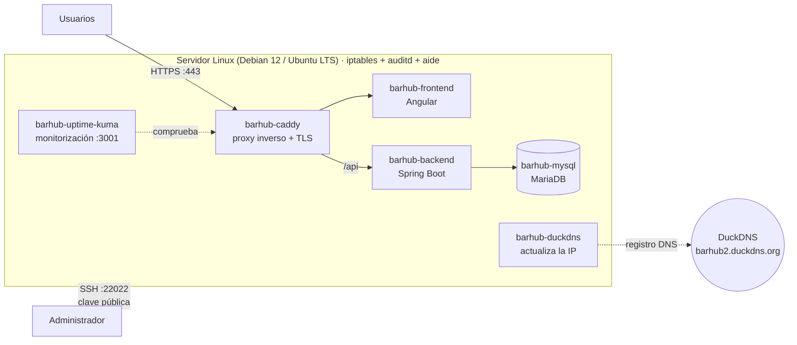
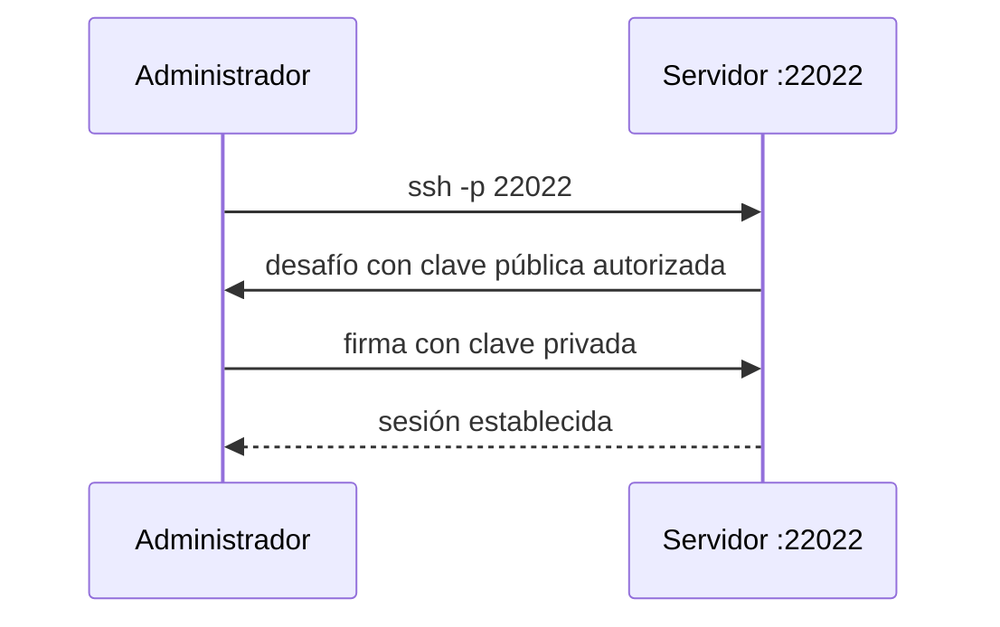
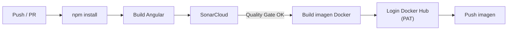
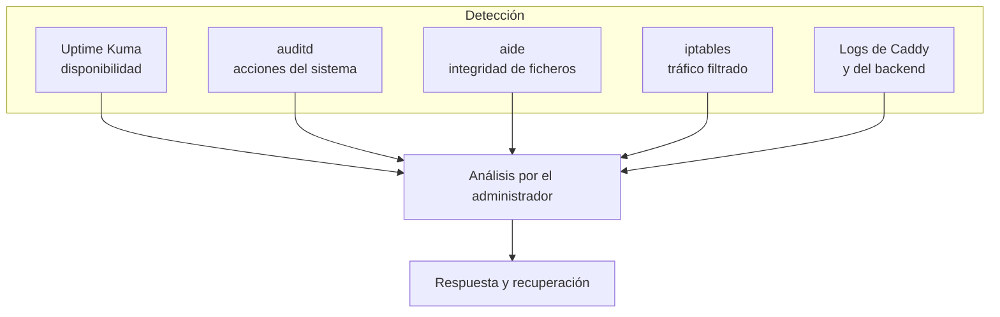

# Infraestructura

Procedimiento de despliegue de la arquitectura multi-contenedor de **BarHub 2.0**, acceso remoto seguro por SSH, endurecimiento (*hardening*) del servidor, automatización CI/CD y monitorización de seguridad (SOC).

## Índice

1. [Arquitectura de despliegue](#1-arquitectura-de-despliegue)
2. [Estructura de ficheros](#2-estructura-de-ficheros)
3. [Requisitos previos](#3-requisitos-previos)
4. [Preparación del servidor](#4-preparación-del-servidor)
5. [Conexión SSH segura](#5-conexión-ssh-segura)
6. [Repositorio y variables de entorno](#6-repositorio-y-variables-de-entorno)
7. [Orquestación y despliegue](#7-orquestación-y-despliegue)
8. [Contenedores y proxy (Docker y Caddy)](#8-contenedores-y-proxy-docker-y-caddy)
9. [Endurecimiento del sistema (hardening)](#9-endurecimiento-del-sistema-hardening)
10. [Pruebas de aceptación](#10-pruebas-de-aceptación)
11. [CI/CD con GitHub Actions](#11-cicd-con-github-actions)
12. [SOC y monitorización](#12-soc-y-monitorización)
13. [Mejoras recomendadas](#13-mejoras-recomendadas)

---

## 1. Arquitectura de despliegue



| Contenedor | Función | Expuesto al exterior |
| :--- | :--- | :---: |
| `barhub-caddy` | Proxy inverso, HTTPS automático y servidor de entrada | 80 / 443 |
| `barhub-frontend` | Aplicación Angular | Vía Caddy |
| `barhub-backend` | API REST (Spring Boot) | Vía Caddy |
| `barhub-mysql` | Base de datos MariaDB | Solo red interna |
| `barhub-duckdns` | Mantiene actualizado el registro DNS dinámico (solo con el perfil `prod`) | No |
| `barhub-uptime-kuma` | Panel de monitorización de disponibilidad | 3001 |

Puertos abiertos en el cortafuegos tras el bastionado: **`22022`** (SSH), **`80`**, **`443`** y **`3001`** (Uptime Kuma). Restringir el acceso al puerto 3001 figura entre las [mejoras recomendadas](#13-mejoras-recomendadas).

## 2. Estructura de ficheros

```text
BarHub2.0/
├── infra/
│   ├── docker/
│   │   ├── docker-compose.yml   Orquestación (6 servicios; 5 sin el perfil `prod`)
│   │   ├── .env.example         Plantilla de variables (sin secretos)
│   │   └── .env                 Credenciales reales (NO se versiona)
│   ├── caddy/
│   │   └── Caddyfile            Enrutamiento y proxy inverso
│   ├── mysql/                   Configuración de la base de datos
│   └── README.md                Guía de despliegue
└── seguridad/
    └── hardening-linux.py       Script de bastionado del sistema
```

## 3. Requisitos previos

| Requisito | Detalle |
| :--- | :--- |
| Sistema operativo | Linux: **Debian 12** o **Ubuntu LTS** |
| Acceso administrativo | Canal SSH seguro (ver [sección 5](#5-conexión-ssh-segura)) |
| Dominio | Operativo, p. ej. `barhub2.duckdns.org`, con registro **A/AAAA** apuntando a la IP pública del servidor |
| Credenciales | Parámetros confidenciales preparados de antemano (ver [sección 6](#6-repositorio-y-variables-de-entorno)) |
| Puertos accesibles | `80` y `443` desde Internet (necesarios para emitir el certificado TLS) |

## 4. Preparación del servidor

**1. Actualizar el sistema**

```bash
apt update && apt upgrade -y
```

**2. Crear un usuario con privilegios administrativos**

Por seguridad operativa se usa un usuario dedicado en lugar de `root`:

```bash
adduser barhubadmin
usermod -aG sudo barhubadmin
```

## 5. Conexión SSH segura

El acceso remoto se realiza **únicamente con criptografía asimétrica** sobre un puerto personalizado (`22022`). Cambiar el puerto no es una defensa por sí mismo, solo reduce el ruido de los escaneos automáticos; la protección real es desactivar la contraseña y exigir clave.



### 5.1. Entorno de laboratorio (máquina virtual en NAT)

Esta sección solo se aplica a las pruebas en una máquina virtual con red NAT. En un VPS con IP pública se conecta directamente al puerto `22022`.

- Se configura **Port Forwarding** en el hipervisor.
- El tráfico al puerto **`22022`** de la interfaz local se redirige al puerto **`22022`** del servidor invitado.

### 5.2. Generación del par de claves

En el equipo cliente:

```cmd
ssh-keygen -t ed25519
```

| Fichero (`~/.ssh/`) | Descripción |
| :--- | :--- |
| `id_ed25519` | **Clave privada**. Estrictamente confidencial, nunca se comparte ni se sube al repositorio |
| `id_ed25519.pub` | **Clave pública**. Es la que se instala en el servidor |

> RSA de 4096 bits (`ssh-keygen -t rsa -b 4096`) también es válido. En ese caso los ficheros se llaman `id_rsa` e `id_rsa.pub`.

### 5.3. Autorización de la clave en el servidor

El servidor tiene desactivada la contraseña (`PasswordAuthentication no`), por lo que solo entra quien presente una clave autorizada.

```bash
mkdir -p ~/.ssh
nano ~/.ssh/authorized_keys      # pegar aquí el contenido de la clave pública

chmod 700 ~/.ssh
chmod 600 ~/.ssh/authorized_keys
```

> **Importante:** hay que instalar la clave pública **antes** de aplicar el bastionado o de desactivar las contraseñas. Si se hace al revés, se pierde el acceso al servidor.

### 5.4. Ejecutar la conexión

```bash
ssh -i ~/.ssh/id_ed25519 -p 22022 barhubadmin@<IP_SERVIDOR>
```

## 6. Repositorio y variables de entorno

**1. Clonar el repositorio**

```bash
git clone https://github.com/juanparejog/BarHub2.0.git
cd BarHub2.0/infra/docker
```

**2. Crear el fichero `.env`** a partir de la plantilla:

```bash
cp .env.example .env
nano .env
```

```env
# Base de datos
DB_DATABASE=barhub
DB_USERNAME=barhub_user
DB_PASSWORD=contrasena_usuario_segura
MYSQL_ROOT_PASSWORD=contrasena_root_muy_segura

# Backend
JWT_SECRET=secreto-aleatorio-de-al-menos-32-bytes

# Opcional: pago con tarjeta real (sin ella funciona el modo demostración)
STRIPE_SECRET_KEY=

# Solo producción (perfil prod)
DUCKDNS_DOMAINS=barhub2
DUCKDNS_TOKEN=tu-token-de-duckdns-aqui

# Opcional: datos de demostración y administrador inicial
APP_SEED_DEMO=false
APP_SEED_ADMIN_USERNAME=admin
APP_SEED_ADMIN_PASSWORD=
```

| Variable | Descripción |
| :--- | :--- |
| `DB_DATABASE` | Nombre de la base de datos |
| `DB_USERNAME` / `DB_PASSWORD` | Usuario y contraseña que usa el backend |
| `MYSQL_ROOT_PASSWORD` | Contraseña del usuario `root` de la base de datos |
| `DUCKDNS_DOMAINS` | Solo producción. Subdominio registrado (sin `.duckdns.org`) |
| `DUCKDNS_TOKEN` | Solo producción. Token de tu cuenta de DuckDNS |
| `STRIPE_SECRET_KEY` | Opcional. Clave secreta de Stripe; sin ella, el pago con tarjeta funciona en modo demostración |
| `JWT_SECRET` | Secreto de firma de los tokens JWT |
| `APP_SEED_DEMO` | `true` carga 19 productos y 10 mesas de ejemplo si la base de datos está vacía |
| `APP_SEED_ADMIN_USERNAME` / `APP_SEED_ADMIN_PASSWORD` | Administrador inicial (solo con `APP_SEED_DEMO=true` y si no existe ninguno). La contraseña debe tener al menos 8 caracteres |

> `.env` **nunca** se sube a Git: está en `.gitignore`. Usa contraseñas largas y únicas, genera los secretos con `openssl rand -base64 32` y trata el token de DuckDNS y la clave de Stripe como credenciales.

**3. Validar la estructura**

| Componente | Ruta |
| :--- | :--- |
| Orquestación Docker | `infra/docker/docker-compose.yml` |
| Enrutamiento y proxy | `infra/caddy/Caddyfile` |
| Plantilla de variables | `infra/docker/.env.example` |

## 7. Orquestación y despliegue

**1. Levantar la infraestructura**

En local (sin DuckDNS, la aplicación responde en `http://localhost`):

```bash
cd infra/docker
docker compose up -d --build
```

En producción (incluye DuckDNS y HTTPS para el dominio):

```bash
cd infra/docker
docker compose --profile prod up -d --build
```

**2. Auditar el estado**

```bash
docker compose ps
```

Deben aparecer en ejecución `barhub-mysql`, `barhub-backend`, `barhub-frontend`, `barhub-caddy` y `barhub-uptime-kuma` (cinco en local) y, con el perfil `prod`, también `barhub-duckdns` (seis).

**3. Verificar los certificados TLS (solo producción)**

```bash
docker logs -f barhub-caddy
```

Debe verse la emisión automática del certificado para el dominio.

**Modo demostración (opcional)**

Con `APP_SEED_DEMO=true` y una `APP_SEED_ADMIN_PASSWORD` en el `.env`, el primer arranque con la base de datos vacía carga el catálogo de ejemplo y crea el usuario administrador. En arranques posteriores no duplica nada. Es lo que usa un revisor para ver la aplicación con datos sin preparar nada más.

**Operaciones habituales**

| Acción | Comando |
| :--- | :--- |
| Ver logs de un servicio | `docker logs -f barhub-backend` |
| Reiniciar un servicio | `docker compose restart backend` |
| Actualizar tras un `git pull` | `docker compose up -d --build` |
| Parar todo | `docker compose down` |
| Parar y borrar datos | `docker compose down -v` (elimina los volúmenes) |

## 8. Contenedores y proxy (Docker y Caddy)

### 8.1. Imágenes Docker

| Imagen | Detalle |
| :--- | :--- |
| Frontend | Multi-etapa: **Node.js** compila Angular y **Caddy** sirve los estáticos |
| Backend | Multi-etapa con Gradle |
| Bastionado de ambas | Usuario **no root** (DS-0002) y `HEALTHCHECK` (DS-0026). Trivy: **0 incidencias** ([auditorias.md](auditorias.md#3-trivy)) |

### 8.2. Docker Compose (extracto)

Todos los servicios están en la red interna `barhub-net`. Solo Caddy y Uptime Kuma publican puertos. Las versiones de las imágenes están fijadas. El fichero completo está en [`infra/docker/docker-compose.yml`](../infra/docker/docker-compose.yml); este extracto es orientativo.

```yaml
services:
  mysql:
    image: mariadb:13.0
    container_name: barhub-mysql
    environment:
      MYSQL_ROOT_PASSWORD: ${MYSQL_ROOT_PASSWORD:?}
      MYSQL_DATABASE: ${DB_DATABASE:?}
      MYSQL_USER: ${DB_USERNAME:?}
      MYSQL_PASSWORD: ${DB_PASSWORD:?}

  backend:
    build: ../../backend
    container_name: barhub-backend
    # Además de la conexión a la base de datos recibe JWT_SECRET,
    # STRIPE_SECRET_KEY (opcional) y las variables APP_SEED_*.

  frontend:
    build: ../../frontend
    container_name: barhub-frontend

  caddy:
    image: caddy:2.11-alpine
    container_name: barhub-caddy
    ports:
      - "80:80"
      - "443:443"

  duckdns:
    image: lscr.io/linuxserver/duckdns:8aabc87c-ls95
    container_name: barhub-duckdns
    profiles: ["prod"]

  uptime-kuma:
    image: louislam/uptime-kuma:1.23.17
    container_name: barhub-uptime-kuma
    ports:
      - "3001:3001"
```

> Los puntos que aún se endurecerán (Uptime Kuma y `docker.sock`, `healthcheck` de MariaDB, `no-new-privileges`) están en la [sección 13](#13-mejoras-recomendadas).

### 8.3. Caddy

Caddy es el único punto de entrada web: reenvía la API al backend, entrega la SPA a través del contenedor del frontend y gestiona el **HTTPS automático** (emisión y renovación de certificados) del dominio de producción. En local la aplicación responde en `http://localhost`, sin certificado.

El fichero real es [`infra/caddy/Caddyfile`](../infra/caddy/Caddyfile) y es la referencia; no se copia aquí para que no quede desactualizado. Resumen de las rutas:

| Ruta | Destino |
| :--- | :--- |
| `/api/*` | `backend:8080`, quitando el prefijo `/api` antes de reenviar |
| Imágenes subidas | Ruta propia definida en el mismo fichero |
| Resto | `frontend:80` (SPA) |

El contenedor del frontend lleva su propio `Caddyfile` (caché de los bundles con hash y reescritura de rutas de la SPA).

## 9. Endurecimiento del sistema (hardening)

Fase final del despliegue: un script automatizado endurece el sistema operativo **preservando las interfaces de red virtuales de Docker**.

```bash
sudo python3 seguridad/hardening-linux.py
```

> **Importante:** despliega primero los contenedores (sección 7) y comprueba que tu clave SSH funciona. Mantén **otra sesión SSH abierta** mientras se aplica el script, por si algo bloquea el acceso.

### 9.1. Directivas aplicadas

| Área | Medida | Objetivo |
| :--- | :--- | :--- |
| **Contraseñas y PAM** | Complejidad estricta y políticas de caducidad | Evitar credenciales débiles |
| **Kernel (`sysctl`)** | Mitigación de ataques de red comunes, manteniendo los parámetros que necesita el enrutamiento de contenedores | Reducir superficie de ataque sin romper Docker |
| **Auditoría (`auditd`)** | Reglas de supervisión estricta | Trazabilidad de acciones sensibles |
| **Integridad (`aide`)** | Control de integridad de ficheros | Detectar modificaciones no autorizadas |
| **SSH** | Puerto `22022`, acceso directo de `root` restringido, sesiones concurrentes limitadas, sin contraseña | Proteger el acceso remoto |
| **Cortafuegos (Netfilter / iptables)** | Reglas restrictivas de entrada sobre `22022`, `80`, `443` y `3001`, sin tocar las cadenas NAT de Docker | Exponer solo lo imprescindible |

### 9.2. Configuración SSH resultante

```text
# /etc/ssh/sshd_config
Port 22022
PermitRootLogin no
PasswordAuthentication no
PubkeyAuthentication yes
MaxAuthTries 3
MaxSessions 2
```

### 9.3. Por qué se respeta Docker

Docker gestiona sus propias cadenas de `iptables` (NAT y reenvío). Un bastionado agresivo que vacíe las reglas dejaría los contenedores sin red. Por eso el script **solo consolida la cadena de entrada** y deja intactas las de Docker.

### 9.4. Verificaciones posteriores

```bash
sudo iptables -L INPUT -n --line-numbers   # reglas de entrada
sudo ss -tlnp                              # puertos en escucha
sudo systemctl status auditd               # auditoría activa
sudo aide --check                          # integridad de ficheros
docker compose ps                          # los contenedores siguen sanos
```

## 10. Pruebas de aceptación

| # | Prueba | Resultado esperado |
| :--- | :--- | :---: |
| 1 | Abrir `https://barhub2.duckdns.org` | Certificado SSL válido y la interfaz Angular conectada al backend |
| 2 | Abrir `http://<IP_PUBLICA_DEL_VPS>:3001` | Panel de Uptime Kuma operativo |
| 3 | SSH con clave por `22022` | Acceso concedido |
| 4 | SSH con contraseña | Rechazado |
| 5 | SSH como `root` | Rechazado |
| 6 | Puerto no autorizado (p. ej. `3306`) desde fuera | Cerrado / filtrado |
| 7 | `docker compose ps` | Los 6 contenedores en ejecución (5 en local, sin DuckDNS) |
| 8 | Crear un pedido y verlo en comandas | El pedido aparece en unos segundos (sondeo cada 5 s) a través de Caddy |

## 11. CI/CD con GitHub Actions

Pipeline del frontend: calidad → compilación → imagen Docker → publicación.



> **Estado:** el pipeline cubre el frontend. El primer análisis completo en SonarCloud y el pipeline del backend están pendientes.

### 11.1. Análisis estático continuo (SonarCloud)

- **Migración a la nube** desde una instancia local de SonarQube, centralizando calidad y seguridad en cada ciclo.
- **Integración del proyecto:** repositorio vinculado a la organización, con su *Project Key* único.
- **Resolución de conflictos:** se desactivó el **Análisis Automático** en SonarCloud para evitar colisiones con el escáner del CI.

### 11.2. Dependencias y compilación

- `npm install` en el runner para procesar limpiamente las librerías.
- Ajuste de las restricciones de tamaño en la compilación de producción para que el empaquetado termine correctamente.

### 11.3. Contenedores y registro (Docker Hub)

- Empaquetado multi-etapa con Node.js y Caddy.
- Autenticación con *secrets* de GitHub mediante un **PAT de Docker Hub** con permisos *Read & Write*.
- La imagen se sube **solo si se superan los controles de calidad**.

| Secreto de GitHub | Uso |
| :--- | :--- |
| `SONAR_TOKEN` | Autenticación con SonarCloud |
| `DOCKERHUB_USERNAME` | Usuario de Docker Hub |
| `DOCKERHUB_TOKEN` | PAT con permisos Read & Write |

## 12. SOC y monitorización

El servidor combina **monitorización de disponibilidad**, **auditoría del sistema**, **control de integridad** y **filtrado de red**, que son la base de un SOC básico. Hoy el análisis de los eventos es **manual**; la automatización de alertas y de respuesta está en la [sección 13](#13-mejoras-recomendadas).



### 12.1. Capas de control

| Capa | Herramienta | Qué vigila |
| :--- | :--- | :--- |
| Disponibilidad | **Uptime Kuma** (`:3001`) | Caídas del sitio, backend y servicios, con histórico y alertas |
| Auditoría | **auditd** | Accesos, cambios de configuración y ejecución de comandos sensibles |
| Integridad | **aide** | Modificación no autorizada de ficheros del sistema |
| Red | **iptables** | Solo `22022`, `80`, `443` y `3001` aceptan tráfico |
| Acceso | **SSH + PAM** | Solo clave pública, `root` restringido y política de contraseñas |
| Aplicación | **Logs de Caddy y backend** | Peticiones, `401/403`, errores y accesos a `/api/auth/login` |
| Contenedores | **HEALTHCHECK** | Estado de salud de cada contenedor |

### 12.2. Monitores recomendados en Uptime Kuma

| Monitor | Tipo | Objetivo |
| :--- | :--- | :--- |
| Web pública | HTTPS | `https://barhub2.duckdns.org` responde `200` |
| Caducidad TLS | HTTPS | Aviso antes de que expire el certificado |
| API | HTTP | Endpoint de salud del backend (ruta por definir) |
| Base de datos | TCP / Docker | Contenedor `barhub-mysql` activo |
| SSH | TCP | Puerto `22022` accesible |
| Notificaciones | Email / Telegram | Aviso inmediato al administrador |

### 12.3. Casos de detección

| Caso | Señal | Fuente | Respuesta |
| :--- | :--- | :--- | :--- |
| Fuerza bruta SSH | Fallos repetidos de autenticación | `auditd`, `/var/log/auth.log` | Bloqueo de IP y revisión |
| Fuerza bruta en login web | Muchos `401` en `/api/auth/login` | Logs de Caddy / backend | Bloqueo temporal de IP |
| Fichero del sistema alterado | Diferencias en la comprobación | `aide --check` | Aislar, investigar y restaurar |
| Caída de servicio | Monitor en rojo / contenedor *unhealthy* | Uptime Kuma, Docker | Reinicio y análisis de logs |
| Escalada de privilegios | `403` repetidos en `/productos` o `/caja` | Logs del backend | Revisar cuenta y revocar token |
| Puerto inesperado abierto | Nuevo servicio en escucha | `ss -tlnp` | Cerrar y auditar |
| Descuadre de caja | `diferencia` distinta de 0 al cierre | Aplicación | Revisión por gerencia |

### 12.4. Respuesta a incidentes

1. **Detección:** alerta de Uptime Kuma, de `auditd`/`aide` o aviso del personal.
2. **Contención:** aislar el contenedor, bloquear la IP con `iptables` o revocar credenciales.
3. **Análisis:** revisar logs de Caddy, backend y sistema, con la línea temporal de `auditd`.
4. **Recuperación:** restaurar desde copia de seguridad o desde la imagen anterior de Docker Hub.
5. **Lecciones aprendidas:** documentar el incidente y actualizar [seguridad.md](seguridad.md).

## 13. Mejoras recomendadas

Propuestas **aún no implementadas**, ordenadas por prioridad. Se irán marcando a medida que se apliquen.

| Prioridad | Mejora | Motivo |
| :---: | :--- | :--- |
| Alta | No exponer Uptime Kuma (`:3001`) a Internet: ponerlo detrás de Caddy con autenticación o accederlo solo por VPN | Un panel administrativo expuesto es superficie de ataque |
| Alta | Quitar el montaje de `/var/run/docker.sock` en Uptime Kuma y monitorizar por HTTP/TCP | Quien comprometa el contenedor controlaría Docker, es decir, el servidor |
| Alta | Copias de seguridad de MariaDB (`mysqldump` programado), almacenadas fuera del servidor y con **restauración probada** | La caja y los pedidos son datos de negocio |
| Media | `healthcheck` en MariaDB y `depends_on` con `condition: service_healthy` | Evitar que el backend arranque antes que la base de datos |
| Media | Fail2Ban (SSH y logs de Caddy) con aviso por Telegram | Pasar de análisis manual a detección y respuesta automáticas |
| Media | Límite de peticiones en el login y en la creación de pedidos | Fuerza bruta y abuso de la API |
| Media | Cabeceras de seguridad en Caddy (ejemplo abajo) | Defensa en profundidad en el navegador |
| Media | Endurecer contenedores: `security_opt: [no-new-privileges:true]` y `cap_drop: [ALL]` donde sea posible | Reducir lo que puede hacer un contenedor comprometido |
| Media | Pipeline del backend y `trivy image` sobre las imágenes finales, más `gitleaks` | Cobertura completa de CI y detección de secretos |
| Baja | Quitar DuckDNS cuando el servidor tenga IP fija | Un servicio y una credencial menos |
| Baja | Definir el endpoint de salud del backend para Uptime Kuma | Monitorización más fiable que la comprobación de puerto |

**Ya aplicadas:** `JWT_SECRET` y `STRIPE_SECRET_KEY` llegan al backend desde el entorno, las imágenes tienen la versión fijada y DuckDNS solo arranca con el perfil `prod`.

**Ejemplo de cabeceras de seguridad en Caddy** (la política CSP depende de la aplicación y requiere pruebas):

```caddyfile
barhub2.duckdns.org {
    header {
        Strict-Transport-Security "max-age=31536000; includeSubDomains"
        X-Content-Type-Options "nosniff"
        X-Frame-Options "DENY"
        Referrer-Policy "strict-origin-when-cross-origin"
        -Server
    }
    # ... resto de la configuración
}
```