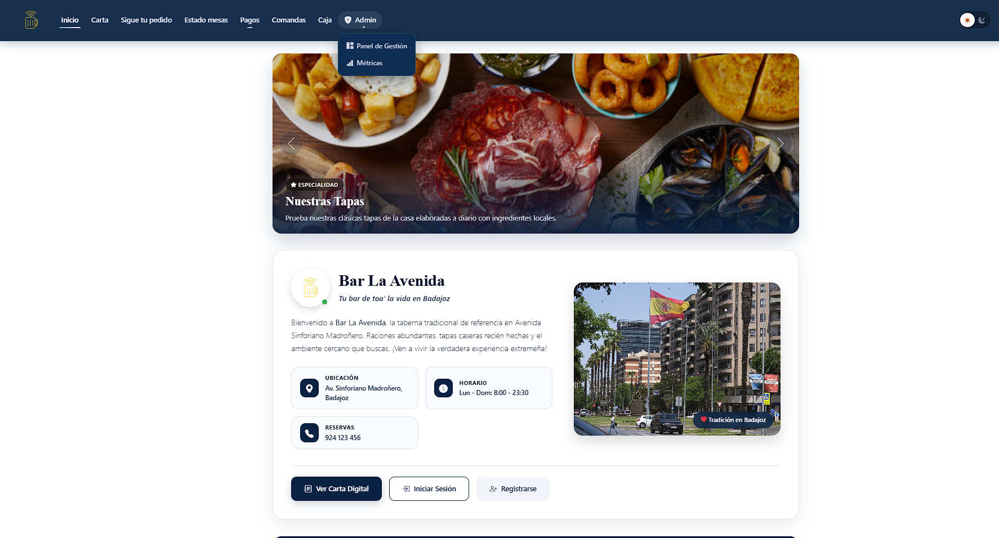
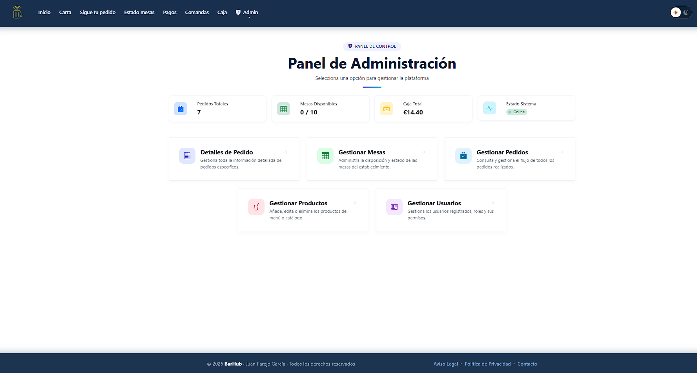
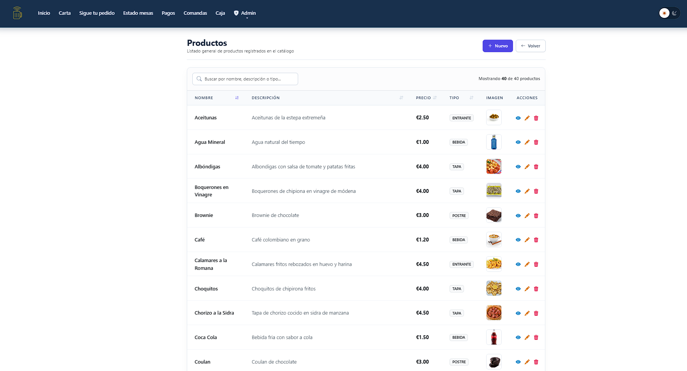
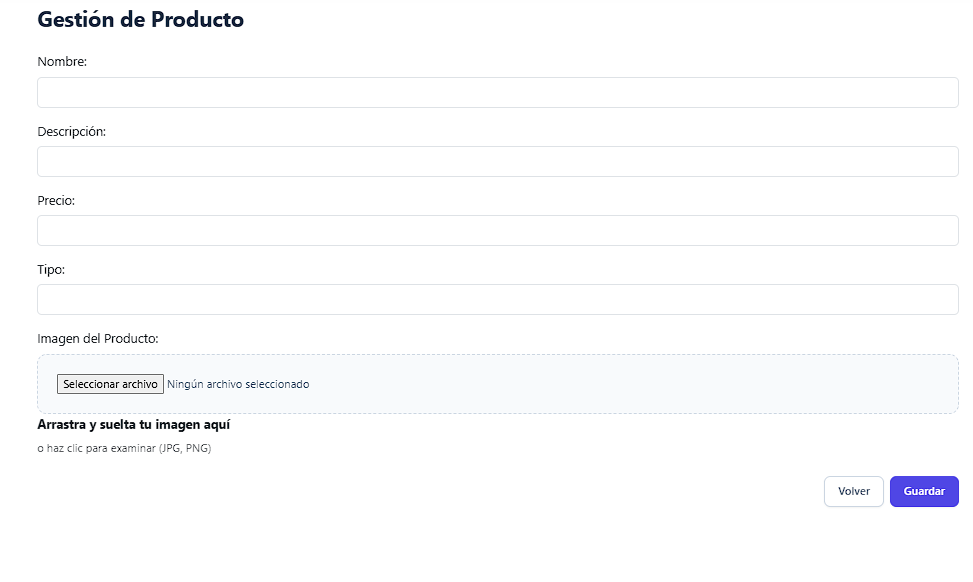
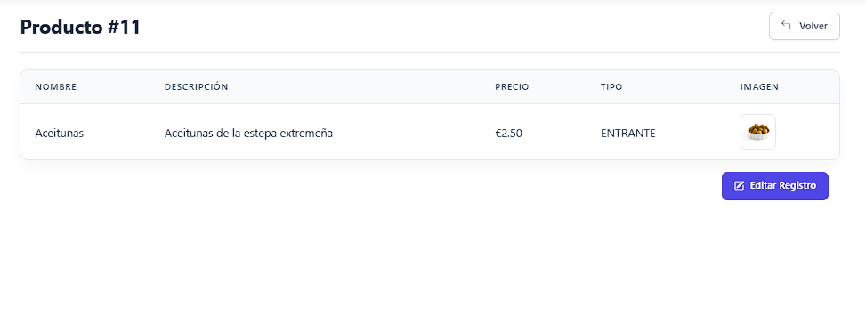
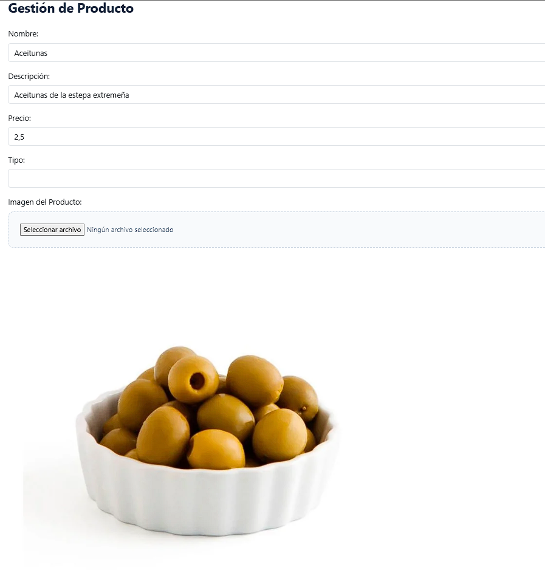
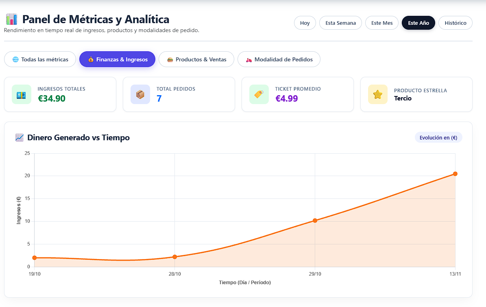
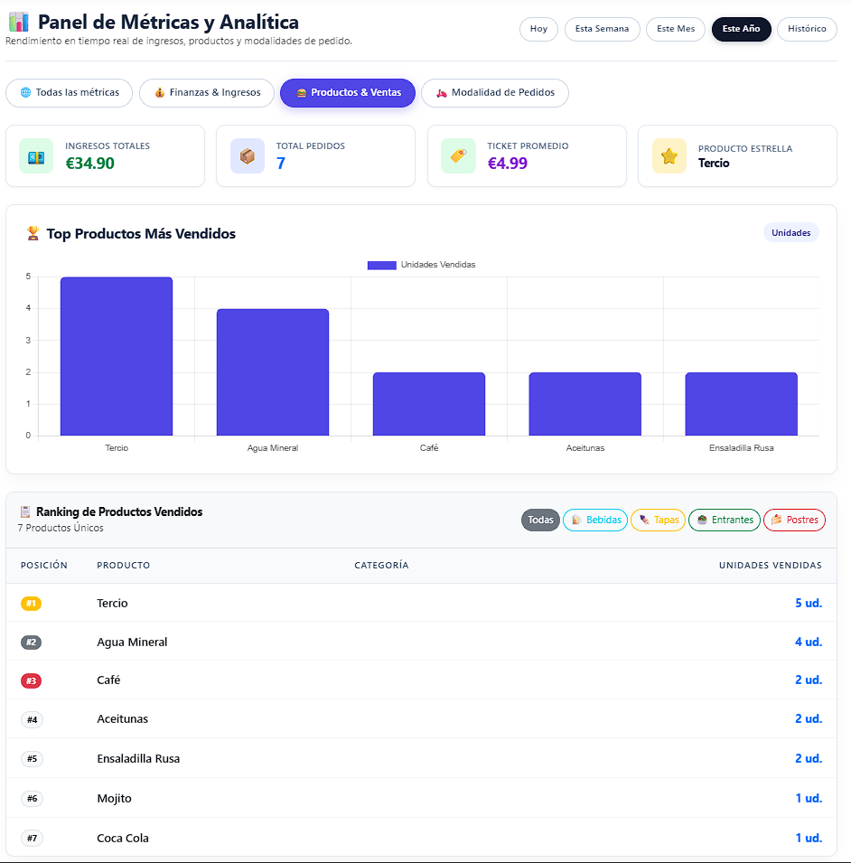
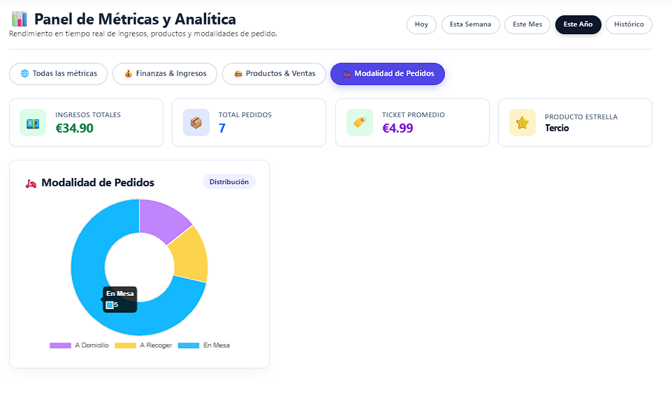

# Guía de uso del administrador

Esta guía describe las funciones exclusivas del rol de administrador. Además de todas las vistas del cliente y del empleado, el administrador dispone del menú **Admin**, que se divide en dos paneles: **Panel de Gestión** y **Métricas**.

## Índice

1. [Acceso al menú de administración](#1-acceso-al-menú-de-administración)
2. [Panel de gestión](#2-panel-de-gestión)
3. [Gestión de productos](#3-gestión-de-productos)
4. [Gestión de pedidos, usuarios, mesas y detalles](#4-gestión-de-pedidos-usuarios-mesas-y-detalles)
5. [Métricas](#5-métricas)

---

## 1. Acceso al menú de administración

El menú **Admin** aparece en la barra de navegación únicamente para los usuarios con rol de administrador. Al desplegarlo se ofrecen dos opciones.

  

<em>Menú desplegable Admin con Panel de Gestión y Métricas.</em>

| Opción | Función |
| :--- | :--- |
| **Panel de Gestión** | Consulta y mantenimiento de los datos de la base de datos mediante tablas |
| **Métricas** | Estadísticas de negocio por periodo |

> En una instalación nueva con datos de demostración (`APP_SEED_DEMO=true`), el usuario `admin` se crea con la contraseña definida en `APP_SEED_ADMIN_PASSWORD`. Esa contraseña no está en el repositorio.

## 2. Panel de gestión

El **Panel de Administración** es el punto de entrada a la gestión de datos. Muestra cuatro indicadores y cinco accesos a las tablas de gestión.

  

<em>Panel de administración.</em>

### 2.1. Indicadores

| Indicador | Descripción |
| :--- | :--- |
| **Pedidos totales** | Número de pedidos registrados |
| **Mesas disponibles** | Mesas libres sobre el total |
| **Caja total** | Importe acumulado en caja |
| **Estado del sistema** | Situación operativa de la plataforma |

### 2.2. Tablas de gestión

| Acceso | Contenido |
| :--- | :--- |
| **Detalles de Pedido** | Líneas de cada pedido |
| **Gestionar Mesas** | Disposición y estado de las mesas |
| **Gestionar Pedidos** | Consulta y flujo de todos los pedidos realizados |
| **Gestionar Productos** | Catálogo de la carta |
| **Gestionar Usuarios** | Usuarios registrados, roles y permisos |

## 3. Gestión de productos

La gestión de productos se toma como ejemplo del funcionamiento común de todas las tablas del panel.

### 3.1. Listado

  

<em>Listado de productos del catálogo.</em>

La tabla muestra nombre, descripción, precio, tipo e imagen de cada producto, junto con el recuento total de registros.

| Elemento | Función |
| :--- | :--- |
| **Buscador** | Filtra por nombre, descripción o tipo |
| **Cabeceras ordenables** | Ordenan la tabla por la columna seleccionada |
| **Nuevo** | Abre el formulario de alta |
| **Volver** | Regresa al panel de administración |

### 3.2. Acciones por registro

| Icono | Acción | Descripción |
| :--- | :--- | :--- |
| Ojo | **Ver** | Muestra el detalle de un único registro |
| Lápiz | **Editar** | Abre el formulario con los datos actuales |
| Papelera | **Eliminar** | Elimina el registro, previa confirmación |

### 3.3. Crear un producto

Se pulsa **Nuevo** y se completa el formulario **Gestión de Producto**:

| Campo | Descripción |
| :--- | :--- |
| Nombre | Denominación del producto |
| Descripción | Texto descriptivo |
| Precio | Importe unitario |
| Tipo | Categoría: bebida, entrante, tapa o postre |
| Imagen | Archivo JPG, PNG o WebP de hasta 5 MB, arrastrándolo al recuadro o seleccionándolo manualmente. El servidor comprueba que realmente es una imagen |

  

<em>Formulario de alta de producto.</em>

Los cambios se confirman con **Guardar**. El botón **Volver** descarta la operación.

### 3.4. Ver un producto

La vista de detalle muestra el registro seleccionado y ofrece el botón **Editar Registro**.

  

<em>Detalle de un producto.</em>

### 3.5. Editar un producto

El formulario de edición carga los datos existentes y la imagen actual. Se modifican los campos necesarios y se confirma con **Guardar**.

  

<em>Formulario de edición con los datos del producto cargados.</em>

## 4. Gestión de pedidos, usuarios, mesas y detalles

Las tablas de **pedidos**, **usuarios**, **mesas** y **detalles de pedido** siguen el mismo patrón que la de productos: listado con buscador y ordenación, y las acciones **Ver**, **Editar** y **Eliminar** sobre cada registro, además de la creación de nuevos registros.

| Tabla | Uso principal |
| :--- | :--- |
| **Pedidos** | Consultar y corregir pedidos, estados y pagos |
| **Detalles de pedido** | Revisar o ajustar las líneas de un pedido concreto |
| **Usuarios** | Gestionar cuentas, roles y permisos |
| **Mesas** | Mantener las mesas del establecimiento y su estado |

> Las operaciones de eliminación son definitivas. Se recomienda revisar el registro con la acción **Ver** antes de eliminarlo.

## 5. Métricas

El panel **Métricas y Analítica** presenta el rendimiento del negocio. La información se filtra por periodo y se organiza en cuatro pestañas.

### 5.1. Periodo de análisis

El selector superior derecho permite elegir el intervalo:

| Periodo | Ámbito |
| :--- | :--- |
| **Hoy** | Día en curso |
| **Esta semana** | Semana en curso |
| **Este mes** | Mes en curso |
| **Este año** | Año en curso |
| **Histórico** | Todos los datos registrados |

### 5.2. Indicadores generales

Todas las pestañas comparten cuatro indicadores:

| Indicador | Descripción |
| :--- | :--- |
| **Ingresos totales** | Dinero generado en el periodo |
| **Total pedidos** | Número de pedidos realizados |
| **Ticket promedio** | Importe medio por pedido |
| **Producto estrella** | Producto más vendido |

### 5.3. Finanzas e ingresos

Gráfico de líneas **Dinero generado vs tiempo**, que muestra la evolución de los ingresos en euros a lo largo del periodo seleccionado.

  

<em>Evolución de los ingresos.</em>

### 5.4. Productos y ventas

Incluye el gráfico de barras **Top productos más vendidos** y el **Ranking de productos vendidos**, con la posición, el producto, la categoría y las unidades vendidas. El ranking puede filtrarse por **Bebidas**, **Tapas**, **Entrantes** o **Postres**.

  

<em>Productos más vendidos y ranking.</em>

### 5.5. Modalidad de pedidos

Gráfico circular que muestra la distribución de los pedidos entre **A domicilio**, **A recoger** y **En mesa**.

  

<em>Distribución de los pedidos por modalidad.</em>

La pestaña **Todas las métricas** reúne los tres bloques anteriores en una única vista.