# Guía de uso del cliente

Esta guía describe cómo utilizar BarHub 2.0 desde la perspectiva del cliente: consultar la carta, realizar un pedido en mesa, para recoger o a domicilio, pagarlo, seguir su estado y gestionar el perfil personal.

## Índice

1. [Acceso a la plataforma](#1-acceso-a-la-plataforma)
2. [Pantalla de inicio](#2-pantalla-de-inicio)
3. [Registro e inicio de sesión](#3-registro-e-inicio-de-sesión)
4. [Realizar un pedido](#4-realizar-un-pedido)
5. [Resumen, pago y confirmación](#5-resumen-pago-y-confirmación)
6. [Seguimiento del pedido](#6-seguimiento-del-pedido)
7. [Perfil de usuario](#7-perfil-de-usuario)
8. [Modo oscuro](#8-modo-oscuro)

---

## 1. Acceso a la plataforma

La plataforma puede utilizarse **con o sin cuenta de usuario**. La diferencia reside en el seguimiento del pedido:

| Funcionalidad | Sin registrarse | Con sesión iniciada |
| :--- | :---: | :---: |
| Consultar la página de inicio y la carta | Sí | Sí |
| Realizar un pedido en mesa, para recoger o a domicilio | Sí | Sí |
| Pagar con tarjeta o en efectivo | Sí | Sí |
| Seguir el estado del pedido (se actualiza solo) | No | Sí |
| Guardar datos y dirección de entrega predeterminada | No | Sí |
| Personalizar el perfil y la foto | No | Sí |

## 2. Pantalla de inicio

La página de inicio presenta el establecimiento: un carrusel de imágenes de especialidades y espacios, la descripción del local, su ubicación, el horario de apertura, el teléfono de reservas y un mapa interactivo con el enlace a Google Maps.

  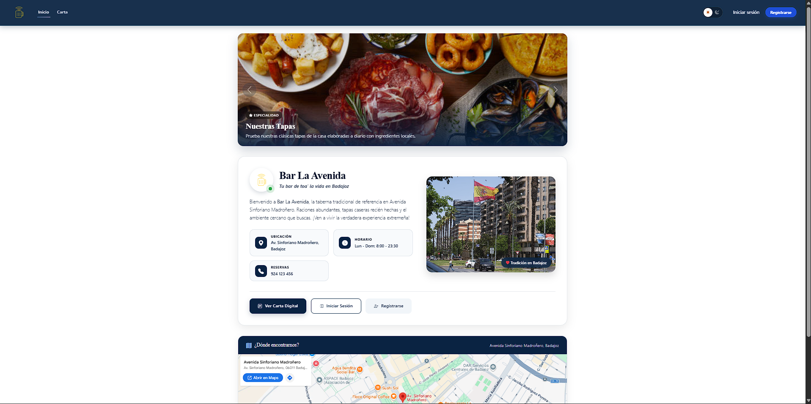

<em>Pantalla de inicio de BarHub 2.0.</em>

Desde la barra superior se accede a **Inicio** y **Carta**, así como a las opciones **Iniciar sesión** y **Registrarse**. Los botones inferiores de la tarjeta principal (**Ver Carta Digital**, **Iniciar Sesión** y **Registrarse**) ofrecen los mismos accesos.

## 3. Registro e inicio de sesión

### 3.1. Registro

Para crear una cuenta se completan los siguientes campos y se aceptan la Política de Privacidad y los Términos y Condiciones:

| Campo | Descripción |
| :--- | :--- |
| Nombre de usuario | Identificador único de la cuenta |
| Nombre y primer apellido | Datos personales básicos |
| Correo | Dirección de correo electrónico |
| Contraseña y repetición | Credencial de acceso, introducida dos veces para evitar errores |

  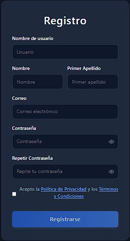
  &nbsp;&nbsp;&nbsp;
  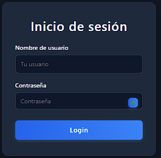

<em>Formularios de registro (izquierda) e inicio de sesión (derecha).</em>

### 3.2. Inicio de sesión

Se introducen el **nombre de usuario** y la **contraseña**. El icono situado en el campo de contraseña permite mostrarla u ocultarla.

## 4. Realizar un pedido

Los pedidos se realizan desde la **Carta Digital**. Antes de añadir productos es necesario elegir la modalidad del pedido.

  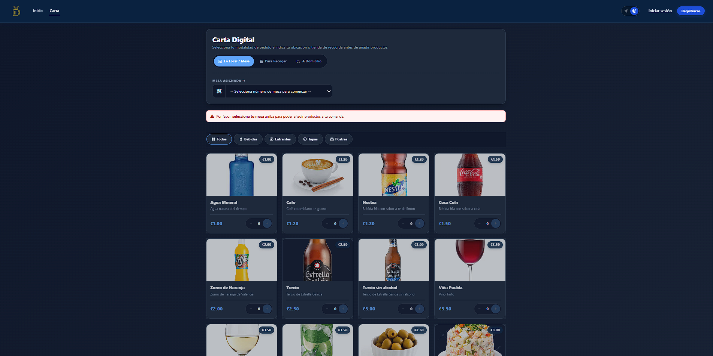

<em>Carta digital con la selección de modalidad y las categorías de producto.</em>

### 4.1. Modalidades de pedido

| Modalidad | Información requerida |
| :--- | :--- |
| **En local / mesa** | Mesa asignada |
| **Para recoger** | Teléfono de contacto para avisos |
| **A domicilio** | Dirección de entrega y teléfono de contacto |

### 4.2. Pedido en mesa

La mesa se asocia al pedido mediante el código QR de la mesa o, en su defecto, seleccionando su número en el desplegable **Mesa asignada**. El listado muestra el estado de cada mesa (disponible, ocupada o reservada). Hasta que no se indica la mesa, la carta muestra un aviso y no permite añadir productos.

  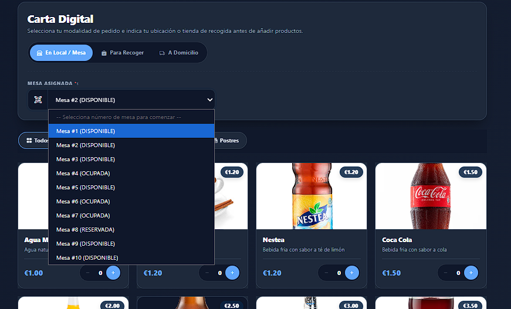

<em>Selección de la mesa asignada.</em>

### 4.3. Pedido para recoger

Se utiliza una única tienda de recogida (**BarHub Principal**), cuya dirección se muestra junto con un mapa. El cliente debe indicar un **teléfono de contacto para avisos**. Si ha iniciado sesión, el botón **Usar mi teléfono** rellena el campo con el dato guardado en el perfil.

  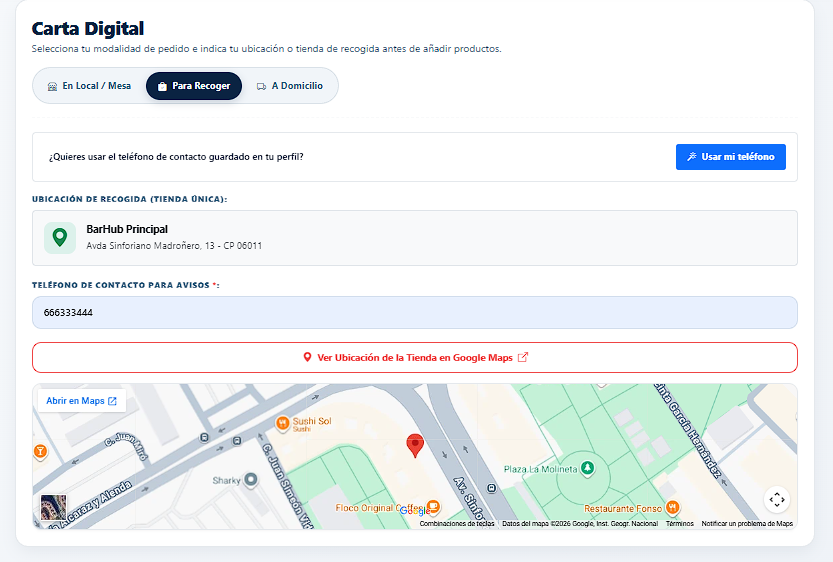

<em>Modalidad para recoger.</em>

### 4.4. Pedido a domicilio

Se completa la dirección de entrega:

| Campo | Observaciones |
| :--- | :--- |
| Calle / avenida / vía | Obligatorio |
| Tipo de inmueble | Piso / Departamento, Casa unifamiliar o Urbanización |
| Número de portal, planta y puerta | Obligatorios para pisos |
| Código postal | Datos de la zona de entrega |
| Teléfono de contacto | Obligatorio |

Con sesión iniciada, el botón **Usar mis datos** completa el formulario con la dirección y el teléfono del perfil. El botón **Ver Ubicación en Google Maps** permite comprobar la dirección introducida.

  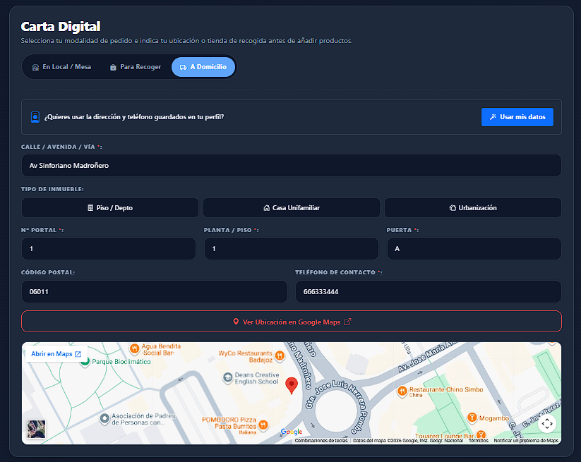

<em>Modalidad a domicilio.</em>

### 4.5. Selección de productos

1. Elegir la categoría: **Todos**, **Bebidas**, **Entrantes**, **Tapas** o **Postres**.
2. Ajustar la cantidad de cada producto con los botones **+** y **−**.
3. Revisar el **total estimado** en la barra inferior.
4. Pulsar **Confirmar Pedido**.

  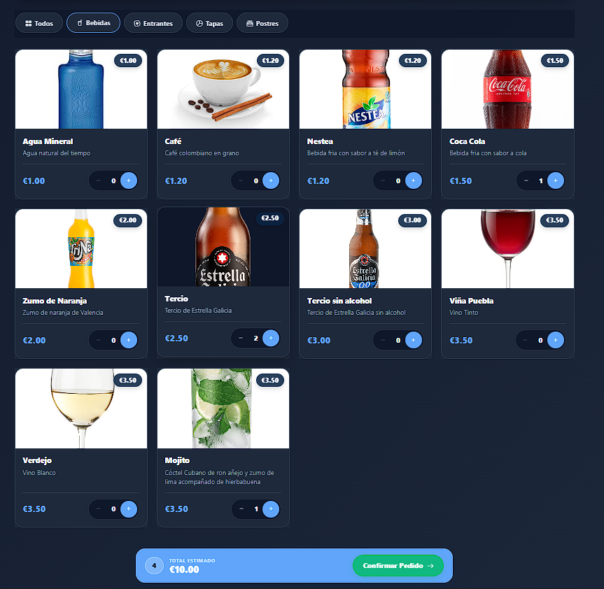

<em>Selección de productos y barra de total estimado.</em>

## 5. Resumen, pago y confirmación

La pantalla **Resumen del Pedido** reúne los datos de entrega, la tabla de productos con cantidades, precios unitarios y subtotales, y el resumen de pago.

  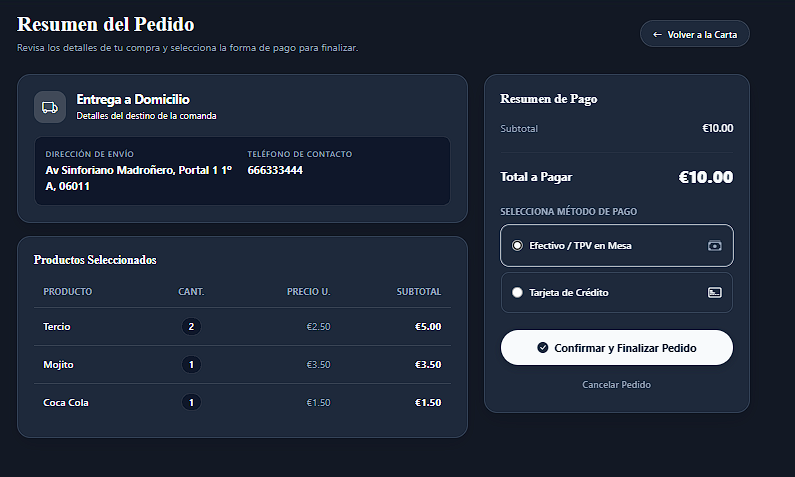

<em>Resumen del pedido y selección del método de pago.</em>

### 5.1. Métodos de pago

| Método | Descripción |
| :--- | :--- |
| **Efectivo / TPV en mesa** | El pago se realiza al personal. El pedido queda pendiente de cobro hasta que un empleado lo registra |
| **Tarjeta de crédito** | Pago con tarjeta en **modo demostración**: el pago se simula y no se realiza ningún cargo. La pantalla de pago muestra un aviso |

### 5.2. Finalización

- **Confirmar y Finalizar Pedido** registra el pedido y lo envía al personal.
- **Cancelar Pedido** descarta la operación.
- **Volver a la Carta** permite modificar la selección.

### 5.3. Ticket

Al finalizar se genera un **ticket simplificado** con el número de pedido, la fecha, la modalidad, el detalle de productos, el total con IVA incluido y el método de pago.

  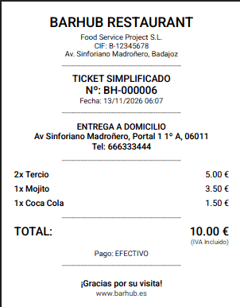

<em>Ejemplo de ticket simplificado.</em>

## 6. Seguimiento del pedido

Los usuarios con sesión iniciada disponen de la opción **Sigue tu pedido**, que muestra el estado de sus comandas. Los cambios de estado los realizan los empleados y se reflejan sin recargar la página, con una actualización automática cada pocos segundos.

| Fase | Significado |
| :--- | :--- |
| **Recibido** | El pedido ha sido registrado |
| **En cocina** | El pedido se está preparando |
| **Listo para servir** | El pedido está preparado |
| **Entregado** | El pedido ha sido servido o entregado |

  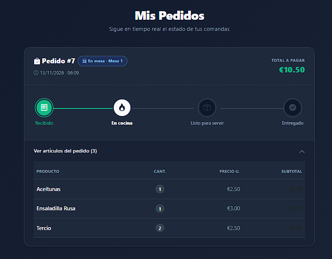

<em>Seguimiento del pedido con su línea de estados y el detalle de artículos.</em>

Cada pedido muestra su número, la modalidad (por ejemplo, «En mesa · Mesa 1»), la fecha, el total y un desplegable con los artículos incluidos.

## 7. Perfil de usuario

La sección **Mi Perfil** permite gestionar los datos personales y la ubicación predeterminada.

  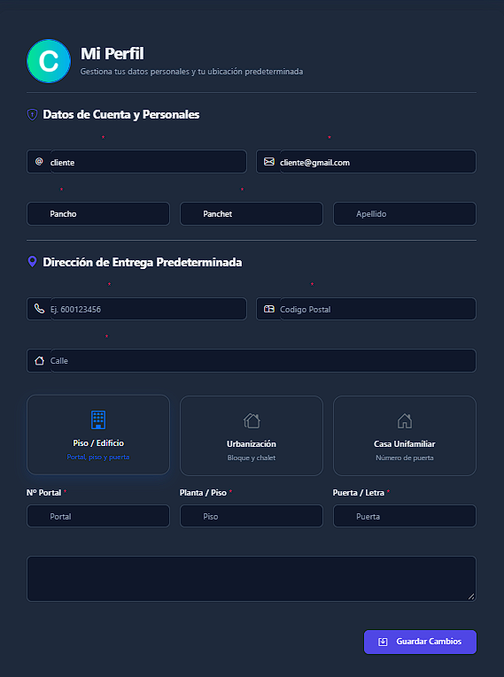
  &nbsp;&nbsp;&nbsp;
  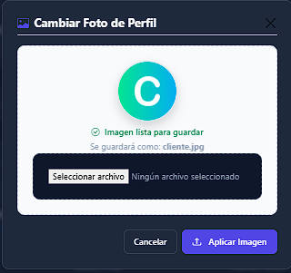

<em>Perfil de usuario (izquierda) y ventana de cambio de foto (derecha).</em>

| Bloque | Contenido |
| :--- | :--- |
| **Datos de cuenta y personales** | Usuario, correo, nombre y apellidos |
| **Dirección de entrega predeterminada** | Teléfono, código postal, calle, tipo de vivienda, portal, planta, puerta y notas de entrega |
| **Foto de perfil** | Se modifica con **Seleccionar archivo** y **Aplicar Imagen**. Formatos JPG, PNG o WebP, máximo 5 MB; si el archivo no es una imagen real, se rechaza |

Los cambios se confirman con **Guardar Cambios**. Estos datos se reutilizan en los pedidos para recoger y a domicilio mediante los botones **Usar mi teléfono** y **Usar mis datos**.

## 8. Modo oscuro

El interruptor situado en la esquina superior derecha de la barra de navegación alterna entre el tema claro y el tema oscuro en toda la aplicación.

  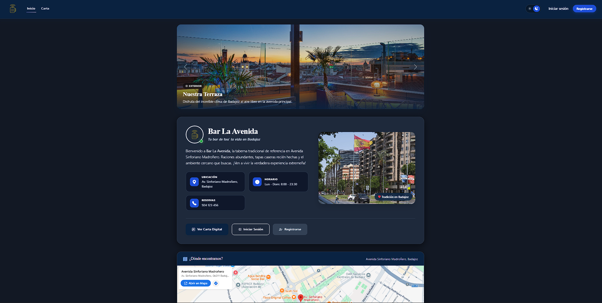

<em>Pantalla de inicio en modo oscuro.</em>
