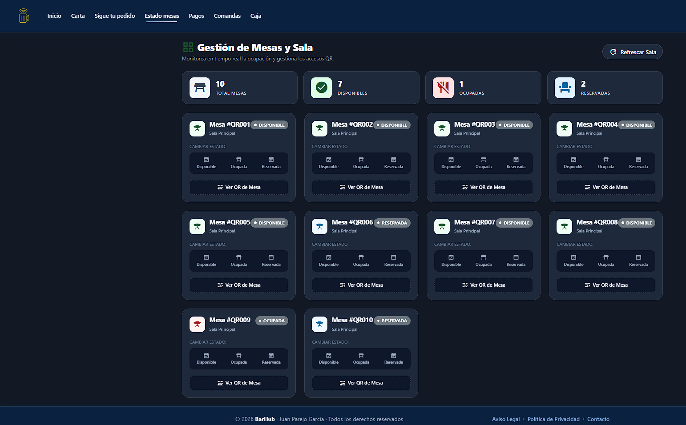
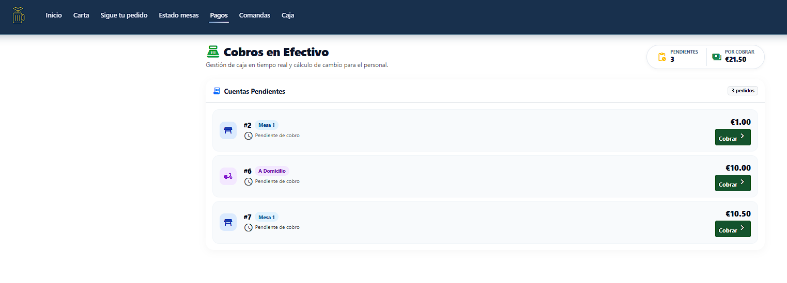
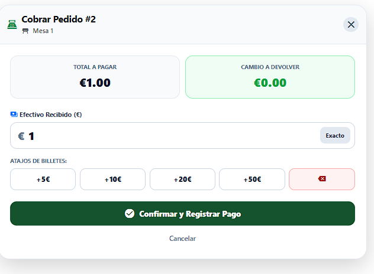
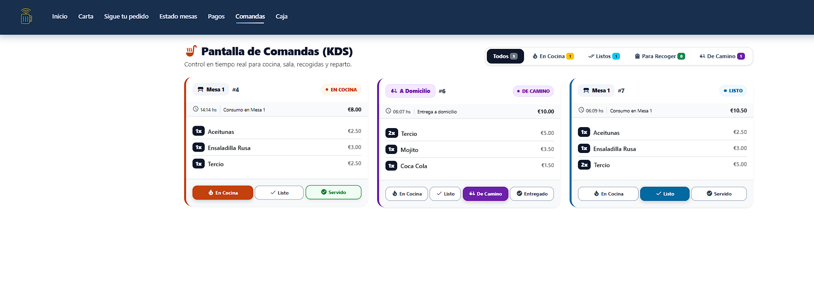
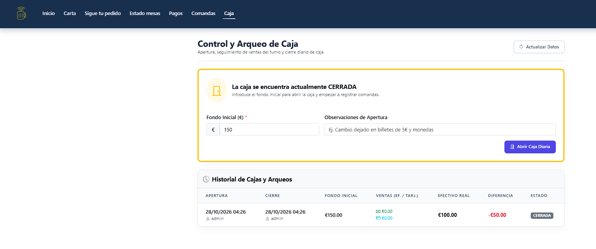
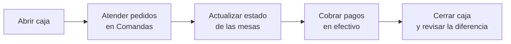

# Guía de uso del empleado

Esta guía describe las vistas operativas disponibles para el personal del establecimiento. Los usuarios con rol de empleado acceden, además de a las vistas del cliente, a las secciones **Estado mesas**, **Pagos**, **Comandas** y **Caja**.

## Índice

1. [Navegación del personal](#1-navegación-del-personal)
2. [Estado de las mesas](#2-estado-de-las-mesas)
3. [Pagos en efectivo](#3-pagos-en-efectivo)
4. [Comandas](#4-comandas)
5. [Caja](#5-caja)
6. [Flujo de trabajo recomendado](#6-flujo-de-trabajo-recomendado)

---

## 1. Navegación del personal

La barra superior muestra las secciones habituales del cliente (**Inicio**, **Carta**, **Sigue tu pedido**) y las específicas del personal.

| Sección | Función |
| :--- | :--- |
| **Estado mesas** | Consulta y cambio del estado de cada mesa; acceso a su código QR |
| **Pagos** | Cobro de los pedidos pendientes de pago en efectivo |
| **Comandas** | Gestión del estado de los pedidos en cocina y reparto |
| **Caja** | Apertura, seguimiento y cierre del turno de caja |

## 2. Estado de las mesas

La vista **Gestión de Mesas y Sala** permite supervisar la ocupación del local; la información se actualiza automáticamente cada pocos segundos.

  

<em>Gestión de mesas y sala.</em>

### 2.1. Indicadores

En la parte superior se muestran cuatro contadores: **total de mesas**, **disponibles**, **ocupadas** y **reservadas**.

### 2.2. Cambio de estado

Cada mesa se presenta en una tarjeta con su identificador, la sala y el estado actual. Para modificarlo, se selecciona una de las tres opciones de **Cambiar estado**:

| Estado | Uso |
| :--- | :--- |
| **Disponible** | La mesa está libre para nuevos clientes |
| **Ocupada** | Hay clientes en la mesa |
| **Reservada** | La mesa está reservada |

### 2.3. Código QR

El botón **Ver QR de Mesa** muestra el código QR asociado a cada mesa, que los clientes utilizan para realizar pedidos desde la carta. El botón **Refrescar Sala** actualiza la información.

## 3. Pagos en efectivo

La vista **Cobros en Efectivo** reúne los pedidos que el cliente ha decidido abonar en efectivo y que continúan pendientes de cobro.

  

<em>Listado de cuentas pendientes de cobro.</em>

En la cabecera se indican el **número de pedidos pendientes** y el **importe total por cobrar**. Cada línea muestra el número de pedido, la modalidad (mesa, a domicilio), el importe y el botón **Cobrar**.

### 3.1. Registrar un cobro

1. Pulsar **Cobrar** en el pedido correspondiente.
2. Introducir el **efectivo recibido**. El botón **Exacto** completa el importe del pedido y los atajos de billetes (**+5€**, **+10€**, **+20€**, **+50€**) suman cantidades de forma rápida.
3. Comprobar el **cambio a devolver**, calculado automáticamente.
4. Pulsar **Confirmar y Registrar Pago**.

  

<em>Ventana de cobro con cálculo del cambio.</em>

Los cobros registrados quedan incorporados a las ventas en efectivo del turno de caja.

## 4. Comandas

La **Pantalla de Comandas (KDS)** permite controlar la cocina, la sala, las recogidas y el reparto. Los nuevos pedidos aparecen sin recargar la página, con una actualización automática cada pocos segundos.

  

<em>Pantalla de comandas.</em>

### 4.1. Filtros

| Filtro | Contenido |
| :--- | :--- |
| **Todos** | Todas las comandas activas |
| **En cocina** | Pedidos en preparación |
| **Listos** | Pedidos preparados |
| **Para recoger** | Pedidos de recogida en tienda |
| **De camino** | Pedidos a domicilio en reparto |

### 4.2. Tarjeta de comanda

Cada comanda indica la modalidad y el número de pedido (por ejemplo, «Mesa 1 · #4» o «A Domicilio · #6»), el estado actual, la hora, el tipo de consumo, el importe total y el listado de productos con sus cantidades.

### 4.3. Cambio de estado

Los botones situados en la parte inferior de la tarjeta permiten avanzar el pedido. Cada cambio se refleja en la vista de seguimiento del cliente en pocos segundos.

| Modalidad | Estados disponibles |
| :--- | :--- |
| **En mesa** | En cocina, Listo, Servido |
| **A domicilio** | En cocina, Listo, De camino, Entregado |

## 5. Caja

La sección **Control y Arqueo de Caja** gestiona los turnos de caja y el cuadre diario.

  

<em>Control y arqueo de caja con la caja cerrada.</em>

### 5.1. Apertura de caja

Con la caja cerrada se muestra el formulario de apertura:

| Campo | Descripción |
| :--- | :--- |
| **Fondo inicial (€)** | Importe base con el que se abre el turno. Obligatorio |
| **Observaciones de apertura** | Notas opcionales, por ejemplo, la composición del cambio |

Se confirma con **Abrir Caja Diaria**. Mientras la caja permanece abierta se registran las ventas del turno.

### 5.2. Cierre y arqueo

Al cerrar el turno se contabiliza el **efectivo real** existente en caja y se calcula la **diferencia** con respecto al importe esperado, a partir del fondo inicial y de las ventas en efectivo y con tarjeta.

### 5.3. Historial de cajas y arqueos

La tabla de historial conserva el registro de cada turno:

| Columna | Descripción |
| :--- | :--- |
| Apertura / Cierre | Fecha, hora y usuario responsable |
| Fondo inicial | Importe de apertura |
| Ventas (ef. / tarj.) | Totales por método de pago |
| Efectivo real | Efectivo contado al cierre |
| Diferencia | Descuadre del turno (positivo o negativo) |
| Estado | Abierta o cerrada |

El botón **Actualizar Datos** refresca la información mostrada.

## 6. Flujo de trabajo recomendado

