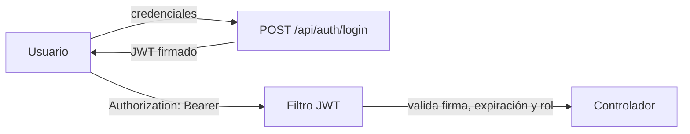

# Seguridad

Resumen de las prácticas de seguridad aplicadas en BarHub 2.0 y un modelo de amenazas básico. Las evidencias de las auditorías están en [auditorias.md](auditorias.md).

## Índice

1. [Prácticas aplicadas](#1-prácticas-aplicadas)
2. [Autenticación y autorización](#2-autenticación-y-autorización)
3. [Seguridad del tiempo real](#3-seguridad-del-tiempo-real)
4. [Modelo de amenazas básico](#4-modelo-de-amenazas-básico)
5. [Checklist y pendientes](#5-checklist-y-pendientes)

---

## 1. Prácticas aplicadas

| Área | Práctica | Evidencia |
| :--- | :--- | :--- |
| **Dependencias** | Actualización a Spring Boot 3.4.3 y `jjwt 0.12.5`; conectores BBDD actualizados | Snyk backend |
| **Dependencias frontend** | `overrides` para `engine.io`, `socket.io-parser` y `ws` | Snyk frontend |
| **Código** | Eliminado `e.printStackTrace()`; excepciones centralizadas con respuestas HTTP estandarizadas | SonarQube |
| **Contrato de objetos** | `equals()` + `hashCode()` en `UserDetailsImpl` | SonarQube |
| **Contenedores** | Usuario **no root** (DS-0002) y `HEALTHCHECK` (DS-0026) en los Dockerfiles | Trivy |
| **Contraseñas** | Almacenadas cifradas (`users.password`, `varchar(120)`). | Modelo ER |
| **Accesibilidad** | Contrastes WCAG y etiquetas asociadas a inputs | SonarQube |
| **CI/CD** | Análisis estático continuo con SonarCloud; credenciales en *secrets* de GitHub | Pipeline |

## 2. Autenticación y autorización

- **JWT** firmado con `jjwt 0.12.5` (`JwtUtils.java`, API moderno).
- **Control por roles** (`role_admin`, `role_cliente`, `role_empleado`) en dos capas:
  - **Backend:** barrera real, con Spring Security y `UserDetailsImpl`.
  - **Frontend:** `auth.guard.ts`, `role.guard.ts` y `auth.interceptor.ts`, que mejoran la experiencia pero **no sustituyen** al backend.
- **Verificación de email** en el registro.
- **Token QR de mesa** (`mesas.token_qr`): vincula el QR a una mesa concreta.

## 3. Modelo de amenazas básico

### Activos

| Activo | Por qué importa |
| :--- | :--- |
| Datos personales (`users`: nombre, teléfono, dirección) | Privacidad y RGPD |
| Credenciales y tokens JWT | Suplantación de identidad |
| Datos de caja y pedidos | Integridad financiera |
| Disponibilidad del servicio en hora punta | Pérdida directa de ventas |

### Actores

| Actor | Descripción |
| :--- | :--- |
| Visitante anónimo | Accede a carta y registro |
| Cliente malicioso | Intenta ver pedidos ajenos o manipular precios |
| Empleado con exceso de permisos | Accede a caja o datos fuera de su función |
| Atacante externo | Explota vulnerabilidades en dependencias, API o contenedores |

### Amenazas y mitigaciones (STRIDE simplificado)

| # | Amenaza | Tipo | Mitigación aplicada | Estado |
| :--- | :--- | :--- | :--- | :---: |
| 1 | Robo o falsificación de JWT | Suplantación | Firma con `jjwt 0.12.5`, expiración, HTTPS | expiración |
| 2 | Acceso a endpoints de otro rol (p. ej. `POST /productos`) | Elevación de privilegios | Autorización por rol en backend | ✅ |
| 3 | Ver pedidos de otro cliente (IDOR en `/pedidos/{id}`) | Divulgación | Filtrar por usuario autenticado (`/mis-pedidos`) | ⚠️ Verificar |
| 4 | Manipular precios desde el cliente | Manipulación | El backend recalcula con `productos.precio` (`crearPedidoSeguro`) | ⚠️ Verificar |
| 5 | Reutilizar un QR de otra mesa | Manipulación | `token_qr` por mesa | ⚠️ Verificar rotación |
| 6 | Escucha de eventos de otros usuarios por socket | Divulgación | Auth en handshake + salas por rol | ⚠️ Verificar |
| 7 | Dependencias vulnerables | Varias | Snyk + SonarCloud en CI | ✅ parcial |
| 8 | Escape de contenedor / escalada | Elevación | Usuario no root, imágenes multi-etapa | ✅ |
| 9 | Fuga de información en errores | Divulgación | Eliminado `printStackTrace`, respuestas estandarizadas | ✅ |
| 10 | Fuerza bruta en login | Denegación / suplantación | Limitación de intentos | ⚠️ Pendiente |
| 11 | Descuadre o fraude en caja | Repudio | Registro de usuario de apertura y cierre, `diferencia` y `observaciones` | ✅ |
| 12 | Saturación de la API | Denegación de servicio | Rate limiting en Caddy o backend | ⚠️ Pendiente |

### Fuera de alcance

Ataques físicos al local, ingeniería social contra el personal y seguridad del TPV o datáfono externo.