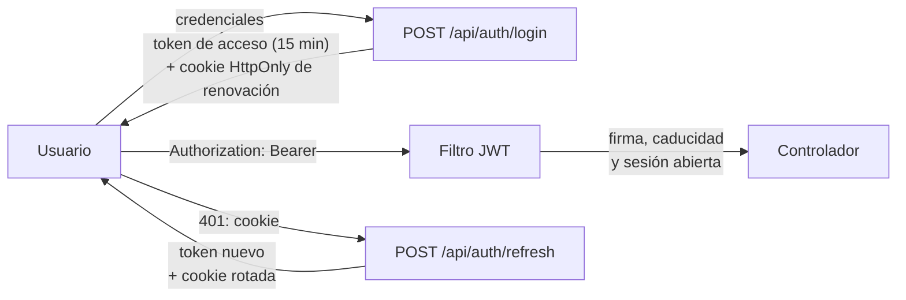

# Seguridad

Resumen de las prácticas de seguridad aplicadas en BarHub 2.0, un modelo de amenazas básico y el SOC que vigila la aplicación. Las evidencias estáticas están en [auditorias.md](auditorias.md) y las pruebas dinámicas en [evidencias/](evidencias/seguridad-2026-11-15.md).

## Índice

1. [Prácticas aplicadas](#1-prácticas-aplicadas)
2. [Autenticación y autorización](#2-autenticación-y-autorización)
3. [Modelo de amenazas básico](#3-modelo-de-amenazas-básico)
4. [Pruebas dinámicas](#4-pruebas-dinámicas)
5. [SOC: detección y alertas](#5-soc-detección-y-alertas)
6. [Pendientes y limitaciones conocidas](#6-pendientes-y-limitaciones-conocidas)

---

## 1. Prácticas aplicadas

| Área | Práctica | Evidencia |
| :--- | :--- | :--- |
| **Control de acceso** | Denegación por defecto (`anyRequest().denyAll()`) y `@PreAuthorize` por rol en las operaciones de escritura | Pruebas dinámicas |
| **Acceso a datos ajenos** | Un usuario solo ve y modifica sus propios pedidos y perfil; el resto recibe un `404` uniforme | Pruebas dinámicas |
| **Integridad de pedidos** | El servidor recalcula los precios con los del catálogo y no confía en los del cliente | Pruebas dinámicas |
| **Pagos con tarjeta** | Stripe en modo de pruebas: la tarjeta se escribe en un iframe de Stripe y nunca pasa por BarHub; el servidor crea el intento de pago por el importe que calcula él y, al crear el pedido, comprueba en Stripe que el pago está cobrado, es de ese usuario, por ese importe y para esos productos, y que no se ha usado ya. La clave secreta solo vive en el servidor | Tests de integración, E2E y pruebas dinámicas |
| **Subida de archivos** | Lista blanca de extensiones, tipo declarado, firma real del archivo, límites de tamaño, nombre aleatorio y ruta normalizada | Pruebas dinámicas y en navegador |
| **Errores** | Respuestas genéricas al cliente; el detalle queda solo en el log | Pruebas dinámicas |
| **Validación** | Bean Validation (`@Valid`) en los DTO de entrada | Pruebas dinámicas |
| **CORS** | Orígenes limitados a los del frontend (local y dominio de producción) | Revisión de código |
| **Dependencias** | Spring Boot 4.2 (Spring Framework 7 y Spring Security 7), `jjwt 0.13.0` y conector de MariaDB 4; dependencias sin uso retiradas | Snyk y Dependabot |
| **Conexión con la base de datos** | TLS 1.3 con el certificado del servidor verificado (Connector/J 4, `sslMode=verify-full` por defecto) y TLS obligatorio para el usuario de la aplicación (`REQUIRE SSL`) | [Evidencia](evidencias/tls-mariadb-2026-11-20.md) |
| **Código** | Eliminado `e.printStackTrace()`; `equals()` y `hashCode()` en `UserDetailsImpl` | SonarQube |
| **Contenedores** | Usuario no root (DS-0002) y `HEALTHCHECK` (DS-0026); versiones de imagen fijadas | Trivy |
| **Contraseñas** | Almacenadas como hash mediante el `PasswordEncoder` de Spring Security, nunca en claro | Modelo ER |
| **Secretos** | Fuera del repositorio: variables de entorno y `.env` ignorado por git | `.env.example` |
| **Accesibilidad** | Contrastes WCAG y etiquetas asociadas a los campos | SonarQube |
| **Cabeceras HTTP** | Caddy añade HSTS, `nosniff`, `X-Frame-Options: DENY`, `Referrer-Policy` y `Permissions-Policy` (sin cámara, micrófono ni ubicación) | Pruebas dinámicas |
| **CSP estricta** | `Content-Security-Policy` en Caddy: scripts solo de la propia web y de Stripe, sin `unsafe-inline` ni `unsafe-eval`; `object-src 'none'`, `base-uri 'self'`, `form-action 'self'` y `frame-ancestors 'none'`. Las infracciones llegan al log del backend (`POST /api/csp-informe`). Con `CSP_CABECERA=Content-Security-Policy-Report-Only` queda solo en modo aviso para probar cambios | E2E (fallan si algo infringe la política) y pruebas dinámicas |
| **Registro de auditoría** | Inicios de sesión (también los fallidos), segundo paso, reautenticación, cambios de contraseña y de correo, verificación en dos pasos, sesiones, descargas de datos, cuentas eliminadas, altas, ediciones (con los roles antes y después) y bajas de usuarios, caja y accesos denegados por rol, con usuario, IP, resultado y petición. Sin contraseñas, códigos ni tokens; solo lectura para el administrador (*Admin → Auditoría*) y se borra al año | Tests de integración y E2E |
| **Avisos en tiempo real** | Server-Sent Events con el token en la cabecera `Authorization` (nunca en la URL). El canal del personal solo para empleados y administradores; el del cliente, solo con los pedidos propios. Los avisos llevan tipo e id, sin datos: la pantalla los vuelve a pedir por los endpoints que comprueban permisos. El servidor corta la conexión cuando la sesión se cierra o caduca, y limita las conexiones (5 por usuario, 500 en total, 5 min cada una) | Tests de integración, E2E y pruebas dinámicas |
| **SOC** | Logs de Caddy y del backend en Loki (30 días), 8 reglas de alerta (fuerza bruta, accesos denegados, cambios de privilegios, escaneo, 5xx, CSP, errores) y avisos por correo o Telegram. Recolector sin acceso a Docker ni capacidades, paneles solo en `127.0.0.1`. Desplegado y probado con `seguridad/soc/soc.py` ([sección 5](#5-soc-detección-y-alertas)) | Job `soc` de CI y `soc.py probar` |
| **CI/CD** | Análisis estático con SonarCloud; credenciales en secretos de GitHub | Pipeline |
| **Endurecimiento del pipeline** | Acciones fijadas por SHA, permisos mínimos, `npm ci --ignore-scripts`, `gradle.lockfile` y contenedor del frontend sin root | SonarCloud |

## 2. Autenticación y autorización



- **Token de acceso** JWT firmado con `jjwt 0.13.0` (`JwtUtils.java`), válido 15 minutos y ligado a una sesión del servidor por el claim `sid`. El filtro comprueba en cada petición que esa sesión sigue abierta, así que cerrar sesión o caducar por inactividad lo invalida al momento.
- **Token de renovación** opaco y aleatorio (256 bits), en una cookie `HttpOnly`, `Secure` y `SameSite=Strict`, limitada a `/api/auth`: JavaScript no puede leerla y no viaja desde otros sitios. En la base de datos (`sesiones`) solo se guarda su SHA-256.
- **Rotación con detección de robo:** cada renovación entrega un token de renovación nuevo. Si alguien presenta uno ya rotado (pasados 30 segundos de margen, que cubren dos pestañas renovando a la vez), se revoca la sesión entera, también para quien tenga el token bueno.
- **Límites por rol**, configurables en `application.yml` (`app.sesion.roles`). Con varios roles se aplica el más estricto:

  | Rol | Inactividad máxima | Duración máxima de la sesión |
  | :--- | :---: | :---: |
  | Administrador | 15 min | 8 h |
  | Empleado | 30 min | 10 h (un turno) |
  | Cliente | 1 h | 12 h |

- **Un único interceptor HTTP** en el frontend (`auth.interceptor.ts`): añade el token, renueva al recibir un 401 y repite la petición sin que el usuario lo note (varias peticiones caducadas comparten una sola renovación). Si la sesión ya no se puede renovar, lleva al login con el aviso de sesión caducada.
- **Cerrar sesión** revoca la sesión en el servidor (`POST /api/auth/logout`) y borra la cookie.
- **Confirmación del correo y recuperación de la contraseña** (`CuentaCorreoService`): un cliente no puede iniciar sesión hasta abrir el enlace que recibe al registrarse (el login responde `403 EMAIL_NO_VERIFICADO` solo si la contraseña es correcta, para no revelar nada a quien no la sabe). Los enlaces son de un solo uso, caducan (24 h la confirmación, 30 min la recuperación), pedir uno nuevo anula el anterior y en la base de datos solo se guarda su SHA-256. El token va en el fragmento de la URL (`#token=...`), que el navegador no envía al servidor, así que no queda en los logs de Caddy ni en la cabecera `Referer`. Recuperar la contraseña y reenviar la confirmación responden siempre lo mismo y el envío es asíncrono, para que ni el mensaje ni el tiempo de respuesta revelen qué cuentas existen; como mucho sale un correo por minuto a cada cuenta. Restablecer la contraseña cierra todas las sesiones abiertas de la cuenta.
- **Bloqueo del login por usuario y por IP** (`LoginAttemptService`): 5 fallos seguidos de una cuenta la bloquean 15 minutos, y 20 fallos desde una IP contra cualquier cuenta bloquean esa IP 15 minutos (frena el *password spraying*). Un login correcto limpia el contador de su cuenta, no el de la IP. Detrás de Caddy, Tomcat toma la IP real de `X-Forwarded-For` (`server.forward-headers-strategy: native`) y solo si la petición llega desde la red interna de Docker, así que desde fuera no se puede falsificar.
- **Verificación en dos pasos** (`DosFactoresService`), obligatoria para el administrador y los empleados (`app.dos-factores.obligatorio`) y opcional para el resto. Con la contraseña correcta, el login no entrega ningún token: responde un desafío aleatorio que caduca a los 5 minutos y admite 5 códigos, y la sesión se abre en `POST /api/auth/2fa/verificar` con el código de 6 dígitos de la app de autenticación (TOTP, RFC 6238, HMAC-SHA1 y pasos de 30 s, con un paso de margen) o con un código de recuperación. Quien aún no la tiene la configura en ese momento (`/2fa/configurar` y `/2fa/activar`): el secreto de 160 bits no se activa hasta que la app genera un código correcto. Un código ya aceptado no vale otra vez, ni siquiera con dos peticiones simultáneas (actualización condicional en la base de datos). Los códigos incorrectos suman al bloqueo del login y la contraseña correcta no limpia el contador hasta terminar el segundo paso, así que repetirla no da intentos nuevos. El secreto se guarda cifrado con AES-256-GCM, con el id del usuario como dato autenticado; de los 10 códigos de recuperación (de un solo uso, unos 50 bits cada uno) solo se guarda su HMAC-SHA256 con una clave del servidor. Las dos claves se derivan de `APP_TOTP_CLAVE` o, si no está definida, de `JWT_SECRET`. Si un empleado pierde el móvil y los códigos, el administrador se la quita (`DELETE /api/usuarios/{id}/dos-factores`), lo que cierra también sus sesiones; la propia no se puede quitar así.
- **Seguridad de la propia cuenta** (`PerfilController`, `/api/perfil/**`): siempre sobre el usuario del token, nunca sobre un id de la URL. Cambiar la contraseña pide la actual (los fallos cuentan para el bloqueo del login) y cierra las demás sesiones; cuando el administrador cambia la contraseña de otro usuario se le cierran todas. Cada usuario ve sus sesiones abiertas (navegador, IP, última actividad) y puede cerrar una o todas las demás; las de otro usuario responden `404`. Activar, desactivar y regenerar la verificación en dos pasos exigen reautenticación también para los clientes (`@RequiereReautenticacion(paraTodos = true)`): con una sesión robada no se puede quitar, ni activar con un móvil ajeno para dejar fuera al dueño. El personal no puede desactivarla.
- **Cambio de correo, descarga de datos y eliminación de la cuenta** (`/api/perfil/correo`, `/api/perfil/mis-datos`, `DELETE /api/perfil`): las tres exigen reautenticación. El correo nuevo solo entra en la cuenta al abrir el enlace enviado a él (token de un solo uso, 24 h, guardado como SHA-256 y en el fragmento de la URL); al actual se le avisa al pedirlo y al confirmarlo, y el cambio pendiente se puede cancelar. Si otra cuenta ocupa ese correo antes de confirmar, no se cambia. La descarga es un JSON con `Cache-Control: no-store`, sin contraseña, secretos ni tokens. Eliminar la cuenta la anonimiza en lugar de borrarla, porque los pedidos son registros de venta: se borran nombre, correo, teléfono, dirección, foto, verificación en dos pasos, enlaces pendientes e IP y navegador de las sesiones, se le pone una contraseña aleatoria, se quitan sus roles, se cierran todas sus sesiones y los pedidos se quedan sin dirección ni teléfono. Solo los clientes: al personal lo da de baja el administrador.
- **Reautenticación para acciones críticas** (`@RequiereReautenticacion` y `ReautenticacionInterceptor`): dar de alta, editar a otro usuario (datos, contraseña o roles), borrar usuarios y restablecer su verificación en dos pasos solo se ejecutan si el administrador se ha reautenticado en esa sesión en los últimos 5 minutos (`app.sesion.reautenticacion`). Iniciar sesión cuenta como reautenticación; después hay que confirmar en `POST /api/auth/reautenticar` con el código de la app (no con un código de recuperación) o, si no tiene la verificación en dos pasos, con la contraseña. Si no, el backend responde `403 REAUTENTICACION_REQUERIDA` sin ejecutar nada, y el interceptor del frontend pide el código y repite la petición. La marca se guarda en la sesión del servidor (`sesiones.reautenticada_en`): un token de acceso robado con XSS no la trae consigo, y los fallos cuentan para el bloqueo del login.
- **Avisos antes del cierre** (`SesionAvisoService`): dos minutos antes del cierre por inactividad aparece "¿Sigues ahí?" con cuenta atrás. "Seguir conectado" renueva la sesión; sin respuesta, se cierra también en el servidor y el login muestra el aviso. Cinco minutos antes de la duración máxima se avisa de la hora de cierre, que no se puede alargar. La inactividad se mide por la interacción del usuario y se comparte entre pestañas. Si el usuario está activo en una pantalla que no hace peticiones (leyendo o rellenando un formulario), la sesión se renueva en segundo plano para que el servidor no la cierre mientras tanto.
- **Control por roles** (`role_admin`, `role_cliente`, `role_empleado`) en dos capas:
  - **Backend:** barrera real, con Spring Security y `UserDetailsImpl`.
  - **Frontend:** `auth.guard.ts`, `role.guard.ts` y `auth.interceptor.ts`, que mejoran la experiencia pero **no sustituyen** al backend.
- **Token QR de mesa** (`mesas.token_qr`): vincula el QR a una mesa concreta.

## 3. Modelo de amenazas básico

### Activos

| Activo | Por qué importa |
| :--- | :--- |
| Datos personales (`users`: nombre, teléfono, dirección) | Privacidad y RGPD |
| Credenciales y tokens JWT | Suplantación de identidad |
| Datos de caja y pedidos | Integridad financiera |
| Disponibilidad del servicio en hora punta | Pérdida directa de ventas |

### Actores

| Actor | Descripción |
| :--- | :--- |
| Visitante anónimo | Accede a carta y registro |
| Cliente malicioso | Intenta ver pedidos ajenos o manipular precios |
| Empleado con exceso de permisos | Accede a caja o datos fuera de su función |
| Atacante externo | Explota vulnerabilidades en dependencias, API o contenedores |

### Amenazas y mitigaciones (STRIDE simplificado)

| # | Amenaza | Tipo | Mitigación | Estado |
| :--- | :--- | :--- | :--- | :---: |
| 1 | Robo o falsificación de JWT | Suplantación | Firma con `jjwt 0.13.0`, HTTPS, token de acceso de 15 min ligado a una sesión revocable, renovación en cookie `HttpOnly` con rotación y detección de reutilización | Verificado (tests de integración y E2E) |
| 2 | Acceso a endpoints de otro rol (p. ej. `POST /productos`) | Elevación de privilegios | `@PreAuthorize` y denegación por defecto | Verificado |
| 3 | Ver o modificar pedidos y perfiles de otro usuario (IDOR) | Divulgación | Filtrado por usuario autenticado y `404` uniforme | Verificado |
| 4 | Manipular precios desde el cliente | Manipulación | El backend recalcula con `productos.precio` | Verificado |
| 5 | Mass assignment (enviar campos que el cliente no debe controlar) | Manipulación | DTO con los campos permitidos | Verificado |
| 6 | Subida de archivos maliciosos | Ejecución / DoS | Lista blanca, firma real, límites, nombre aleatorio | Verificado |
| 7 | Fuga de información en errores | Divulgación | Respuestas genéricas; detalle solo en el log | Verificado |
| 8 | Reutilizar el QR de otra mesa | Manipulación | `token_qr` por mesa | Pendiente de verificar, sin rotación |
| 9 | Dependencias vulnerables | Varias | Snyk y SonarCloud; versiones de seguridad fijadas | Parcial: 2 avisos en el backend sin parche publicado y no explotables en BarHub; 0 en el frontend (ver [auditorias.md](auditorias.md)) |
| 10 | Escape de contenedor o escalada | Elevación | Usuario no root, imágenes multi-etapa | Aplicada |
| 11 | Fuerza bruta en el login | Suplantación | Bloqueo de 15 minutos tras 5 fallos de una cuenta o 20 de una IP (429 con `Retry-After`); los códigos incorrectos del segundo paso también cuentan | Mitigado y comprobado en las pruebas dinámicas y en los tests de integración |
| 12 | Cambio de contraseña con una sesión robada | Suplantación | Exigir la contraseña actual; el cambio cierra las demás sesiones | Verificado (tests de integración y E2E) |
| 13 | Saturación de la API | Denegación de servicio | Límite de peticiones en Caddy o backend | Pendiente |
| 14 | Descuadre o fraude en caja | Repudio | Registro de usuario de apertura y cierre, `diferencia` y `observaciones`; la apertura y el cierre quedan también en la auditoría con la IP | Aplicada |
| 15 | Contraseña del personal robada o reutilizada | Suplantación | Verificación en dos pasos obligatoria para administrador y empleados, con secreto cifrado y códigos no repetibles | Verificado (tests unitarios, de integración y E2E) |
| 16 | Sesión de administrador robada (token copiado, equipo desatendido) usada para crear cuentas o cambiar roles | Elevación de privilegios | Reautenticación con el código de la app para las acciones críticas, comprobada en el servidor con una ventana de 5 minutos | Verificado (tests de integración y E2E) |
| 17 | Sesión olvidada abierta o robada en otro equipo | Suplantación | El usuario ve sus sesiones abiertas y las cierra desde el perfil; cambiar la contraseña cierra las demás | Verificado (tests de integración y E2E) |
| 18 | Secuestro de la cuenta cambiando su correo con una sesión robada (y pidiendo después la recuperación de la contraseña) | Suplantación | El correo nuevo no entra hasta abrir el enlace enviado a él; aviso al correo actual con opción de cancelar; reautenticación para pedirlo | Verificado (tests de integración y E2E) |
| 19 | Descarga o borrado de los datos de una cuenta con una sesión robada | Divulgación / Denegación de servicio | Reautenticación para descargar y para eliminar; la descarga no lleva contraseña, secretos ni tokens; aviso por correo al eliminar | Verificado (tests de integración y E2E) |
| 20 | Script inyectado (XSS) que lee el token de acceso o actúa en nombre del usuario | Suplantación / Elevación | Angular escapa lo que pinta; CSP que solo ejecuta los scripts de la propia web y de Stripe, sin inline ni `eval`, con aviso al log de lo que bloquea | Verificado (E2E: un `<script>` inyectado no se ejecuta) |
| 21 | Uso indebido de una cuenta sin dejar rastro (cambios de roles, borrados, pruebas de contraseñas o de permisos) | Repudio | Registro de auditoría de las acciones de seguridad y de gestión, con resultado, IP y petición, que la aplicación no deja modificar | Verificado (tests de integración y E2E) |
| 22 | Escuchar en tiempo real los pedidos de otros (un cliente en el canal del personal o en el de otro cliente) o seguir recibiendo avisos con una sesión ya cerrada | Divulgación | Canal del personal solo para empleados y administradores; el del cliente filtra por dueño del pedido; avisos sin datos personales; latido cada 25 s que corta la conexión de una sesión cerrada | Verificado (tests de integración, E2E y pruebas dinámicas) |
| 23 | Agotar el servidor abriendo conexiones de avisos | Denegación de servicio | Sin hilo por conexión (modo asíncrono), 5 por usuario (se cierra la más antigua), 500 en total (`503`) y 5 min de duración máxima | Aplicada (tests de integración) |
| 24 | Un ataque en curso (fuerza bruta, escaneo, pruebas de permisos, XSS) que nadie ve hasta revisar los logs a mano | Varias | SOC: Alloy recoge los logs de Caddy y del backend, Loki los vigila con reglas de alerta y Alertmanager avisa por correo o Telegram en uno o dos minutos | Verificado (`soc.py probar` y job `soc` de CI) |
| 25 | Acceso a los paneles del SOC o a los logs, que llevan IP | Divulgación | Puertos solo en `127.0.0.1` (túnel SSH), contraseña obligatoria en Grafana, sin registro ni acceso anónimo; los logs del SOC no llevan usuarios ni detalle y se borran a los 30 días | Aplicada (tests de `soc.py`) |
| 26 | Pedido con tarjeta marcado como pagado sin pagar (el cliente manda `estado_pago: COMPLETADO` o un id de pago inventado, de otro pedido o de otra persona) | Manipulación / Fraude | El servidor nunca cree al navegador: pregunta a Stripe con la clave secreta si el pago existe, está cobrado, es de ese usuario, por el importe que calcula él, en euros y para esos productos, y no se ha usado ya (índice único). Si el importe o los productos no cuadran, lo devuelve | Verificado (tests unitarios, de integración, E2E y pruebas dinámicas) |
| 27 | Robo de los datos de la tarjeta | Divulgación | Stripe Elements: la tarjeta se escribe en un iframe de Stripe y nunca pasa por BarHub (fuera del alcance de PCI DSS más allá del SAQ A). La clave secreta solo está en el servidor; al navegador solo llega la publicable | Aplicada |

### Fuera de alcance

Ataques físicos al local, ingeniería social contra el personal y seguridad del TPV o datáfono externo.

## 4. Pruebas dinámicas

La API en ejecución se probó con un script propio contra una instancia local y se repitió tras cada cambio del backend. El script no se versiona; los resultados sí:

- [Pruebas de seguridad (22 de noviembre de 2026, con Spring Boot 4.2 y Angular 22, a través de Caddy)](evidencias/seguridad-2026-11-22.md)
- [Conexión cifrada con MariaDB (20 de noviembre de 2026, con Spring Boot 4.2 y Connector/J 4)](evidencias/tls-mariadb-2026-11-20.md)
- [Pruebas de seguridad (15 de noviembre de 2026, con Spring Boot 3.5.16)](evidencias/seguridad-2026-11-15.md)
- [Pruebas de seguridad (14 de noviembre de 2026)](evidencias/seguridad-2026-11-14.md)
- [Subidas de archivos y errores](evidencias/subidas-y-errores.md)

Resultado de la última ejecución (22 de noviembre de 2026): 53 OK y 0 fallos, incluida la fuerza bruta en el login, que el 15 de noviembre figuraba como pendiente.

## 5. SOC: detección y alertas

El SOC de la aplicación vive en [`seguridad/soc/`](../seguridad/soc), junto al bastionado del servidor, y se arranca con el perfil `soc` de Docker Compose. Detecta y avisa; la respuesta es manual (salvo el bloqueo del login, que hace el backend). Cómo encaja con el resto de la monitorización del servidor (Uptime Kuma, `auditd`, `aide`) está en [infraestructura.md](infraestructura.md#12-soc-y-monitorización).

| Contenedor | Imagen | Función | Puerto |
| :--- | :--- | :--- | :--- |
| `barhub-alloy` | `grafana/alloy` | Lee `access.log` de Caddy y `backend.log` del backend (volúmenes en solo lectura) y los envía a Loki con la etiqueta `servicio`. Sin acceso a Docker, sin capacidades (`cap_drop: ALL`) y sin puertos | Ninguno |
| `barhub-loki` | `grafana/loki` | Guarda los logs 30 días y evalúa cada minuto las reglas de [`seguridad/soc/loki/reglas/barhub.yml`](../seguridad/soc/loki/reglas/barhub.yml) | `127.0.0.1:3100` |
| `barhub-alertmanager` | `prom/alertmanager` | Agrupa las alertas por regla e IP y las envía; avisa también cuando se resuelven | `127.0.0.1:9093` |
| `barhub-grafana` | `grafana/grafana` | Panel *BarHub - SOC* (página de inicio) y consultas libres a los logs. Sin registro ni acceso anónimo | `127.0.0.1:3000` |

**De dónde salen los datos:**

- **Caddy** ya escribía el log de acceso en JSON (una línea por petición, con IP, ruta y código).
- **El backend** escribe, además de la consola, un log en JSON (`LOGGING_STRUCTURED_FORMAT_FILE=logstash`) en el volumen `backend_logs`, con rotación a los 10 MB y 7 días de histórico. Cada entrada del registro de auditoría deja una línea `evento=auditoria accion=INICIO_SESION resultado=RECHAZADO ip=203.0.113.7`: acción, resultado e IP, **sin usuario ni detalle**, que siguen solo en la base de datos (*Admin → Auditoría*). Se escribe antes de guardar la entrada, así que el SOC la tiene aunque la base de datos falle o alguien la modifique después. Los avisos de la CSP (`CSP:`) y los errores llegan por el mismo log.

### 5.1. Reglas de alerta

| Alerta | Se dispara con | Severidad |
| :--- | :--- | :---: |
| `FuerzaBrutaInicioSesion` | 8 o más inicios de sesión, segundos pasos o reautenticaciones rechazados o bloqueados desde una IP en 5 min (el backend bloquea una cuenta a los 5 y una IP a los 20) | alta |
| `FallosInicioSesionRepartidos` | 40 o más inicios de sesión fallidos en 15 min sumando todas las IP (botnet o lista de contraseñas) | media |
| `AccesosDenegadosRepetidos` | 10 o más `ACCESO_DENEGADO` (zonas de otro rol) desde una IP en 5 min | alta |
| `CambioDePrivilegios` | Alta, edición o baja de un usuario, o restablecimiento de su verificación en dos pasos | info |
| `EscaneoOAbusoDesdeUnaIp` | 40 o más respuestas 4xx para una IP en 5 min (escaneo de rutas) | media |
| `ErroresDelServidor` | 10 o más respuestas 5xx en 5 min | alta |
| `InfraccionCSP` | Cualquier aviso de la CSP en 10 min | media |
| `ErroresDelBackend` | 5 o más líneas `ERROR` en 5 min | media |

Los umbrales están pensados para el tráfico de un bar: con el uso normal no salta ninguna. Las pruebas sí las disparan, y es lo esperado: `pruebas_seguridad.py` y los E2E provocan fuerza bruta, accesos denegados, 4xx y avisos de la CSP.

### 5.2. Despliegue y prueba con `soc.py`

`seguridad/soc/soc.py` (Python 3, solo biblioteca estándar) hace todo el ciclo. Como el resto de scripts del proyecto, `desplegar`, `probar` y `parar` solo cuentan lo que harían hasta que se añade `--aplicar`.

| Orden | Qué hace |
| :--- | :--- |
| `validar` | Revisa los ficheros (reglas, panel, que ningún puerto salga de `127.0.0.1`, versiones fijadas) y pasa la configuración por las propias imágenes: Loki la verifica y, en un contenedor de usar y tirar, carga y evalúa las reglas; `amtool` y Alloy revisan las suyas. Es lo que ejecuta el job `soc` de CI |
| `comprobar` | Ficheros, variables `SOC_*` del `.env`, Docker, y que el backend ya escribe el log del SOC |
| `desplegar` | Genera `seguridad/soc/alertmanager/alertmanager.yml` desde el `.env` (lleva las claves del SMTP y de Telegram: no se versiona), arranca los cuatro contenedores y espera a que estén listos y con todas las reglas cargadas |
| `probar` | Ataque simulado: 8 inicios de sesión fallidos de un usuario inventado, 45 peticiones a rutas que no existen y un aviso de la CSP. Espera a que `FuerzaBrutaInicioSesion`, `EscaneoOAbusoDesdeUnaIp` e `InfraccionCSP` estén activas en Alertmanager y, con Mailpit, a que lleguen los tres correos. Si falta alguna, dice si los logs han llegado a Loki (recogida) o no (regla) |
| `estado` | Contenedores, reglas cargadas con su estado y alertas activas |
| `parar` | Para los cuatro contenedores; los datos de Loki y Grafana se quedan |

```bash
# 1. Variables: SOC_GRAFANA_CLAVE (obligatoria) y, en producción, el SMTP o Telegram (ver .env.example)
nano infra/docker/.env
# 2. La aplicación, con el log del SOC en el backend
cd infra/docker && docker compose up -d --build && cd ../..
# 3. El SOC
python3 seguridad/soc/soc.py comprobar
python3 seguridad/soc/soc.py desplegar --aplicar
python3 seguridad/soc/soc.py probar --aplicar
```

Si siguen activas las alertas de una prueba anterior, `probar` espera a que se resuelvan (y, con Mailpit, al correo de resueltas) antes de atacar: Alertmanager no repite el correo de una alerta de la que ya ha avisado hasta que se resuelve o pasan 4 horas, y la prueba no demostraría nada. `probar` suma 8 fallos al contador de la IP en el backend, que la bloquea 15 minutos a los 20: conviene no lanzarlo seguido de `pruebas_seguridad.py` desde el mismo equipo. Las alertas de la prueba se resuelven solas cuando pasa su ventana (5 a 10 minutos).

### 5.3. Acceso y datos personales

- Ningún puerto del SOC sale del equipo. En el servidor se entra por un túnel SSH: `ssh -p 22022 -L 3000:127.0.0.1:3000 -L 9093:127.0.0.1:9093 usuario@servidor` y, en el navegador, `http://127.0.0.1:3000`.
- Grafana pide usuario (`SOC_GRAFANA_USUARIO`, `admin` por defecto) y la contraseña de `SOC_GRAFANA_CLAVE`, que solo se aplica la primera vez que arranca (después se cambia desde el propio Grafana); sin registro, sin acceso anónimo y sin informes a Grafana Labs. `soc.py` no despliega sin una de al menos 12 caracteres.
- Las IP son datos personales. Loki las guarda **30 días** (`retention_period: 720h`), lo necesario para investigar un incidente; el registro de auditoría de la base de datos las guarda un año por interés legítimo en la seguridad ([limitaciones](#6-pendientes-y-limitaciones-conocidas)). El SOC no recibe nombres de usuario, contraseñas, códigos ni tokens.
- Memoria y acceso en el servidor: [infraestructura.md](infraestructura.md#121-soc-de-la-aplicación-perfil-soc).

## 6. Pendientes y limitaciones conocidas

| Tema | Detalle |
| :--- | :--- |
| Pago con tarjeta | Solo en modo de pruebas de Stripe (las claves reales se rechazan). El pedido se crea con el pago ya comprobado en Stripe, sin webhook: si el navegador se cierra entre el cobro y la creación del pedido, el pago queda cobrado sin pedido hasta que el cliente reintente desde ese navegador (se guarda para no cobrar dos veces) o se devuelva desde el panel de Stripe. Antes del modo real (paso 18) hacen falta el webhook `payment_intent.succeeded` con su firma, el límite de intentos de pago por IP y las condiciones de venta y devolución |
| Verificación en dos pasos | La primera configuración la hace quien conoce la contraseña, así que el personal tiene que activarla en cuanto recibe su cuenta. Si un empleado pierde el móvil y los códigos de recuperación, el administrador se la restablece desde el panel; si es el propio administrador, hay que hacerlo en la base de datos (ver el README). Los login a medias viven en memoria 5 minutos. Si cambia `APP_TOTP_CLAVE` (o `JWT_SECRET` sin ella), los secretos guardados dejan de descifrarse |
| Límite de intentos | El login bloquea 15 minutos una cuenta tras 5 fallos seguidos y una IP tras 20 fallos contra cualquier cuenta. Los contadores viven en memoria (se pierden al reiniciar y no se comparten entre réplicas), alguien puede bloquear a propósito una cuenta ajena durante 15 minutos, y la creación de pedidos sigue sin límite |
| Correo | En local los correos solo llegan a Mailpit. En producción hace falta un SMTP real con SPF, DKIM y DMARC en el dominio, o acabarán en la carpeta de correo no deseado. Las cuentas creadas antes de la 2.1 y las que da de alta un administrador cuentan como confirmadas |
| Registro de jornada | Registra entradas y salidas del personal, pero no es un sistema de fichaje certificado: no guarda firma del empleado ni impide que el administrador consulte o exporte a su criterio, y la conservación durante 4 años que exige la normativa depende de las copias de seguridad de la base de datos |
| Token de acceso en `localStorage` | El token de acceso (15 min) sigue en `localStorage`; el de renovación ya no es accesible desde JavaScript. La CSP estricta reduce el riesgo de XSS que podría leerlo |
| Registro de auditoría | Vive en la misma base de datos: quien tenga acceso directo a MariaDB puede modificarlo. Con el SOC en marcha, cada entrada (acción, resultado e IP) queda también en Loki, así que un cambio en la base de datos se puede contrastar; pero Loki está en el mismo servidor, y quien lo controle entero podría borrar las dos copias. Guarda IP y nombres de usuario un año (interés legítimo en la seguridad); al eliminar una cuenta sus entradas se quedan sin nombre ni IP. Los `401` sin sesión no se anotan, para no llenarlo de ruido |
| CSP | Los estilos en línea están permitidos (`style-src 'unsafe-inline'`), porque Angular inserta así los de cada componente y Bootstrap usa el atributo `style`; un estilo inyectado no ejecuta código. Google Maps y Stripe siguen permitidos; las fuentes y los iconos ya son de la propia web (`font-src 'self'`). Los QR ya se dibujan en el navegador: `api.qrserver.com` ya no está en la política |
| Pantallas que se refrescan solas | El cierre por inactividad lo decide la interacción del usuario, no las peticiones automáticas: un monitor de comandas que nadie toca durante 30 minutos pide confirmación y, sin respuesta, se cierra |
| SOC | Detecta y avisa, pero no bloquea: la respuesta es manual (salvo el bloqueo del login, que hace el backend). Los avisos dependen del correo o de Telegram; si el SMTP falla no hay aviso, solo la alerta en Alertmanager. Las reglas tienen umbrales fijos: un ataque lento, por debajo de ellos, no salta |
| Uptime Kuma | Publicado en el puerto 3001; ver mejoras en [infraestructura.md](infraestructura.md#13-mejoras-recomendadas) |
| Dependencias sin parche compatible | `jaxb-core` 4.0.9 (XXE, no explotable: BarHub no lee XML de fuera) y `jakarta.validation-api` 3.1.1 (baja, corrección solo en una versión preliminar). Queda 1 alerta de Dependabot por revisar |
