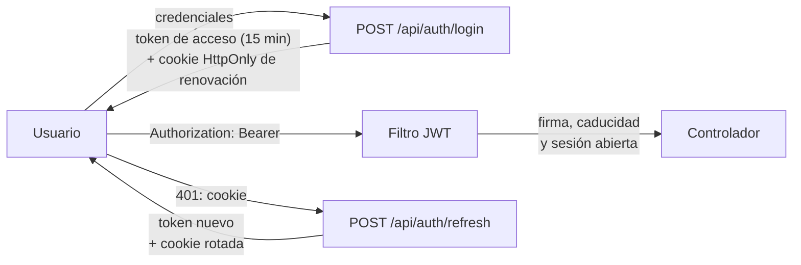

# Seguridad

Resumen de las prácticas de seguridad aplicadas en BarHub 2.0 y un modelo de amenazas básico. Las evidencias estáticas están en [auditorias.md](auditorias.md) y las pruebas dinámicas en [evidencias/](evidencias/seguridad-2026-11-15.md).

## Índice

1. [Prácticas aplicadas](#1-prácticas-aplicadas)
2. [Autenticación y autorización](#2-autenticación-y-autorización)
3. [Modelo de amenazas básico](#3-modelo-de-amenazas-básico)
4. [Pruebas dinámicas](#4-pruebas-dinámicas)
5. [Pendientes y limitaciones conocidas](#5-pendientes-y-limitaciones-conocidas)

---

## 1. Prácticas aplicadas

| Área | Práctica | Evidencia |
| :--- | :--- | :--- |
| **Control de acceso** | Denegación por defecto (`anyRequest().denyAll()`) y `@PreAuthorize` por rol en las operaciones de escritura | Pruebas dinámicas |
| **Acceso a datos ajenos** | Un usuario solo ve y modifica sus propios pedidos y perfil; el resto recibe un `404` uniforme | Pruebas dinámicas |
| **Integridad de pedidos** | El servidor recalcula los precios con los del catálogo y no confía en los del cliente | Pruebas dinámicas |
| **Subida de archivos** | Lista blanca de extensiones, tipo declarado, firma real del archivo, límites de tamaño, nombre aleatorio y ruta normalizada | Pruebas dinámicas y en navegador |
| **Errores** | Respuestas genéricas al cliente; el detalle queda solo en el log | Pruebas dinámicas |
| **Validación** | Bean Validation (`@Valid`) en los DTO de entrada | Pruebas dinámicas |
| **CORS** | Orígenes limitados a los del frontend (local y dominio de producción) | Revisión de código |
| **Dependencias** | Spring Boot 4.2 (Spring Framework 7 y Spring Security 7), `jjwt 0.13.0` y conector de MariaDB 4; dependencias sin uso retiradas | Snyk y Dependabot |
| **Conexión con la base de datos** | TLS 1.3 con el certificado del servidor verificado (Connector/J 4, `sslMode=verify-full` por defecto) y TLS obligatorio para el usuario de la aplicación (`REQUIRE SSL`) | [Evidencia](evidencias/tls-mariadb-2026-11-20.md) |
| **Código** | Eliminado `e.printStackTrace()`; `equals()` y `hashCode()` en `UserDetailsImpl` | SonarQube |
| **Contenedores** | Usuario no root (DS-0002) y `HEALTHCHECK` (DS-0026); versiones de imagen fijadas | Trivy |
| **Contraseñas** | Almacenadas como hash mediante el `PasswordEncoder` de Spring Security, nunca en claro | Modelo ER |
| **Secretos** | Fuera del repositorio: variables de entorno y `.env` ignorado por git | `.env.example` |
| **Accesibilidad** | Contrastes WCAG y etiquetas asociadas a los campos | SonarQube |
| **CI/CD** | Análisis estático con SonarCloud; credenciales en secretos de GitHub | Pipeline |
| **Endurecimiento del pipeline** | Acciones fijadas por SHA, permisos mínimos, `npm ci --ignore-scripts`, `gradle.lockfile` y contenedor del frontend sin root | SonarCloud |

## 2. Autenticación y autorización

- **Token de acceso** JWT firmado con `jjwt 0.13.0` (`JwtUtils.java`), válido 15 minutos y ligado a una sesión del servidor por el claim `sid`. El filtro comprueba en cada petición que esa sesión sigue abierta, así que cerrar sesión o caducar por inactividad lo invalida al momento.
- **Token de renovación** opaco y aleatorio (256 bits), en una cookie `HttpOnly`, `Secure` y `SameSite=Strict`, limitada a `/api/auth`: JavaScript no puede leerla y no viaja desde otros sitios. En la base de datos (`sesiones`) solo se guarda su SHA-256.
- **Rotación con detección de robo:** cada renovación entrega un token de renovación nuevo. Si alguien presenta uno ya rotado (pasados 30 segundos de margen, que cubren dos pestañas renovando a la vez), se revoca la sesión entera, también para quien tenga el token bueno.
- **Límites por rol**, configurables en `application.yml` (`app.sesion.roles`). Con varios roles se aplica el más estricto:

  | Rol | Inactividad máxima | Duración máxima de la sesión |
  | :--- | :---: | :---: |
  | Administrador | 15 min | 8 h |
  | Empleado | 30 min | 10 h (un turno) |
  | Cliente | 1 h | 12 h |

- **Un único interceptor HTTP** en el frontend (`auth.interceptor.ts`): añade el token, renueva al recibir un 401 y repite la petición sin que el usuario lo note (varias peticiones caducadas comparten una sola renovación). Si la sesión ya no se puede renovar, lleva al login con el aviso de sesión caducada.
- **Cerrar sesión** revoca la sesión en el servidor (`POST /api/auth/logout`) y borra la cookie.
- **Confirmación del correo y recuperación de la contraseña** (`CuentaCorreoService`): un cliente no puede iniciar sesión hasta abrir el enlace que recibe al registrarse (el login responde `403 EMAIL_NO_VERIFICADO` solo si la contraseña es correcta, para no revelar nada a quien no la sabe). Los enlaces son de un solo uso, caducan (24 h la confirmación, 30 min la recuperación), pedir uno nuevo anula el anterior y en la base de datos solo se guarda su SHA-256. El token va en el fragmento de la URL (`#token=...`), que el navegador no envía al servidor, así que no queda en los logs de Caddy ni en la cabecera `Referer`. Recuperar la contraseña y reenviar la confirmación responden siempre lo mismo y el envío es asíncrono, para que ni el mensaje ni el tiempo de respuesta revelen qué cuentas existen; como mucho sale un correo por minuto a cada cuenta. Restablecer la contraseña cierra todas las sesiones abiertas de la cuenta.
- **Bloqueo del login por usuario y por IP** (`LoginAttemptService`): 5 fallos seguidos de una cuenta la bloquean 15 minutos, y 20 fallos desde una IP contra cualquier cuenta bloquean esa IP 15 minutos (frena el *password spraying*). Un login correcto limpia el contador de su cuenta, no el de la IP. Detrás de Caddy, Tomcat toma la IP real de `X-Forwarded-For` (`server.forward-headers-strategy: native`) y solo si la petición llega desde la red interna de Docker, así que desde fuera no se puede falsificar.
- **Verificación en dos pasos** (`DosFactoresService`), obligatoria para el administrador y los empleados (`app.dos-factores.obligatorio`) y opcional para el resto. Con la contraseña correcta, el login no entrega ningún token: responde un desafío aleatorio que caduca a los 5 minutos y admite 5 códigos, y la sesión se abre en `POST /api/auth/2fa/verificar` con el código de 6 dígitos de la app de autenticación (TOTP, RFC 6238, HMAC-SHA1 y pasos de 30 s, con un paso de margen) o con un código de recuperación. Quien aún no la tiene la configura en ese momento (`/2fa/configurar` y `/2fa/activar`): el secreto de 160 bits no se activa hasta que la app genera un código correcto. Un código ya aceptado no vale otra vez, ni siquiera con dos peticiones simultáneas (actualización condicional en la base de datos). Los códigos incorrectos suman al bloqueo del login y la contraseña correcta no limpia el contador hasta terminar el segundo paso, así que repetirla no da intentos nuevos. El secreto se guarda cifrado con AES-256-GCM, con el id del usuario como dato autenticado; de los 10 códigos de recuperación (de un solo uso, unos 50 bits cada uno) solo se guarda su HMAC-SHA256 con una clave del servidor. Las dos claves se derivan de `APP_TOTP_CLAVE` o, si no está definida, de `JWT_SECRET`.
- **Avisos antes del cierre** (`SesionAvisoService`): dos minutos antes del cierre por inactividad aparece "¿Sigues ahí?" con cuenta atrás. "Seguir conectado" renueva la sesión; sin respuesta, se cierra también en el servidor y el login muestra el aviso. Cinco minutos antes de la duración máxima se avisa de la hora de cierre, que no se puede alargar. La inactividad se mide por la interacción del usuario y se comparte entre pestañas. Si el usuario está activo en una pantalla que no hace peticiones (leyendo o rellenando un formulario), la sesión se renueva en segundo plano para que el servidor no la cierre mientras tanto.
- **Control por roles** (`role_admin`, `role_cliente`, `role_empleado`) en dos capas:
  - **Backend:** barrera real, con Spring Security y `UserDetailsImpl`.
  - **Frontend:** `auth.guard.ts`, `role.guard.ts` y `auth.interceptor.ts`, que mejoran la experiencia pero **no sustituyen** al backend.
- **Token QR de mesa** (`mesas.token_qr`): vincula el QR a una mesa concreta.

## 3. Modelo de amenazas básico

### Activos

| Activo | Por qué importa |
| :--- | :--- |
| Datos personales (`users`: nombre, teléfono, dirección) | Privacidad y RGPD |
| Credenciales y tokens JWT | Suplantación de identidad |
| Datos de caja y pedidos | Integridad financiera |
| Disponibilidad del servicio en hora punta | Pérdida directa de ventas |

### Actores

| Actor | Descripción |
| :--- | :--- |
| Visitante anónimo | Accede a carta y registro |
| Cliente malicioso | Intenta ver pedidos ajenos o manipular precios |
| Empleado con exceso de permisos | Accede a caja o datos fuera de su función |
| Atacante externo | Explota vulnerabilidades en dependencias, API o contenedores |

### Amenazas y mitigaciones (STRIDE simplificado)

| # | Amenaza | Tipo | Mitigación | Estado |
| :--- | :--- | :--- | :--- | :---: |
| 1 | Robo o falsificación de JWT | Suplantación | Firma con `jjwt 0.13.0`, HTTPS, token de acceso de 15 min ligado a una sesión revocable, renovación en cookie `HttpOnly` con rotación y detección de reutilización | Verificado (tests de integración y E2E) |
| 2 | Acceso a endpoints de otro rol (p. ej. `POST /productos`) | Elevación de privilegios | `@PreAuthorize` y denegación por defecto | Verificado |
| 3 | Ver o modificar pedidos y perfiles de otro usuario (IDOR) | Divulgación | Filtrado por usuario autenticado y `404` uniforme | Verificado |
| 4 | Manipular precios desde el cliente | Manipulación | El backend recalcula con `productos.precio` | Verificado |
| 5 | Mass assignment (enviar campos que el cliente no debe controlar) | Manipulación | DTO con los campos permitidos | Verificado |
| 6 | Subida de archivos maliciosos | Ejecución / DoS | Lista blanca, firma real, límites, nombre aleatorio | Verificado |
| 7 | Fuga de información en errores | Divulgación | Respuestas genéricas; detalle solo en el log | Verificado |
| 8 | Reutilizar el QR de otra mesa | Manipulación | `token_qr` por mesa | Pendiente de verificar, sin rotación |
| 9 | Dependencias vulnerables | Varias | Snyk y SonarCloud; versiones de seguridad fijadas | Parcial: 2 avisos en el backend sin parche publicado y no explotables en BarHub; 0 en el frontend (ver [auditorias.md](auditorias.md)) |
| 10 | Escape de contenedor o escalada | Elevación | Usuario no root, imágenes multi-etapa | Aplicada |
| 11 | Fuerza bruta en el login | Suplantación | Bloqueo de 15 minutos tras 5 fallos de una cuenta o 20 de una IP (429 con `Retry-After`); los códigos incorrectos del segundo paso también cuentan | Mitigado y comprobado en las pruebas dinámicas y en los tests de integración |
| 12 | Cambio de contraseña con una sesión robada | Suplantación | Exigir la contraseña actual | Pendiente |
| 13 | Saturación de la API | Denegación de servicio | Límite de peticiones en Caddy o backend | Pendiente |
| 14 | Descuadre o fraude en caja | Repudio | Registro de usuario de apertura y cierre, `diferencia` y `observaciones` | Aplicada |
| 15 | Contraseña del personal robada o reutilizada | Suplantación | Verificación en dos pasos obligatoria para administrador y empleados, con secreto cifrado y códigos no repetibles | Verificado (tests unitarios, de integración y E2E) |

### Fuera de alcance

Ataques físicos al local, ingeniería social contra el personal y seguridad del TPV o datáfono externo.

## 4. Pruebas dinámicas

La API en ejecución se probó con un script propio contra una instancia local y se repitió tras cada cambio del backend. El script no se versiona; los resultados sí:

- [Pruebas de seguridad (22 de noviembre de 2026, con Spring Boot 4.2 y Angular 22, a través de Caddy)](evidencias/seguridad-2026-11-22.md)
- [Conexión cifrada con MariaDB (20 de noviembre de 2026, con Spring Boot 4.2 y Connector/J 4)](evidencias/tls-mariadb-2026-11-20.md)
- [Pruebas de seguridad (15 de noviembre de 2026, con Spring Boot 3.5.16)](evidencias/seguridad-2026-11-15.md)
- [Pruebas de seguridad (14 de noviembre de 2026)](evidencias/seguridad-2026-11-14.md)
- [Subidas de archivos y errores](evidencias/subidas-y-errores.md)

Resultado de la última ejecución (22 de noviembre de 2026): 53 OK y 0 fallos, incluida la fuerza bruta en el login, que el 15 de noviembre figuraba como pendiente.

## 5. Pendientes y limitaciones conocidas

| Tema | Detalle |
| :--- | :--- |
| Pago con tarjeta simulado | Funciona en modo demostración y la interfaz lo indica. Antes de un uso real hay que verificar en el servidor el `PaymentIntent` de Stripe (estado `succeeded` e importe) |
| Verificación en dos pasos | La primera configuración la hace quien conoce la contraseña, así que el personal tiene que activarla en cuanto recibe su cuenta. Si alguien pierde el móvil y los códigos de recuperación, hoy se le quita desde la base de datos (ver el README). Los login a medias viven en memoria 5 minutos. Si cambia `APP_TOTP_CLAVE` (o `JWT_SECRET` sin ella), los secretos guardados dejan de descifrarse |
| Límite de intentos | El login bloquea 15 minutos una cuenta tras 5 fallos seguidos y una IP tras 20 fallos contra cualquier cuenta. Los contadores viven en memoria (se pierden al reiniciar y no se comparten entre réplicas), alguien puede bloquear a propósito una cuenta ajena durante 15 minutos, y la creación de pedidos sigue sin límite |
| Correo | En local los correos solo llegan a Mailpit. En producción hace falta un SMTP real con SPF, DKIM y DMARC en el dominio, o acabarán en la carpeta de correo no deseado. Las cuentas creadas antes de la 2.1 y las que da de alta un administrador cuentan como confirmadas |
| Registro de jornada | Registra entradas y salidas del personal, pero no es un sistema de fichaje certificado: no guarda firma del empleado ni impide que el administrador consulte o exporte a su criterio, y la conservación durante 4 años que exige la normativa depende de las copias de seguridad de la base de datos |
| Token de acceso en `localStorage` | El token de acceso (15 min) sigue en `localStorage`; el de renovación ya no es accesible desde JavaScript. La CSP estricta de la 2.1 reduce el riesgo de XSS que podría leerlo |
| Pantallas que se refrescan solas | El cierre por inactividad lo decide la interacción del usuario, no las peticiones automáticas: un monitor de comandas que nadie toca durante 30 minutos pide confirmación y, sin respuesta, se cierra |
| Uptime Kuma | Publicado en el puerto 3001; ver mejoras en [infraestructura.md](infraestructura.md#13-mejoras-recomendadas) |
| Dependencias sin parche compatible | `jaxb-core` 4.0.9 (XXE, no explotable: BarHub no lee XML de fuera) y `jakarta.validation-api` 3.1.1 (baja, corrección solo en una versión preliminar). Queda 1 alerta de Dependabot por revisar |
