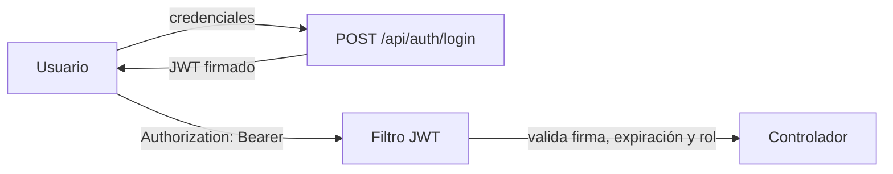

# Seguridad

Resumen de las prácticas de seguridad aplicadas en BarHub 2.0 y un modelo de amenazas básico. Las evidencias estáticas están en [auditorias.md](auditorias.md) y las pruebas dinámicas en [evidencias/](evidencias/seguridad-2026-11-14.md).

## Índice

1. [Prácticas aplicadas](#1-prácticas-aplicadas)
2. [Autenticación y autorización](#2-autenticación-y-autorización)
3. [Modelo de amenazas básico](#3-modelo-de-amenazas-básico)
4. [Pruebas dinámicas](#4-pruebas-dinámicas)
5. [Pendientes y limitaciones conocidas](#5-pendientes-y-limitaciones-conocidas)

---

## 1. Prácticas aplicadas

| Área | Práctica | Evidencia |
| :--- | :--- | :--- |
| **Control de acceso** | Denegación por defecto (`anyRequest().denyAll()`) y `@PreAuthorize` por rol en las operaciones de escritura | Pruebas dinámicas |
| **Acceso a datos ajenos** | Un usuario solo ve y modifica sus propios pedidos y perfil; el resto recibe un `404` uniforme | Pruebas dinámicas |
| **Integridad de pedidos** | El servidor recalcula los precios con los del catálogo y no confía en los del cliente | Pruebas dinámicas |
| **Subida de archivos** | Lista blanca de extensiones, tipo declarado, firma real del archivo, límites de tamaño, nombre aleatorio y ruta normalizada | Pruebas dinámicas y en navegador |
| **Errores** | Respuestas genéricas al cliente; el detalle queda solo en el log | Pruebas dinámicas |
| **Validación** | Bean Validation (`@Valid`) en los DTO de entrada | Pruebas dinámicas |
| **CORS** | Orígenes limitados a los del frontend (local y dominio de producción) | Revisión de código |
| **Dependencias** | Spring Boot 3.4.3 y `jjwt 0.12.5`; conectores actualizados; dependencias sin uso retiradas | Snyk |
| **Código** | Eliminado `e.printStackTrace()`; `equals()` y `hashCode()` en `UserDetailsImpl` | SonarQube |
| **Contenedores** | Usuario no root (DS-0002) y `HEALTHCHECK` (DS-0026); versiones de imagen fijadas | Trivy |
| **Contraseñas** | Almacenadas como hash mediante el `PasswordEncoder` de Spring Security, nunca en claro | Modelo ER |
| **Secretos** | Fuera del repositorio: variables de entorno y `.env` ignorado por git | `.env.example` |
| **Accesibilidad** | Contrastes WCAG y etiquetas asociadas a los campos | SonarQube |
| **CI/CD** | Análisis estático con SonarCloud; credenciales en secretos de GitHub | Pipeline |

## 2. Autenticación y autorización

- **JWT** firmado con `jjwt 0.12.5` (`JwtUtils.java`), sin sesión en el servidor. La caducidad actual es de 24 horas.
- **Control por roles** (`role_admin`, `role_cliente`, `role_empleado`) en dos capas:
  - **Backend:** barrera real, con Spring Security y `UserDetailsImpl`.
  - **Frontend:** `auth.guard.ts`, `role.guard.ts` y `auth.interceptor.ts`, que mejoran la experiencia pero **no sustituyen** al backend.
- **Token QR de mesa** (`mesas.token_qr`): vincula el QR a una mesa concreta.

## 3. Modelo de amenazas básico

### Activos

| Activo | Por qué importa |
| :--- | :--- |
| Datos personales (`users`: nombre, teléfono, dirección) | Privacidad y RGPD |
| Credenciales y tokens JWT | Suplantación de identidad |
| Datos de caja y pedidos | Integridad financiera |
| Disponibilidad del servicio en hora punta | Pérdida directa de ventas |

### Actores

| Actor | Descripción |
| :--- | :--- |
| Visitante anónimo | Accede a carta y registro |
| Cliente malicioso | Intenta ver pedidos ajenos o manipular precios |
| Empleado con exceso de permisos | Accede a caja o datos fuera de su función |
| Atacante externo | Explota vulnerabilidades en dependencias, API o contenedores |

### Amenazas y mitigaciones (STRIDE simplificado)

| # | Amenaza | Tipo | Mitigación | Estado |
| :--- | :--- | :--- | :--- | :---: |
| 1 | Robo o falsificación de JWT | Suplantación | Firma con `jjwt 0.12.5`, HTTPS, caducidad de 24 h | Parcial: reducir la caducidad |
| 2 | Acceso a endpoints de otro rol (p. ej. `POST /productos`) | Elevación de privilegios | `@PreAuthorize` y denegación por defecto | Verificado |
| 3 | Ver o modificar pedidos y perfiles de otro usuario (IDOR) | Divulgación | Filtrado por usuario autenticado y `404` uniforme | Verificado |
| 4 | Manipular precios desde el cliente | Manipulación | El backend recalcula con `productos.precio` | Verificado |
| 5 | Mass assignment (enviar campos que el cliente no debe controlar) | Manipulación | DTO con los campos permitidos | Verificado |
| 6 | Subida de archivos maliciosos | Ejecución / DoS | Lista blanca, firma real, límites, nombre aleatorio | Verificado |
| 7 | Fuga de información en errores | Divulgación | Respuestas genéricas; detalle solo en el log | Verificado |
| 8 | Reutilizar el QR de otra mesa | Manipulación | `token_qr` por mesa | Pendiente de verificar, sin rotación |
| 9 | Dependencias vulnerables | Varias | Snyk y SonarCloud | Parcial |
| 10 | Escape de contenedor o escalada | Elevación | Usuario no root, imágenes multi-etapa | Aplicada |
| 11 | Fuerza bruta en el login | Suplantación | Límite de intentos | Pendiente: 30 intentos fallidos seguidos no provocan bloqueo |
| 12 | Cambio de contraseña con una sesión robada | Suplantación | Exigir la contraseña actual | Pendiente |
| 13 | Saturación de la API | Denegación de servicio | Límite de peticiones en Caddy o backend | Pendiente |
| 14 | Descuadre o fraude en caja | Repudio | Registro de usuario de apertura y cierre, `diferencia` y `observaciones` | Aplicada |

### Fuera de alcance

Ataques físicos al local, ingeniería social contra el personal y seguridad del TPV o datáfono externo.

## 4. Pruebas dinámicas

La API en ejecución se probó con un script propio contra una instancia local y se repitió tras cada cambio del backend. El script no se versiona; los resultados sí:

- [Pruebas de seguridad (14 de noviembre de 2026)](evidencias/seguridad-2026-11-14.md)
- [Subidas de archivos y errores](evidencias/subidas-y-errores.md)

Resultado de la última ejecución: 0 fallos. La fuerza bruta en el login figura como pendiente.

## 5. Pendientes y limitaciones conocidas

| Tema | Detalle |
| :--- | :--- |
| Pago con tarjeta simulado | Funciona en modo demostración y la interfaz lo indica. Antes de un uso real hay que verificar en el servidor el `PaymentIntent` de Stripe (estado `succeeded` e importe) |
| Verificación de correo | No implementada: el registro no envía ni exige confirmación por correo |
| Límite de intentos | Login y creación de pedidos sin limitación (Fail2Ban sobre los logs de Caddy o límite en la aplicación) |
| Caducidad del JWT | 24 horas; valorar token de corta duración con renovación |
| Contraseña actual | No se exige al cambiar la contraseña |
| Uptime Kuma | Publicado en el puerto 3001; ver mejoras en [infraestructura.md](infraestructura.md#13-mejoras-recomendadas) |
