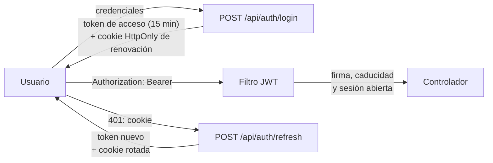

# Seguridad

Resumen de las prácticas de seguridad aplicadas en BarHub 2.0 y un modelo de amenazas básico. Las evidencias estáticas están en [auditorias.md](auditorias.md) y las pruebas dinámicas en [evidencias/](evidencias/seguridad-2026-11-15.md).

## Índice

1. [Prácticas aplicadas](#1-prácticas-aplicadas)
2. [Autenticación y autorización](#2-autenticación-y-autorización)
3. [Modelo de amenazas básico](#3-modelo-de-amenazas-básico)
4. [Pruebas dinámicas](#4-pruebas-dinámicas)
5. [Pendientes y limitaciones conocidas](#5-pendientes-y-limitaciones-conocidas)

---

## 1. Prácticas aplicadas

| Área | Práctica | Evidencia |
| :--- | :--- | :--- |
| **Control de acceso** | Denegación por defecto (`anyRequest().denyAll()`) y `@PreAuthorize` por rol en las operaciones de escritura | Pruebas dinámicas |
| **Acceso a datos ajenos** | Un usuario solo ve y modifica sus propios pedidos y perfil; el resto recibe un `404` uniforme | Pruebas dinámicas |
| **Integridad de pedidos** | El servidor recalcula los precios con los del catálogo y no confía en los del cliente | Pruebas dinámicas |
| **Subida de archivos** | Lista blanca de extensiones, tipo declarado, firma real del archivo, límites de tamaño, nombre aleatorio y ruta normalizada | Pruebas dinámicas y en navegador |
| **Errores** | Respuestas genéricas al cliente; el detalle queda solo en el log | Pruebas dinámicas |
| **Validación** | Bean Validation (`@Valid`) en los DTO de entrada | Pruebas dinámicas |
| **CORS** | Orígenes limitados a los del frontend (local y dominio de producción) | Revisión de código |
| **Dependencias** | Spring Boot 4.2 (Spring Framework 7 y Spring Security 7), `jjwt 0.13.0` y conector de MariaDB 4; dependencias sin uso retiradas | Snyk y Dependabot |
| **Conexión con la base de datos** | TLS 1.3 con el certificado del servidor verificado (Connector/J 4, `sslMode=verify-full` por defecto) y TLS obligatorio para el usuario de la aplicación (`REQUIRE SSL`) | [Evidencia](evidencias/tls-mariadb-2026-11-20.md) |
| **Código** | Eliminado `e.printStackTrace()`; `equals()` y `hashCode()` en `UserDetailsImpl` | SonarQube |
| **Contenedores** | Usuario no root (DS-0002) y `HEALTHCHECK` (DS-0026); versiones de imagen fijadas | Trivy |
| **Contraseñas** | Almacenadas como hash mediante el `PasswordEncoder` de Spring Security, nunca en claro | Modelo ER |
| **Secretos** | Fuera del repositorio: variables de entorno y `.env` ignorado por git | `.env.example` |
| **Accesibilidad** | Contrastes WCAG y etiquetas asociadas a los campos | SonarQube |
| **CI/CD** | Análisis estático con SonarCloud; credenciales en secretos de GitHub | Pipeline |
| **Endurecimiento del pipeline** | Acciones fijadas por SHA, permisos mínimos, `npm ci --ignore-scripts`, `gradle.lockfile` y contenedor del frontend sin root | SonarCloud |

## 2. Autenticación y autorización

- **Token de acceso** JWT firmado con `jjwt 0.13.0` (`JwtUtils.java`), válido 15 minutos y ligado a una sesión del servidor por el claim `sid`. El filtro comprueba en cada petición que esa sesión sigue abierta, así que cerrar sesión o caducar por inactividad lo invalida al momento.
- **Token de renovación** opaco y aleatorio (256 bits), en una cookie `HttpOnly`, `Secure` y `SameSite=Strict`, limitada a `/api/auth`: JavaScript no puede leerla y no viaja desde otros sitios. En la base de datos (`sesiones`) solo se guarda su SHA-256.
- **Rotación con detección de robo:** cada renovación entrega un token de renovación nuevo. Si alguien presenta uno ya rotado (pasados 30 segundos de margen, que cubren dos pestañas renovando a la vez), se revoca la sesión entera, también para quien tenga el token bueno.
- **Límites por rol**, configurables en `application.yml` (`app.sesion.roles`). Con varios roles se aplica el más estricto:

  | Rol | Inactividad máxima | Duración máxima de la sesión |
  | :--- | :---: | :---: |
  | Administrador | 15 min | 8 h |
  | Empleado | 30 min | 10 h (un turno) |
  | Cliente | 1 h | 12 h |

- **Un único interceptor HTTP** en el frontend (`auth.interceptor.ts`): añade el token, renueva al recibir un 401 y repite la petición sin que el usuario lo note (varias peticiones caducadas comparten una sola renovación). Si la sesión ya no se puede renovar, lleva al login con el aviso de sesión caducada.
- **Cerrar sesión** revoca la sesión en el servidor (`POST /api/auth/logout`) y borra la cookie.
- **Control por roles** (`role_admin`, `role_cliente`, `role_empleado`) en dos capas:
  - **Backend:** barrera real, con Spring Security y `UserDetailsImpl`.
  - **Frontend:** `auth.guard.ts`, `role.guard.ts` y `auth.interceptor.ts`, que mejoran la experiencia pero **no sustituyen** al backend.
- **Token QR de mesa** (`mesas.token_qr`): vincula el QR a una mesa concreta.

## 3. Modelo de amenazas básico

### Activos

| Activo | Por qué importa |
| :--- | :--- |
| Datos personales (`users`: nombre, teléfono, dirección) | Privacidad y RGPD |
| Credenciales y tokens JWT | Suplantación de identidad |
| Datos de caja y pedidos | Integridad financiera |
| Disponibilidad del servicio en hora punta | Pérdida directa de ventas |

### Actores

| Actor | Descripción |
| :--- | :--- |
| Visitante anónimo | Accede a carta y registro |
| Cliente malicioso | Intenta ver pedidos ajenos o manipular precios |
| Empleado con exceso de permisos | Accede a caja o datos fuera de su función |
| Atacante externo | Explota vulnerabilidades en dependencias, API o contenedores |

### Amenazas y mitigaciones (STRIDE simplificado)

| # | Amenaza | Tipo | Mitigación | Estado |
| :--- | :--- | :--- | :--- | :---: |
| 1 | Robo o falsificación de JWT | Suplantación | Firma con `jjwt 0.13.0`, HTTPS, token de acceso de 15 min ligado a una sesión revocable, renovación en cookie `HttpOnly` con rotación y detección de reutilización | Verificado (tests de integración y E2E) |
| 2 | Acceso a endpoints de otro rol (p. ej. `POST /productos`) | Elevación de privilegios | `@PreAuthorize` y denegación por defecto | Verificado |
| 3 | Ver o modificar pedidos y perfiles de otro usuario (IDOR) | Divulgación | Filtrado por usuario autenticado y `404` uniforme | Verificado |
| 4 | Manipular precios desde el cliente | Manipulación | El backend recalcula con `productos.precio` | Verificado |
| 5 | Mass assignment (enviar campos que el cliente no debe controlar) | Manipulación | DTO con los campos permitidos | Verificado |
| 6 | Subida de archivos maliciosos | Ejecución / DoS | Lista blanca, firma real, límites, nombre aleatorio | Verificado |
| 7 | Fuga de información en errores | Divulgación | Respuestas genéricas; detalle solo en el log | Verificado |
| 8 | Reutilizar el QR de otra mesa | Manipulación | `token_qr` por mesa | Pendiente de verificar, sin rotación |
| 9 | Dependencias vulnerables | Varias | Snyk y SonarCloud; versiones de seguridad fijadas | Parcial: 2 avisos en el backend sin parche publicado y no explotables en BarHub; 0 en el frontend (ver [auditorias.md](auditorias.md)) |
| 10 | Escape de contenedor o escalada | Elevación | Usuario no root, imágenes multi-etapa | Aplicada |
| 11 | Fuerza bruta en el login | Suplantación | Bloqueo de 15 minutos tras 5 fallos (429 con `Retry-After`) | Mitigado y comprobado en las pruebas dinámicas; falta el bloqueo por IP (2.1) |
| 12 | Cambio de contraseña con una sesión robada | Suplantación | Exigir la contraseña actual | Pendiente |
| 13 | Saturación de la API | Denegación de servicio | Límite de peticiones en Caddy o backend | Pendiente |
| 14 | Descuadre o fraude en caja | Repudio | Registro de usuario de apertura y cierre, `diferencia` y `observaciones` | Aplicada |

### Fuera de alcance

Ataques físicos al local, ingeniería social contra el personal y seguridad del TPV o datáfono externo.

## 4. Pruebas dinámicas

La API en ejecución se probó con un script propio contra una instancia local y se repitió tras cada cambio del backend. El script no se versiona; los resultados sí:

- [Pruebas de seguridad (22 de noviembre de 2026, con Spring Boot 4.2 y Angular 22, a través de Caddy)](evidencias/seguridad-2026-11-22.md)
- [Conexión cifrada con MariaDB (20 de noviembre de 2026, con Spring Boot 4.2 y Connector/J 4)](evidencias/tls-mariadb-2026-11-20.md)
- [Pruebas de seguridad (15 de noviembre de 2026, con Spring Boot 3.5.16)](evidencias/seguridad-2026-11-15.md)
- [Pruebas de seguridad (14 de noviembre de 2026)](evidencias/seguridad-2026-11-14.md)
- [Subidas de archivos y errores](evidencias/subidas-y-errores.md)

Resultado de la última ejecución (22 de noviembre de 2026): 53 OK y 0 fallos, incluida la fuerza bruta en el login, que el 15 de noviembre figuraba como pendiente.

## 5. Pendientes y limitaciones conocidas

| Tema | Detalle |
| :--- | :--- |
| Pago con tarjeta simulado | Funciona en modo demostración y la interfaz lo indica. Antes de un uso real hay que verificar en el servidor el `PaymentIntent` de Stripe (estado `succeeded` e importe) |
| Verificación de correo | No implementada: el registro no envía ni exige confirmación por correo |
| Límite de intentos | El login bloquea 15 minutos tras 5 fallos seguidos de un mismo usuario (desde la 2.0.1); el bloqueo es por usuario y no por IP, y la creación de pedidos sigue sin límite |
| Token de acceso en `localStorage` | El token de acceso (15 min) sigue en `localStorage`; el de renovación ya no es accesible desde JavaScript. La CSP estricta de la 2.1 reduce el riesgo de XSS que podría leerlo |
| Actividad en pantallas que se refrescan solas | Las pantallas con refresco automático (seguimiento, comandas) cuentan como actividad: un monitor de cocina abierto no caduca por inactividad, aunque sí al llegar a la duración máxima |
| Uptime Kuma | Publicado en el puerto 3001; ver mejoras en [infraestructura.md](infraestructura.md#13-mejoras-recomendadas) |
| Dependencias sin parche compatible | `jaxb-core` 4.0.9 (XXE, no explotable: BarHub no lee XML de fuera) y `jakarta.validation-api` 3.1.1 (baja, corrección solo en una versión preliminar). Queda 1 alerta de Dependabot por revisar |
