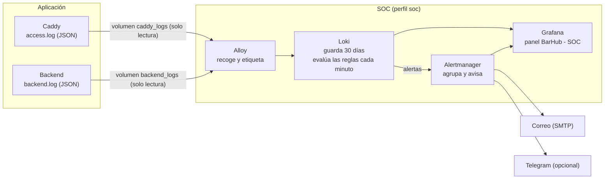

# SOC de BarHub

El SOC (centro de operaciones de seguridad) de BarHub vigila los logs de la aplicación y avisa cuando ve algo que no debería pasar: fuerza bruta contra el inicio de sesión, alguien probando zonas que no son de su rol, cambios en las cuentas del personal, escaneos de rutas, errores del servidor o avisos de la CSP. **Detecta y avisa; la respuesta es manual.** La única respuesta automática es la del propio backend, que bloquea una cuenta a los 5 inicios de sesión fallidos y una IP a los 20.

Este documento es la referencia completa del SOC. Las prácticas de seguridad del resto de la aplicación están en [`docs/seguridad.md`](../../docs/seguridad.md), y cómo encaja con la monitorización del servidor (Uptime Kuma, `auditd`, `aide`), en [`docs/infraestructura.md`](../../docs/infraestructura.md#12-soc-y-monitorización).

## Índice

1. [Arquitectura](#1-arquitectura)
2. [De dónde salen los datos](#2-de-dónde-salen-los-datos)
3. [Reglas de alerta](#3-reglas-de-alerta)
4. [Avisos: Alertmanager](#4-avisos-alertmanager)
5. [Panel de Grafana](#5-panel-de-grafana)
6. [Puesta en marcha con `soc.py`](#6-puesta-en-marcha-con-socpy)
7. [Qué hacer cuando salta una alerta](#7-qué-hacer-cuando-salta-una-alerta)
8. [Acceso, datos personales y recursos](#8-acceso-datos-personales-y-recursos)
9. [Tests y CI](#9-tests-y-ci)
10. [Problemas frecuentes](#10-problemas-frecuentes)
11. [Limitaciones](#11-limitaciones)
12. [Ficheros](#12-ficheros)

---

## 1. Arquitectura

Son cuatro contenedores que solo arrancan con el perfil `soc` de Docker Compose ([`infra/docker/docker-compose.yml`](../../infra/docker/docker-compose.yml)). La aplicación funciona igual con el SOC parado: solo escribe sus logs, y el SOC los lee cuando está encendido.



| Contenedor | Imagen | Función | Puerto |
| :--- | :--- | :--- | :--- |
| `barhub-alloy` | `grafana/alloy:v1.21.0` | Lee `access.log` de Caddy y `backend.log` del backend desde sus volúmenes, en solo lectura, y los envía a Loki con la etiqueta `servicio`. Sin acceso a Docker, sin capacidades (`cap_drop: ALL`) y sin puertos | Ninguno |
| `barhub-loki` | `grafana/loki:3.7.7` | Guarda los logs 30 días y evalúa cada minuto las reglas de [`loki/reglas/barhub.yml`](loki/reglas/barhub.yml); las que se cumplen van a Alertmanager | `127.0.0.1:3100` |
| `barhub-alertmanager` | `prom/alertmanager:v0.34.1` | Agrupa las alertas por regla e IP, las envía por correo (y por Telegram, si se configura) y avisa también cuando se resuelven | `127.0.0.1:9093` |
| `barhub-grafana` | `grafana/grafana:13.2.0` | Panel *BarHub - SOC* como página de inicio y consultas libres a los logs. Sin registro ni acceso anónimo | `127.0.0.1:3000` |

Las versiones de las imágenes están fijadas: `soc.py validar` falla si alguna usa `latest` o no lleva versión.

## 2. De dónde salen los datos

### 2.1. Caddy

Caddy escribe su log de acceso en JSON, una línea por petición, en el volumen `caddy_logs`. Alloy la envía tal cual con `servicio="caddy"` y las reglas leen de ella la IP (`request.client_ip`) y el código de respuesta (`status`).

### 2.2. Backend

El backend escribe, además de la consola, un log en JSON (`LOGGING_STRUCTURED_FORMAT_FILE=logstash`) en el volumen `backend_logs`, con rotación a los 10 MB y 7 días de histórico. Alloy lo procesa antes de enviarlo:

- Toma la hora de la propia línea (`@timestamp`), no la de lectura, para que las ventanas de las reglas cuadren aunque Alloy lea con retraso.
- Pone la etiqueta `nivel` (`INFO`, `WARN`, `ERROR`) para poder filtrar sin leer cada línea.
- Deja como contenido el mensaje y, si la hay, la traza del error.

Tres tipos de línea interesan al SOC:

| Línea | Ejemplo | Para qué |
| :--- | :--- | :--- |
| Auditoría | `evento=auditoria accion=INICIO_SESION resultado=RECHAZADO ip=203.0.113.7` | Fuerza bruta, accesos denegados y cambios en las cuentas |
| CSP | `CSP: ...` (el aviso que manda el navegador) | Lo que el navegador ha bloqueado por la política de seguridad de contenido |
| Errores | Cualquier línea con nivel `ERROR` | Fallos del backend |

La línea de auditoría lleva **la acción, el resultado y la IP, sin usuario ni detalle**. Esos siguen solo en la base de datos, en *Admin → Auditoría*. El backend escribe la línea antes de guardar la entrada, así que el SOC la tiene aunque la base de datos falle o alguien la modifique después.

## 3. Reglas de alerta

Están en [`loki/reglas/barhub.yml`](loki/reglas/barhub.yml), escritas en LogQL, en cuatro grupos. Loki las evalúa cada minuto.

| Grupo | Alerta | Se dispara con | Severidad |
| :--- | :--- | :--- | :---: |
| Autenticación | `FuerzaBrutaInicioSesion` | 8 o más inicios de sesión, segundos pasos o reautenticaciones rechazados o bloqueados desde una IP en 5 minutos | alta |
| Autenticación | `FallosInicioSesionRepartidos` | 40 o más inicios de sesión fallidos en 15 minutos sumando todas las IP (botnet o lista de contraseñas) | media |
| Autorización | `AccesosDenegadosRepetidos` | 10 o más `ACCESO_DENEGADO` (peticiones a zonas de otro rol) desde una IP en 5 minutos | alta |
| Autorización | `CambioDePrivilegios` | Un alta, edición o baja de usuario, o un restablecimiento de su verificación en dos pasos | info |
| Tráfico | `EscaneoOAbusoDesdeUnaIp` | 40 o más respuestas 4xx para una IP en 5 minutos | media |
| Tráfico | `ErroresDelServidor` | 10 o más respuestas 5xx en 5 minutos | alta |
| Aplicación | `InfraccionCSP` | Cualquier aviso de la CSP en 10 minutos | media |
| Aplicación | `ErroresDelBackend` | 5 o más líneas `ERROR` del backend en 5 minutos | media |

**Por qué estos umbrales.** Están pensados para el tráfico de un bar: con el uso normal no salta ninguna. `FuerzaBrutaInicioSesion` avisa a los 8 fallos, entre el bloqueo de una cuenta (5) y el de una IP (20), para enterarse antes de que el backend corte la IP. Las pruebas sí las disparan, y es lo esperado: `pruebas_seguridad.py`, los E2E y `soc.py probar` provocan fuerza bruta, accesos denegados, 4xx y avisos de la CSP.

Cada regla lleva un `summary` y una `description` en sus anotaciones, que son el asunto y el texto del aviso. `test_soc.py` comprueba que todas las tienen y que solo usan las etiquetas que pone Alloy.

## 4. Avisos: Alertmanager

`soc.py desplegar` genera `alertmanager/alertmanager.yml` a partir de las variables `SOC_*` del `.env`. El fichero lleva las claves del SMTP y de Telegram, así que **no se versiona** (está en `.gitignore`).

| Ajuste | Valor | Efecto |
| :--- | :--- | :--- |
| `group_by` | `alertname`, `ip` | Un aviso por regla y por IP, no uno por cada línea |
| `group_wait` | 30 s | Espera medio minuto para juntar lo que llega a la vez |
| `group_interval` | 5 min | Cada cuánto manda novedades de un grupo ya avisado (también el «resuelta») |
| `repeat_interval` | 4 h (24 h las `info`) | No repite el aviso de una alerta que sigue activa hasta pasado ese tiempo |
| `send_resolved` | `true` | Avisa también cuando la alerta deja de cumplirse |

| Variable | Para qué | Por defecto |
| :--- | :--- | :--- |
| `SOC_GRAFANA_CLAVE` | Contraseña de Grafana (obligatoria, mínimo 12 caracteres) | Ninguno |
| `SOC_GRAFANA_USUARIO` | Usuario de Grafana | `admin` |
| `SOC_SMTP_HOST`, `SOC_SMTP_PUERTO` | Servidor de correo | Mailpit (`mailpit:1025`) |
| `SOC_SMTP_USUARIO`, `SOC_SMTP_CLAVE`, `SOC_SMTP_TLS` | Autenticación y cifrado del SMTP | Sin autenticación ni TLS (Mailpit) |
| `SOC_CORREO_DESTINO`, `SOC_CORREO_REMITENTE` | A quién y desde quién | Direcciones de ejemplo |
| `SOC_TELEGRAM_TOKEN`, `SOC_TELEGRAM_CHAT` | Bot y chat de Telegram | Sin Telegram |

En local, los correos llegan a **Mailpit** (`http://localhost:8025`), que los captura y no entrega ninguno. En producción hay que poner un SMTP real o Telegram: `soc.py comprobar` avisa si el SMTP es real y va sin TLS, o si las alertas solo llegan a Mailpit, y no despliega si los valores no cuadran: un puerto que no es un número, un correo mal escrito, usuario del SMTP sin clave (o al revés), token de Telegram sin chat (o al revés) o un chat que no es numérico.

## 5. Panel de Grafana

El panel *BarHub - SOC* ([`grafana/paneles/soc.json`](grafana/paneles/soc.json)) es la página de inicio de Grafana. Enseña las últimas 24 horas y se refresca cada minuto.

| Panel | Tipo | Qué muestra |
| :--- | :--- | :--- |
| Inicios de sesión fallidos | Cifra | Inicio de sesión, segundo paso y reautenticación rechazados o bloqueados en el periodo |
| Accesos denegados | Cifra | Peticiones a zonas de otro rol |
| Respuestas 5xx | Cifra | Errores del servidor vistos por Caddy |
| Avisos de la CSP | Cifra | Lo que el navegador ha bloqueado por la CSP |
| Auditoría: lo que no ha salido bien | Gráfica | Entradas de auditoría rechazadas, bloqueadas o con error, por acción y resultado |
| Respuestas de Caddy por código | Gráfica | Todas las peticiones a la web, por código de respuesta |
| IP con más fallos de autenticación | Tabla | Las 10 IP con más inicios de sesión fallidos o bloqueados |
| IP con más respuestas 4xx | Tabla | Las 10 IP con más respuestas 400-499 |
| Registro de auditoría | Logs | Acción, resultado e IP de cada entrada (el usuario, en *Admin → Auditoría*) |
| Backend: errores, avisos y CSP | Logs | Líneas `ERROR` y `WARN` del backend, con la traza si la hay |

Las fuentes de datos (Loki y Alertmanager) y el panel se cargan solos al arrancar ([`grafana/provisioning/`](grafana/provisioning)). Para consultas libres, *Explore* con la fuente Loki: por ejemplo `{servicio="backend"} |= "evento=auditoria" | logfmt | ip="203.0.113.7"`.

## 6. Puesta en marcha con `soc.py`

[`soc.py`](soc.py) (Python 3, solo biblioteca estándar) hace todo el ciclo. Como el resto de scripts del proyecto, `desplegar`, `probar` y `parar` solo cuentan lo que harían hasta que se añade `--aplicar`, y nunca enseñan los secretos del `.env`.

| Orden | Qué hace |
| :--- | :--- |
| `validar` | Revisa los ficheros (reglas, panel, que ningún puerto salga de `127.0.0.1`, versiones fijadas) y pasa la configuración por las propias imágenes: Loki la verifica y, en un contenedor de usar y tirar, carga y evalúa las reglas; `amtool` y Alloy revisan las suyas. Con `--sin-docker`, solo los ficheros. Es lo que ejecuta el job `soc` de CI |
| `comprobar` | Ficheros, variables `SOC_*` del `.env`, Docker, y que el backend ya escribe el log del SOC |
| `desplegar` | Genera `alertmanager/alertmanager.yml`, arranca los cuatro contenedores y espera a que estén listos y con todas las reglas cargadas |
| `probar` | Ataque simulado: 8 inicios de sesión fallidos de un usuario inventado, 45 peticiones a rutas que no existen y un aviso de la CSP. Espera a que `FuerzaBrutaInicioSesion`, `EscaneoOAbusoDesdeUnaIp` e `InfraccionCSP` estén activas en Alertmanager y, con Mailpit, a que lleguen los tres correos. Si falta alguna, dice si los logs han llegado a Loki (fallo de la recogida) o no (fallo de la regla) |
| `estado` | Contenedores, reglas cargadas con su estado y alertas activas |
| `parar` | Para los cuatro contenedores; los datos de Loki y Grafana se quedan |

```bash
# 1. Variables: SOC_GRAFANA_CLAVE (obligatoria) y, en producción, el SMTP o Telegram (ver .env.example)
nano infra/docker/.env
# 2. La aplicación, con el log del SOC en el backend
cd infra/docker && docker compose up -d --build && cd ../..
# 3. El SOC
python3 seguridad/soc/soc.py comprobar
python3 seguridad/soc/soc.py desplegar --aplicar
python3 seguridad/soc/soc.py probar --aplicar
python3 seguridad/soc/soc.py estado
```

**Antes de repetir `probar`.** Si siguen activas las alertas de una prueba anterior, `probar` espera a que se resuelvan (y, con Mailpit, al correo de resueltas) antes de atacar, hasta 15 minutos (`--espera-previa`). Alertmanager no repite el aviso de una alerta ya avisada hasta que se resuelve o pasan 4 horas, y la prueba no demostraría nada. Las alertas de la prueba se resuelven solas cuando pasa su ventana, entre 5 y 10 minutos.

**Y antes de `pruebas_seguridad.py`.** `probar` suma 8 fallos al contador de la IP en el backend, que la bloquea 15 minutos a los 20. No conviene lanzarlo seguido de `pruebas_seguridad.py` desde el mismo equipo; si pasa, `docker compose restart backend` limpia los contadores.

## 7. Qué hacer cuando salta una alerta

Lo primero, siempre: abrir el panel del SOC en Grafana y *Admin → Auditoría* en la aplicación, que tiene el usuario y el detalle de cada entrada.

| Alerta | Comprobar | Si es un ataque |
| :--- | :--- | :--- |
| `FuerzaBrutaInicioSesion` | La IP en la tabla «IP con más fallos de autenticación» y, en *Auditoría*, contra qué usuarios va | El backend ya bloquea la cuenta (5 fallos) y la IP (20). Si sigue tras el bloqueo, cortar la IP en el cortafuegos (`iptables`) y avisar al usuario afectado para que cambie la contraseña |
| `FallosInicioSesionRepartidos` | Si hay muchas IP distintas con pocos fallos cada una | Revisar que el personal tiene la verificación en dos pasos (es obligatoria) y que nadie usa contraseñas repetidas. Valorar Fail2Ban o un servicio de protección delante de la web |
| `AccesosDenegadosRepetidos` | En *Auditoría*, qué usuario es y qué rutas ha pedido | Es alguien con sesión probando lo que no le corresponde: cerrar sus sesiones desde *Gestionar Usuarios* y, si es un cliente, valorar dar de baja la cuenta |
| `CambioDePrivilegios` | Quién ha hecho el cambio, a quién y desde qué IP | Si no lo ha hecho la gerencia: deshacer el cambio, cambiar la contraseña del administrador y revisar sus sesiones abiertas |
| `EscaneoOAbusoDesdeUnaIp` | Las rutas pedidas por esa IP en *Explore* (`{servicio="caddy"}` con su IP) | Si es un escáner, cortar la IP en el cortafuegos. Si son sesiones caducadas en bucle o un cliente roto, no es un ataque |
| `ErroresDelServidor` | El panel «Respuestas de Caddy por código» y `docker ps` | Un 502 suele ser el backend reiniciando o caído: `docker logs barhub-backend` |
| `InfraccionCSP` | El aviso en «Backend: errores, avisos y CSP»: qué página y qué recurso | Si el recurso es de fuera y nadie ha cambiado la web, es un posible XSS: buscar de dónde sale el contenido. Si es un cambio propio, ajustar la CSP en el `Caddyfile` |
| `ErroresDelBackend` | La traza en el mismo panel | Corregir el fallo; si es la base de datos, revisar `barhub-mysql` |

La respuesta a incidentes completa (contención, análisis, recuperación y lecciones aprendidas) está en [`docs/infraestructura.md`](../../docs/infraestructura.md#125-respuesta-a-incidentes).

## 8. Acceso, datos personales y recursos

- **Acceso.** Ningún puerto del SOC sale del equipo. En el servidor se entra por un túnel SSH: `ssh -p 22022 -L 3000:127.0.0.1:3000 -L 9093:127.0.0.1:9093 usuario@servidor` y, en el navegador, `http://127.0.0.1:3000`.
- **Grafana.** Pide usuario (`SOC_GRAFANA_USUARIO`, `admin` por defecto) y la contraseña de `SOC_GRAFANA_CLAVE`, que solo se aplica la primera vez que arranca: después se cambia desde el propio Grafana. Sin registro, sin acceso anónimo y sin informes a Grafana Labs. `soc.py` no despliega sin una contraseña de al menos 12 caracteres.
- **Alloy.** Corre como root para poder leer el log de Caddy (permisos `0600`), pero sin ninguna capacidad, con `no-new-privileges`, sin acceso a Docker y con los dos volúmenes de logs en solo lectura.
- **Datos personales.** Las IP son datos personales. Loki las guarda **30 días** (`retention_period: 720h`), lo necesario para investigar un incidente; el registro de auditoría de la base de datos las guarda un año por interés legítimo en la seguridad. El SOC no recibe nombres de usuario, contraseñas, códigos ni tokens.
- **Memoria.** Los cuatro contenedores usan del orden de 500 a 700 MB con este volumen de logs. En un VPS pequeño conviene revisarlo antes de dejarlos siempre encendidos.

## 9. Tests y CI

[`test_soc.py`](test_soc.py) prueba `soc.py` y la configuración sin Docker ni red:

- Lectura del `.env` (comentarios, comillas, valores con `=`) y valores por defecto.
- Errores y avisos de configuración: valores incoherentes y SMTP real sin TLS.
- `alertmanager.yml` generado: secretos escapados, chat de Telegram numérico, y que la simulación no los enseña.
- Reglas: nombres únicos, severidad y textos en todas, solo las etiquetas que pone Alloy, y que el ataque de `probar` supera los umbrales de sus tres alertas.
- Panel: JSON válido, todas las consultas a Loki y paneles sin solaparse.
- Docker Compose: ningún puerto fuera de `127.0.0.1`, Alloy en solo lectura, sin capacidades ni Docker, el backend escribe el log que lee Alloy y las imágenes llevan versión.
- Que `alertmanager.yml` no se sube al repositorio y que las órdenes que escriben solo simulan sin `--aplicar`.

```bash
python3 -m unittest discover -s seguridad/soc -p "test_*.py" -v
```

En CI, el job `soc` ejecuta estos tests y `soc.py validar`, que pasa la configuración por las imágenes fijadas: Loki carga y evalúa las reglas, y `amtool` y Alloy revisan las suyas. La imagen de la aplicación solo se publica si este job pasa, igual que el análisis y los E2E.

## 10. Problemas frecuentes

| Síntoma | Causa probable | Solución |
| :--- | :--- | :--- |
| `comprobar` dice que falta `SOC_GRAFANA_CLAVE` | No está en el `.env` | Añadirla, de al menos 12 caracteres |
| `comprobar` dice que el backend no escribe el log del SOC | El backend se arrancó con una versión anterior | `docker compose up -d --build backend` |
| `probar` termina sin alertas y dice que los logs no han llegado a Loki | Alloy no lee los volúmenes | `docker logs barhub-alloy` y comprobar que la aplicación ha recibido tráfico |
| `probar` dice que los logs están en Loki pero no hay alerta | La regla no se ha cargado o no se cumple | `soc.py estado` (reglas cargadas) y `soc.py validar` |
| Las alertas están activas pero no llega el correo | Alertmanager ya avisó de esa alerta y no la repite hasta 4 h después | Esperar a que se resuelva (5 a 10 minutos) y repetir la prueba |
| `pruebas_seguridad.py` da 429 después de `probar` | La IP está bloqueada por los fallos de la prueba | `docker compose restart backend` |
| La contraseña de Grafana no cambia | `SOC_GRAFANA_CLAVE` solo se aplica la primera vez | Cambiarla desde Grafana, o borrar el volumen `grafana_data` y desplegar de nuevo |

## 11. Limitaciones

- **La respuesta es manual.** El SOC no bloquea IP por su cuenta; eso lo hace el backend en el login, y Fail2Ban queda como mejora ([infraestructura](../../docs/infraestructura.md#13-mejoras-recomendadas)).
- **Solo ve la aplicación.** Los logs del sistema (`auditd`, `aide`, `auth.log`) no pasan por el SOC, sino por las herramientas del servidor.
- **Un solo nodo.** Loki guarda en disco local y sin réplica: si se pierde el disco, se pierde el histórico del SOC (no el de la auditoría, que está en la base de datos).
- **En producción todavía no.** Hoy funciona en local; el SOC en el servidor es la tarea 17 de la [hoja de ruta](../../README.md#hoja-de-ruta), cuando haya VPS.

## 12. Ficheros

| Ruta | Contenido |
| :--- | :--- |
| [`soc.py`](soc.py) | Valida, comprueba, despliega, prueba, muestra el estado y para el SOC |
| [`test_soc.py`](test_soc.py) | Tests de `soc.py` y de la configuración, sin Docker ni red |
| [`loki/loki.yml`](loki/loki.yml) | Loki de un solo nodo: 30 días de logs y evaluación de las reglas cada minuto |
| [`loki/reglas/barhub.yml`](loki/reglas/barhub.yml) | Las 8 reglas de alerta (LogQL) |
| [`alloy/config.alloy`](alloy/config.alloy) | Recogida del log de acceso de Caddy y del log en JSON del backend |
| [`grafana/provisioning/`](grafana/provisioning) | Fuentes de datos (Loki y Alertmanager) y carga del panel |
| [`grafana/paneles/soc.json`](grafana/paneles/soc.json) | Panel *BarHub - SOC* |
| `alertmanager/alertmanager.yml` | Lo genera `soc.py desplegar` desde el `.env`. No se versiona: lleva claves |
